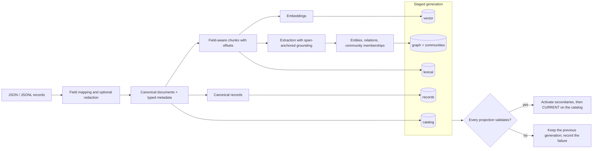
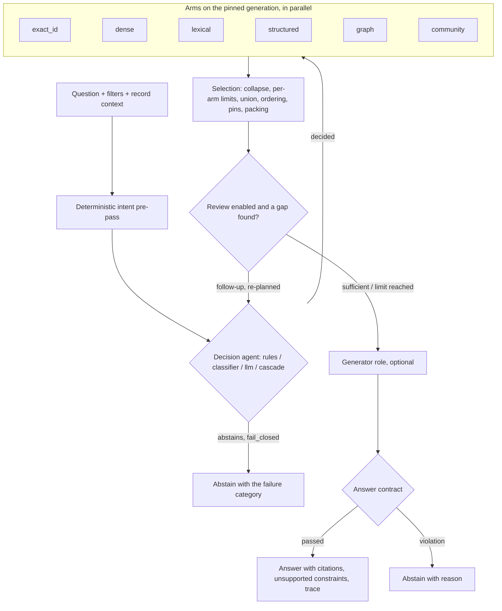

<p align="center">
  
</p>

<h1 align="center">su_multi_arm</h1>

<p align="center">
  <b>Configurable multi-arm retrieval with typed scope, span-level provenance and contract-checked answers.</b>
</p>

<p align="center">
  <a href="https://taranjeet-su.github.io/su_multiarm/">Docs</a> ·
  <a href="#quickstart">Quickstart</a> ·
  <a href="docs/ARCHITECTURE.md">Architecture</a> ·
  <a href="docs/CONFIGURATION.md">Configuration</a> ·
  <a href="docs/VALIDATION.md">Validation</a> ·
  <a href="CONTRIBUTING.md">Contributing</a>
</p>

<p align="center">
  <a href="https://github.com/Taranjeet-SU/su_multiarm/actions/workflows/ci.yml"></a>
  <a href="LICENSE"></a>
  
  <a href="https://github.com/Taranjeet-SU/su_multiarm/stargazers"></a>
  <a href="https://github.com/Taranjeet-SU/su_multiarm/commits"></a>
</p>

One question fans out into several retrieval **arms** — dense vectors, lexical full-text, structured
aggregates over typed metadata, a provenance-carrying entity graph, communities and exact-identifier
lookup — on the backends you choose. A decision agent plans the arms, a deterministic selection stage
merges their results, an optional review stage asks for what is missing, and an answer contract
refuses counts, exhaustive lists or absence claims that the evidence cannot back. Everything is
declared in one YAML file; nothing is imported by name from configuration.

> **Alpha (`2.0.0a3`).** Interfaces may still change. Relevance on real corpora has not been measured
> for v2 yet — see [honest status](#validation-and-honest-status).

> [!TIP]
> **Runs fully offline — no API key required for the quickstart.** The example uses a local SQLite
> backend, hash embeddings and no chat model. Hash embeddings are a smoke-test device, not a semantic
> model.

## When to use it

- You need retrieval over **mixed evidence** (articles, tickets, records with metadata) where one
  ranking method misses what another finds, and you want to see which arm found each document.
- You need **exact, typed answers** to count / earliest / grouped questions next to narrative
  retrieval, and you want the system to abstain instead of guessing when a constraint is unsupported.
- You want to **move between backends** (SQLite locally; PostgreSQL, OpenSearch/Elasticsearch,
  MongoDB, Neo4j in production) without rewriting the pipeline, and trace every passage back to its field offsets.

## Choose your starting point

| Goal | Start here |
|---|---|
| Try it on a laptop in five minutes, offline | [Quickstart](#quickstart) |
| Understand the request and ingestion paths | [How it works](#how-it-works) · [Architecture](docs/ARCHITECTURE.md) |
| Write a configuration for your own corpus | [Configuration in 20 lines](#configuration-in-20-lines) · [Configuration reference](docs/CONFIGURATION.md) |
| Pick databases and model providers | [Backends and providers](#backends-and-providers) |
| Serve it to an application or an agent | [Serving](#serving) |
| Adopt it next to an existing search system | [Adopting](docs/ADOPTING.md) |
| Judge what is and is not proven | [Validation](docs/VALIDATION.md) |

## Quickstart

Python 3.11+ on Linux or macOS (advisory file locking uses `fcntl`).

```bash
git clone https://github.com/Taranjeet-SU/su_multiarm.git
cd su_multiarm
python -m venv .venv
. .venv/bin/activate
pip install -e '.[dev]'
```

Once the package is published, `pip install "su-multi-arm[all]"` will install it with every optional
backend and provider; until then install from a clone.

**CLI** — ingest the synthetic example corpus, then search, ask for a typed aggregate, answer and evaluate:

```bash
su-multi-arm --config examples/v2/local.yaml ingest examples/documents.jsonl
su-multi-arm --config examples/v2/local.yaml search 'exemption certificate'
su-multi-arm --config examples/v2/local.yaml search --request examples/aggregate.json
su-multi-arm --config examples/v2/local.yaml answer 'exemption certificate'
su-multi-arm --config examples/v2/local.yaml evaluate examples/evaluation.json
su-multi-arm --config examples/v2/local.yaml doctor
```

**Python** — the same flow:

```python
import json

from su_multi_arm import Engine, SearchRequest, load_config
from su_multi_arm.ingestion.normalize import parse_documents

config = load_config("examples/v2/local.yaml")
engine = Engine(config)

with open("examples/documents.jsonl") as handle:
    records = [json.loads(line) for line in handle if line.strip()]
print(engine.ingest(parse_documents(records, config))["status"])  # complete

result = engine.search(SearchRequest(query="exemption certificate"))
for hit in result.hits[:3]:
    print(hit.document_id, hit.arms)

answer = engine.answer(SearchRequest(query="exemption certificate"))
print(answer.contract, answer.answer.answer)  # generation is disabled until a model is configured
```

Every ingest stages a new immutable generation and switches to it only after every projection
validates; a failed build leaves the previous generation active. Each hit carries the arms that found
it and the field offsets of its passages. With no chat model configured, `answer` returns the
retrieved evidence and says that generation is disabled.

## How it works

**Write path** — one generation, projected to the backends the configuration selects:



**Request path** — decision, arms, selection, contract, review, answer:



| Operation | CLI | Python | What it guarantees |
|---|---|---|---|
| Ingest | `ingest FILE [--replace --rebuild]` | `engine.ingest(docs)` | New generation activated only after every projection validates |
| Delete | `delete ID...` | `engine.ingest([], delete_ids=[...])` | Derived facts and memberships rebuilt in a new generation |
| Search | `search QUERY` / `--request FILE` | `engine.search(req)` | Per-arm provenance; filters are pushed down, never rewritten |
| Answer | `answer QUERY` | `engine.answer(req)` / `answer_stream` | Contract-checked; counts need exact aggregate evidence |
| Inspect | `status`, `doctor [--probe]` | `engine.status()` | Active generation, coverage gaps, backend probes |
| Evaluate | `evaluate FILE` | `su_multi_arm.evaluation.evaluate` | Recall per labelled query on your own labels |
| Config | `config upgrade / validate / schema` | `load_config(path)` | v1 files upgrade deterministically; all problems reported at once |

## Backends and providers

Generated from `backends/capabilities.py` and `providers/capabilities.py` by
[`scripts/gen_capability_tables.py`](scripts/gen_capability_tables.py) (CI fails on drift). Full
pages: [backends](docs/backends.md), [providers](docs/providers.md).

<!-- BEGIN capability-tables -->
<!-- generated by scripts/gen_capability_tables.py; do not edit by hand -->

| Backend | catalog | lexical | vector | records | graph | cache | ledger | session | Evidence |
|---|---|---|---|---|---|---|---|---|---|
| `memory` | yes | yes | yes | yes | yes | yes | yes | yes | in-process conformance kit, default test run (`tests/conformance/test_backend_conformance.py`) |
| `sqlite` | yes | yes | yes | yes | yes | yes | yes | yes | in-process conformance kit, default test run (`tests/conformance/test_backend_conformance.py`) |
| `postgres` | yes | yes | yes | yes | planned | yes | yes | yes | real-service conformance suite `tests/conformance/test_postgres_conformance.py` (passed in the 2.0.0a1 release run, see VALIDATION.md) |
| `sqlalchemy` | yes | planned | planned | yes | — | yes | yes | yes | real-service conformance suite `tests/conformance/test_sql_conformance.py` (passed in the 2.0.0a1 release run, see VALIDATION.md) |
| `opensearch` | yes | yes | yes | yes | — | — | — | — | real-service conformance suite `tests/services/test_opensearch_adapter.py` (passed in the 2.0.0a1 release run, see VALIDATION.md) |
| `elasticsearch` | yes | yes | yes | yes | — | — | — | — | real-service conformance suite `tests/conformance/test_elasticsearch_conformance.py` (passed in the 2.0.0a1 release run, see VALIDATION.md) |
| `neo4j` | — | — | — | — | yes | — | — | — | real-service conformance suite `tests/conformance/test_neo4j_conformance.py` (passed in the 2.0.0a1 release run, see VALIDATION.md) |
| `kuzu` | — | — | — | — | yes | — | — | — | in-process conformance kit, default test run (`tests/conformance/test_kuzu_conformance.py`) |
| `mongodb` | yes | yes | planned | yes | — | yes | yes | yes | real-service conformance suite `tests/conformance/test_mongodb_conformance.py` (passed in the 2.0.0a1 release run, see VALIDATION.md) |

`yes` = implemented on the frozen contracts; `planned` = declared, no code, configuration naming it is rejected; `legacy` = v1 code only; `—` = not declared.

| Chat provider | Model patterns | Evidence |
|---|---|---|
| `anthropic` | 8 | contract-mocked (mocked HTTP transport); Haiku/Sonnet 5.x also one real-API smoke (2.0.0a3) |
| `openai` | 10 | contract-mocked (mocked HTTP transport); `gpt-4o-mini` also in the 2.0.0a2 paid QA-08 rerun |
| `openai_compatible` | 1 | contract-mocked; optional `external` smoke against a local server you run |
| `none` | — | in-process (answer generation disabled) |

| Embedding provider | Evidence |
|---|---|
| `hash` | in-process, offline demo vectors (not semantic) |
| `sentence_transformers` | local model via optional extra; used (v1 runtime) in the 2026-10-12 diagnostics |
| `openai` | contract-mocked (no paid call made) |
| `openai_compatible` | contract-mocked |
<!-- END capability-tables -->

## Serving

Install the extra you need (`pip install -e '.[api]'`, `'.[mcp]'`) and run against an ingested
configuration. Both bind to loopback by default; binding elsewhere requires a bearer token.

**HTTP + server-sent events** (`/v2/search`, `/v2/answer`, `/v2/answer/stream`, OpenAPI at `/docs`):

```bash
su-multi-arm --config examples/v2/local.yaml serve --port 8099 &
sleep 3   # wait for the server to start
curl -s http://127.0.0.1:8099/v2/search \
  -H 'Content-Type: application/json' \
  -d '{"query":"exemption certificate"}'
curl -sN http://127.0.0.1:8099/v2/answer/stream \
  -H 'Content-Type: application/json' \
  -d '{"query":"exemption certificate"}'
```

The stream emits `decision`, `arm_result`, `review_round`, `evidence`, provisional `token` deltas,
`contract` and a final authoritative `done` event.

**MCP over stdio** — register the server with any MCP client:

```json
{
  "mcpServers": {
    "su-multi-arm": {
      "command": "su-multi-arm",
      "args": ["--config", "examples/v2/local.yaml", "mcp"]
    }
  }
}
```

**MCP over streamable HTTP** (path `/mcp`) needs `serving.mcp.transports: [stdio, streamable_http]`
in the configuration, then `su-multi-arm --config YOUR_CONFIG.yaml mcp --transport streamable_http --port 8100`.
Tools mirror the HTTP API (`search`, `answer`, `capabilities`, `list_values`, …). Details:
[Configuration → Serving](docs/CONFIGURATION.md#serving).

## Configuration in 20 lines

A v2 file with PostgreSQL for the catalog, records and vectors, OpenSearch for full-text, Neo4j for
the graph, a rules decision agent with an LLM-planned variant, and the neutral profile:

```yaml
schema_version: 2
dataset: demo
profile: neutral
backends:
  pg:    {kind: postgres, dsn_env: SU_POSTGRES_DSN, table_prefix: demo}
  os:    {kind: opensearch, hosts_env: SU_OPENSEARCH_HOSTS, index_prefix: demo}
  graph: {kind: neo4j, uri: bolt://127.0.0.1:7687, password_env: SU_NEO4J_PASSWORD, namespace: demo}
storage: {catalog: pg, records: pg, ledger: pg, sessions: pg, cache: pg, communities: graph}
metadata_schema: {fields: [{name: product, type: string, filterable: true, listable: true}]}
models:
  roles:
    planner: {provider: openai_compatible, model: my-local-model, base_url: "http://127.0.0.1:11434/v1"}
pipeline:
  decision: {kind: rules}
  arms: {dense: {backend: pg}, lexical: {backend: os}, structured: {backend: pg},
         graph: {backend: graph}, community: {backend: graph}}
pipelines:
  planned: {decision: {kind: llm}}
request: {pipelines: [planned]}
```

Validate without touching any service: `su-multi-arm --config FILE config validate`. Secrets are named
by environment variable, never stored in the file. v1 files keep loading through a deterministic
upgrade (`config upgrade`). Complete examples: [`examples/v2/`](examples/v2/) (local, mixed backends,
hosted models). JSON schema: [`docs/config.schema.json`](docs/config.schema.json).

## Validation and honest status

What is and is not proven is recorded, with dates and evidence levels, in
[docs/VALIDATION.md](docs/VALIDATION.md). In short:

- **Relevance on real corpora is not yet measured for v2.** The example corpus is a six-document
  synthetic fixture; it shows that the pipeline runs, not that it ranks well.
- **Hosted model providers are contract-mocked.** No paid call has been made from this repository; an
  optional test runs against a local OpenAI-compatible server only when you point it at one.
- **Database backends** marked "real-service conformance" pass their conformance suites against
  throwaway containers; this is behavioural conformance, not a scale or latency result.
- **The 2026-10-12 public-data diagnostics** (small development samples of two public QA datasets,
  local models, v1 runtime) found failures — invalid extraction output, grounding rejections,
  natural-language count questions answered from the wrong population, unsupported graph predicates.
  The v2 work (span-anchored grounding, typed scope with unsupported-constraint reporting, the answer
  contract, ingestion policies) is designed to address them; re-running those cohorts is Phase 4.

## Roadmap

From the [v2 implementation plan](docs/plans/v2_implementation_plan.md):

- **Phase 2** — harness depth: cache arm, guards, ACL hook, incremental ingestion with resume, release promote/rollback/GC.
- **Phase 3** — knowledge depth: ontology, entity resolution, more extractors, hierarchical communities, selection policies, quote verification.
- **Phase 4** — evaluation harness, learning proposals and public benchmark re-runs; the gate for any general-purpose claim.

## Contributing, security and license

Contributions are welcome — read [CONTRIBUTING.md](CONTRIBUTING.md) (synthetic fixtures only, no
hidden retries or fallbacks, state your evidence level). Report vulnerabilities as described in
[SECURITY.md](SECURITY.md). Licensed under [Apache-2.0](LICENSE); provider SDKs, models and databases
carry their own licenses. If you use this in research, see [CITATION.cff](CITATION.cff).
