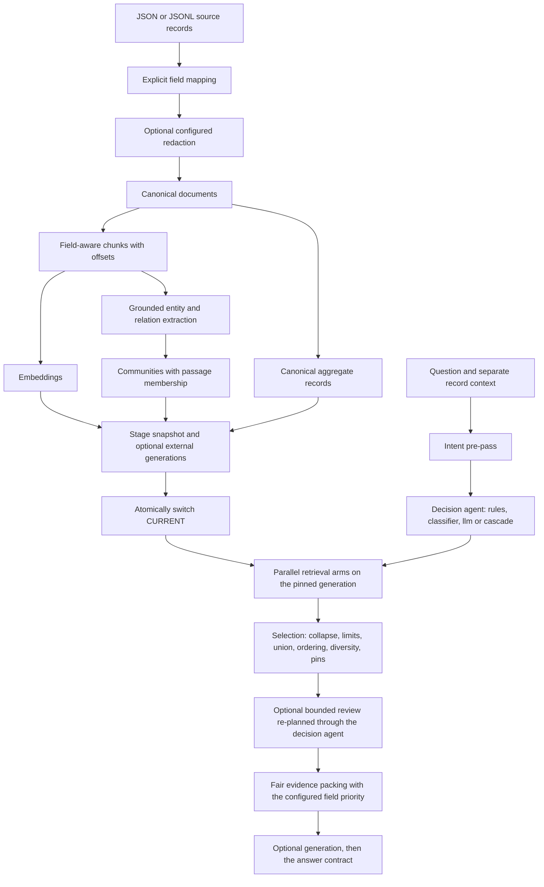
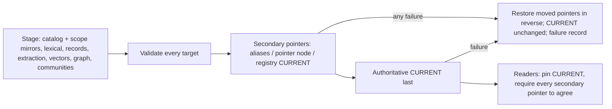

# Architecture

## Request and ingestion paths



## Component contracts

`Config` rejects unknown keys and invalid built-in provider names. `Document` is a canonical record
with dataset-scoped ID, source, title, absolute source URL or null, textual fields and flat metadata.
`Chunk` identifies the canonical field and exact character offsets. `Hit` carries document-level
identity, original source metadata, supporting chunk IDs and arm-specific provenance. `SearchResult`
preserves individual-arm pools and aggregates as well as the merged result.

`Engine` coordinates the lifecycle. `Store` is the canonical catalog/snapshot owner. `Embedder`,
`Extractor` and `JsonModel` isolate model interfaces. `Retriever` applies eligibility and performs
retrieval; optional PostgreSQL and Neo4j modules load only when selected. `fuse` is a pure operation.
The API and MCP wrappers call the same engine rather than reimplementing retrieval; both accept the
same `SearchRequest` (`serving/parity.py` checks the MCP tool schemas against it at start-up).

The supported backend names are deliberately closed in this alpha. Adding another backend currently
requires implementing its adapter and extending the configuration/dispatch/tests. Avoid arbitrary
Python imports from untrusted YAML.

### V2 kernel (branch `v2/phase-0`, plan §3.1–3.5)

`core/types.py` holds the canonical v2 types: a field-anchored `Span` (`text == source[start:end]`,
the only legal quote carrier), `Document` (adds a neutral `kind`), `Chunk` (adds `recipe`), `Entity`,
`Relation` (`edge_kind` in `fact|co_occurrence|mention|native_link|derived`, `support`, provenance;
a `fact` needs predicate support and `entailment_checked` is reserved with no producer), `Event`,
`StructuredRecord`, `Membership`, `ExtractionOutput` (relation endpoints must be typed entities of
the same chunk contained in the relation span), `Evidence` (no cache kind exists), `GenerationId`,
`MetadataSchema`/`FieldSpec`, and the typed scope/result/paging types the backend contracts use.

`core/component.py` defines the `Component` protocol (`name`, `kind`, `config_model`, `validate(env,
probe)` returning diagnostics, `run(ctx, inputs)`, `recipe_fingerprint()`), and the artifact rules:
no pickled files, no `module:attr` factories, no dotted import paths from configuration; classifier
artifacts are ONNX files pinned by sha256. `core/registry.py` keeps one registry per component kind;
built-ins register by explicit import, third parties only through the `su_multi_arm.components`
entry-point group and only for names listed under `plugins:`. Python objects can be injected only
through the Python API.

`backends/contracts.py` freezes the eight capability protocols (`Catalog`, `LexicalIndex`,
`VectorIndex`, `RecordStore`, `GraphStore`, `CacheStore`, `LedgerStore`, `SessionStore`); adapters
expose one facet per capability because the contracts share method names. Every operation is
generation-scoped, reads are paged or bounded by `k`, cache keys start with the generation prefix,
`delete_generation` is the only destructive operation and is refused for an active or pinned
generation. `backends/capabilities.py` is the static matrix (kind → declared capabilities, flags,
and an honest `status` per capability: `contracts` for what passed the conformance kit (memory,
sqlite, mongodb except vector, opensearch and elasticsearch for catalog/lexical/vector/records, neo4j
graph, postgres except graph, sqlalchemy for catalog/records/cache/ledger/session), `planned` for
everything else, which configuration rejects). `backends/memory.py`
is the in-memory adapter that satisfies every protocol and anchors the conformance kit.

`runtime/` holds the harness objects: `RunContext` (immutable per request; principal, session,
memory, budget, trace, pinned `GenerationId`, deadline, access policy), `Budget` (reservation API
for calls, tokens, USD through an operator price table, and wall clock; exhaustion is a typed error
recorded in the trace), `Trace` (nested spans, JSONL export masked by default: query text, passages,
prompts, answers, unsupported-constraint text and review follow-ups become hashes), `SessionManager`
(principal-scoped sessions, generation change recorded, episodic IDs re-validated), `Memory`
(working/episodic; never evidence), `ToolRegistry`/`invoke_tool` (read-only tools) and
`ActionRunner` (audited, idempotent writes; HTTP/MCP denied unless allow-listed and scoped).
`core/config.py` is configuration v2 and `compat/config_v1.py` keeps the v1 model, its fingerprint
and the deterministic upgrade/downgrade (see CONFIGURATION.md).

### Storage, arms and the write path on the contracts (slice P0/S4)

`backends/elasticsearch/` (Phase 1) serves `catalog`, `lexical`, `vector` and `records` on the same
contracts as `backends/opensearch/`, from which it inherits: both are the OpenSearch classes over
`backends/_lucene_common.py` (three indices per generation, dataset aliases switched atomically by
`activate(gen)`, typed-field pushdown, BM25 `multi_match`, bounded records scan with the shared
`_scope` measures). The subclass replaces only the engine-specific parts: the official-client
transport, the 8.x `probe`, `dense_vector` fields (exact `script_score` cosine by default, float HNSW
with the top-level `knn` search behind `knn.method: hnsw`), no `index.knn` setting, and an
alias-backed `generation_registry()` (`registry.py`) so the write path can own `storage.catalog` on
it. Typed errors carry the adapter's kind. Graph, cache, ledger and session are not served.

`backends/sqlite/` is the local default on the frozen contracts (all eight capabilities; conformance
kit in `testing/backend_conformance.py`, run over the memory fake, sqlite and sqlite+faiss by
`tests/conformance/`). `backends/extras.py` declares the few read operations the arms and the write
path need beyond the frozen protocols (row counts for projection validation, entity lookup by query
tokens, span-anchored mentions, community objects) as separately named protocols with typed checks.

`backends/mongodb/` (Phase 1) is the first external adapter on the contracts: six facets (catalog,
text-index lexical, typed records, cache, ledger with raw replies, sessions) over generation-scoped
collections named `<prefix>_<dataset>_<generation>_<kind>`, a `MongoGenerationRegistry` whose
`CURRENT` pointer is one document replaced atomically only by `activate`, typed field rows for
predicate pushdown (`_db.py`), and every driver failure mapped to `BackendError(adapter, operation)`.
It exposes no `vector` facet: MongoDB vector search is Atlas-only and the matrix keeps that pair
`planned`. Its conformance suite (`tests/conformance/test_mongodb_conformance.py`) is `external`
and runs against the `mongo:7` container of `tests/services/`.
`backends/opensearch/` (Phase 1) serves `catalog`, `lexical`, `vector` and `records` on the same
contracts against OpenSearch 2.x through `opensearch-py`, with `backends/_lucene_common.py` holding
the engine-neutral parts shared with the future Elasticsearch adapter (index naming, the typed field
layout that compiles a `Scope` into a native `bool.filter`, predicate and lexical query DSL, paging,
transport protocol, bulk checks). Every index is named `<prefix>_<dataset>_<generation>_<kind>`;
dataset aliases are the serving pointer and are switched in one atomic `_aliases` call by
`activate(gen)`, so a build that never reaches activation never changes what the alias serves and
older generations stay until `delete_generation` (refused for a protected or aliased generation).
Vector search is exact by default (cosine `script_score`); HNSW is an explicit opt-in that always
rescores its candidates exactly. Records push every filter down and compute measures with the
shared `_scope.py` code, so `ScopeResult`s are exact and identical across adapters. The adapter never
retries and never degrades: unreachable server, refused query, bulk item failure, missing generation
and mapping-version mismatch are typed `BackendError`s. The conformance kit runs against the real
service under `-m external` (`tests/conformance/`, `tests/services/test_opensearch_adapter.py`).

`backends/neo4j/` (Phase 1) serves the `graph` capability (with memberships) and nothing else. Every
statement is a constant in `_cypher.py` (relationship types, which Cypher cannot parameterise, come
from a table precomputed from the closed `EdgeKind` set; one relationship type per edge kind, so the
`fact` traversal template cannot match a co-occurrence edge); the adapter refuses any other text.
Values travel only as driver parameters; traversal expands one hop per statement up to a validated
integer bound and mirrors the sqlite BFS (no revisits, load order, `limit`). Nodes and edges are
generation-scoped by a `g` property (`<namespace>|<dataset>|<generation>`); loads are `MERGE`-
idempotent inside one explicit transaction per call, never auto-retried; a per-dataset pointer node
(`extras.GenerationPointer`) is moved by the write path just before the authoritative `CURRENT`
switch and moved back if that switch fails. The graph evaluates eligibility as document-id allow/deny
lists only (`predicate_scope: false`); `BaseArm.graph_scope` resolves predicates through the catalog
first, so filters and ACL constraints are never dropped. The v1 `adapters/neo4j.py` was removed.
Conformance and engine runs against `neo4j:5.26` are `external` (`tests/conformance/
test_neo4j_conformance.py`, `tests/services/test_neo4j_engine.py`).

`backends/postgres/` (Phase 1) serves seven facets (catalog, FTS lexical, pgvector, typed records,
cache, ledger, sessions) with **one schema per generation** (`delete_generation` = `DROP SCHEMA ...
CASCADE`), a runtime schema `<prefix>` holding the generation list, the registry's `meta` rows
(`CURRENT` pointer replaced by a single-row upsert only by `activate`) and the cache/ledger/session
tables, and a `PostgresGenerationRegistry` whose write lock is a session-level advisory lock. Typed
scope compiles to bound-parameter `EXISTS` subqueries over typed field rows with native
`double precision`/`timestamptz` columns (`_db.py`). Vectors are exact by default; HNSW is opt-in
and gated at `refresh` by a measured filter-recall floor. `backends/sql/` (config kind
`sqlalchemy`) is the dialect-agnostic SQLAlchemy Core adapter (catalog, records, cache, ledger,
sessions; lexical/vector `planned`), conformance-tested on SQLite (every push) and PostgreSQL
(`external`). Both map every driver failure to `BackendError(adapter, operation)` and never retry;
a broken postgres connection is discarded and the next operation reconnects.

`arms/` holds the five arms as components (`dense`, `lexical`, `structured`, `graph`, `community`):
`run(ctx, ArmInput{query, scope, acl, candidates, aggregate}) -> ArmResult{hits, aggregates, paths,
reports, diagnostics, incomplete}`. An arm receives the already-applied eligibility scope (request
filters, exclusions, ACL predicates) and never widens it; it reads the catalog only for the chunks it
hit. `graph` seeds on stored entities whose name tokens all occur in the query, traverses `fact` edges
only through a minimal `TraversalSpec` and returns mention passages with depth and edge provenance;
`structured` executes a typed `ScopeSpec` and returns the `ScopeResult` exactness metadata;
`community` returns membership passages and report claims whose cited records are all eligible. An
arm whose stage is incomplete in a `partial` generation refuses with a typed error unless
`pipeline.allow_incomplete_arms` is set, in which case its results are flagged.

`ingestion/write.py` is the single write path: catalog → lexical → records → extraction under the
configured policy (`ingestion/policy.py`: strict, quarantine, partial) → embeddings → communities
and reports → graph, then per-projection validation, then the atomic `CURRENT` switch through
`ingestion/release.py` (generation registry: pointer, manifests, failure records, advisory lock).
Per-document status, validated extraction outputs (reused by chunk id and extractor recipe) and every
raw model reply live in the `LedgerStore`. `extraction/base.py` is the v2 extractor component:
every entity is a mention with its own id so the kernel's endpoint-containment invariant holds per
chunk; mentions are resolved to canonical ids (type + name) before storage; quotes ground at the
`exact`, `normalised` or `relocated` level; `extraction/dedupe.py` collapses identical relations
across chunks keeping all occurrences.

`engine.py` builds backends, providers, the extractor, the arms (built-ins, or Python objects
injected through `Engine(config, components=[...])`) and the write path from a v2 `Config` (a v1
`Config` is upgraded in memory). Decision (rules / llm with optional review), fusion and answer
generation are today's logic on the v2 configuration until `decision/`, `selection/`, `generation/`
and `pipeline/review.py` replace them. `profiles/` holds the overlays and the neutral built-in
prompts (`profiles/prompts.py`); `request:` in the configuration declares the accepted context keys
and canonical fields. The engine builds `backends/postgres/` and `backends/sql/` for `kind: postgres`
and `kind: sqlalchemy`; the v1 `store.py`/`retrieval.py` and `adapters/postgres.py`, no longer
imported anywhere, were removed.

### Decision, selection, answer contract and review (plan §3.7, §3.9, §3.9a, §3.9b)

`decision/` is the planning layer and executes nothing. `intent.py` is the deterministic pre-pass
(English-only grammar; never fails). `values.py::ValueResolver` implements the resolution table:
enum values must be declared; string/id values must match the ACL-scoped observed values when the
field is listable and under its cardinality cap, otherwise `RecordStore.exists` verifies the
candidate; numeric and boolean values are type-parsed; `range` bounds are typed and a datetime bound
needs an offset under `require_offset`; `date_interval` produces half-open calendar bounds under the
field's timezone policy; `missing` needs a nullable field; unknown or non-filterable fields,
non-groupable/sortable fields and unsupported measures are `UnsupportedConstraint`s with a reason.
`scope.py::ScopeCompiler` prepends the immutable request filters (a contradicting predicate is an
`invalid_step`), resolves every predicate and refuses to execute a scope with any unsupported part —
a measure is never substituted by `count`. Agents (`rules`, `classifier`, `llm`, `cascade`) share
`base.py`: `attempt` plans or raises a categorised `DecisionFailure`; `decide` applies the fail
policy and records outcome, policy, failure category and `decision_fallback` in the trace.
`raw_all_arms` is the only fail-open outcome and always carries one unsupported constraint per
aggregate intent. After a successful `attempt`, `decide` runs `qualifiers.py` on every structured step
the agent compiled from the question (not on caller-typed aggregates): question qualifiers (observed
field values, calendar expressions, quoted phrases, and since 2.0.0a2 a filterable field named next
to a value of its type such as `priority 3`) that no predicate or request filter expresses are
attached to the step as `qualifier_not_applied` constraints, and a structured step on a question
without an aggregate operator is flagged as a whole; the engine then reports that step's aggregate as
`bounded`. The engine runs the pre-pass with `Capabilities.structured_targets()` on every surface,
and validates request filters against `MetadataSchema` first (`values.py::check_request_filters`:
unambiguous coercion, otherwise the filter is applied as given, reported, and every aggregate under
it is `bounded`). The `llm` agent calls `providers.JsonModel` through `providers.RunBudgetMeter`,
which reserves the call, the input estimate and the `max_tokens` ceiling (and USD when priced)
before the request and commits the reported usage afterwards; the `classifier` agent verifies its ONNX artifact's sha256 at
`validate()` and needs an injected runtime (nothing executable comes from configuration).

`providers/` (plan §3.6) holds the `ChatProvider` protocol (`complete_json`, `complete_json_raw`,
`complete_text`) and its implementations `anthropic` (Messages API; native structured output as one
forced tool; `cache_control` on system and tool blocks), `openai` (Chat Completions; native = strict
`json_schema`; passive caching read from usage; `base.strict_schema` converts a schema to strict
form or raises `StrictSchemaError` listing every refused construct, and config validation and
`doctor --probe` run it on the schemas each native OpenAI role sends), `openai_compatible` (local servers; request hints
only as the role declares) and `none`; `JsonModel` is the stage-facing facade and `Embedder` the
embedding facade (`hash`, `sentence_transformers`, `openai`, `openai_compatible`).
`providers/capabilities.py` is the per-`(provider, model-pattern)` registry (native structured output
and how, request modes, prompt caching, output-token and reasoning parameter names) that config
validation and provider construction both consult. Providers make exactly one request per call,
never retry, repair or downgrade, map failures to typed `ProviderError` categories (`auth`,
`rate_limited`, `server_error`, `bad_request`, `timeout`, `connection`, `bad_response`,
`incomplete`, `refusal`, `capability_mismatch`, `missing_secret`, `unavailable`) or
`SchemaViolation`, and record normalised usage (input incl. cached and cache-write tokens, output,
reasoning) for every call, successful or not.

`selection/` splits fusion into pure stages: `collapse` (passage → record, one vote per record per
arm, chunk IDs merged), `limits` (per-arm cap), `union` (`preserve`), `ordering` (`reciprocal_rank`
reproduces the alpha's `per_arm` scores exactly — checked by `tests/parity/test_ordering_parity.py`
against `fusion.fuse` for every v1 strategy — plus `rrf`, `minmax`, `zscore`, `best_arm_rank`,
`stable_interleave`), `diversity` (opt-in group guarantee), `pins` and `packing` (fair per-record
character allocation with a configured field priority). Every stage returns a trace of the effective
policy and every selected record carries its selection reasons.

`generation/contract.py::AnswerContract` is enforced by the engine after generation (guards are
Phase 2; 2.0.0a1 rejects a configured guard at validation rather than skip it): citations must exist; `count`/`exhaustive_list`/`absence` claims need an exact (for absence,
exhaustive) `ScopeResult` (a result with a dropped predicate is `bounded`, never exact); an aggregate intent without an exact scope forbids count and list claims
and guarantees a non-empty `unsupported_constraints` (engine-injected; the generator's `Answer`
model has no such field); factual answers need citations and text. `generation/statements.py` finds
count, exhaustive-list and absence statements in the answer text itself (deterministic,
English-scoped) and each needs a matching typed claim backed by an exact scope
(`answer_text_without_exact_scope`); a backed count statement must state the cited aggregate's value
(`answer_number_mismatch`, 2.0.0a2). Violations abstain with the rules recorded, strip (an unbacked
non-narrative claim on an answer whose text states no aggregate is always stripped rather than
abstained; `on_violation: strip` also removes unbacked sentences; `contract: stripped`) or raise, per
configuration. With native structured output the engine sends a per-request `Answer` schema whose
cited ids are an enum of the supplied evidence ids and whose claim kinds are narrative-only unless
aggregate evidence was supplied (`contract.answer_schema`). `pipeline/review.py::ReviewStage` is the bounded review loop with the
stop reasons listed in CONFIGURATION.md; it re-plans only through the decision agent and merges new
hits through `selection`.

### Declarative pipelines, harness objects and `exact_id` (Phase 1, plan §3.3, §3.4, §3.8)

```text
SearchRequest{pipeline?, mode?} --choose (request.pipelines/modes allowlists)--> PipelineRuntime
  session_id? --SessionTurns.open/reserve/prepare--> RunContext(generation pinned, principal, budget, trace)
  -> intent pre-pass (Capabilities.id_patterns from exact_id) -> decision agent of the chosen mode
  -> arms of the pipeline (exact_id hits marked pinned) -> selection (pins first) -> packing
  -> review (mode's agent) -> generation -> AnswerContract -> unknown ids appended to unsupported_constraints
  -> SessionTurns.finish (turn: query hash, shown IDs, answer/trace id, generation; usage)
```

`pipeline/spec.py` holds one `PipelineRuntime` per configured pipeline (`pipeline` = `default`,
plus the merged `pipelines` overlays): its arm instances, one decision agent per allowed mode, the
review stage per mode and its `AnswerContract`; `choose()` enforces the request allowlists
(`RequestRejected`). `Engine.arms/decision/review/contract` stay as views of the default pipeline.
`pipeline/validate.py` is the aggregated static validation run by `Config` (capabilities, storage
selectors, roles, registries, projection rule for named pipelines, request allowlists, budget
coherence) and `probe_report()` behind `doctor --probe` (backend `probe()`s, registry-declared
provider pairs, no model calls). Named pipelines may only read index projections the write path
builds — those of the default pipeline — so ingestion is unchanged.

`runtime/turns.py::SessionTurns` drives `runtime/session.py::SessionManager` over the configured
`SessionStore` facet (sqlite, memory, mongodb, postgres, sqlalchemy): principal binding,
per-session budget (request limits clipped to the remainder and held on the record for the turn;
exhausted refuses), generation-switch re-validation of episodic IDs, optional `exclude_shown`, and
turn/usage recording (`SessionRecord.usage`). Every session write goes through
`SessionManager.update`: a compare-and-set on `SessionRecord.version` (`SessionStore.touch(...,
expected_version)`, atomic in every store; `SessionConflict` on a lost race, after which the change
is re-applied to the fresh record), serialised per session within a process by lock stripes, so
concurrent turns are merged and racing requests cannot exceed `budgets.session`. Memory never enters
the generator payload; the contract's evidence-id rule makes a remembered id uncitable.
`runtime/builtin_tools.py` registers the read-only `search`, `get_document`, `list_values`,
`aggregate` tools on a `ToolRegistry`; the engine implements their `EngineOperations` (ACL-scoped
catalog reads, listable-only values, declared-field aggregates) and `call_tool` runs them inside a
`tool.<name>` trace span. `runtime/builtin_actions.py` provides `ingest_delta`/`invalidate_cache`
and `LedgerAuditLog` (append-only `AuditRecord` versions on `storage.ledger`, `started` before
execution); `Engine.run_action` registers only `actions.allow` names with `ActionRunner` and records
an `action.<name>` span.

`arms/exact_id.py` recognises identifiers only by `id`-field `pattern`s and alias-map keys, resolves
them through the alias map, as document ids and through `alias_fields` (record store, ACL applied),
confirms existence with one `Catalog.iter_scope` read bounded by the identifiers, inside the request
scope; unmatched identifiers are reported, never guessed. Its capability is `catalog`
(`storage.catalog`); it has no `backend` key.

## Storage and lifecycle

```
state/
  .write.lock
  CURRENT                     # active generation UUID (generation registry, never read by the adapter)
  runtime.sqlite              # cache, ingestion ledger (status entries, extraction outputs, raw replies), sessions
  failures/<generation>.json  # failure manifest of a build that did not activate
  snapshots/<generation>/
    manifest.json             # schema_version 2, recipe fingerprint, policy, status, counts, coverage, projections
    catalog.sqlite            # docs, chunks, FTS5, typed field rows, records, mentions, relations, memberships, communities
    chunk_ids.json             # vector row mapping
    vectors.npy                # normalized vectors, safe NumPy format
    vectors.faiss              # only when Faiss is selected
```

One writer holds the write lease (a non-blocking `flock` on `.write.lock`; a second writer is
refused with `WriteConflict`, see "Writers" below). Builds occur in a new generation. Every projection is
written and validated (row counts against the catalog, sampled round-trips, `refresh` visible), and
then `CURRENT` is atomically replaced. Readers pin one generation, including multi-hop answers. A
failed build removes its staged generation from every backend it reached, records a failure manifest
(failing unit, category, projections left for cleanup) and leaves the old generation active. A
`partial` build activates only when explicitly allowed and is marked as such in its manifest. This is process-failure isolation, **not** a distributed transaction or a
power-loss durability guarantee; explicit fsync and multi-host coordination are future work.

### Generations across backends (multi-backend write path)

A generation is one `GenerationId` (dataset, generation UUID, index format, recipe fingerprint) that
may be materialised on several backends: the catalog on `storage.catalog` (authoritative: its
generation registry holds `CURRENT`), the other projections wherever the configuration places them
(`ingestion/generations.py::placement`; ledger, sessions and cache are not generation-scoped).



* **Staging.** Every holder receives the generation under its own physical identity (PostgreSQL
  schema, Lucene indices, MongoDB collections, SQL table token, Neo4j generation key, sqlite snapshot
  folder). A secondary holder that serves `catalog` gets a scope mirror (documents + chunks) because
  its search/graph facets push eligibility down against their own rows; Neo4j has no catalog and the
  arms resolve predicates to document ids first.
* **Validation per target.** Counts against the catalog for the catalog, every mirror, every records
  target, lexical and vector; one sample of chunk ids round-trips through all of them (with the
  catalog's document id); graph targets return exactly the memberships written and find sampled
  entities inside their document's scope; community targets hold exactly the communities built and
  their member lists equal the memberships.
* **Activation.** Secondaries first, in projection order, each through its own mechanism
  (`extras.GenerationPointer` — Neo4j pointer node, OpenSearch/Elasticsearch dataset aliases — or the
  backend's own generation registry); the authoritative `CURRENT` last. A failure anywhere restores
  every moved pointer in reverse order (or removes it on a first build) and leaves `CURRENT`
  unchanged; the failure record lists the compensation outcome per backend. A pointer that cannot be
  restored keeps naming the failed generation, its cleanup is refused, and readers are refused (next
  bullet) until it is realigned — fail closed, not a distributed transaction.
* **Pinning.** `WritePath.pin()` (used by `Engine` for every request) resolves `CURRENT` and requires
  every secondary pointer to name the same generation; otherwise `GenerationDisagreement`. Adapters
  still never read a pointer on the request path; the write path does, once per request.
* **Manifest.** `generations.backends.<name>` records kind, projections, role, scope mirror,
  activation mechanism, generation key, physical identity and the lexical `analyzer_id`
  (per generation for PostgreSQL: `pg_ts_<config>`).
* **Clean-up.** `WritePath.delete_generation` deletes on every holder in activation order and
  refuses (`GenerationInUse`, before deleting anything) the `CURRENT` generation, one named by any
  secondary pointer, or one protected on the first holder; later errors are reported, never ignored.

### Writers: leases, fencing and compare-and-set activation (2.0.0a2)

Every generation registry implements a **write lease** (`ingestion/lease.py`): an owner token per
acquisition, renewed by a heartbeat thread every `ttl/4` while the build runs (default `ttl` 120 s),
so a lease expires only after four missed renewals. A live lease of another writer is a typed
`WriteConflict(held)` (a `BackendError`), never a wait. Renewal and release are conditional on the
owner token, so a writer whose lease was taken over can neither extend nor delete the new holder's
lease.

| Registry | Lease | Takeover | Pointer compare-and-set |
|---|---|---|---|
| sqlite (`FileGenerationRegistry`) | non-blocking `flock` on `.write.lock` per lease (excludes threads and processes) | none needed: the kernel drops it with the holder | compare under the lease, then atomic rename |
| memory | `{owner, expires_at}` on the backend clock | after `expires_at` | under the registry lock |
| PostgreSQL | session advisory lock on a dedicated connection; heartbeat checks `pg_locks` for that session | none needed: dropped with the session | `UPDATE … WHERE value = expected` / `INSERT … ON CONFLICT DO NOTHING` |
| SQLAlchemy | `write_lock` row `{owner, expires_at}`; takeover/renew/release `WHERE value = <row read>` | after `expires_at` | as PostgreSQL |
| MongoDB | `write_lock` document; owner-filtered `update_one`/`delete_one` | `find_one_and_update` on `expires_at <= now` | `update_one({generation: expected})` / `insert_one` |
| Elasticsearch | `lock:<dataset>` document; `_create`, then `if_seq_no`/`if_primary_term` writes | conditional overwrite after `expires_at` | aliases must name `expected`; the `_aliases` request removes the expected docs index with `must_exist` |
| OpenSearch / Neo4j (secondary pointers) | — (covered by the catalog registry's lease) | — | OpenSearch as Elasticsearch; Neo4j `MERGE` + lock-taking `SET` then `WHERE p.generation = $expected`, rolled back otherwise |

The write path takes the lease before it reads `CURRENT`, records the generation it starts from,
renews synchronously right before activation (`Lease.check`) and switches every pointer as a
compare-and-set: secondaries on what they named just before, the authoritative `CURRENT` on the
starting generation; compensation also moves a pointer back only while it still names the failed
generation. A writer whose lease was lost, or whose base is no longer `CURRENT`, fails with
`IngestConflict` (an `IngestError` and a `WriteConflict`, failure category
`write_conflict:<lost|stale_base>`), its staged generation is removed and `CURRENT` is untouched, so
two concurrent writers can never activate one after the other on the same base and lose the first
one's documents. Limits: moving an alias that names nothing (a first release) cannot be made
conditional on Elasticsearch/OpenSearch, and an injected `GenerationPointer` without an `expected`
parameter is switched after a read-and-compare; in both cases the catalog lease alone excludes a
second writer.

### Incremental embeddings and the ingestion budget (2.0.0a2)

Embedding inputs are streamed in `models.roles.embedder.batch_size` windows. Each chunk's exact
input (`"{title}\n{field}: {text}"`) and the embedding recipe (provider, model, revision, dimension,
endpoint of hosted models, document prefix, L2 normalisation, input template) key a vector stored in
the ledger (`embedding:<recipe>:<sha256(input)>`, little-endian float32); an unchanged input is
reused byte-for-byte, a changed title, field text or recipe is embedded again. Only the current
window and the sampled validation vectors are held in memory (the corpus documents and chunks still
are). A stored vector of the wrong shape fails the build (`projection:vector`), it is never silently
re-embedded. The manifest reports `embedded` and `reused_embeddings`. LLM calls, embedding requests
and USD of a build are limited by `budgets.ingest` (`ingestion/budget.py`): reservations before every
call, commits with reported usage, exhaustion as a `budget` stage failure under the extraction
policy. A hosted embedder on the dense arm needs an explicit `budgets.ingest.max_usd` or
`max_embedding_calls` (`require_ingest_cap`, refused at construction). The extractor's recipe hash
keeps the keys 2.0.0a1 hashed (`extraction.base.A1_RECIPE_KEYS`), so removing a config key does not
change an index fingerprint; `tests/unit/test_index_fingerprint_golden.py` pins the 2.0.0a1
fingerprint of every shipped example. Write and session conflicts reach HTTP as 409 and MCP as typed
tool errors (`core.errors.failure_category`), never with backend text.

What an upsert (`ingest` without `--replace`, the `ingest_delta` action) does today is recorded in
the manifest's `incremental` entry: embeddings and extraction outputs of unchanged chunks are
reused; the catalog, lexical, records, vector rows, graph, communities and **community reports** of
the new generation are rebuilt from the whole canonical corpus (read into memory), so report calls
recur on every upsert. Delete/replace rebuilds derived state so stale facts and communities cannot
remain active. The embedding entries in the ledger are not garbage-collected yet. Old snapshots and external generations persist
until an operator removes them. Do not delete a snapshot while readers might still use it.

A changed model/dimension/prefix/revision, chunk recipe, extraction setting, privacy rule, community
strategy or backend address invalidates the fingerprint. Use a separate state directory to compare
recipes. `--replace --rebuild` explicitly permits a new recipe. Model identifiers should be pinned
when reproducibility matters; a provider changing weights behind a stable alias is not detectable.

## Retrieval and selection semantics

Every request runs inside one `RunContext`: the generation pinned at request start (review hops and
cached answers read the same snapshot), the principal and its access policy, the budget (calls,
tokens, USD when a price table is configured, deadline) and a masked trace. Eligibility is the
intersection of the configured dataset, the caller's explicit equality filters, excluded IDs and the
principal's access-policy predicates, pushed down to the backend as one `Scope`. A context record ID
is excluded automatically, and the canonical record it names is read through the same ACL-scoped
catalog path as `documents_in` (an out-of-scope or unknown id is dropped, traced and reported as
unsupported; it never reaches a model). Request filters are **not an ACL**; the access policy is. Arms receive the
already-applied scope and never widen it; candidates are filtered inside the backend before the
per-arm cutoff, vector search is exact over the eligible set, and catalog reads are bounded by the
number of hits.

The decision agent (`pipeline.decision.kind`) plans; it executes nothing. The deterministic intent
pre-pass runs first and its result (aggregate intents, exact identifiers, quoted phrases) reaches the
agent and the answer contract. `rules` sends a plain question unchanged to every enabled
non-structured arm and turns an aggregate question into a typed structured scope only when every
qualifier binds to an observed value or a request filter; `llm` plans through a strict per-arm step
schema with every step validated; `classifier` maps to one arm; `cascade` runs stages in order.
A caller's explicit typed `aggregate` is the v1 contract: the engine maps it onto a `ScopeSpec` and
runs it as given next to the retrieval steps (the record store reports its exactness and any
unsupported constraint), so a typed request is never re-interpreted from the question text. A
planning failure follows the configured policy: `fail_closed` (default) abstains — no arm runs, the
search result is empty and `unsupported_constraints` says why — while `raw_all_arms` runs the raw
question on the non-structured arms with every aggregate intent flagged as unsupported.

Selection is a chain of pure stages (`selection/`): `collapse` (passage → canonical record, one vote
per record per arm, chunk IDs merged), `limits` (`per_arm`), `union` (`preserve`), `ordering`,
`diversity` (opt-in), `pins`. `ordering: reciprocal_rank` (default) is the alpha's `per_arm`
formula — each arm contributes `arm_weight / rank`, the sum is multiplied by the record's source
weight, ties break on the record ID — and reproduces the previous order on the shipped example
(`tests/contract/test_engine_harness.py`, `tests/parity/test_ordering_parity.py`). `rrf` uses
`sum(weight/(rrf_k+rank))`; `minmax` rescales each arm; `zscore` maps each standardized score through
the normal CDF so absence contributes zero; `best_arm_rank` orders by the best rank any arm gave;
`stable_interleave` round-robins the arms. Ordering never changes membership; `max_documents` is the
only cut and is explicit. The optional cross-encoder reranks the ordered union using retrieved
title/passage pairs. `arm_hits` reports every arm that ran (empty when it found nothing), the trace
records the effective selection policy and the selection reason per record, and the search result
carries the decision's `unsupported_constraints`.

Extraction output is span-anchored: every entity and relation carries a `Span` whose text is the
verbatim source substring at its field offsets. A model quote is located at the `exact` level or,
after the configured normalisation (NFKC, casefold, whitespace collapse) through an offset map, at
the `normalised` level, or in another field of the same record at the `relocated` level; the stored
text is always source text, never model text. No match, or an ambiguous match under the `reject`
policy, fails closed. A relation is a `fact` only when its predicate (or a declared trigger phrase)
is evidenced inside the span without an intervening negation; otherwise it is stored as a separate
`co_occurrence` edge with the same provenance. Graph retrieval matches extracted entity names,
traverses bounded `fact` relations only and returns source passages. Co-occurrence edges are never
traversed. Tag extraction alone creates mentions, not semantic relations. Community retrieval returns
member-document passages for matched groups; optional LLM community reports carry per-claim passage
references and explicit omitted-input lists. Report claims contribute retrieval terms; the answer
generator receives their underlying canonical documents. Hierarchical/global map-reduce answering is
not implemented. The structured arm executes a typed `ScopeSpec` through the `RecordStore` after the
same filters, exclusions and ACL predicates, never model-generated SQL; aggregates carry IDs,
contributing document IDs, the exactness and the denominator. The query string alone is never a
hidden filter.

## Model flow

- `pipeline.decision.kind: rules` (v1 `raw`): no model call for planning; the original query goes
  unchanged to the configured non-structured arms, an explicit typed aggregate runs on the structured
  arm, and an aggregate question becomes a typed scope only when it resolves exactly (otherwise the
  fail policy applies). Context can exclude the current record but does not rewrite the query.
- `kind: llm` (v1 `planned`): one planner call on `models.roles.planner`, validated steps, parallel
  arms, optional generator. The planner sees the question, the caller context as untrusted data, the
  engine-verified canonical record, the enabled arms, the filterable fields and observed values only
  for listable fields under their cardinality cap.
- `kind: llm` with `pipeline.review.enabled` (v1 `agentic`): planned retrieval plus the `ReviewStage`
  between selection and generation — the reviewer role asks for a concrete gap and a follow-up query,
  the follow-up is re-planned through the configured decision agent (never raw-all-arms) with the
  request filters, ACL and generation unchanged, new hits merge through selection with one vote per
  record per arm, and the loop stops on `sufficient | no_actionable_gap | repeated_query | hop_limit
  | budget_exhausted | replan_abstained`. `search()` performs one retrieval round; review runs in
  `answer()` and works with any decision kind.
- Generation: the generator role receives the packed evidence, the question and the record context
  and returns an `Answer` with `claims` (`narrative | count | exhaustive_list | absence`, each with
  its evidence IDs). The engine then enforces the `AnswerContract`: citations must be supplied
  evidence; count, exhaustive-list and absence claims need an exact (for absence, exhaustive)
  `ScopeResult`; an aggregate intent without an exact scope forbids count/list claims and guarantees
  a non-empty `unsupported_constraints` (populated from the decision and the scope results — the
  generator cannot set it); a factual answer needs citations. Violations abstain with the rules
  recorded (`AnswerResult.violations`, `contract: abstained`) or raise under `on_violation: fail`.
  Prose numerals are not screened yet (the Phase 2 `exact_set` guard).

Planner, reviewer, extractor and generator use independent model configurations. One request budget
(`budgets.*`) is shared by the planner, the review rounds and the generator through the `RunContext`;
a deadline bounds the whole request and provider timeouts bound individual calls. External network
exceptions propagate rather than silently substituting empty results. No model call is retried
automatically.

Evidence packing (`selection.packing`) gives every selected record a fair share of the character
budget (`fair_share`: `budget // n` each, unused remainder water-filled in rank order; a record whose
share would fall under `min_per_record` is omitted rather than reduced to a stub) or fills greedily.
A record's passage renders its fields in the configured priority — `selection.packing.field_priority`,
then `generation.evidence_fields`, then the chunking field order, then the document's own order;
nothing is privileged by name under the neutral profile — and the trace reports omitted and
truncated IDs. The budget is passage **characters**, not tokenizer-accurate input tokens; JSON
overhead, title, context, schema and output tokens add to provider usage. Aggregates are appended
whole when they fit. `AnswerResult.coverage` is set from the pinned generation's manifest when the
extraction policy was `quarantine` or `partial` or a stage is incomplete (policy, documents covered,
incomplete stages, rejected categories) and is `None` for a strict, complete generation. Citation
checks detect nonexistent IDs, not every unsupported sentence; model grounding still needs independent
evaluation.

## Privacy and trust boundaries

Optional redaction runs before canonical persistence, embeddings and extraction. Exact source mapping
prevents losing procedural fields. Redaction covers selected patterns and optionally emails; it is not
a complete PII product. URLs and identifiers are preserved and may themselves be sensitive. Audit
counts contain labels/counts, not matched PII. Old snapshots may contain earlier unredacted data.
Prompts distinguish context/evidence from instructions, but prompt wording is not a complete injection
security boundary. Built-in prompts are domain-neutral; domain conventions come only from a profile
overlay or explicit configuration. Accepted context keys are configured per deployment and unknown
keys are rejected before any model sees them. Tools execute fixed operations, not arbitrary generated code/SQL/Cypher.

API auth is a `PrincipalResolver` hook: by default a single optional bearer token, with network CLI
binding requiring a token; OAuth2/API-key adapters live outside the core. TLS, per-user permissions,
rate limits, tenant routing, encryption at rest and retention are deployment duties. MCP over stdio
inherits the caller's process/environment boundary; MCP streamable HTTP resolves a principal for
every HTTP request like the HTTP API. Never expose model-provider base URLs or editable
configurations to untrusted users.

## Serving parity and streaming — 2026-11-03 (Phase 1, slice P1/serving, plan §3.15)

```
            Python API ── Engine.search / answer / answer_stream / call_tool / run_action / list_values
                │
   ┌────────────┼──────────────────────────────┬───────────────────────────────┐
serving/http.py (FastAPI)              serving/mcp.py (FastMCP)          CLI
 /v2/search /v2/answer                  search  answer(+progress)
 /v2/answer/stream ── serving/sse.py    get_document aggregate list_values
 /v2/sessions /v2/tools /v2/actions     session_get session_delete capabilities
 /v2/values /v2/capabilities /health /ready   stdio | streamable HTTP (/mcp)
   └─ serving/auth.py PrincipalResolver ─┘  (PrincipalMiddleware on streamable HTTP)
```

* **One request model.** HTTP bodies are `SearchRequest`/tool input models; MCP tools take their
  fields as arguments; `serving/parity.py::tool_differences(schema, model)` compares every MCP tool
  with the model it mirrors at start-up (`serving/mcp.py::TOOL_MODELS`) and refuses to start on drift.
* **Streaming** (`runtime/events.py`). `Engine.answer_stream` validates the request, pins the
  generation and opens the session synchronously (problems raise before any event), then runs the
  unchanged answer path on a worker thread with an event sink: `decision` after the decision agent,
  `arm_result` per arm and round, `review_round`, `evidence` after packing, `token` deltas from the
  generator's streamed reply, `contract` after `AnswerContract.enforce`, then `done` with the same
  `AnswerResult` `Engine.answer` builds (the non-streaming path is the same code with no sink).
  Token deltas are provisional by type (`provisional: true`); a contract abstention after tokens is
  the `contract` event (`tokens_superseded`) plus the abstained answer in `done`.
* **Provider streaming** (`providers/_chat.py`, `anthropic.py::AnthropicStream`,
  `openai.py::ChatStream`, `base.py::HttpCall.post_stream`/`iter_sse`). The streamed events are
  folded back into the provider's non-streaming reply and parsed by the same `_parse`, so truncation,
  refusal, missing terminal events and provider error events fail exactly as the non-streamed call;
  usage comes from the stream and is metered the same way. A role must declare
  `capabilities.streaming`; a non-event-stream reply is an error, never a silent non-streamed
  fallback.
* **Cancellation.** `AnswerStream.cancel()` (SSE: `SseResponse` always listens for
  `http.disconnect`; MCP: the tool call's cancellation) sets the run's `Budget.cancel()` — every
  further reservation raises `RunCancelled` — and the sink raises at the next event or token, which
  closes the provider's HTTP stream. Spent usage is committed and recorded on the session.
* **Sessions.** HTTP binds via `X-Session-Id`; MCP binds every call to an engine session created
  for the MCP session id and the calling principal (`SessionBinder`).
