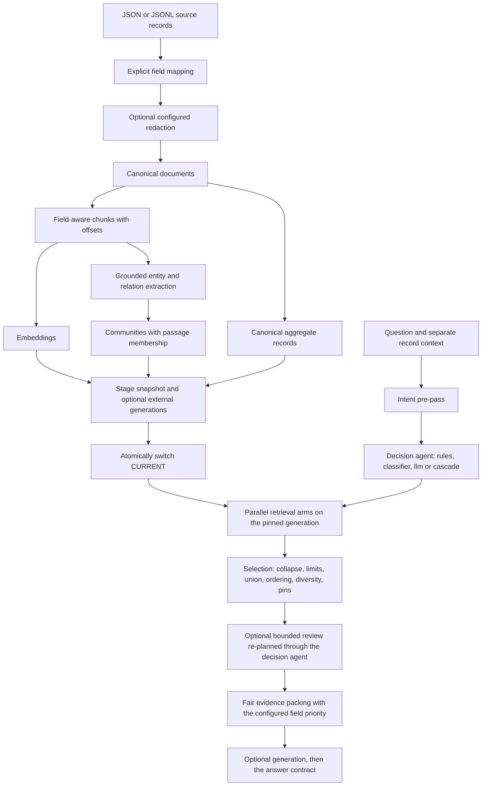
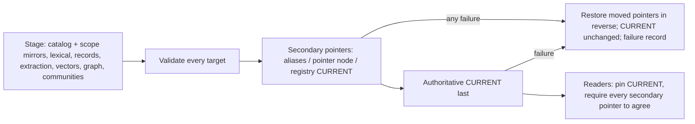

Large Lucene bulk writes are bounded by UTF-8 request size, preserving atomic action/source pairs
and per-item failure reporting across subrequests. Private incident collection and publication run
as independent supervised services: failed or slow publication does not stop capture, and unsupported
source index paths remain explicitly deferred under the existing read-only transport guard.

## Unified merge M2b-2: one planner, two halves, per-source coverage — 2026-11-09 (docs/plans/unified_merge.md §6.11, §6.12, §10.5)

`crosssource.planner.enabled` wraps the pipeline's decision agent in `decision/two_halves.TwoHalvesAgent`.
Per request:

1. **Operations half (deterministic).** Today's log detectors run first (`DecisionAgent.log_step`: the
   typed log intents, `issue_history`, `log_liveness`; the outage investigation, replaced by the observed
   episodes of the default view on an episode archive). Support-shaped questions they miss go to
   `log_intents.detect_operations`: a failure symptom ("unauthorized", "cannot log in", "stuck in the
   queue", "slow", "outage") about a **grounded subject** (a known service or tenant, a
   `question.vocabulary` term, a registry customer) reads `issue_history` over the default live view
   (`log_top` by signature without an archive). No subject, no operations half: a symptom alone never
   becomes an all-service answer. Grounding reuses M0's binding (vocabulary, question clock with both
   12-hour readings stated, `default_view_days`); customers named in the question are read through the
   pinned identity registry (`values.ground_customers`, matched aliases only) and filter the operations
   half to their matched log tenants, or refuse it for them (stated, never widened). A liveness reading
   that a bare hour cannot isolate states both readings; "what was the error" adds the failure episodes
   of the readings' days; a liveness question that describes a failure adds the failure episodes of the
   same scope. A search-ranking question names search analytics, stated as not served until M7.
2. **Knowledge half = today's plan.** The wrapped agent decides with the log capabilities removed, so a
   question without an operations half gets exactly today's decision and llm-planner payload. With an
   operations half the llm planner also receives the **source cards** (`decision/source_cards.py`:
   per source its half, arms, members/cadence/time roles, live window and history, identity-joined
   fields; configuration only) and the operations half already planned.
3. **Merge.** One plan with both halves (`policy_applied: two_halves`; a rollup-only log question
   without a knowledge cue keeps the operations half only). A deliberate refusal of the knowledge half
   keeps the operations half and states it. A planner failure after its repair (schema violation,
   provider error, timeout, invalid/empty plan) is replaced by the **labelled deterministic plan**
   (`decision/fallback_plan.py`: the question on lexical/dense/segment + the operations steps;
   `Decision.fallback: deterministic_plan`, stated first in `limitations`; aggregate intents stay
   unsupported); refusals (unresolvable values, budget, caller-typed operations) stay fail closed.

**Per-source coverage** (`decision/two_halves.source_coverage`): every search/answer of an engine with
the planner carries `trace.source_coverage` — knowledge sources (candidates, packed evidence, members
and layers on a partitioned collection), `logs` (each typed intent's status, window, day tiers
archive/provisional/gap/missing, refusal reason, notes; `not_served` without log intents),
`search_analytics` when asked, identity (registry version, joins, customers and unmatched names) and
links (link version, withheld), the plan's halves, and every gap as a stated limitation
(`AnswerResult.limitations`). HTTP/SSE/MCP return it unchanged (additive key). One generator: the
operations aggregates are packed beside the knowledge passages as before (`operations_coverage` on a
log aggregate is kept out of the generator payload).

**Cross-source views.** `Engine.identity_view()` pins `crosssource.identity` (digest mismatch: joins
off, stated); `Engine.link_view()` pins `crosssource.links.{store_path, sha256}`; `Engine.links_for`
shows a link only when the caller can read the other record (links never grant access).
`runtime/collection.unserved_blocks` no longer refuses `crosssource`.

**Legacy binding (staged cutover).** `DatasetProfile.unified: {enabled, config}` serves the same
dataset id, routes and envelope from the merged-view configuration; default off. A switched dataset
refuses an engine without the planner. Envelopes of such an engine gain the additive `coverage` key
and per-citation `source`, `links` (display fields; links to hidden records dropped) and `link_status`
(`reviewed` | `candidate`); `/health?dataset=` reports `view: unified`. Rollback: switch off, restart.

Not done here: the log member inside a partitioned collection (lane LB; until then the operations half
needs a configuration with `logs`), source-scoped retrieval steps (the knowledge half is today's plan),
an analytics intent (M7), MCP discovery/UI badges (M10).

## Unified merge M3: cross-source links tiers A/B — 2026-11-09 (docs/plans/unified_merge.md §6.9, §6.12, §6.13)

Offline tooling plus a query-time view, like the identity registry; no request path reads links yet
(record pages and citations are rendered by the serving lane; the engine still refuses a
configuration with `crosssource`).

- **Builders** (`crosssource/links/builders.py`, `signature_mentions.py`) over the **pinned**
  documents (members in order, then each live day's pinned slices; a later version of an id wins):
  tier A `explicit_ref` (a ticket or tracker issue naming another record by id or URL; status
  `accepted`; unresolvable id/URL mentions are reported as `dangling`, never linked); tier B
  `customer_window_signature` (ticket <-> episode: the same **matched** customer through
  `IdentityView` on both sides, ticket created in `[episode first - window_before_days, episode
  last + window_after_days]`, the ticket text names the episode's rule id or its whole title),
  `signature_mention` (ticket <-> `family:<rule>`, family <-> doc), `title_mention` (ticket <-> doc
  by a whole doc title of at least two words). A disabled identity view disables only the customer
  builder (reported). Tier-B links are capped at `max_per_record` per subject and builder (nearest
  in time first). Analytics clicks are stubbed until M7; tier C is M9.
- **Store** (`crosssource/links/store.py`): private append-only SQLite with one `link_version` per
  build/review/decision. Statuses `accepted | candidate | model_accepted | model_rejected |
  human_accepted | human_rejected | contested`: a model verdict counts only for the evidence it saw
  (a rebuild with new evidence re-queues the link); a coordinator decision contradicting the model
  makes the link `contested` (owner queue); an owner decision prevails. A link of the previous build
  that is not produced again is retracted: `tombstoned_subject`/`tombstoned_object` when the record
  left the pinned collection (gap-filling merges, tickets leaving the snapshot), else `not_rebuilt`.
- **View** (`LinkView.pinned(path, sha256, identity=...)`): missing store, digest mismatch or edited
  export -> no links (labelled). Display classes: `accepted`/`human_accepted` shown;
  `candidate`/`model_accepted`/`contested` shown with a label (or hidden with `show_candidates:
  hidden`); rejected and retracted hidden; at most `max_per_record` per record. Links derived from a
  customer join are withheld (with a limitation) when the identity view is disabled or pins another
  registry version than the build used. Links never grant access.
- **Review** (`crosssource/links/review.py`): served `candidate` rule links, each reserved at its
  worst case on the **same** review ledger as identity review (one cumulative ceiling) before it is
  sent; excerpts of both records with field cuts stated; citations limited to the supplied fields;
  the run stops at the first refusal, provider error or invalid reply (no retry, no repair).
- **Daily ticket snapshot** (`sources/ticket_snapshot.py`): validated rows -> `ticket:<n>`
  documents; `build_snapshot_member` builds `<member>/snapshot:<day>` through `Engine.build_member`,
  replacing the previous snapshot unit and tombstoning removed ids. Superseding the adopted store's
  ticket portion waits for M1b's `supersede` and the QA100 ticket-subset gate.
- **CLI** (`cli_links.py`): `links build | review [--dry-run] | decide | report | show | export`;
  config-only, never builds an engine.

## Unified merge M2b-1: identity registry v1 — 2026-11-09 (docs/plans/unified_merge.md §6.9, §6.12)

Offline tooling plus a query-time view; no request path reads it yet (the engine still refuses a
configuration with `crosssource`; M2b-2/M4 wire `IdentityView` into grounding and SQL).

- **Registry** (`crosssource/identity.py`): a private SQLite file outside the repository. Every table
  is append-only (triggers refuse `UPDATE`/`DELETE`); each mutating operation adds a
  `registry_version` and the current state of an alias is its latest row. Tables: `customer`,
  `curated`, `classification` (deterministic outcome per `(namespace, raw)`, record ids without a
  value, occurrence counts), `evidence` (`web` needs URL + retrieval date + quote; `source_field`;
  `curated_list`), `decision` (`match | exclude | reject`, coordinator or owner, evidence required),
  `review` (`agree | refutes | uncertain`, rationale, cited fields, USD) and `alias` (status
  `matched | candidate | contested | ambiguous | excluded | unmatched | missing`, rule, authority,
  confidence, evidence, review/decision ids, effective date, version).
- **Deterministic candidates** (`crosssource/identity_candidates.py`): `exact` and `casefold`
  **unique** hits auto-match (owner rule: tenant name = organization name); `curated`,
  `environment_suffix`, `token_set_jaccard` (>= 0.6) and `token_prefix` only propose candidates;
  several customers make a value `ambiguous`.
- **Derivation**: a non-exact match is `matched` only with a coordinator `match` decision (with
  evidence) **and** an `agree` review; `refutes` makes it `contested` (owner queue, no join) and only
  an owner decision resolves it. Casefold auto-matches are reviewed too, non-gating (a refutation
  contests them).
- **Review** (`run_review`): a separate step through the `ChatProvider` abstraction with a strict
  reply schema; citations outside the supplied fields/evidence are not recorded; the run stops at
  the first refusal, provider error or invalid reply (no retry, no repair).
- **Review ledger** (`crosssource/review_ledger.py`): append-only SQLite shared with link review (M3).
  The ceiling and approval reference of `crosssource.links.review` are recorded at first use; a
  higher configured figure is ignored (reported), a lower one applies; only `approve_ceiling` with a
  new approval reference raises it (cap US$10). Every call reserves its worst case (characters / 3
  input, `max_tokens` output) before it is sent; unsettled reservations stay counted.
- **Query-time view** (`IdentityView.pinned(path, sha256)`): reads the pinned sqlite file (from the
  hashed bytes) or a YAML/JSON export (content digest checked); only `matched` aliases yield a
  `customer_id`, on the verbatim raw value. A missing file, digest mismatch or edited export disables
  every join (fail closed). Identity never grants access.
- **CLI** (`cli_identity.py`): `identity describe | candidates | decide | review [--dry-run] | report
  | export | import`; config-only, never builds an engine.

## Unified merge: the live log member served by the partitioned collection (M2a wiring) — 2026-11-09 (docs/plans/unified_merge.md §6.5–§6.7, lane LB)

The M2a live log path is reachable from the engine. A member declared with `cadence: minutes`
(`collection.members.<id>`, one source, `key: day`, `stats: query_time`) is the **live log member**;
everything else in the collection is served exactly as before (M1a/M1b).

- **Construction** (`ingestion/log_collection.LiveLogs`, set as `MemberRegistry.live` by
  `runtime/collection.PartitionedView.attach`): per live member a `LogSliceLedger` at
  `<registry>/slices/<member>` built from the configuration — the member `PartitionRecipe`
  (`recipes.partition_recipe` + the catalog backend's bm25 options), `embed_fields`,
  `catalog_kinds`, `collection.slices`, the metadata schema, **LA's id directory** and the slice
  pins stored next to the unified generation registry; a text-hash vector store at
  `<registry>/vectors/<member>` pinned to the collection's embedding space; the ledger's catalog
  check reads the catalog member of the **active** generation. Building the member through the write
  path is refused.
- **Unit format.** Slices and archive day/month/catalog members are sealed units; each now carries
  `catalog.sqlite` (documents, chunks, typed document fields, one record per document), so the
  partitioned facets serve `get`, hit reads, listings, typed scope and records of log units with the
  sqlite facets' own SQL (`backends/sqlite/log_units.UnitStore`). Embed texts follow the space's
  template (`engine_template`: the write path's `title + field + text`), so log and write-path
  vectors share one space. Archive members are written into the member registry
  (`members/<member>/<key>/<partition>/` + `member.json`, `catalog` facet backend `log_unit`);
  `MemberRegistry.verify` checks a log unit at its seal (bytes are verified when sealed/received),
  so compose stays O(members).
- **Request pin** (`PartitionedWritePath.pin` → `LiveLogs.pin`): the active generation plus every
  live ledger's version vector minus the days the generation serves from an archive member (one
  tier per day). When a slice is pinned the engine receives a **request generation id** (sha256 of
  generation + vector; same dataset, format and fingerprint): every facet resolves it to the pinned
  view, so no engine change was needed and caches keyed by the id are shared while the vector is
  unchanged. Pinned slices are held by slice pins for a lease of `budgets.deadline_seconds` + 60 s
  after the last request that pinned them (one registry write per slice per lease, not per
  request); `release(id)` ends a request's hold, `hold(session, id, ttl)` keeps a session's.
- **Serving** (`backends/sqlite/members.py` + `log_units.LogStratum`): the member's pinned units are
  one stratum. Served rows are decided by sealed versions (highest version per id; newer tombstones
  hide older rows); a unit's other rows are its hidden ids for catalog/records/counts/listings, and
  `get` routes a log id to the unit serving it. Lexical: `QueryTimeScorer` over the served rows, with
  scope, `fields`, phrase and boolean restrictions applied as candidate eligibility (statistics stay
  over the whole stratum, as one store's search); fused with the other strata by RRF under
  `source_quotas`. Dense: `DenseLogScorer` exact top-k over served embed rows, merged with the other
  units by score; units whose vectors are not stored are skipped and reported (`coverage.dense:
  pending`, `slices[].dense`, the dense arm's `dense_pending` report). A request scoped to support
  sources never opens a log unit; the support stratum's lists are byte-identical with and without
  the log member (tested).
- **Id directory** (LA): a slice registers with `replaces` = every unit holding a live row it
  supersedes — the compacted slices, a slice of another live day (chain C), or the archive day
  member `<member>/day:<closed>` of an id that continued past midnight (chain B, also between close
  and `release_day`); gc purges a deleted slice's rows. `close_day` registers the archive day member
  replacing the day's slices and swaps the catalog member's unit (`<member>/catalog`, one unit id:
  the previous version's rows are retired and purged, restored if the new registration fails).
- **Close** (`LiveLogs.close_day`): archive day member (+ catalog member when it changed), id
  registration, **one** compose over the active generation's members plus the new ones (measured),
  then `release_day`. Requests pinned before keep reading their slices until their pins lapse.
- **Dense cold start after a compaction**: `DenseLogScorer` loads one vector per distinct text
  (`TextVectorStore.get_unique`, one index pass, rows read in shard order; the matrix is kept per
  distinct text) and a compaction's new hourly/base unit is pre-loaded by the ledger's
  `on_registered` hook in the serving process (`LogStratum.warm`).
- **Fresh-process start** (`Engine.warmup`, run by `serve` and the legacy adapter before `/ready`
  reports ready; `runtime/warmup.py`): the request pin is taken and the partitioned backend opens
  every pinned unit and pre-opens each live log stratum over that view (`LogStratum.warm_view`:
  readers, served-row masks, unit catalogs, dense matrices); write-path member stores load their
  bm25 segment and vectors. A failure or a run past the bound is a `/ready` problem.
- **Session holds**: a session turn's request pin is held by the session (`LiveLogs.hold`, union of
  every turn's slices, lease = `sessions.ttl_seconds` + deadline, renewed per turn) and released by
  `Engine.close_session`, so slices a conversation read are not collected mid-conversation.

Limits: engine-level log intents/history (`logs` block) stay refused on a partitioned collection
(M2b); a slice registered by another process (the log host's compaction) is warmed on its first
read in the serving process, not by the hook; typed projection rows of slices (M4);
month members are built by `build_month_member` but no scheduler composes them yet (M9).

## Unified merge M1b: read-only adoption, attached layers, per-member projection — 2026-11-09 (docs/plans/unified_merge.md §6.2–§6.4, §10.3)

A partitioned collection can now take an **existing validated store as its first member without
touching it**, with that store's companion stores as **attached layers**. Still refused at engine
construction: `crosssource`, layer kinds other than the three below, community strategies other
than `imported`, a typed projection over more than one member (M4), native member graphs (M5),
`logs` (M2a).

- **Read-only adoption** (`ingestion/adopt_member.py`, `MemberRegistry.adopt`, CLI `collection
  adopt`): the original v2 configuration is pinned by sha256; the store's whole-config fingerprint
  is recomputed **backend-free** (`recipes.fingerprint_of`; no `WritePath`, backend or provider)
  and must equal the fingerprint in the store's active manifest (a relocated or re-stamped store is
  refused); every backing file of the active generation (`CURRENT`, catalog, bm25 arrays, vectors,
  faiss index, projection files, manifest) is hashed; ids/kinds/sources are read over a `mode=ro`
  connection and checked against the member declaration; the decomposed recipe
  (`recipes.store_recipe`), the digests and the store's own backend settings are written **into
  the unified registry** (`member.json`, `adoption.json`). The store's runtime file (written by the
  service that serves it) is never read or hashed. Nothing under the store is written: the facet
  location is the symbolic `adopted/<member>`, resolved through `adopt.store` at serve time.
- **Serving an adopted member** (`backends/sqlite/members.py`): the unit is a `SqliteBackend(...,
  readonly=True)` over the store with its recorded settings: catalog connections `mode=ro`; runtime
  database, index/upsert, lexical rebuild, projection writes and deletes refused. Digests are
  re-checked on the first open per process; a mismatch makes the member unavailable (the request
  fails closed). A single adopted unit is served by today's code paths unchanged (R1: one support
  stratum with today's idf, candidate counts and `source_weights`).
- **Attached layers** (`ingestion/layers.py`): `graph_attach` (the kuzu `mode: attach` backend;
  the engine wraps it in `LayerBackend`, whose graph facet maps the unified generation to the bound
  adopted store's generation; digest = mapping file sha256 + database listing), `segment_sidecar`
  (directory content digest) and `communities_imported` (the import file, which must be the one the
  adopted store materialised). `compose` pins every layer (`manifest.layers`, part of the unified
  fingerprint); an optional layer whose files do not match its pin is left out
  (`layers_unavailable`), a `required` one refuses. At serve time a layer is re-verified once per
  process and generation; an unavailable layer fails only the arm that reads it
  (`LayerUnavailableError` → empty arm result, `layer_unavailable` report, coverage incomplete).
  Layers are exempt from the non-sqlite write-path refusal.
- **Graph and community facets**: the community arm reads `PartitionedGraph`, which serves the
  communities, entity lookups and mentions of the adopted member bound by the
  `communities_imported` layer; `communities.layers` entries with `strategy: imported` are
  published as `CommunityLayerReader` values (`communities/base.py`, the protocol M6 implements).
  Traversal over member stores is refused until M5.
- **Projection per member** (`PartitionedProjection`, `projection/store.py`): one projection-bearing
  member is served as its store serves it (`served_generation` maps the unified generation to the
  member's, so `ProjectionCatalog.load` and the SQL route read the sealed manifest and file
  unchanged). `projection.store.attach_list(facet, gen)` returns the read-only attachments (alias,
  absolute path, role, unit) of every pinned member's projection files: the input of the M4
  multi-source setup (`sql_surface/setup.py`); until M4 completes, a single-file read over several
  members is refused.
- **Coverage labels**: a partitioned search trace carries `collection` — per member (unit, tier,
  sources, as-of, counts, status) and per layer (kind, arms, status, reason).
- **Regression fixed** (found by the real-data equivalence run): a partitioned hit read mixing
  chunk ids remembered from an earlier search with unknown ones reordered them, so a document's
  text-carrying first chunk could differ from today's; the caller's order is now kept.

## Unified merge M1a: partition core — 2026-11-09 (docs/plans/unified_merge.md §6.1, §6.2, §6.5)

A `schema_version: 3` configuration with `collection.mode: partitioned` is now **served** by one
engine over member partitions composed by reference. Not yet served (refused at engine
construction, before a backend opens): adopted members and attached layers (M1b), community
layers, `crosssource`, the graph/community/segment/typed_query arms, typed projection and `logs`
over a partitioned collection.

- **Members** (`ingestion/members.py`): a member partition is one ordinary sqlite store built by
  today's `WritePath` into `<catalog path>/collection/members/<member>/<key>/<build>/store/` and
  described by a frozen `MemberRef` (`member.json`: partition id, location-free `PartitionRecipe`,
  tier, counts, facet locations, file digests). Documents are checked against the member
  declaration (sources, record kinds, id namespaces, key scheme); catalog kinds (`signature` and a
  member's `catalog_kinds`) live only in the member's `catalog` unit (latest-wins).
- **Id directory** (`ingestion/id_directory.py`, the frozen `IdDirectory` protocol): one sqlite
  table `doc_id → unit` maintained incrementally at registration; refuses a duplicate non-catalog
  id (one transaction, nothing written), except a same-member same-day slice supersede, a declared
  `replaces` (compaction, close, rebuild) and `catalog_provisional` carriers; `supersede`,
  `tombstone`, `retire`, `purge`, `live_ids`; resolution is one indexed lookup filtered to the
  request's pinned units, and a row superseded/tombstoned by a unit **outside** the pinned view
  still serves that view.
- **Compose** (`ingestion/compose.py`): a unified generation is a manifest naming member refs
  (O(members), no document read), activated by compare-and-set on `CURRENT` under the write lease.
  It refuses undeclared/unregistered members, a directory inconsistent with a member manifest, a
  digest mismatch, a foreign embedding space and an analyzer that differs within a source; `fts5`
  is refused for new members. `PartitionedWritePath.current()` compares only the **collection
  recipe** (`ingestion/recipes.py`: dataset, index format, partition protocol, embedding space,
  member list); member recipes may differ (keyword epochs, chunking).
- **Partitioned facets** (`backends/sqlite/members.py`): the configured sqlite backend is replaced
  by `PartitionedSqliteBackend`. Catalog `get` and `document_ids` scopes are routed through the id
  directory; listings are per-unit pages k-way merged by id (cursor = per-unit offsets); records
  concatenate per-unit matched rows and compute `scope_result` once (one store's semantics);
  lexical runs **per stratum** (a member id): one unit is today's search unchanged, several units use
  **query-time statistics** (N, token total and query-term df summed over the units minus
  superseded/tombstoned rows; BM25Okapi idf; the epsilon floor's average idf over the union
  vocabulary, cached per unit set); strata are fused by RRF under `source_quotas`
  (`arms/stratified.py`); dense is the exact top-k per unit merged by score with one store's tie
  order. Units outside the request's `source`/`kind` scope are never opened.
- **Caches per unit**: one sqlite backend per `partition_id` (segments, vectors, row maps, faiss
  keyed by the member's own generation); a new compose opens only new members.
- **Equivalence kit** (`tests/contract/test_partition_equivalence.py`): a single-member collection
  returns today's hits, scores, evidence and records; a source-scoped request equals that member
  alone; the log stratum over catalog + month + day members ranks like one store of the same
  documents; dense and records over all members equal the monolithic engine.

## Success heartbeats and liveness — 2026-11-09 (docs/plans/unified_merge.md O6)

- **Collection** (`ingestion/episode_summaries.py`): rules with `category: success` come after every
  failure rule (`check_precedence`), so the exclusive rule filters of the failure rules are
  unchanged and a line that matches a failure rule stays a failure. Success runs are built like
  episodes (same minute series, same quiet gap) but carry no evidence, no observed-rule community
  and no shared-error community; the coverage row counts them apart. A snapshot's 5-minute
  `heartbeats` block is checked against its minute series (refused when it does not reconcile).
  A failure-only recipe builds byte-identical documents to before (golden test).
- **Archive and epochs**: no new document kind; success runs are `incident`/`episode_cell` rows with
  `category: success` and reach the typed `episode_piece`/`issue_day` tables. Adding the success
  family is a new recipe epoch (`keywords.effective_from`); earlier days keep their shards.
- **Failure views** exclude `category: success` by default: `issue_history` (SQL `NOT IN` over the
  tiers, with the excluded count stated), `incident_episodes`, summary `log_top`/`log_trend`,
  outage investigations (`runtime/episode_tools.failure_only`).
- **Liveness** (`runtime/liveness.py`, intent `log_liveness`): reads the success pieces of the
  archive and provisional tiers (`TieredAggregate.pieces`, bounded) and the per-scope capture
  horizon (`horizons`), merges pieces into runs, takes the median interval between run starts as
  the cadence and reports `halted` above `liveness.halt_factor` x cadence; recovery is the first
  success of the same scope after a failure episode. Days without heartbeat recording (other recipe
  via `day_recipes`, before `effective_from`) are excluded from cadence intervals and stated.

## Unified merge S0: schema v3 skeleton and seams — 2026-11-09 (docs/plans/unified_merge.md §7, §10.7)

Validated but inert: nothing on a request path changed.

- **Schema v3** (`core/config_collection.py`, `core/config_crosssource.py`, `communities.layers`):
  `schema_version: 3` adds `collection` (`mode: partitioned`, members, embedding space, lexical
  strata, `selection.source_quotas`, attached layers, live-slice settings, id directory),
  `crosssource` (identity registry, links) and `communities.layers`. A v2 file loads unchanged with
  the same index fingerprint; a v2 file with any v3 block is refused with a migration message.
- **Frozen interfaces** (`core/types_members.py`): `PartitionRecipe`, `MemberRef` (incl. the
  per-source `catalog` member), `SliceRef` (supersede list and **tombstones**), `IdDirectoryEntry`
  (`superseded_by`, `deleted_by`, `catalog_provisional`), `LayerRef`, `PinnedView` (generation +
  members + per-member slice vector + layers; one tier per day), `StratumRanking`, and the
  `IdDirectory`, `SliceLedger` and `StratumScorer` protocols the partition core and live log path
  implement.
- **Engine seam** (`runtime/collection.py`): `Engine.view = CollectionView.for_config(config)`, a
  single-member view no path calls yet. A configuration with `collection`, `crosssource` or
  `communities.layers` is refused at engine construction (`ConfigError`, before any backend opens)
  instead of being served as one monolithic store.
- **Backend-free recipe** (`ingestion/recipes.py`): `recipe_of(config)` equals
  `WritePath.index_recipe()` without constructing a write path, backend or provider (used by
  read-only adoption, M1b).
- **CLI stubs** (`cli_collection.py`, `cli_identity.py`): `collection describe` and `identity
  describe` read the configuration only; later operations refuse with exit code 1.

## Unified merge M2a: live log path producer — 2026-11-09 (docs/plans/unified_merge.md §6.7, lane LB)

Library modules and tests; not yet reachable from the engine (the partition core, M1a, wires them).

- **Slice ledger** (`ingestion/log_slices.py`, `LogSliceLedger`, the S0 `SliceLedger`): each refresh
  of a live day is sealed as a **delta slice** (documents whose content changed for that day) and
  registered in the member's ledger (`CURRENT.json`, read once per request) without a generation
  activation. A slice records `supersedes` (ids whose live row it replaces), **`tombstones`** (with a
  full-day build: ids live on that day but absent from the build, e.g. after a gap-filling merge),
  `catalog_provisional` (rule documents first seen on a provisional day; known rules are excluded
  and changes are parked for the close) and `excluded_stats`. Every row carries a **version** (the
  sequence of the slice that first sealed that content, kept by compaction): the served row of an id
  is the highest version among the pinned units and a newer tombstone hides older rows.
- **Compaction** (background, holds the writer lock): five-minute slices of a finished hour → one
  hourly slice; every `day_base_hours` (and after the day ends) the day's slices → one base. A day
  pins at most `max_units_per_day` units (19); a seal beyond it is refused.
- **Archive members** (`ingestion/log_members.py`): `close_day` builds the archive day member and,
  when it changed, the per-source catalog member (latest wins, N3) as sealed units in the member
  registry; after the generation that includes them is active, `release_day` retires the day's
  slices. `vector_for` drops days the reader's pinned generation already archives, so a day is in
  exactly one tier. `build_month_member` merges closed days (one row per id, unique-text dedupe).
- **Query-time statistics** (`backends/sqlite/query_stats.py`, `QueryTimeScorer`, the S0
  `StratumScorer`): `N`, token totals and per-query-term `df` over the served rows of the pinned
  units; the ranking over N slices equals the ranking over one compacted day (the epsilon floor uses
  a maintained `average_idf`, a declared approximation). `DenseLogScorer`: exact flat top-k over the
  served embed rows; a unit whose vectors are pending is skipped and reported.
- **Text-hash vector store** (`ingestion/text_vectors.py`): vectors keyed by the sha256 of the text,
  float16, pinned to one embedding space; only declared `embed_fields` are embedded and log-line text
  is refused (retention invariant).
- **Handoff** (`ingestion/handoff.py`): sealed units (`unit.json` + `SEAL`), sha256 verification of
  every file, resumable `transfer`; the serving ledger's `receive` re-checks sequence and lists
  against its own state and refuses (keeping the previous slices) on any mismatch.
- **Slice pins** (`ingestion/pins.py`, `SlicePins`): rows `slicepin:<slice id>#<holder>` in the
  generation pins' store; `ProcessPins` works unchanged on them. A retired slice is deleted only when
  unpinned and older than `gc_grace_seconds`.

## M0 log-side fixes — 2026-11-09 (docs/plans/unified_merge.md §9)

- **Startup spend check** (`runtime/plan_cost.py`, `budgets.plan_check`): `Engine.__init__` computes
  the worst-case answer spend from the configured call slots and the price table; `warn` (default)
  logs and notes it on `/ready`, `refuse` raises `ConfigError`.
- **Explicit provider retries** (`providers/_chat.py`): `on_incomplete` (one retry after a
  `max_tokens` cut, shorter or with a larger ceiling) and `retry_transient` (5xx/429/timeout/cut
  stream, inside the deadline). Each attempt is metered; `incomplete_cause` tells truncation from a
  cut stream.
- **Question binding of log intents** (`decision/log_question.py`, applied in
  `DecisionAgent.bind_log_question` for every agent): default view for undated outage/presence
  questions, the question clock (`question.timezone`) with both 12-hour readings of a bare hour,
  and the reviewed vocabulary (`question.vocabulary`). Statements reach the aggregate rendering
  (`StructuredStep.notes`, `unapplied`).
- **Bounded incident selection** (`runtime/log_investigation.py`): an over-limit selection is
  answered bounded with a per-client count instead of a 503.

## Retrieval-parity features — 2026-11-09 (branch `v2/su-retrieval-parity`)

Opt-in additions so a deployment can replace an earlier support QA service; defaults are unchanged
(details and keys in CONFIGURATION.md, "Retrieval-parity features").

- **Rerank stage** (`selection/rerank.py`): a cross-encoder scores the first `top_k_in` unpinned
  records of the ordered selection; pins stay first; `top_k_out` is an explicit cut. The scoring
  call has a latency budget in its own worker thread. Failures either raise (`fail`) or keep the
  fusion order with `status: failed_open` and the reason in `trace.selection.rerank_detail`; the
  degradation is chosen by the operator and always traced.
- **Segment arm** (`segments/`, `arms/segment.py`): child records (description, comment,
  resolution segments) live in a sealed sidecar index (sqlite rows + FTS5, float32 vectors, sha256
  manifest with the embedder recipe), outside the catalog, counts and projection. Segments are
  anchored verbatim in a parent field at build. The arm ranks every segment, admits parents through
  the catalog with the request scope, returns one hit per parent with its best segments as
  provenance and drops segments whose anchor no longer holds in the serving generation.
- **Imported communities** (`communities/imported.py`): communities built elsewhere enter the
  `communities` store only with claims whose quotes are verbatim in member passages (summary prose
  is refused; optional extractive member sentences). `community.claim_hits` returns the cited member
  passages with membership lineage; existing per-claim eligibility applies.
- **Record attach** (`ingestion/attach.py`): one-to-one columns of a sha-pinned, read-only SQLite
  table or view become declared metadata fields at ingest, so they are filterable, projectable and
  ACL-scoped like any field. Many-to-many facts stay in an attached graph.
- **Attached graph stores**: a `kuzu` `mode: attach` backend is no longer a write-path target (not a
  projection holder, not in the index recipe); `graph.path_evidence` turns free-text traversal paths
  over such a store into document hits with edge quotes as provenance.
- The local sentence-transformers embedder serialises tokenizer and encode calls: the dense and
  segment arms encode the same query concurrently and the fast tokenizer is not thread-safe.

## Source-side incident summaries — 2026-11-07

The optional `incident_episode_summaries_v1` collection mode counts the configured keyword union
and mutually exclusive issue rules at the source. It retains minute counters privately to establish
observed sessions, exact hourly counters for aggregation, and bounded masked first/last examples.
It never falls back to raw scroll export. Inexact totals, shard failures, missing counters and
unreconciled timelines reject that source snapshot; completed scopes and failed/pending work remain
explicit. Broad keyword matches outside the rule catalog are unclassified candidates, not incidents.
A source query covers at most one day. A five-minute quiet gap separates observations; silence does
not establish recovery. An explicitly correlated success example supports only its sampled operation.

Canonical documents include `summary_coverage`, `episode_cell`, `incident`, `signature`,
`unit_day`, `signature_day`, `shared_error`, and bounded `unclassified_example` records. The
`incident_episodes` tool uses ordinary generation pins and ACL filters for counts, evidence and
keyword distribution. Reused `log_top`, `log_trend`, `log_affected` and `log_signature` intents read
summary counters when that manifest contract is active. Unretained severity, rates and parser
coverage are refused. This mode is opt-in; existing datasets retain their existing behavior.
Episode rows retain their full observed count when overlapping a query boundary; exact window
aggregations use the hourly cells instead. Completeness of captured source scopes is distinct
from corpus coverage and incident detection accuracy.

Typed headers provide tenant→service and service→rule association edges, including episode evidence.
Client/rule/day observed-session groups support episode retrieval; large investigations return an
explicitly bounded selection. Header-link recipe versions enter extraction-cache reuse keys. Shared rule communities
are recomputed by rule/day across captured tenants on publication; membership and repeat counts
are scoped to member documents. They do not imply common cause, monitored alerts or confirmed
outages. Collector/publisher scheduling and source credentials belong in a private deployment,
not the distributable library. The Overview selects this tool only when advertised, renders a
structured table with bounded evidence, and shows pending coverage and unknown recovery.

## Declared collection policy and long-term episode archive — 2026-11-08

`logs.collection` makes the collection, keyword, retention and serving policy part of the
configuration (`core/config_log_policy.py`) and of the package's checks (`ingestion/log_policy.py`):
the heavy-pull UTC window and the day-close rule, the continuous refresh interval, the keyword
families pinned by sha256 into a recipe identity, retention per data class (reusing
`logs.retention`; keyword/episode aggregates forever) and the longest servable range.

`ingestion/episode_archive.py` keeps the source-side summary aggregates forever. `close_day(D)`
accepts only snapshots whose window is exactly `[D 00:00Z, D+1 00:00Z)` and whose compiled summary
recipe equals the pinned policy's, builds the canonical documents (`summary_documents` with evidence
citations) and writes the aggregate kinds (`summary_coverage`, `unit_day`, `episode_cell`,
`incident`, `signature_day`, `shared_error`) as one append-only, content-addressed day shard of an
`EpisodeArchiveStore` (the H1 `SqliteHistoryStore` layout in its own file, with its own kinds).
Appending day N+1 writes that day's rows only; earlier shards are never read or rewritten, an
archived day is never replaced, and the archive refuses garbage collection. A hash-chained archive
log (head mirrored next to the file) records every closed day and every explicit gap record, so
`logs policy verify` detects a deleted day. Text fields may be trimmed at archive time
(`archive.max_text_chars`); aggregate fields and `evidence_refs` citations are kept.

`publish` builds a small serving generation: the rule catalog plus the live window (every document
of the last `keep_days` days as built), with `logs.history: {store: episode_archive, kinds,
shards}` naming every archived day. `Engine.history_route` sends every structured scope over the
archive kinds to the archive (the structured arm through the records router), other kinds to the
generation, and refuses a scope mixing both; `documents_in` falls back to the archive for ids not
in the generation. `incident_episodes` accepts ranges up to `serving.max_window_days` and joins a
per-day episode continued across midnight (within `gap_seconds`) into one row. Each archived day
records its recipe identity; an answer whose range spans two recipe epochs or a gap record says so
in its notes (missing and gapped days are never zero).

Limits: the community arm and search cover the live window (archived incidents keep their
`community_id` for grouping); the archive's EAV reads are not pushed down on `first_hour`/
`last_hour`; the collector itself (source queries, continuous refresh) stays in the deployment and
hands complete day snapshots to `staging.path`.

### One served history: provisional and archived days (plan K, increment I1) — 2026-11-08

Every day is in exactly one tier. `ingestion/provisional.py` keeps per-scope snapshot versions of
every unclosed day (a refresh carrying some scopes keeps the others) and one replaceable projection
file per day version, named by an atomically replaced `CURRENT.json`; `logs policy refresh` builds
them from the collector's rolling staged snapshots without rebuilding any generation. Closed days
are served by the **archive serving pointer** (`<archive>.serving.json`, the archive log sequence
up to which days are served), advanced in O(1) after each close; `Engine.history_route` and
`issue_history` read it (archives without a pointer fall back to the generation manifest). A day
becomes `archive` only when the pointer serves it, which also drops its provisional entry; readers
read the provisional ledger before the pointer, so a day is never lost and archive wins. The
serving generation keeps only the rule catalog and the live window (bounded by `keep_days`), so
adding day N+1 costs one day's close plus the pointer advance, never work proportional to N.

`close_day` streams snapshots through a spill file (`ingestion/day_spill.py`; the documents equal
`summary_documents`, the shard id is unchanged) and writes typed rows next to the EAV shard
(`ingestion/episode_history.py`): `episode_piece`, `issue_day` (tenant x env x service x rule x
day: occurrences, `episodes_started`, `episodes_continued`), `coverage_day`, and a row-hash
`history_log` chained over per-day digests that `verify` recomputes. The cross-midnight count rule
compares a piece starting within `gap_seconds` after midnight with D-1's boundary tail (one indexed
read, no rewrite): a match continues the chain (`continues_id`, `chain_first`); no D-1 rows give
`boundary_unknown` (counted as new, stated). Over [A, B], episodes = started + continued on A,
occurrences window-exact; the read-time `stitch` of `incident_episodes` agrees (parity test). A day
past `close_after_days + grace_days` without a complete set closes `partial` (flagged on every row
and in the ledger, missing and stale scopes listed; a later complete set is refused) or becomes a
gap record. `TieredAggregate` answers `issue_history` with one `GROUP BY` per tier and a merge over
disjoint days (sums, min/max, distinct days, distinct tenants by key union; anything else refused).

Not in I1: the provisional days are not in the search/graph/community arms or `incident_episodes`
(they read the archive and the live-window generation); the SQL/IR route over history (I4); text
search over history (I2); the UI reads `default_view_days` from `/v2/capabilities` only after a
bundle rebuild (the shipped client-issue view already defaults to 3 days).

# Architecture

The proposed [Unified SU platform architecture](plans/unified_su_platform.md) extends this
dataset-scoped kernel toward one MCP/UI across support, documentation and ELK. Collection
orchestration, cross-source identity and customer-scoped log authorization are explicit
integration work; the diagram below describes the implemented per-dataset path.

## Request and ingestion paths



## Component contracts

Partition parsing lazily starts one process pool for the partition and retains it across source
units. At most twice the configured worker count of serialized batches are queued; results remain
in input order and every batch must report the parent's library identity. Small units and an
explicit single-worker configuration retain the serial path. Worker caches stay private to each
process. This bounds queued serialization, not the complete partition's retained records or output
aggregates; it does not imply that increasing worker count improves throughput.

Pattern-learning prompts select distinct message bodies while balancing explicit tenant, date and
message-shape attributes; repeated messages still contribute to cluster support, but do not consume
multiple prompt slots. Up to two nearby messages outside the cluster can serve as negative examples,
within the existing line budget. A cluster without enough distinct examples is reported as not sent.
The sampling helper can reserve a complete day or tenant before mining and removes overlapping exact
texts from training. If no usable split remains it reports validation unavailable; ordinary learner
runs do not implicitly claim an independent holdout. Provider proposals still pass the existing RE2,
support, out-of-cluster and regression gates before the configured promotion policy applies.

`logs.compose.kinds.shared_error` opts into deterministic daily shared-error communities. These
use format-2 `aggregates.level_hours`, which preserves the actual joint tenant, environment,
service, deployment, signature and severity. Legacy `hourly_cells` does not preserve severity and
is not used for this feature. Only parsed ERROR/FATAL rows qualify; configured generic signatures
are excluded. At least two tenants must meet the observed-line support threshold on the same
partition day. Estimated event counts cannot manufacture tenant support. This is shared-pattern
membership, separate from a co-firing incident, and establishes neither simultaneous failure nor
a common cause or monitored alert state.

Each `shared_error` supporting document contains one tenant/service/environment/deployment/level/day
and its own counts, observed lines, exactness and first/last observed hours. A shared daily
`community_id` joins members; `community_family_id` identifies the same signature across days.
No member document contains other tenants' names or global counts. Header extraction adds grounded
tenant/service/signature mentions without duplicating existing weighted graph edges. Declared
community statistics aggregate all member documents instead of copying the first member. Scoped
community retrieval filters member documents and cited claims, uses a neutral label/status for
partial membership, and does not return unrestricted community statistics. Missing days and capped
groups are recorded in the compose report and generation manifest. The configuration and its limits
are included in the compose identity; no model call is needed to form these communities.
Supporting documents use the effective approved pattern's `issue_name` when present, with its
origin and human-review status. An unreviewed learned name remains explicitly provisional. The
stored `template` is the pattern expression, not an event quote or another client's exemplar;
its summary preview is bounded and marks truncation, while the field retains the full expression.
Matching IDs remain stable. A builder version and a digest of this descriptive metadata enter the
compose identity because label/review changes are not part of the pattern's matching identity.

`log_top` with `by: service_signature` groups ERROR/FATAL events by both service and signature,
returning `service`, `error_type`, `error_count`, stable signature IDs and stored supporting
templates. The service-failure-and-issue question selects this shape rather than service totals
or parser coverage. The answer is a deterministic three-column table; no model narration is
needed. Counts describe classified log events, not distinct outages or established causes.
Missing days, sampling and inconsistent source totals remain disclosed. The tool defaults to
at most 100 service/type combinations and the answer text explicitly bounds its ten-row preview.

`log_top` also supports `tenant_signature` and explicit `group_by` (up to four fields)
with ordered `columns`. The planner chooses the dimensions and presentation; validation requires
every grouping dimension and count, and rejects invented fields. Signature breakdowns count only
ERROR/FATAL events. `tenant` is presented as Client. Structured output retains stable identifiers
and supporting templates for API/MCP consumers; table columns are additive response metadata.
The general ScopeSpec permits four grouping fields; the English free-scope grammar remains limited
to two. Existing backend cardinality and truncation limits still apply.

The logs decision path binds known service/client names and recognised calendar expressions from
the question into typed intent arguments. A contradictory filter or a dimension the chosen intent
cannot express is a planning refusal, not an unfiltered query. Explicit quoted unknown names are
refused. Named uppercase severities are preserved together. Same-month day ranges such as
`March 2–3, 2026` include both days. These are deterministic English grammar safeguards, not a
claim that arbitrary natural-language qualifiers are understood. Latest-event questions cannot be
answered by a daily frequency rollup; selecting such a log intent is refused.

`pipeline.decision.schema_repair_attempts` is 0 by default and accepts only 0 or 1. The logs example
profile opts into one schema repair after a malformed planner response. It uses the same provider,
schema, original request and budget meter; the repaired plan passes all ordinary validation and
scope checks. Replies over 64,000 characters are not repaired. Logs record validation paths, not
raw replies. The provider kernel still has no automatic retry or repair; this is an explicit
decision-layer policy. It does not authorize an unscoped search fallback.

`Config` rejects unknown keys and invalid built-in provider names. `Document` is a canonical record
with dataset-scoped ID, source, title, absolute source URL or null, textual fields and flat metadata.
`Chunk` identifies the canonical field and exact character offsets. `Hit` carries document-level
identity, original source metadata, supporting chunk IDs and arm-specific provenance. `SearchResult`
preserves individual-arm pools and aggregates as well as the merged result.

`Engine` coordinates the lifecycle. `Store` is the canonical catalog/snapshot owner. `Embedder`,
`Extractor` and `JsonModel` isolate model interfaces. `Retriever` applies eligibility and performs
retrieval; optional PostgreSQL and Neo4j modules load only when selected. `fuse` is a pure operation.
The API and MCP wrappers call the same engine rather than reimplementing retrieval; both accept the
same `SearchRequest` (`serving/parity.py` checks the MCP tool schemas against it at start-up).

The supported backend names are deliberately closed in this alpha. Adding another backend currently
requires implementing its adapter and extending the configuration/dispatch/tests. Avoid arbitrary
Python imports from untrusted YAML.

### V2 kernel (branch `v2/phase-0`, plan §3.1–3.5)

`core/types.py` holds the canonical v2 types: a field-anchored `Span` (`text == source[start:end]`,
the only legal quote carrier), `Document` (adds a neutral `kind`), `Chunk` (adds `recipe`), `Entity`,
`Relation` (`edge_kind` in `fact|co_occurrence|mention|native_link|derived`, `support`, provenance;
a `fact` needs predicate support and `entailment_checked` is reserved with no producer), `Event`,
`StructuredRecord`, `Membership`, `ExtractionOutput` (relation endpoints must be typed entities of
the same chunk contained in the relation span), `Evidence` (no cache kind exists), `GenerationId`,
`MetadataSchema`/`FieldSpec`, and the typed scope/result/paging types the backend contracts use.

`core/component.py` defines the `Component` protocol (`name`, `kind`, `config_model`, `validate(env,
probe)` returning diagnostics, `run(ctx, inputs)`, `recipe_fingerprint()`), and the artifact rules:
no pickled files, no `module:attr` factories, no dotted import paths from configuration; classifier
artifacts are ONNX files pinned by sha256. `core/registry.py` keeps one registry per component kind;
built-ins register by explicit import, third parties only through the `su_multi_arm.components`
entry-point group and only for names listed under `plugins:`. Python objects can be injected only
through the Python API.

`backends/contracts.py` freezes the eight capability protocols (`Catalog`, `LexicalIndex`,
`VectorIndex`, `RecordStore`, `GraphStore`, `CacheStore`, `LedgerStore`, `SessionStore`); adapters
expose one facet per capability because the contracts share method names. Every operation is
generation-scoped, reads are paged or bounded by `k`, cache keys start with the generation prefix,
`delete_generation` is the only destructive operation and is refused for an active or pinned
generation. `backends/capabilities.py` is the static matrix (kind → declared capabilities, flags,
and an honest `status` per capability: `contracts` for what passed the conformance kit (memory,
sqlite, mongodb except vector, opensearch and elasticsearch for catalog/lexical/vector/records, neo4j
and kuzu graph, postgres except graph, sqlalchemy for catalog/records/cache/ledger/session), `planned` for
everything else, which configuration rejects). `backends/memory.py`
is the in-memory adapter that satisfies every protocol and anchors the conformance kit.

`runtime/` holds the harness objects: `RunContext` (immutable per request; principal, session,
memory, budget, trace, pinned `GenerationId`, deadline, access policy), `Budget` (reservation API
for calls, tokens, USD through an operator price table, and wall clock; exhaustion is a typed error
recorded in the trace), `Trace` (nested spans, JSONL export masked by default: query text, passages,
prompts, answers, unsupported-constraint text and review follow-ups become hashes), `SessionManager`
(principal-scoped sessions, generation change recorded, episodic IDs re-validated), `Memory`
(working/episodic; never evidence), `ToolRegistry`/`invoke_tool` (read-only tools) and
`ActionRunner` (audited, idempotent writes; HTTP/MCP denied unless allow-listed and scoped).
`core/config.py` is configuration v2 and `compat/config_v1.py` keeps the v1 model, its fingerprint
and the deterministic upgrade/downgrade (see CONFIGURATION.md).

### Storage, arms and the write path on the contracts (slice P0/S4)

`backends/elasticsearch/` (Phase 1) serves `catalog`, `lexical`, `vector` and `records` on the same
contracts as `backends/opensearch/`, from which it inherits: both are the OpenSearch classes over
`backends/_lucene_common.py` (three indices per generation, dataset aliases switched atomically by
`activate(gen)`, typed-field pushdown, BM25 `multi_match`, bounded records scan with the shared
`_scope` measures). The subclass replaces only the engine-specific parts: the official-client
transport, the 8.x `probe`, `dense_vector` fields (exact `script_score` cosine by default, float HNSW
with the top-level `knn` search behind `knn.method: hnsw`), no `index.knn` setting, and an
alias-backed `generation_registry()` (`registry.py`) so the write path can own `storage.catalog` on
it. Typed errors carry the adapter's kind. Graph, cache, ledger and session are not served.

`backends/sqlite/` is the local default on the frozen contracts (all eight capabilities; conformance
kit in `testing/backend_conformance.py`, run over the memory fake, sqlite and sqlite+faiss by
`tests/conformance/`). `backends/extras.py` declares the few read operations the arms and the write
path need beyond the frozen protocols (row counts for projection validation, entity lookup by query
tokens, span-anchored mentions, community objects) as separately named protocols with typed checks.

`backends/mongodb/` (Phase 1) is the first external adapter on the contracts: six facets (catalog,
text-index lexical, typed records, cache, ledger with raw replies, sessions) over generation-scoped
collections named `<prefix>_<dataset>_<generation>_<kind>`, a `MongoGenerationRegistry` whose
`CURRENT` pointer is one document replaced atomically only by `activate`, typed field rows for
predicate pushdown (`_db.py`), and every driver failure mapped to `BackendError(adapter, operation)`.
It exposes no `vector` facet: MongoDB vector search is Atlas-only and the matrix keeps that pair
`planned`. Its conformance suite (`tests/conformance/test_mongodb_conformance.py`) is `external`
and runs against the `mongo:7` container of `tests/services/`.
`backends/opensearch/` (Phase 1) serves `catalog`, `lexical`, `vector` and `records` on the same
contracts against OpenSearch 2.x and 3.x through `opensearch-py`, with `backends/_lucene_common.py` holding
the engine-neutral parts shared with the future Elasticsearch adapter (index naming, the typed field
layout that compiles a `Scope` into a native `bool.filter`, predicate and lexical query DSL, paging,
transport protocol, bulk checks). Every index is named `<prefix>_<dataset>_<generation>_<kind>`;
dataset aliases are the serving pointer and are switched in one atomic `_aliases` call by
`activate(gen)`, so a build that never reaches activation never changes what the alias serves and
older generations stay until `delete_generation` (refused for a protected or aliased generation).
Vector search is exact by default (cosine `script_score`); HNSW is an explicit opt-in that always
rescores its candidates exactly. Records push every filter down and compute measures with the
shared `_scope.py` code, so `ScopeResult`s are exact and identical across adapters. With
`records.aggregation: native` (both Lucene adapters) the scope operations are compiled to server-side
aggregations instead (`backends/_lucene_aggs.py`: `composite`, `terms`, `date_histogram`, `filters`,
`stats`, `top_hits`, and `cardinality` only above the exact distinct cap, labelled `approximate`). The
ACL filter is the query of every aggregation request, nothing is scanned, `matched_ids` is capped at
`matched_ids_cap` with `matched_ids_truncated`, and every other result field is identical to the
client path (kit `testing/aggregation_parity.py`). The adapter never
retries and never degrades: unreachable server, refused query, bulk item failure, missing generation
and mapping-version mismatch are typed `BackendError`s. The conformance kit runs against the real
service under `-m external` (`tests/conformance/`, `tests/services/test_opensearch_adapter.py`).

`backends/neo4j/` (Phase 1) serves the `graph` capability (with memberships) and nothing else. Every
statement is a constant in `_cypher.py` (relationship types, which Cypher cannot parameterise, come
from a table precomputed from the closed `EdgeKind` set; one relationship type per edge kind, so the
`fact` traversal template cannot match a co-occurrence edge); the adapter refuses any other text.
Values travel only as driver parameters; traversal expands one hop per statement up to a validated
integer bound and mirrors the sqlite BFS (no revisits, load order, `limit`). Nodes and edges are
generation-scoped by a `g` property (`<namespace>|<dataset>|<generation>`); loads are `MERGE`-
idempotent inside one explicit transaction per call, never auto-retried; a per-dataset pointer node
(`extras.GenerationPointer`) is moved by the write path just before the authoritative `CURRENT`
switch and moved back if that switch fails. The graph evaluates eligibility as document-id allow/deny
lists only (`predicate_scope: false`); `BaseArm.graph_scope` resolves predicates through the catalog
first, so filters and ACL constraints are never dropped. The v1 `adapters/neo4j.py` was removed.
Conformance and engine runs against `neo4j:5.26` are `external` (`tests/conformance/
test_neo4j_conformance.py`, `tests/services/test_neo4j_engine.py`).

`backends/kuzu/` serves the same `graph` capability on an **embedded** Kuzu database (extra `kuzu`).
`mode: native` mirrors the neo4j adapter (fixed parameterised Cypher in `_cypher.py`, one relationship
table per edge kind, `g`-keyed rows, `MERGE`-idempotent loads in one explicit transaction, a
compare-and-set pointer row, `predicate_scope: false`) and passes the conformance kit in-process, so
the graph contract is exercised without a service. `mode: attach` (`attach.py`) opens an existing
Kuzu database read-only and maps its own node/relationship tables onto the contract through a
declared mapping file: entity ids `<Table>:<key>`, edge spans over the stored quote, document ids
derived in Python from source ids by a declared pattern/template, quote-less/unverified edges never
surfaced, eligibility applied per row with per-node paging, communities read once. The mapping is
validated against the store's catalog at open; only statements built from it run; writes are refused.
It exists so evidence from graph stores built outside the package can be measured through the same
arms (parity), not as a write target.

`arms/traversal.py` executes **typed traversal templates** (`core/config_graph.py`): declared,
parameterised read-only patterns (`neighbors`, `chain`, `connect`, `mentioned_in`) selected by name
through a `GraphIntent{template, seeds}` on a graph plan step. A template only fills
`TraversalSpec`s and graph lookups, so it has identical semantics on every conformant graph backend;
an optional `GraphOntology` (arm config, or an attached mapping) validates predicates, entity types
and chain continuity statically. No model-written query text exists anywhere in the path.

`backends/postgres/` (Phase 1) serves seven facets (catalog, FTS lexical, pgvector, typed records,
cache, ledger, sessions) with **one schema per generation** (`delete_generation` = `DROP SCHEMA ...
CASCADE`), a runtime schema `<prefix>` holding the generation list, the registry's `meta` rows
(`CURRENT` pointer replaced by a single-row upsert only by `activate`) and the cache/ledger/session
tables, and a `PostgresGenerationRegistry` whose write lock is a session-level advisory lock. Typed
scope compiles to bound-parameter `EXISTS` subqueries over typed field rows with native
`double precision`/`timestamptz` columns (`_db.py`). Vectors are exact by default; HNSW is opt-in
and gated at `refresh` by a measured filter-recall floor. `backends/sql/` (config kind
`sqlalchemy`) is the dialect-agnostic SQLAlchemy Core adapter (catalog, records, cache, ledger,
sessions; lexical/vector `planned`), conformance-tested on SQLite (every push) and PostgreSQL
(`external`). Both map every driver failure to `BackendError(adapter, operation)` and never retry;
a broken postgres connection is discarded and the next operation reconnects.

`arms/` holds the five arms as components (`dense`, `lexical`, `structured`, `graph`, `community`):
`run(ctx, ArmInput{query, scope, acl, candidates, aggregate}) -> ArmResult{hits, aggregates, paths,
reports, diagnostics, incomplete}`. An arm receives the already-applied eligibility scope (request
filters, exclusions, ACL predicates) and never widens it; it reads the catalog only for the chunks it
hit. `graph` seeds on stored entities whose name tokens all occur in the query, traverses `fact` edges
only through a minimal `TraversalSpec` and returns mention passages with depth and edge provenance; with
a graph intent it runs the named template and returns one hit per evidence document carrying each
path edge's quote, predicate, kind, support and provenance;
`structured` executes a typed `ScopeSpec` and returns the `ScopeResult` exactness metadata;
`community` returns membership passages and report claims whose cited records are all eligible;
`lexical` optionally front-orders documents named by an identifier in the query or holding verbatim
query windows (`pin_identifiers`, `verbatim_boost`, both off by default). Chunk hits become document
hits through the catalog's optional `hit_parts` read (chunk references, the first chunk's text and
document heads; no whole-document parse) where the backend has it. An
arm whose stage is incomplete in a `partial` generation refuses with a typed error unless
`pipeline.allow_incomplete_arms` is set, in which case its results are flagged.

`ingestion/write.py` is the single write path: catalog → lexical → records → extraction under the
configured policy (`ingestion/policy.py`: strict, quarantine, partial) → embeddings → communities
and reports → graph, then per-projection validation, then the atomic `CURRENT` switch through
`ingestion/release.py` (generation registry: pointer, manifests, failure records, advisory lock).
Per-document status, validated extraction outputs (reused by chunk id and extractor recipe) and every
raw model reply live in the `LedgerStore`. `extraction/base.py` is the v2 extractor component:
every entity is a mention with its own id so the kernel's endpoint-containment invariant holds per
chunk; mentions are resolved to canonical ids (type + name) before storage; quotes ground at the
`exact`, `normalised` or `relocated` level; `extraction/dedupe.py` collapses identical relations
across chunks keeping all occurrences.

`engine.py` builds backends, providers, the extractor, the arms (built-ins, or Python objects
injected through `Engine(config, components=[...])`) and the write path from a v2 `Config` (a v1
`Config` is upgraded in memory). Decision (rules / llm with optional review), fusion and answer
generation are today's logic on the v2 configuration until `decision/`, `selection/`, `generation/`
and `pipeline/review.py` replace them. `profiles/` holds the overlays and the neutral built-in
prompts (`profiles/prompts.py`); `request:` in the configuration declares the accepted context keys
and canonical fields. The engine builds `backends/postgres/` and `backends/sql/` for `kind: postgres`
and `kind: sqlalchemy`; the v1 `store.py`/`retrieval.py` and `adapters/postgres.py`, no longer
imported anywhere, were removed.

### Decision, selection, answer contract and review (plan §3.7, §3.9, §3.9a, §3.9b)

`decision/` is the planning layer and executes nothing. `intent.py` is the deterministic pre-pass
(English-only grammar; never fails). `values.py::ValueResolver` implements the resolution table:
enum values must be declared; string/id values must match the ACL-scoped observed values when the
field is listable and under its cardinality cap, otherwise `RecordStore.exists` verifies the
candidate; numeric and boolean values are type-parsed; `range` bounds are typed and a datetime bound
needs an offset under `require_offset`; `date_interval` produces half-open calendar bounds under the
field's timezone policy; `missing` needs a nullable field; unknown or non-filterable fields,
non-groupable/sortable fields and unsupported measures are `UnsupportedConstraint`s with a reason.
`scope.py::ScopeCompiler` prepends the immutable request filters (a contradicting predicate is an
`invalid_step`), resolves every predicate and refuses to execute a scope with any unsupported part —
a measure is never substituted by `count`. Agents (`rules`, `classifier`, `llm`, `cascade`) share
`base.py`: `attempt` plans or raises a categorised `DecisionFailure`; `decide` applies the fail
policy and records outcome, policy, failure category and `decision_fallback` in the trace.
`raw_all_arms` is the only fail-open outcome and always carries one unsupported constraint per
aggregate intent. After a successful `attempt`, `decide` runs `qualifiers.py` on every structured step
the agent compiled from the question (not on caller-typed aggregates): question qualifiers (observed
field values, calendar expressions, quoted phrases, and since 2.0.0a2 a filterable field named next
to a value of its type such as `priority 3`) that no predicate or request filter expresses are
attached to the step as `qualifier_not_applied` constraints, and a structured step on a question
without an aggregate operator is flagged as a whole; the engine then reports that step's aggregate as
`bounded`. V3.2 (2026-11-08): the `llm` agent no longer executes a structured step the question did
not ask for. When the pre-pass found no aggregate or untargeted list intent, the question contains no
aggregate operator word (`intent.mentions_aggregate_operator`: count, how many, number(s) of, total,
list, average, top N, percentage, breakdown, earliest/latest, is there any, compare, ...) and the
caller typed no aggregate or scope, every planner `structured` scope step is dropped before
compilation and recorded on `Decision.dropped_steps` (`reason: unsolicited_structured`, the
operation and field names, never values) and in a `planner_steps_dropped` trace event. The plan keeps
its retrieval steps; if none remain, `Decision.fallback = "retrieval_after_dropped_steps"` and the
plan is the original query on the enabled `lexical`/`dense` arms (request filters are applied by the
engine to every arm, as for any retrieval step). With neither arm enabled the decision fails as
`invalid_step`. The decision span and `trace.decision` carry `dropped_steps` and `planner_fallback`;
`decision_fallback` keeps meaning `raw_all_arms` only. 2026-11-08: the operator check also
recognises ranking, superlative and ordinal phrasings ("which X has raised the most Y", "who is
second for Z", "next two highest"), ranges ("date range"), `distinct`, existence ("are any", "does
any") and trends ("change across", "over time", "how concentrated"), so a planner count/list step on
such a question is kept (and every guard still applies to it). The `rules` agent refuses a ranking
question that its grammar compiled to one ungrouped total (`measure_unsupported`), reads "which X
currently has / raised / filed the most Y" (a fixed list of record verbs) as a ranking, and reports
a *mention* count ("records that mention X", "X-mention records") as `bounded` with a
`qualifier_not_applied` reason: the literal lexical match is another counting basis. Quoted phrases
and "containing <words>" stay exact. Requested aggregates, typed log intents,
`rules`, `classifier` and the qualifier check are unchanged. Typed-query plan M1 (2026-11-08): the dropped scope's question
qualifiers travel as typed `eq` filters of the fallback steps when they are positive exact values of
filterable fields that resolve, else they are `qualifier_not_applied` on the decision
(`DroppedStep.carried_filters` / `unapplied`); `LlmConfig.on_step_failure` (`abstain` default |
`partial` | `retrieval_only`) turns a non-executable planner structured step into
`DroppedStep(reason="step_not_executable")` with its constraints plus one
`aggregate_intent_without_scope` per aggregate intent on `Decision.unsupported`, instead of failing
the decision; caller-typed operations, disabled arms and coherence errors still fail closed. Qualifier precision (V3.2): a word after
a `string`/`id` field label is a `field` qualifier only when bound to the field (an explicit `=`,
`==`, `:`, `equals`, `equal to` or comparison, an identifier-shaped token with a digit, or a value
`ValueResolver.known_value` confirms); prose such as "source association" or "service is healthy"
is not a constraint. A `value`/`field` qualifier preceded by a negation cue (`not`, `non-`, `never`,
`except`, `excluding`, `without`, `other than`, `rather than`, `instead of`, `...n't`) is negated:
only a predicate with `negate: true` on that value applies it, never a positive predicate or a
request filter (`no` is the absence operator, not a cue). The engine runs the pre-pass with `Capabilities.structured_targets()` on every surface,
and validates request filters against `MetadataSchema` first (`values.py::check_request_filters`:
unambiguous coercion, otherwise the filter is applied as given, reported, and every aggregate under
it is `bounded`). The `llm` agent calls `providers.JsonModel` through `providers.RunBudgetMeter`,
which reserves the call, the input estimate and the `max_tokens` ceiling (and USD when priced)
before the request and commits the reported usage afterwards; the `classifier` agent verifies its ONNX artifact's sha256 at
`validate()` and needs an injected runtime (nothing executable comes from configuration).

`providers/` (plan §3.6) holds the `ChatProvider` protocol (`complete_json`, `complete_json_raw`,
`complete_text`) and its implementations `anthropic` (Messages API; native structured output as
`output_config.format` or one forced tool, per the registry, and the default for capable models since
2.0.0a3. A schema over the `output_config.format` complexity ceilings (`OUTPUT_FORMAT_LIMITS`) is
never sent natively: a registry-default role resolves to prompt mode at config time, and the API's
"grammar too large" 400 is `ProviderSchemaTooComplex`, after which a registry-default role makes one
recorded `structured_output_fallback` switch. Thinking tokens are recorded as reasoning usage; `cache_control` on system and tool blocks), `openai` (Chat Completions; native = strict
`json_schema`; passive caching read from usage; `base.strict_schema` converts a schema to strict
form or raises `StrictSchemaError` listing every refused construct, and config validation and
`doctor --probe` run it on the schemas each native OpenAI role sends), `openai_compatible` (local servers; request hints
only as the role declares) and `none`; `JsonModel` is the stage-facing facade and `Embedder` the
embedding facade (`hash`, `sentence_transformers`, `openai`, `openai_compatible`).
`providers/capabilities.py` is the per-`(provider, model-pattern)` registry (native structured output
and how, request modes, prompt caching, output-token and reasoning parameter names, thinking by
default and the minimum `max_tokens` that implies) that config validation and provider construction
both consult. A reply reporting more output tokens than the role's `max_tokens` is
`output_limit_ignored` (2.0.0a3, QQ-01). Providers make exactly one request per call unless the
role declares an explicit M0 retry policy (`on_incomplete`, `retry_transient`: each attempt is a
separate reserved, traced call; off by default), never repair or downgrade, map failures to typed `ProviderError` categories (`auth`,
`rate_limited`, `server_error`, `bad_request`, `timeout`, `connection`, `bad_response`,
`incomplete`, `output_limit_ignored`, `refusal`, `capability_mismatch`, `missing_secret`, `unavailable`) or
`SchemaViolation`, and record normalised usage (input incl. cached and cache-write tokens, output,
reasoning) for every call, successful or not.

`selection/` splits fusion into pure stages: `collapse` (passage → record, one vote per record per
arm, chunk IDs merged), `limits` (per-arm cap), `union` (`preserve`), `ordering` (`reciprocal_rank`
reproduces the alpha's `per_arm` scores exactly — checked by `tests/parity/test_ordering_parity.py`
against `fusion.fuse` for every v1 strategy — plus `rrf`, `minmax`, `zscore`, `best_arm_rank`,
`stable_interleave`), `diversity` (opt-in group guarantee), `pins` and `packing` (fair per-record
character allocation with a configured field priority). Every stage returns a trace of the effective
policy and every selected record carries its selection reasons.

`generation/contract.py::AnswerContract` is enforced by the engine after generation (guards are
Phase 2; 2.0.0a1 rejects a configured guard at validation rather than skip it): citations must exist; `count`/`exhaustive_list`/`absence` claims need an exact (for absence,
exhaustive) `ScopeResult` (a result with a dropped predicate is `bounded`, never exact); an aggregate intent without an exact scope forbids count and list claims
and guarantees a non-empty `unsupported_constraints` (engine-injected; the generator's `Answer`
model has no such field); factual answers need citations and text. `generation/statements.py` finds
count, exhaustive-list and absence statements in the answer text itself (deterministic,
English-scoped) and each needs a matching typed claim backed by an exact scope
(`answer_text_without_exact_scope`); a backed count statement must state the cited aggregate's value
(`answer_number_mismatch`, 2.0.0a2). 2.0.0a3: total/sum statements of an amount are count statements
(QQ-03), a number after a declared field name is a value label (QQ-02), the model's
`insufficient_evidence` flag no longer exempts the text (QQ-06), and a list operator on an undeclared
record noun is an untargeted list intent (`Intents.untargeted`, QQ-04). 2026-11-08: an `examples`
claim (1 to 10 cited records, no completeness; `examples_claim_invalid` otherwise) next to a count
claim on an exact aggregate backs the enumerated sample block of a list question when the text frames
it as examples; it never backs a count, an absence or a completeness phrase. A completeness phrase
that its sentence denies or only advises ("not a complete list", "to get the full list, run ...") is
a disclaimer, not an exhaustive-list statement (`statements.completeness_disclaimed`). Violations are handled per
`on_violation`: `strip` (default since 2.0.0a3) removes unbacked non-narrative claims and, when the
question asks no aggregate, the unbacked count/list/absence sentences of a narrative answer
(`contract: stripped`, each removal recorded; since 2026-11-09 the removal keeps the Markdown
structure — list markers, bold labels, headings, blockquotes and table cells stay, and an item left
empty is dropped whole, `contract.strip_sentences`); an unbacked statement answering an aggregate question
abstains. A singular possessive ("one record's owner") is not a count statement. `abstain_with_reason` abstains (stripping only claims when the text states no aggregate);
`annotate` (opt-in, 2026-11-09) keeps the cited answer and appends one deterministic limitation note
per violated claim (`contract: annotated`, `limitations`) while unknown/uncited evidence, an empty
answer and a number contradicting an exact aggregate are still removed or abstained;
`fail` raises. Inline `[id]` markers of supplied evidence count as citations, and a count statement
whose number is a value of a cited exact aggregate needs no typed claim (`contract.result_statements`
drops result sizes, retained-id counts and the question's own thresholds before the check). With native structured output the engine sends a per-request `Answer` schema whose
cited ids are an enum of the supplied evidence ids and whose claim kinds are narrative-only unless
aggregate evidence was supplied (`contract.answer_schema`). `pipeline/review.py::ReviewStage` is the bounded review loop with the
stop reasons listed in CONFIGURATION.md; it re-plans only through the decision agent and merges new
hits through `selection`.

### Declarative pipelines, harness objects and `exact_id` (Phase 1, plan §3.3, §3.4, §3.8)

```text
SearchRequest{pipeline?, mode?} --choose (request.pipelines/modes allowlists)--> PipelineRuntime
  session_id? --SessionTurns.open/reserve/prepare--> RunContext(generation pinned, principal, budget, trace)
  -> intent pre-pass (Capabilities.id_patterns from exact_id) -> decision agent of the chosen mode
  -> arms of the pipeline (exact_id hits marked pinned) -> selection (pins first) -> packing
  -> review (mode's agent) -> generation -> AnswerContract -> unknown ids appended to unsupported_constraints
  -> SessionTurns.finish (turn: query hash, shown IDs, answer/trace id, generation; usage)
```

`pipeline/spec.py` holds one `PipelineRuntime` per configured pipeline (`pipeline` = `default`,
plus the merged `pipelines` overlays): its arm instances, one decision agent per allowed mode, the
review stage per mode and its `AnswerContract`; `choose()` enforces the request allowlists
(`RequestRejected`). `Engine.arms/decision/review/contract` stay as views of the default pipeline.
`pipeline/validate.py` is the aggregated static validation run by `Config` (capabilities, storage
selectors, roles, registries, projection rule for named pipelines, request allowlists, budget
coherence) and `probe_report()` behind `doctor --probe` (backend `probe()`s, registry-declared
provider pairs, no model calls). Named pipelines may only read index projections the write path
builds — those of the default pipeline — so ingestion is unchanged.

`runtime/turns.py::SessionTurns` drives `runtime/session.py::SessionManager` over the configured
`SessionStore` facet (sqlite, memory, mongodb, postgres, sqlalchemy): principal binding,
per-session budget (request limits clipped to the remainder and held on the record for the turn;
exhausted refuses), generation-switch re-validation of episodic IDs, optional `exclude_shown`, and
turn/usage recording (`SessionRecord.usage`). Every session write goes through
`SessionManager.update`: a compare-and-set on `SessionRecord.version` (`SessionStore.touch(...,
expected_version)`, atomic in every store; `SessionConflict` on a lost race, after which the change
is re-applied to the fresh record), serialised per session within a process by lock stripes, so
concurrent turns are merged and racing requests cannot exceed `budgets.session`. Memory never enters
the generator payload; the contract's evidence-id rule makes a remembered id uncitable.
`runtime/builtin_tools.py` registers the read-only `search`, `get_document`, `list_values`,
`aggregate` tools on a `ToolRegistry`; the engine implements their `EngineOperations` (ACL-scoped
catalog reads, listable-only values, declared-field aggregates) and `call_tool` runs them inside a
`tool.<name>` trace span. `runtime/builtin_actions.py` provides `ingest_delta`/`invalidate_cache`
and `LedgerAuditLog` (append-only `AuditRecord` versions on `storage.ledger`, `started` before
execution); `Engine.run_action` registers only `actions.allow` names with `ActionRunner` and records
an `action.<name>` span.

`arms/exact_id.py` recognises identifiers only by `id`-field `pattern`s and alias-map keys, resolves
them through the alias map, as document ids and through `alias_fields` (record store, ACL applied),
confirms existence with one `Catalog.iter_scope` read bounded by the identifiers, inside the request
scope; unmatched identifiers are reported, never guessed. Its capability is `catalog`
(`storage.catalog`); it has no `backend` key.

### Typed-column query route (`typed_query`, typed-query plan rev 2, MVP M3-M6)

Status: M1 and M3-M6 implemented (2026-11-08); synthetic evidence only. The `llm` planner plans
typed steps only under `pipeline.decision.typed_query.enabled` (M6); the arm stays out of
`Capabilities.arms` and every default is unchanged. M2/M7 (fresh-set evaluations, gate G1) not run.

- **IR** (`core/types_typed.py`): `TypedQueryDraft` (grain table, at most one declared relation,
  typed predicates and calendar windows per table, literal text match, one measure, at most two
  group-by columns, group ranking, projected columns, limit), `PlannedTypedStep` (untrusted
  `analysis` first, `answerability`, `query` iff answerable), `CompileError` and
  `CompiledTypedQuery` (fingerprint over IR, catalog fingerprint, generation and `acl_key`). Absent
  on purpose: exists/not-exists, more than one join, arithmetic, functions, `LIKE`, unions, CTEs,
  window functions, self/cross joins, `HAVING`.
- **Reasons** (additive `UnsupportedReason`): `join_not_declared`, `fanout_unsafe`,
  `filter_not_applicable`, `column_not_projectable`, `projection_unavailable`, `result_truncated`,
  `planner_not_answerable`.
- **Config** (`core/config_projection.py`): `projection` (off by default; tables keyed by document
  `kind`, key = document id, columns = declared metadata fields, declared `many_to_one` relations
  only) and `pipeline.arms.typed_query` (limits). Validation refuses the arm without
  `projection.enabled`, a projection backend that does not serve `relational`, an undeclared column,
  a column without a reviewed description (`FieldSpec.description` or a per-table override), a
  table without the access column under `access.policy: tenant`, and a projection under the logs
  profile. `typed_query` is in `ALL_ARMS` but not a retrieval arm. v1 cannot express any of it.
- **Projection** (M4, `projection/`): `ProjectionSpec` (layout resolved against the metadata
  schema), `ProjectionBuilder` (fed by the write path's records step with the same
  `StructuredRecord` batches; values checked with `MetadataSchema.validate_value`, a rejected value
  stored as `NULL`, counted per column and marked in the row's internal `_rejected` column;
  datetimes normalised to UTC ISO), sealed per generation into `all.sqlite` plus one
  `t_<sha256>.sqlite` per tenant value under a tenant access column (rows without an access value
  only in `all.sqlite`; no tenant value in a file name) and `manifest.json` (rows, rejected counts,
  dangling child keys per relation, tenant files, per-file sha256, content fingerprint) written last
  as the seal. `ProjectionCatalog` exists only for a sealed manifest of the same spec and
  generation. New backend capability `relational` (contract `RelationalProjection`: `put_file`,
  `read_file`, `file_names`, `connect_readonly`, `forget`), served by `sqlite` (files under
  `snapshots/<generation>/projection/`) and `memory` (bytes in state); conformance check
  `check_relational`. Read-only connections (`projection/store.open_readonly`): `mode=ro` (memory:
  deserialised), `PRAGMA query_only=1`, an authorizer allowing only `SELECT`, `READ` of granted
  tables/columns and a fixed function list, and a progress-handler deadline. Lifecycle: the
  projection backend is a generation holder (`ingestion/generations.py` placement `projection`),
  the write path writes and verifies the files before activation (`manifest.projections.projection`,
  summary in `manifest.projection`, `incremental.rebuilt` gains `projection`), every upsert, delete
  or reparse builds a new generation with a new projection, and `delete_generation` (also retention
  `gc`) removes the files; a CURRENT/protected generation keeps them. Log-profile/history
  generations get none. The build is in memory and not resumable (L4).
- **Compiler and lowering** (M5, `decision/typed_query.py`, `decision/typed_sql.py`):
  `TypedQueryCompiler.compile(draft, request_filters, acl, inject_acl=True)` returns typed
  `CompileError`s (unknown names, undeclared or non-touching joins, unresolved values via the
  `ValueResolver` (never fuzzy; `id` literal), non-filterable/groupable/projectable columns, temporal
  groups, `share`/`bucket`, limits) and raises `TypedStepInvalid` when a draft contradicts a request
  filter. Request filters and the ACL go on every alias that has the column (a request filter no
  alias has: `filter_not_applicable`; an ACL column some alias lacks: refused). Fan-out: a child
  grain joined to its parent is safe; a parent grain with children joined is `distinct_guarded`
  (`COUNT(DISTINCT g.id)`, `SELECT DISTINCT` of grain columns only), `sum`/`avg` over a repeated side
  are `fanout_unsafe`; joins are inner. `typed_sql.lower` emits deterministic SQL with catalog
  identifiers (quoted) and bound values only (`in` sets as one `json_each(?)` parameter); negation
  matches NULL, `casefold_match` uses SQLite `lower()` (ASCII folding), datetimes compare as
  normalised UTC instants. Golden-tested.
- **Arm** (M5, `arms/typed_query.py`, capability `relational`): recompiles with `ArmInput.acl`
  (fingerprint over IR, catalog, generation and `acl_key`); layer 2 picks the file from the ACL
  (none -> `all.sqlite`; `eq(access, v)` -> that tenant's file, a tenant absent from the manifest
  reads zero rows, a listed but missing file is an error; `in(access, [])` -> nothing; any other
  shape -> `projection_unavailable`); text matches resolve to id sets through `text_backend`'s
  lexical index (capped); read-only execution with `row_limit`/`max_groups` + 1 and `timeout_ms`;
  layer 3 checks every returned row's access columns against the tenant grant and discards the
  result with a `BackendError` on a mismatch. Evidence: one `aggregate_record` (value, groups,
  distinct grain total, at most 8 contributor ids overall, NULL and in-scope rejected counts,
  `typed_query: {fingerprint, grain, join, canonical, manifest, file, acl_applied, fanout}`) or
  `typed_rows` with `typed_row` records citing `(document id, field, generation)` per value (no
  spans). `exact` only when every constraint compiled, the ACL was injected, nothing was
  truncated, no in-scope referenced value was rejected and (child-grain joins) the granted file has
  no unresolvable child key; otherwise `bounded` with `bounded_by`/`unsupported`. Trace events
  `typed_query_compiled` and `typed_query_executed`. `ArmInput` gains `typed` and `filters`.
- **Planner integration** (M6, `decision/typed_plan.py`, `decision/llm.py`, `engine.py`): with
  `pipeline.decision.typed_query.enabled` and a sealed projection for the pinned generation the
  engine puts `TypedPlanning` (catalog, arm limits) on `Capabilities.typed` (excluded from
  serialisation); only the `llm` agent reads it, adding `typed_query` to `available_arms` and a
  `typed_query` payload section (described columns, operations, relation descriptions, ACL-scoped
  samples of listable fields under their cap). `capability_plan_schema(arms, log_intents, typed)`
  adds `arm: typed_query` and a `typed` field whose model binds every identifier to catalog enums
  (`typed_step_model`, cached by the names only). A typed reply is compiled for validation only
  (`TypedQueryCompiler` with the request's ACL and filters); the plan step is `TypedStep(draft,
  answerability, unapplied)` in the `Plan` union. `not_answerable` -> `DroppedStep(
  planner_not_answerable)`; compile errors -> `TypedCompileFailure` under `on_step_failure`; filter
  contradictions -> `invalid_step`. Opt-in repair (`typed_repair_attempts`) re-plans once and
  rejects a re-plan that loses a bound question qualifier (`bound_qualifiers`).
  `check_qualifiers` covers typed steps. The engine runs a `TypedStep` on the arm with the request's
  ACL and immutable filters; typed results are packed by `_typed_extra` (bounded rows with
  `(document_id, field)` citations or groups, fingerprint, lineage) inside the aggregate reserve.
  The `rules` and `classifier` agents never plan typed steps.

#### Typed router (`pipeline.decision.typed_query.routing: router`; opt-in, after M7)

M7 (real data) found that the typed catalog in the main planner request raised planner schema
violations and that the planner almost never chose `typed_query`, while executed typed results
were correct. `routing: router` separates the two decisions (`decision/typed_router.py`,
`Engine._typed_route` / `_apply_typed_route`):

- The main planner request carries no typed catalog and no `typed_query` arm: it is byte-identical
  to a deployment without typed queries (contract test compares the wire bodies).
- Before the planner, one metered call (stage `typed_router`, `models.roles.<router_role>`, default
  `planner`) receives the question, the request filters and a compact catalog summary (table names
  and described column names; no samples, values or row counts) and returns `TypedRoute {route:
  typed | retrieval, sub_question, reason}`. The model text is traced masked.
- `route: typed` executes the typed route for the sub-question with the request's ACL and filters
  before the planner: mode `ir` makes one typed-plan call (stage `typed_ir`, the M6 typed section
  and catalog-bound wire model), compiles it with the request filters and runs it on the arm; mode
  `sql_surface` runs the SQL route (`sql_surface/route.run`). An executed result becomes the first
  step of the planner's decided plan (`TypedStep`, pre-executed, `typed_router: true` in the step
  trace); qualifiers of the **original** question it does not express make it `bounded`; its
  evidence is reserved first and packed ahead of the retrieval evidence (`leading_ids`). The
  planner still runs for retrieval context.
- A typed route that does not execute is a `DroppedStep` (`planner_not_answerable`, `sql_refused`,
  `sql_unsupported`, `sql_error`, or `step_not_executable` in mode `ir`) with its constraints and one
  `aggregate_intent_without_scope` per aggregate intent (as `on_step_failure: partial` for that
  step); the planner's decision is otherwise unchanged. A router call failure is a `DroppedStep`
  `typed_router_error` (no constraint added). An executed result whose planner decision is not
  `decided` (abstain, raw_all_arms) is not used (`typed_route_discarded`), except (2026-11-08) when
  the planner **abstained** on a question that asks an aggregate and the caller typed none: the
  executed typed step is then the plan (`policy_applied: typed_route_only`, the planner's failure
  in `failure`/`note`), so the generator answers from exact evidence.
- Budget validation counts router + typed writer (+ the SQL repair round) + planner + generator.
- 2026-11-08: the router chain runs in a worker thread concurrently with the planner call
  (`typed_query.parallel`, default on; `Engine._route_and_decide`). The worker records its events
  under the caller's current span (`Trace.attached`), so the trace's `model_calls` order (router,
  writer, planner) and the merge in `_apply_typed_route` are the sequential run's. Sequential when
  the remaining call budget cannot cover both. `models.roles.query_writer` is a dedicated chat role
  for the router and the SQL writer: its flat schemas keep a registry-default `native` mode, which
  the planner role loses to `LlmPlan`'s size. The SQL writer's one repair round also covers a reply
  that violates `SqlDraft`. After execution `Engine._cover_aggregate_flags` removes the per-intent
  `aggregate_intent_without_scope` flags of a failed route once an exact aggregate exists. Scalar
  single-table SQL aggregates carry their contributors (`contributors`, up to 8 `document_ids`;
  `guard._lineage_statements` under the same bound ACL and filters).

#### Arm cards (`pipeline.decision.arm_cards`; opt-in)

`decision/arm_cards.py` generates one domain-neutral card per **enabled** arm: purpose, use / avoid,
the step fields it reads with their JSON shape (taken from the wire schema the reply is validated
against: `capability_plan_schema(...).model_json_schema()`), configured limits (`pipeline.arms.*`,
declared graph templates, log intents, typed limits) and the evidence it returns. Off (default),
every request is unchanged. On: the planner payload gains `arm_cards` (`typed_query` only when the
planner itself is offered typed steps); the router payload gains `routes` (`reply` shape, `typed`
and `retrieval` cards) and the summary adds column types, descriptions and declared relations; the
SQL writer prompt gains a limits block (statement size, joins, subqueries, row cap, final vs
repairable refusals, unknown values). Cards carry no source values and are deterministic.

#### SQL surface (`pipeline.arms.typed_query.mode: sql_surface`; opt-in, 2026-11-08)

Owner decision 2026-11-08: port NVIDIA Auto-Ontology's catalog and text-to-SQL generation
(Apache-2.0, pinned `c447003f72a822301e927196a4ecb5b597c308d5`; attribution in `NOTICE` and
`docs/THIRD_PARTY_NOTICES.md`) as a second mode of the `typed_query` arm. A model writes one SQLite
`SELECT` over the logical catalog; the arm executes it only behind the guard below. This replaces
the plan's L1 "parse SQL into the IR" design for this mode: model SQL is executed (after
validation, binding and parameterisation), never as written. Default `mode: ir` is unchanged; no
planner routes to the mode yet (M6 is separate); evaluation harnesses call it directly.

- **Catalog** (`sql_surface/catalog.py`, adapted): one `SqlTable` (term = document kind) per
  projection table; `SqlColumn` with physical binding (projection table/column, metadata field),
  SQLite and logical type, flags, nullable, declared foreign key, storage format, reviewed
  description and up to `sample_values` observed values. Samples only for listable columns under
  `max_catalog_cardinality` (enum values are declared), read through the ACL-scoped
  `ValueResolver.observed` (per field across kinds, as for the IR); ids, free text, cap-0 columns
  and the access column show none. Declared `many_to_one` relations are the only join paths shown.
  The fingerprint covers the projection catalog fingerprint, the content and `acl_key`.
- **Prompts** (`sql_surface/prompts.py`, adapted): SQLite rules restricted to the guard's
  functions, bare table names, declared joins, filter values only from samples or literal question
  text, `LIKE`/`instr` only on free-text columns, datetime storage form, LIMIT intent, no comments;
  catalog text is marked as data. Output `SqlDraft`: `thought`, `answerability`
  (`answerable`/`not_answerable`), `gaps`, `sql_code` (iff answerable), `response`.
- **Guard** (`sql_surface/guard.py`, ours; needs `sqlglot`, extra `su-multi-arm[sql-surface]`):
  comment-free single statement; root `SELECT` (CTEs allowed; set operations, `WITH RECURSIVE`,
  `PRAGMA`/`ATTACH`/DML/DDL refused); node, function and join allowlists (`INNER`/`LEFT` with
  `ON`/`USING`; no cross/comma/natural joins; no window functions, placeholders or blobs); catalog
  tables by bare name only (`main.t` and 3-part names refused, not stripped; `sqlite_*`,
  `pragma_*`, table-valued functions refused); `sqlglot.optimizer.qualify` resolves every column
  against the catalog (no `_rejected`, no `rowid`); integer-literal `LIMIT`/`OFFSET`; size, join and
  subquery caps. Every literal compared with an expression is traced through scopes to a catalog
  column and grounded (enum values, ACL-scoped observed values, else an exact `RecordStore.exists`;
  `lower`/`upper` compare transformed observed values; numbers/booleans by type; datetimes only as
  `YYYY`/`YYYY-MM`/`YYYY-MM-DD` ranges or the exact stored form); a text literal in any other
  filter position is refused. Unknown values are refused, never fuzzy-matched (2026-11-09, B5: a
  value equal to one stored value under the documented normalization of `decision/value_match.py`
  (casefold, separators, a plural fold, the distinctive word of one multi-part value) executes as
  the stored value, recorded on the checked value as `as_written`/`rule`; several matches are
  `ambiguous_value`; an `=` on a bare column moves to the one other column that grounds it only
  when the user's own question contains the value and does not name the original column,
  recorded as `column_as_written`). Request filters (`eq`, casefold per field) and the
  ACL are pushed into every catalog table reference (`(SELECT * FROM t WHERE ...) AS t`), every
  literal becomes a named parameter, the outer `LIMIT` is `min(model, row_limit + 1)`. Row-level
  outer queries (no aggregate/`GROUP BY`/`DISTINCT`/derived source) get hidden id and access
  columns per source.
- **Execution** (`sql_surface/executor.py`, ours; `arms/typed_query.py` dispatches by mode):
  catalog and `ValueResolver` from `ArmInput.acl`; file from the ACL exactly as `file_for` (an
  absent tenant or empty grant runs on an empty database of the projection schema: zero-row
  aggregates are computed); `open_readonly(..., functions=SQL_FUNCTIONS)` (the default function list
  and `json_each` are unchanged for the IR); the returned-row check on every source's access
  column; `sqlite` errors are typed (`authorizer_denied` final, `timeout` final, other errors
  repairable). Evidence: row-level -> `typed_rows` with `typed_row` records citing
  `(document id, table, field, generation)`; otherwise `aggregate_record` with `rows`; both
  `sql_derived: true` with `sql_surface: {fingerprint, sql (parameterised), params (ACL masked),
  catalog, manifest, acl_key, file, acl_applied, tables, columns_referenced, checked_values,
  text_patterns, joins}`; `exact` only with the ACL bound, no truncation, no referenced column with
  rejected values and no join over a relation with unresolvable child keys in the granted file.
  Trace events `sql_surface_validated`, `sql_surface_refused`, `sql_surface_executed`,
  `sql_surface_planned`. `ArmInput` gains `sql`; `UnsupportedReason` gains `sql_refused`.
- **Corpus-B fixes (2026-11-09).** The guard projects an aggregate `ORDER BY` key the `SELECT`
  list lacks (`sort_projected`) and, for a ranking `LIMIT`, fetches a bounded tie window (50 rows;
  one row before an `OFFSET`); the executor keeps the rows that tie the last kept row on the
  aggregate sort keys and reports `sql_ties` (overflow is `result_truncated`). A comparison that is
  the sole condition of a conditional measure of the outermost statement is `filter: numerator`,
  which `route.executed_unapplied` accepts for share questions only. Every executed result carries
  a deterministic `rendering` (`generation/rendering.render_sql_rows`). The catalog lists every
  value of a listable column up to `list_values_up_to` and the prompt carries value hints computed
  from those ACL-scoped catalog values. Projection `text_columns` (title / `fields.<name>`) are
  synthesized non-listable string columns: `LIKE`/`instr` only, `=` refused (`free_text_equality`);
  a quoted question phrase is applied by a positive `LIKE` on one, or by an `OR` group of text
  matches that is a conjunct of the outermost `WHERE` (`filter: any_of`, 2026-11-09; all needles
  must be question words, several only for an "or" question). `Engine._reconcile_counts` keeps one
  exact count when a text-column SQL result and an all-chunk text-scope count disagree
  (`conflicting_count`). The rendering of an `OFFSET` result states its rank position. The `AnswerContract` reads the
  numeric cells of SQL/typed rows (and, for "N ids" statements only, the retained id count) as
  backed values; the engine passes rows/columns on the generator path too.
- **Corpus-B B5 fixes (2026-11-09).** Value grounding as above, shared by the planner's scopes
  (`ValueResolver`, `Resolution.canonical`, trace `value_canonicalized`) and the SQL guard. A
  derived table or CTE the outermost statement reads as its only source counts as the outermost
  statement for filter positions and numerators (`guard._effective_roots`). For a question that asks
  only a count, `Engine._supersede_counts` marks every scalar count that differs from the one exact
  scalar count `superseded_by` it; superseded records stay in the result's aggregates but are not
  packed for the generator, rendered or checked, and the contract corrects a count statement or
  claim that differs from that exact count (`answer_number_mismatch`, in `strip` and `annotate`).
  A rendering whose record the engine bounds after rendering is relabelled `(bounded`, a bounded
  zero as "not an exact zero for the question"; `annotate` removes a zero count without an exact
  scope.
- **Planner** (`sql_surface/planner.py`, adapted): `SqlSurfacePlanner(session).plan(question,
  catalog, role)` -> `SqlSurfaceResult` (`executed | not_answerable | refused | unsupported |
  error`). One structured call; `not_answerable` runs nothing (`planner_not_answerable`); a
  repairable refusal is returned once with the typed error (`repair_attempts: 0|1`); value and
  security refusals are never repaired; provider and schema failures are errors (no retries).
  Sessions: `engine_session(engine, principal)` / `open_session(arm, ctx, acl)`; `role_model(engine)`.
- **Planner routing** (`sql_surface/route.py`, ours; 2026-11-08): with
  `pipeline.decision.typed_query.enabled` and the arm in `mode: sql_surface`, `TypedPlanning.mode`
  is `sql_surface`: the planner payload's `typed_query` section is `{mode, catalog, rule}` (the same
  described catalog and ACL-scoped samples as mode `ir`) and the wire step's `typed` is
  `PlannedSqlRoute {analysis, answerability, gaps, question}`. An answerable/partial step becomes
  `TypedStep(question=...)` (`TypedStep` carries exactly one of `draft` | `question`); nothing is
  compiled at decision time. `Engine._route_sql` runs every route before the plan executes:
  `route.run` opens a session with the request's ACL and filters, meters each SQL call through
  `RunBudgetMeter(ctx, "sql_surface", role.price_key())` and calls `SqlSurfacePlanner.plan`;
  executed evidence is kept for `_run_step` with `route.executed_unapplied` (question qualifiers
  without a grounded comparison that is a conjunct of the outermost `WHERE`/`HAVING`, recorded by
  the guard as `checked_values[].filter: positive | negated | other`; `NO_OPERATOR` for an
  unrequested aggregate)
  on the step and the decision. Other statuses are `DroppedStep`s (`planner_not_answerable`,
  `sql_refused`, `sql_unsupported`, `sql_error`) with constraints (`UnsupportedReason` gains
  `sql_route_failed`) and `aggregate_intent_without_scope` per aggregate intent; `route.apply_failures`
  then applies `on_step_failure` (abstain via `on_failure`, partial, retrieval_only, the recorded
  `retrieval_after_dropped_steps` fallback). Packing: `Engine._sql_extra` (<= 50 rows cited
  `(document_id, table.field)`, parameterised SQL and fingerprint); SQL evidence has a
  `denominator` (returned rows). A route in a review hop runs in place and a non-executed route is a
  refused, bounded aggregate record. Trace events `sql_route`, `sql_route_dropped`.
- **Not ported**: the unrestricted filter on a malformed scope (`connectors/registry.py`), LangChain/
  LangGraph/Alembic/pgvector/SQLAlchemy, global caches, error classification and table discovery,
  agentic literal probing/substitution, empty-result value repair, example-query retrieval.

#### Multi-source SQL setup (unified merge M4 guard, 2026-11-09; library only, not yet served)

`sql_surface/setup.py` defines the one-surface contract of unified merge plan §6.8 against declared
files; the `typed_query` arm still executes on its single projection file until M4 completion wires
the attach list of a pinned collection view (`projection/store.py`, after M1b).

- **Setup** (`SqlSurfaceSetup`): read-only attachments (`alias`, absolute `path`, role), views (bare
  identifier names; `source`, `kind`, reviewed description; columns with type, optional measure
  `unit`, physical column; one or more parts, each an attached table with at least one **pin**
  predicate `eq | le | in` rendered as a typed literal), declared join paths (`left.column =
  right.column`, incl. identity and link tables), the access column and pin labels (`member_set`,
  `slice`, `history_seq`, `registry_version`, `link_version`). Validation refuses reserved or
  overlapping names, unpinned parts, joins over undeclared or free-text columns, incompatible join
  types and units on non-numeric columns.
- **Connection** (`open_surface`): a fresh in-memory connection; `ATTACH ... mode=ro` for every
  file, a check that every declared physical and pin column exists, one `CREATE TEMP VIEW` per view
  (table-qualified column references, parts `UNION ALL`), a column check per view, then
  `PRAGMA query_only=1`, the authorizer and the deadline. The authorizer allows SELECT, READ of
  declared view columns, READ of the declared physical/pin columns of the attached tables only on
  behalf of the view that declares them, and the `SQL_FUNCTIONS` allowlist; ATTACH, CREATE, writes,
  PRAGMA and direct reads of attached or `sqlite_*` tables are denied. Any failure closes the
  connection and raises `SqlSetupError` (`attachment_missing`, `view_mismatch`, `setup_failed`).
- **Catalog** (`setup_catalog`): `SqlTable.source`, `SqlColumn.unit`, `SqlCatalog.joins`,
  `join_policy: enforced`, `pins`; `render()` adds "TABLES PER SOURCE", the enforced "DECLARED
  JOIN PATHS" list and a units rule. A projection catalog keeps `join_policy: shown` and its
  fingerprint is computed exactly as before (the new fields are left out at their defaults).
- **Guard** (unchanged for projection catalogs): with `join_policy: enforced`, every `ON` conjunct,
  correlated subquery equality and `IN`/`=` subquery semi-join must be an equality of bare columns
  along a declared path (`join_not_declared`, repairable, the allowed paths listed); with units,
  `+`/`-`, comparisons, `BETWEEN`/`IN` lists and `COALESCE`/`IFNULL`/`NULLIF`/`CASE`/`IIF`/
  multi-argument `min`/`max` over different units are refused (`mixed_units`); ratios and products
  carry no unit. `GuardedSql.join_paths` lists the paths used. ACL binding is unchanged: every
  referenced table is bound, a table without the access column is `acl_not_applicable` for a
  restricted principal, and `execute_setup` runs the executor's returned-row check.
- **Values** (`SetupValues`, `table_aware`): observed values and existence are read per table from
  the setup's own views under the principal's ACL; the documented normalization applies; the
  cross-field rewrite is not offered on a table-aware source.

## Storage and lifecycle

```
state/
  .write.lock
  CURRENT                     # active generation UUID (generation registry, never read by the adapter)
  runtime.sqlite              # cache, ingestion ledger (status entries, extraction outputs, raw replies), sessions
  failures/<generation>.json  # failure manifest of a build that did not activate
  snapshots/<generation>/
    manifest.json             # schema_version 2, recipe fingerprint, policy, status, counts, coverage, projections
    catalog.sqlite            # docs, chunks, FTS5 (or the bm25 vocabulary), typed field rows, records, mentions, relations, memberships, communities
    bm25/                      # lexical_engine: bm25 only: memory-mapped postings, idf, row lengths, row -> document ordinals
    chunk_ids.json             # vector row mapping
    vectors.npy                # normalized vectors, safe NumPy format
    vectors.faiss              # only when Faiss is selected
```

One writer holds the write lease (a non-blocking `flock` on `.write.lock`; a second writer is
refused with `WriteConflict`, see "Writers" below). Builds occur in a new generation. Every projection is
written and validated (row counts against the catalog, sampled round-trips, `refresh` visible), and
then `CURRENT` is atomically replaced. Readers pin one generation, including multi-hop answers. A
failed build removes its staged generation from every backend it reached, records a failure manifest
(failing unit, category, projections left for cleanup) and leaves the old generation active. A
`partial` build activates only when explicitly allowed and is marked as such in its manifest. This is process-failure isolation, **not** a distributed transaction or a
power-loss durability guarantee; explicit fsync and multi-host coordination are future work.

### Generations across backends (multi-backend write path)

A generation is one `GenerationId` (dataset, generation UUID, index format, recipe fingerprint) that
may be materialised on several backends: the catalog on `storage.catalog` (authoritative: its
generation registry holds `CURRENT`), the other projections wherever the configuration places them
(`ingestion/generations.py::placement`; ledger, sessions and cache are not generation-scoped).



* **Staging.** Every holder receives the generation under its own physical identity (PostgreSQL
  schema, Lucene indices, MongoDB collections, SQL table token, Neo4j generation key, sqlite snapshot
  folder). A secondary holder that serves `catalog` gets a scope mirror (documents + chunks) because
  its search/graph facets push eligibility down against their own rows; Neo4j has no catalog and the
  arms resolve predicates to document ids first.
* **Validation per target.** Counts against the catalog for the catalog, every mirror, every records
  target, lexical and vector; one sample of chunk ids round-trips through all of them (with the
  catalog's document id); graph targets return exactly the memberships written and find sampled
  entities inside their document's scope; community targets hold exactly the communities built and
  their member lists equal the memberships.
* **Activation.** Secondaries first, in projection order, each through its own mechanism
  (`extras.GenerationPointer` — Neo4j pointer node, OpenSearch/Elasticsearch dataset aliases — or the
  backend's own generation registry); the authoritative `CURRENT` last. A failure anywhere restores
  every moved pointer in reverse order (or removes it on a first build) and leaves `CURRENT`
  unchanged; the failure record lists the compensation outcome per backend. A pointer that cannot be
  restored keeps naming the failed generation, its cleanup is refused, and readers are refused (next
  bullet) until it is realigned — fail closed, not a distributed transaction.
* **Pinning.** `WritePath.pin()` (used by `Engine` for every request) resolves `CURRENT` and requires
  every secondary pointer to name the same generation; otherwise `GenerationDisagreement`. Adapters
  still never read a pointer on the request path; the write path does, once per request.
* **Manifest.** `generations.backends.<name>` records kind, projections, role, scope mirror,
  activation mechanism, generation key, physical identity and the lexical `analyzer_id`
  (per generation for PostgreSQL: `pg_ts_<config>`).
* **Clean-up.** `WritePath.delete_generation` deletes on every holder in activation order and
  refuses (`GenerationInUse`, before deleting anything) the `CURRENT` generation, one named by any
  secondary pointer, or one protected on the first holder; later errors are reported, never ignored.

### Writers: leases, fencing and compare-and-set activation (2.0.0a2)

Every generation registry implements a **write lease** (`ingestion/lease.py`): an owner token per
acquisition, renewed by a heartbeat thread every `ttl/4` while the build runs (default `ttl` 120 s),
so a lease expires only after four missed renewals. A live lease of another writer is a typed
`WriteConflict(held)` (a `BackendError`), never a wait. Renewal and release are conditional on the
owner token, so a writer whose lease was taken over can neither extend nor delete the new holder's
lease.

| Registry | Lease | Takeover | Pointer compare-and-set |
|---|---|---|---|
| sqlite (`FileGenerationRegistry`) | non-blocking `flock` on `.write.lock` per lease (excludes threads and processes) | none needed: the kernel drops it with the holder | compare under the lease, then atomic rename |
| memory | `{owner, expires_at}` on the backend clock | after `expires_at` | under the registry lock |
| PostgreSQL | session advisory lock on a dedicated connection; heartbeat checks `pg_locks` for that session | none needed: dropped with the session | `UPDATE … WHERE value = expected` / `INSERT … ON CONFLICT DO NOTHING` |
| SQLAlchemy | `write_lock` row `{owner, expires_at}`; takeover/renew/release `WHERE value = <row read>` | after `expires_at` | as PostgreSQL |
| MongoDB | `write_lock` document; owner-filtered `update_one`/`delete_one` | `find_one_and_update` on `expires_at <= now` | `update_one({generation: expected})` / `insert_one` |
| Elasticsearch | `lock:<dataset>` document; `_create`, then `if_seq_no`/`if_primary_term` writes | conditional overwrite after `expires_at` | aliases must name `expected`; the `_aliases` request removes the expected docs index with `must_exist` |
| OpenSearch / Neo4j (secondary pointers) | — (covered by the catalog registry's lease) | — | OpenSearch as Elasticsearch; Neo4j `MERGE` + lock-taking `SET` then `WHERE p.generation = $expected`, rolled back otherwise |

The write path takes the lease before it reads `CURRENT`, records the generation it starts from,
renews synchronously right before activation (`Lease.check`) and switches every pointer as a
compare-and-set: secondaries on what they named just before, the authoritative `CURRENT` on the
starting generation; compensation also moves a pointer back only while it still names the failed
generation. A writer whose lease was lost, or whose base is no longer `CURRENT`, fails with
`IngestConflict` (an `IngestError` and a `WriteConflict`, failure category
`write_conflict:<lost|stale_base>`), its staged generation is removed and `CURRENT` is untouched, so
two concurrent writers can never activate one after the other on the same base and lose the first
one's documents. Limits: moving an alias that names nothing (a first release) cannot be made
conditional on Elasticsearch/OpenSearch, and an injected `GenerationPointer` without an `expected`
parameter is switched after a read-and-compare; in both cases the catalog lease alone excludes a
second writer.

### Incremental embeddings and the ingestion budget (2.0.0a2)

Embedding inputs are streamed in `models.roles.embedder.batch_size` windows. Each chunk's exact
input (`"{title}\n{field}: {text}"`) and the embedding recipe (provider, model, revision, dimension,
endpoint of hosted models, document prefix, L2 normalisation, input template) key a vector stored in
the ledger (`embedding:<recipe>:<sha256(input)>`, little-endian float32); an unchanged input is
reused byte-for-byte, a changed title, field text or recipe is embedded again. Only the current
window and the sampled validation vectors are held in memory (the corpus documents and chunks still
are). A stored vector of the wrong shape fails the build (`projection:vector`), it is never silently
re-embedded. The manifest reports `embedded` and `reused_embeddings`. LLM calls, embedding requests
and USD of a build are limited by `budgets.ingest` (`ingestion/budget.py`): reservations before every
call, commits with reported usage, exhaustion as a `budget` stage failure under the extraction
policy. A hosted embedder on the dense arm needs an explicit `budgets.ingest.max_usd` or
`max_embedding_calls` (`require_ingest_cap`, refused at construction). The extractor's recipe hash
keeps the keys 2.0.0a1 hashed (`extraction.base.A1_RECIPE_KEYS`), so removing a config key does not
change an index fingerprint; `tests/unit/test_index_fingerprint_golden.py` pins the 2.0.0a1
fingerprint of every shipped example. Write and session conflicts reach HTTP as 409 and MCP as typed
tool errors (`core.errors.failure_category`), never with backend text.

What an upsert (`ingest` without `--replace`, the `ingest_delta` action) does today is recorded in
the manifest's `incremental` entry: embeddings and extraction outputs of unchanged chunks are
reused; the catalog, lexical, records, vector rows, graph, communities and **community reports** of
the new generation are rebuilt from the whole canonical corpus (read into memory), so report calls
recur on every upsert. Delete/replace rebuilds derived state so stale facts and communities cannot
remain active. The embedding entries in the ledger are not garbage-collected yet. Old snapshots and external generations persist
until an operator removes them. Do not delete a snapshot while readers might still use it.

A changed model/dimension/prefix/revision, chunk recipe, extraction setting, privacy rule, community
strategy or backend address invalidates the fingerprint. Use a separate state directory to compare
recipes. `--replace --rebuild` explicitly permits a new recipe. Model identifiers should be pinned
when reproducibility matters; a provider changing weights behind a stable alias is not detectable.

### Imported vectors (`models.roles.embedder.precomputed`)

An operator can import document vectors produced elsewhere instead of embedding the corpus. The
import is two files: a float32 `.npy` matrix and a JSONL keys file whose line `i` names the chunk
(`document_id`, `field`, `text_sha256` of the exact chunk text) that row `i` embeds. Both files are
pinned by required digests (`sha256`, `keys_sha256`) and audited before the first write (row/key
count, dimension, finite, non-zero rows, unique keys); every chunk is matched to a key by document,
field and exact-text digest, and a chunk without a key fails the build unless `on_missing: embed`.
The row-to-key pairing is positional and cannot be proven from the files: the digests fix the pair as
published, and the optional `verify` spot check re-embeds `sample` chunks with the configured
provider (its `document_prefix`) and requires cosine `>= min_cosine`, which detects a permuted or
foreign keys file and tests that the rows come from the configured model. `verify.input` names what
the producer embedded, and so what is re-embedded:
- `engine_template` (default since the 2.0.0a3 parity fix) is the engine's own `{title}\n{field}:
  {text}`, the same input `on_missing: embed` uses;
- `chunk_text` is the bare text as keyed.

The manifest's `verify` report records the input. A producer that used another template cannot be
spot-checked. `verify` is not part of the import identity.
Queries are always encoded by the configured provider. The import's identity in the index
fingerprint and the embedding recipe is its digests (`PrecomputedVectors.identity()`), never its
paths, so relocated files keep the index and changed content changes it; the recipe's `input` is
`imported: …` because the engine's `{title}\n{field}: {text}` template does not apply to imported rows.

### Pattern extractor and pattern learning (addendum A1, slices L2, L4a and L4b)

`extraction/patterns/` adds `pattern` as a first-class member of the built-in extractor's dispatcher,
alongside `gazetteer`, `regex`, `spacy`, `gliner` and `llm`.

- `engine.py` holds the explicit engine choice (`re2` via `google-re2`, or the ASCII `regex`
  development engine with per-call timeouts, never substituted), the RE2-subset validator and the
  ReDoS lint, which walks the standard library's parse tree.
- `library.py` holds the four-file library. `library.yaml` is human-owned; `learned.yaml`,
  `proposed.yaml` and `decisions.yaml` are system-owned and append-only. It also holds the merge with
  owner precedence, decisions replay (a human `disable` is final), lint and `library_identity`.
- `extractor.py` holds staged line matching with a per-stage RE2 `Set` prefilter, line-scoped
  relations, header-scoped `native_link` attribute links, and the residue that later extractors see
  when `pattern` is listed first.
- `writer.py` is the sha256 compare-and-swap appender for the system files.

**Library identity is build provenance, not index identity.** Only static options (`engine`,
`max_line_bytes`, `mode`) enter the extractor recipe, and the key is omitted while unset, so the
2.0.0a1/a2 golden fingerprints hold. `BuiltinExtractor.prepare_build()` (re)loads the library at the
start of every build, before anything is written, and returns three things:

- the provenance (identity, engine, engine version, validator version, determinism), which goes into
  the generation manifest;
- the effective approved snapshot, which is stored content-addressed in the ledger;
- the extraction reuse salt.

`WritePath._extract` keys reuse as `extraction:{recipe[:16]}:{salt[:16]}:{chunk}` when the salt is
non-empty. Every other extractor has an empty salt and keeps the unchanged key. Serving constructs the
extractor but never reads library files: `validate()` checks only the engine and the directory unless
`probe` is set.

`learning/patterns/` covers L4a plus the gate interface:

- a deterministic Drain-style miner with bounded memory (`max_clusters` with counted LRU evictions,
  `max_children`, `max_examples`, `max_tokens`), run per `(service, level)` on lines masked by the
  library masks;
- a synthesiser that turns templates into anchored, lint-clean `proposed` message entries with typed
  groups;
- `bootstrap` (coverage before and after, no LLM);
- the deterministic validation `gate`, with the checks `re2_compile`, `lint`, `cited_examples`,
  `no_regressions`, `min_support` and `novelty`;
- the `promotion` policy (`auto` → `learned.yaml` plus an `approve` record; `manual` →
  `proposed.yaml`).

L4b adds the LLM learning loop on top (`loop.py`): mine → propose → gate → write → reparse.

- `egress.py`: only lines processed by the configured `privacy` redaction (stamped with its identity)
  may reach the model; a residual e-mail, IPv4, token or key shape refuses the run before any call;
  `pseudonymise` attributes become per-run aliases before mining, so neither prompt lines nor
  templates carry them; a hosted role needs `allow_hosted`.
- `propose.py`: one structured call per cluster through the providers package (role
  `pattern_learner`; reply schema `PatternProposalReply`, strict-expressible for OpenAI and within the
  Anthropic `output_config.format` limits). A reply becomes a `proposed` entry or a typed reason; it is
  never repaired. `issue_name` and `rationale` are inert provenance.
- `spend.py`: every call is reserved before it is sent against a run `Budget` (calls, USD from the
  price table) and a persistent per-day SQLite ledger (one conditional `UPDATE` under
  `BEGIN IMMEDIATE`). A refusal stops the run; nothing is retried.
- The gate gains `cluster_coverage`, `out_of_cluster` (absolute bound) and `fix_target` when the loop
  supplies the evidence. Promotion writes a passing fix of a system entry as `supersede`, and
  `human_decision` appends the CLI-only `approve | deprecate | disable` records.
- `writer.py` optionally commits the changed system files when the library is a git work tree, and
  refuses to start on uncommitted system-file edits.

The day ledger here covers only the `learning.patterns` scope on SQLite; the general `SpendLedger` on
every ledger backend (B10), raw-reply tagging by partition, partitions, compose and the `line` chunk
recipe (L3a) are not implemented in this slice.

### Accounted coverage and the LLM fallback (addendum A2 rev 2–4, slices C1–C4; preview)

- `ingestion/accounting.py`: final statuses and closed reasons, the identities checked before the
  seal (Q, D and H; S is reported while `rest` is derived), `pattern_owner`, validators, and regex-only
  versus with-model coverage, which are never merged. `logs_parse.match_records` adds `final_status`,
  `reason`, `pattern_owner`, `extraction_source` and `gaps` to every match row.
- `ingestion/overlay.py`: the post-seal **overlay** per partition version, keyed by
  `fallback_identity` (partition key and version, library identity, proposed-set identity, route
  models, prompt and schema versions, settings). It is written atomically per unit and sealed by its
  manifest after H is re-checked. `OverlayStore.rows()` is the read API for compose and snapshots.
  A stale overlay is rebuilt, from the reply cache when the replies are there.
- `learning/extraction/`: `slots.py` (cluster tier: miner → synthesiser → one call → full gate →
  provisional group-span values → the existing writer), `fill.py` (field gaps: gated `fix`, then
  line quotes), `lines.py` (capped per-line tail, quotes grounded by `extraction/grounding.py`),
  `cache.py` (reply cache), `common.py` (provider routes with health and capacity probes, and the
  cache-first caller: no retry, no fallback to another provider after a cap), and `run.py` (residue
  from stored units, per-line egress, tiers, overlay write and report).
- `ingestion/schedule.py`: `run_daily` adds `fallback` (today plus earlier in-window days whose
  overlay is deferred, missing or stale, ranked together) and `apply_decisions` (one reparse into
  `v+1` when auto-approved entries changed the library, then an overlay rebuild with no model call).
  A failed fallback is recorded (`ok: false`) and never blocks compose.
- **Not yet wired:** compose does not read overlays yet (L5/B7 owns the arm mapping), so the arms
  serve deterministic rows only, and `ScopeResult.applied_extraction` is not populated by this slice.

## Retrieval and selection semantics

Selection order of stages: collapse, per-arm limits (optionally with `selection.source_slots`:
pinned candidates first, then the best remaining record of each named source per slot, then fill by
score; the arm keeps that order, so slots also reorder it), union, ordering, optional diversity,
optional strict `selection.source_order` (stable sort by the listed sources, unlisted sources after
them; membership unchanged), then exact-id pins. Packing reserves the budget for aggregate evidence
before allocating documents.

Every request runs inside one `RunContext`: the generation pinned at request start (review hops and
cached answers read the same snapshot), the principal and its access policy, the budget (calls,
tokens, USD when a price table is configured, deadline) and a masked trace. Eligibility is the
intersection of the configured dataset, the caller's explicit equality filters, excluded IDs and the
principal's access-policy predicates, pushed down to the backend as one `Scope`. A context record ID
is excluded automatically, and the canonical record it names is read through the same ACL-scoped
catalog path as `documents_in` (an out-of-scope or unknown id is dropped, traced and reported as
unsupported; it never reaches a model). Request filters are **not an ACL**; the access policy is. Arms receive the
already-applied scope and never widen it; candidates are filtered inside the backend before the
per-arm cutoff, vector search is exact over the eligible set, and catalog reads are bounded by the
number of hits.

The decision agent (`pipeline.decision.kind`) plans; it executes nothing. The deterministic intent
pre-pass runs first and its result (aggregate intents, exact identifiers, quoted phrases) reaches the
agent and the answer contract. `rules` sends a plain question unchanged to every enabled
non-structured arm and turns an aggregate question into a typed structured scope only when every
qualifier binds to an observed value or a request filter; `llm` plans through a strict per-arm step
schema with every step validated; `classifier` maps to one arm; `cascade` runs stages in order.
A caller's explicit typed `aggregate` is the v1 contract: the engine maps it onto a `ScopeSpec` and
runs it as given next to the retrieval steps (the record store reports its exactness and any
unsupported constraint), so a typed request is never re-interpreted from the question text. A
planning failure follows the configured policy: `fail_closed` (default) abstains — no arm runs, the
search result is empty and `unsupported_constraints` says why — while `raw_all_arms` runs the raw
question on the non-structured arms with every aggregate intent flagged as unsupported.

Selection is a chain of pure stages (`selection/`): `collapse` (passage → canonical record, one vote
per record per arm, chunk IDs merged), `limits` (`per_arm`), `union` (`preserve`), `ordering`,
`diversity` (opt-in), `pins`. `ordering: reciprocal_rank` (default) is the alpha's `per_arm`
formula — each arm contributes `arm_weight / rank`, the sum is multiplied by the record's source
weight, ties break on the record ID — and reproduces the previous order on the shipped example
(`tests/contract/test_engine_harness.py`, `tests/parity/test_ordering_parity.py`). `rrf` uses
`sum(weight/(rrf_k+rank))`; `minmax` rescales each arm; `zscore` maps each standardized score through
the normal CDF so absence contributes zero; `best_arm_rank` orders by the best rank any arm gave;
`stable_interleave` round-robins the arms. Ordering never changes membership; `max_documents` is the
only cut and is explicit (the rerank stage's `top_k_out` is the other one). The optional
cross-encoder reranks the first `top_k_in` unpinned records of the ordered union using retrieved
title/passage pairs, under a latency budget and a traced failure policy (`selection/rerank.py`). `arm_hits` reports every arm that ran (empty when it found nothing), the trace
records the effective selection policy and the selection reason per record, and the search result
carries the decision's `unsupported_constraints`.

Extraction output is span-anchored: every entity and relation carries a `Span` whose text is the
verbatim source substring at its field offsets. A model quote is located at the `exact` level or,
after the configured normalisation (NFKC, casefold, whitespace collapse) through an offset map, at
the `normalised` level, or in another field of the same record at the `relocated` level; the stored
text is always source text, never model text. No match, or an ambiguous match under the `reject`
policy, fails closed. A relation is a `fact` only when its predicate (or a declared trigger phrase)
is evidenced inside the span without an intervening negation; otherwise it is stored as a separate
`co_occurrence` edge with the same provenance. Graph retrieval matches extracted entity names,
traverses bounded `fact` relations only and returns source passages. Co-occurrence edges are never
traversed. Tag extraction alone creates mentions, not semantic relations. Community retrieval returns
member-document passages for matched groups; optional LLM community reports carry per-claim passage
references and explicit omitted-input lists. Report claims contribute retrieval terms; the answer
generator receives their underlying canonical documents. Hierarchical/global map-reduce answering is
not implemented. The structured arm executes a typed `ScopeSpec` through the `RecordStore` after the
same filters, exclusions and ACL predicates, never model-generated SQL; aggregates carry IDs,
contributing document IDs, the exactness and the denominator. The query string alone is never a
hidden filter.

Query-compiler operations (2.0.0a3) are computed once, in `backends/_scope.py::scope_result`, over the
rows each records adapter matched with its own predicate pushdown, so memory, sqlite, SQLAlchemy,
PostgreSQL, MongoDB, OpenSearch and Elasticsearch share one semantics (held by
`testing/backend_conformance.py::check_query_operations`): group ranking by measure value with dense
ranks, `nth`, `top_n` and reported boundary `ties`; calendar buckets of temporal group keys in
`metadata_schema.timezone`; two-field cross-tabs; period comparison; group shares and share
numerators (with `group_by`, the numerator's share within each group, `GroupRow.numerator`;
2026-11-09, B5; the Lucene native path reports it `not_supported_by_backend`); the group threshold
`min_count` (`HAVING COUNT(*) >= N`, before ranking); distinct counts that exclude and report null values; numeric measures with null
coverage; the null count a negated predicate included (`unknown`); record lists with `total`; and
human-readable `basis` labels. Calendar expressions never reach a backend: `decision/windows.py`
resolves them against the request anchor (`as_of`) into half-open `date_interval` predicates. A
literal topic (`ScopeSpec.text`) is resolved by the structured arm through the lexical index
(`arms/structured.py::text_match_ids`, paging `LexicalIndex.search` to exhaustion under the
eligibility scope) into an `id in` predicate or share numerator; a record store that receives an
unresolved text condition reports it (`not_supported_by_backend`, `bounded`). The `rules` grammar
(`decision/grammar.py`) is schema-driven: only field names, `time_basis` labels, declared `states`
and enum/observed values bind; every other content word stays an `UnsupportedConstraint`.

## Model flow

- `pipeline.decision.kind: rules` (v1 `raw`): no model call for planning; the original query goes
  unchanged to the configured non-structured arms, an explicit typed aggregate runs on the structured
  arm, and an aggregate question becomes a typed scope only when it resolves exactly (otherwise the
  fail policy applies). Context can exclude the current record but does not rewrite the query.
- `kind: llm` (v1 `planned`): one planner call on `models.roles.planner`, validated steps, parallel
  arms, optional generator. The planner sees the question, the caller context as untrusted data, the
  engine-verified canonical record, the enabled arms, the filterable fields and observed values only
  for listable fields under their cardinality cap. The reply schema is capability-bound: its `arm`
  enum lists only enabled arms, and `log_intent`/`log_args` admit only enabled log intents (none in
  a neutral deployment). The same derived schema validates the reply locally, so a disabled arm or
  intent from a non-enforcing provider is a `schema_violation` (repaired once only when
  `schema_repair_attempts: 1`), not an `invalid_step`; coherence, immutable-filter and scope checks
  still run afterwards.
- `kind: llm` with `pipeline.review.enabled` (v1 `agentic`): planned retrieval plus the `ReviewStage`
  between selection and generation — the reviewer role asks for a concrete gap and a follow-up query,
  the follow-up is re-planned through the configured decision agent (never raw-all-arms) with the
  request filters, ACL and generation unchanged, new hits merge through selection with one vote per
  record per arm, and the loop stops on `sufficient | no_actionable_gap | repeated_query | hop_limit
  | budget_exhausted | replan_abstained`. `search()` performs one retrieval round; review runs in
  `answer()` and works with any decision kind.
- Generation: the generator role receives the packed evidence, the question and the record context
  and returns an `Answer` with `claims` (`narrative | count | exhaustive_list | absence`, each with
  its evidence IDs). The engine then enforces the `AnswerContract`: citations must be supplied
  evidence; count, exhaustive-list and absence claims need an exact (for absence, exhaustive)
  `ScopeResult`; an aggregate intent without an exact scope forbids count/list claims and guarantees
  a non-empty `unsupported_constraints` (populated from the decision and the scope results — the
  generator cannot set it); a factual answer needs citations. Violations strip or abstain with the
  rules recorded (`AnswerResult.violations`, `contract: stripped|abstained`) or raise under
  `on_violation: fail` (policy details above; `strip` is the default since 2.0.0a3).
  Prose numerals are not screened yet (the Phase 2 `exact_set` guard).

Planner, reviewer, extractor and generator use independent model configurations. One request budget
(`budgets.*`) is shared by the planner, the review rounds and the generator through the `RunContext`;
a deadline bounds the whole request and provider timeouts bound individual calls. External network
exceptions propagate rather than silently substituting empty results. No model call is retried
automatically.

Evidence packing (`selection.packing`) gives every selected record a fair share of the character
budget (`fair_share`: `budget // n` each, unused remainder water-filled in rank order; a record whose
share would fall under `min_per_record` is omitted rather than reduced to a stub) or fills greedily.
A record's passage renders its fields in the configured priority — `selection.packing.field_priority`,
then `generation.evidence_fields`, then the chunking field order, then the document's own order;
nothing is privileged by name under the neutral profile — and the trace reports omitted and
truncated IDs. With the opt-in `passage_selection: question_windows` (default `prefix`), truncated
records can use up to three bounded literal windows selected by lexical/English intent cues. Each carries exact field and packed offsets;
these cues do not establish semantic truth. The optional `metadata_fields` allowlist adds exact
canonical scalar values and charges their compact JSON wrapper against the record allocation.
When passage and metadata together exceed a record's allocation, metadata may take at most
`metadata_max_share` of it (default 0.25, the V3.2 setting; the interim 1.0 default was a
regression found by the M7 run: metadata took most of the evidence budget and the passage share fell
to about a fifth): unprotected allowlisted keys are dropped from the end of the
`metadata_fields` order until the wrapper fits, the dropped keys are traced per record
(`metadata_dropped_keys`; `metadata_omitted_ids` lists those records) and the record is kept, its
passage text using the rest (V3.2; earlier releases omitted the record). Keys in
`metadata_protected` (a subset of `metadata_fields`, default empty) are never dropped by the cap:
they still count toward the allocation; protected keys larger than the share cap are traced in
`metadata_protected_over_cap_ids`, and protected keys larger than the whole allocation keep the
record with an empty passage (`metadata_protected_overflow`, characters over; the evidence total
then exceeds the budget by exactly that amount). `pack(..., leading=...)` reserves the typed
router's evidence first and places it ahead of every record (`leading_ids`). The budget is passage plus
allowlisted-metadata **characters**, not tokenizer-accurate input tokens; other JSON
overhead, title, context, schema and output tokens add to provider usage. Aggregates are appended
whole when they fit. `AnswerResult.coverage` is set from the pinned generation's manifest when the
extraction policy was `quarantine` or `partial` or a stage is incomplete (policy, documents covered,
incomplete stages, rejected categories) and is `None` for a strict, complete generation. Citation
checks detect nonexistent IDs, not every unsupported sentence; model grounding still needs independent
evaluation.

Aggregate answer evidence retains bounded aggregate-level contributor IDs (at most eight), the
native matched-record total and generation, and upstream/local truncation flags. It does not
assert per-group lineage or complete membership beyond that cap. The source review and reuse
decision behind these portable improvements is recorded in
[NVIDIA context-layer lessons](plans/nvidia_context_layer_lessons.md); no NVIDIA application or
source code was added as a kernel dependency.

## Privacy and trust boundaries

Optional redaction runs before canonical persistence, embeddings and extraction. Exact source mapping
prevents losing procedural fields. Redaction covers selected patterns and optionally emails; it is not
a complete PII product. URLs and identifiers are preserved and may themselves be sensitive. Audit
counts contain labels/counts, not matched PII. Old snapshots may contain earlier unredacted data.
Prompts distinguish context/evidence from instructions, but prompt wording is not a complete injection
security boundary. Built-in prompts are domain-neutral; domain conventions come only from a profile
overlay or explicit configuration. Accepted context keys are configured per deployment and unknown
keys are rejected before any model sees them. Tools execute fixed operations, not arbitrary generated code/SQL/Cypher.

API auth is a `PrincipalResolver` hook: by default a single optional bearer token, with network CLI
binding requiring a token; OAuth2/API-key adapters live outside the core. TLS, per-user permissions,
rate limits, tenant routing, encryption at rest and retention are deployment duties. MCP over stdio
inherits the caller's process/environment boundary; MCP streamable HTTP resolves a principal for
every HTTP request like the HTTP API. Never expose model-provider base URLs or editable
configurations to untrusted users.

## Serving parity and streaming — 2026-11-03 (Phase 1, slice P1/serving, plan §3.15)

```
            Python API ── Engine.search / answer / answer_stream / call_tool / run_action / list_values
                │
   ┌────────────┼──────────────────────────────┬───────────────────────────────┐
serving/http.py (FastAPI)              serving/mcp.py (FastMCP)          CLI
 /v2/search /v2/answer                  search  answer(+progress)
 /v2/answer/stream ── serving/sse.py    get_document aggregate list_values
 /v2/sessions /v2/tools /v2/actions     session_get session_delete capabilities
 /v2/values /v2/capabilities /health /ready   stdio | streamable HTTP (/mcp)
   └─ serving/auth.py PrincipalResolver ─┘  (PrincipalMiddleware on streamable HTTP)
```

* **One request model.** HTTP bodies are `SearchRequest`/tool input models; MCP tools take their
  fields as arguments; `serving/parity.py::tool_differences(schema, model)` compares every MCP tool
  with the model it mirrors at start-up (`serving/mcp.py::TOOL_MODELS`) and refuses to start on drift.
* **Streaming** (`runtime/events.py`). `Engine.answer_stream` validates the request, pins the
  generation and opens the session synchronously (problems raise before any event), then runs the
  unchanged answer path on a worker thread with an event sink: `decision` after the decision agent,
  `arm_result` per arm and round, `review_round`, `evidence` after packing, `token` deltas from the
  generator's streamed reply, `contract` after `AnswerContract.enforce`, then `done` with the same
  `AnswerResult` `Engine.answer` builds (the non-streaming path is the same code with no sink).
  Token deltas are provisional by type (`provisional: true`); a contract abstention after tokens is
  the `contract` event (`tokens_superseded`) plus the abstained answer in `done`.
* **Provider streaming** (`providers/_chat.py`, `anthropic.py::AnthropicStream`,
  `openai.py::ChatStream`, `base.py::HttpCall.post_stream`/`iter_sse`). The streamed events are
  folded back into the provider's non-streaming reply and parsed by the same `_parse`, so truncation,
  refusal, missing terminal events and provider error events fail exactly as the non-streamed call;
  usage comes from the stream and is metered the same way. A role must declare
  `capabilities.streaming`; a non-event-stream reply is an error, never a silent non-streamed
  fallback.
* **Cancellation.** `AnswerStream.cancel()` (SSE: `SseResponse` always listens for
  `http.disconnect`; MCP: the tool call's cancellation) sets the run's `Budget.cancel()` — every
  further reservation raises `RunCancelled` — and the sink raises at the next event or token, which
  closes the provider's HTTP stream. Spent usage is committed and recorded on the session.
* **Sessions.** HTTP binds via `X-Session-Id`; MCP binds every call to an engine session created
  for the MCP session id and the calling principal (`SessionBinder`).

## Legacy QA compatibility layer and paged listings — 2026-11-08

```
 legacy web UI / MCP gateway ──HTTP──▶ compat/legacy_qa (FastAPI, one Engine per served dataset)
   POST /api/qa ─────────────▶ Engine.answer_stream (drained) ─▶ envelope.py ─▶ legacy envelope + compat
   POST /api/qa/stream ──────▶ Engine.answer_stream ─▶ stream.py ─▶ plan → evidence → token* → final | error
   POST /api/search ─────────▶ Engine.search_page (runtime/listing.py) ─▶ search.py ─▶ typed search envelope
   GET  /source, /api/source ▶ get_document tool ─▶ source.py (visibility rule, redaction)
   GET  /api/datasets|models|clusters|evolution|replay-runs, /health ─▶ profile / generations
```

**Profile, not code.** Everything deployment-specific (dataset ids, labels, content-source labels,
record-context key names, source sections, visibility rule, link policy, facet keys, retired
datasets) is a `LegacyProfile` (`compat/legacy_qa/profile.py`). A dataset id the profile does not
serve is refused with 422 — never routed to the default; a retired one gets its "not available"
message (422) and is never listed.

**Answer envelope** (`envelope.py`). Evidence is numbered 1..N in packing order (the ids of the
stream's `evidence` event; `EvidenceEvent.items` now also carries `{id, title, source, url}` per
packed row, additively). The generator's `[evidence id]` / `[id1, id2]` markers become `[n]` /
`[n][m]`; anything else in brackets (Markdown links, prose) is untouched. `citations` lists every
packed item (legacy behaviour) or only the cited ones (`citations: cited`), always with the same
numbers, so the streamed `evidence` event, the final `citations` and the markers agree. A citation's
`url` is the record's absolute URL and/or the relative record view (`/source?dataset=..&id=..`) by
the profile's `citation_url` policy, or `""`. Panels: `plan` (legacy mode names of the executed
arms: `structured`/`typed_query` → `sql`), `timings` (wall total, decision, retrieval, generator
seconds; per-stage map), `dense`/`lexical` from `arm_hits`, `fusion` from the selected hits, `sql`
from the first aggregate (real SQL text only when the aggregate carries it; a typed aggregate is
labelled `-- typed <operation> (no SQL text)` and listed in `compat.approximations`), `agentic`
(execution DAG from the executed rounds, grading from the review stage) when the legacy `agentic`
mode is routed to a review pipeline.

**Nothing silently dropped.** Every response carries a `compat` block: generation, answer-contract
outcome and violations, `unsupported_constraints`, `cited` numbers, `evidence_ids` (n → evidence
id), `usage` (model calls and USD), `unsupported` (field → reason) and `approximations`. Always
unsupported: `synthetic`/`synth_evidence`, `kg2`, `delivered_evidence` (the packed text is not
exposed; `delivered_evidence_chars` is). Per request: `cases` (no segment-arm hits; with them the
`cases.results` panel is filled, see the hardening section below), `timings.rerank_ms` (no reranker,
or it did not run; otherwise the measured time), `community`, `graph.nodes`, `agentic.memory`/`agentic.skill`,
`session_cache.answer_from_session`, `model` (per-request model selection; each dataset answers with
its configured generator), `fallback_policy: allow` (the package never falls back),
`evaluation_mode`, `record_context.<key>` for keys the profile does not map; legacy warnings for an
unknown mode/model are kept verbatim.

**Stream** (`stream.py`). `decision` → `plan`; `evidence` → numbered `evidence`; `token` →
provisional `token` text — for a structured-output generator only the decoded `answer` string of the
streamed JSON, renumbered, holding back an unfinished `[...` — ; `done` → `final` (the `/api/qa`
envelope + `answer_rewritten` + `stream{tokens, streamed_chars}`); `error` → `error {status,
detail{error, reason}}` with public text only. Statuses: provider failures 502, rejected 422,
unavailable 503, budget 429, deadline 504; 500 only for internal failures (the legacy client's cue
to retry without streaming; non-stream routes use the same mapping since the hardening below).
`: keep-alive` comments every `heartbeat_seconds`; a client disconnect cancels the run and its
budget (the package `SseResponse`; `/api/qa` too since the hardening below).

**Sessions.** `X-QA-Session` (or body `session_id`; `start_session` creates one and returns its
value) binds a package session whose id is derived from (dataset, client id, value), so the same
conversation id from two clients never shares a session. Without `session_cache.enabled` every
turn runs a full search; `session_cache = {enabled, decision: "new_search", turns_in_window, source}`
(follow-up answering: see the 2026-11-09 section below).

**Errors** are `{"detail": ...}` with the package's statuses and non-leaking texts
(`serving.http.http_error`); legacy validation texts (empty question, unknown dataset) are kept.

**Paged listings** (`runtime/listing.py`, `Engine.search_page`, `POST /v2/search/page`). Pages,
`total` and facets are computed over the retrieved candidates (principle 7: never the corpus) and
labelled so (`total_relation: candidates`, facet `exactness: bounded`, `basis: candidates`); the
`filtered_corpus` facet scope is an exact `group_by` aggregate over filters + `any_of` + ACL without
the query. Multi-value `any_of` filters ride on the run context's access constraints
(`dataclasses.replace(ctx, acl=...)`), so every arm, aggregate and value listing applies them.
`Engine.search` and `SearchRequest.filters` are unchanged.

## Legacy QA compatibility layer: UI/API parity — 2026-11-09

```
 /ds/<id>/<route> ──DatasetPrefix──▶ <route> with the dataset fixed by the URL (body/query must agree)
 POST /api/qa ──▶ session follow-up? ──yes──▶ Engine.answer_from_evidence(anchor ids) ─▶ envelope
                         └──no──▶ Engine.answer_stream (drained) ─▶ envelope; the turn becomes the anchor
 POST /api/search ─▶ Engine.search_page ─▶ (+ runtime/result_notes.py when enrich) ─▶ search.py extras
 GET  /source?dataset=<ui token>&id=<alias> ─▶ ui_link.resolve ─▶ get_document (same visibility rule)
 GET  /health[?dataset=] | /ds/<id>/health ─▶ per dataset: 200 up / 503 down / 410 retired
 GET  /api/clusters ─▶ aggregate tool (group_by field) + aggregate list + get_document (metadata groups)
```

**Record links an unmodified UI renders.** Some earlier record pages accept only one dataset token
and one id scheme. `source.ui_link` maps package ids reversibly (`<package_prefix><rest>` ↔
`<alias_prefix><rest>`, `rest` and the alias checked against patterns) for requests on its
`channels`; records with an absolute URL keep it. `GET /source` resolves only aliases produced by
those rules, then applies the dataset's own id pattern and visibility rule, so an alias cannot reach
a hidden or unknown record (404, same text). The token is a URL parameter, never a dataset: a
question naming it is still refused.

**Search extras** (`search.py`). `facts` = the aggregate renderings the search itself computed, each
citing its numbered structured block (`S1..`, numbered after the results); `guidance` = static
profile text + deterministic notes (candidate-bounded totals, filters applied, text cut by
`maxChars`, facet scope, undated records); `notice` = `{kind: limitation}` for unapplied
constraints, an abstained plan, incomplete coverage or no match, else `null` (no policy refusal on
the package search path: reported unsupported); `enrichedSummary` only with `enrich` on a dataset
whose profile enables it: one generator call (`runtime/result_notes.py`) metered by the run budget,
price table and `serving.answers` ledger; notes naming ids not on the page are dropped and listed
(`compat.enrich.dropped_ids`); `summary` stays the retrieved text. `compat.usage` reports the
search-path model calls and USD.

**Session follow-ups** (`session_cache.py`, `runtime/evidence_answer.py`). The anchor of a session is
its latest full-search turn: question, packed document-evidence ids in order, generation, record
context hash — no passages, no answer text, in memory with TTL and LRU bound. A turn is answered from
the anchor only when every deterministic precondition holds (anchor present, same generation, same
record context, no record id absent from the anchor, a follow-up cue matched); otherwise the
decision names the failed precondition (`deep_*`) or `new_search`. `Engine.answer_from_evidence`
re-reads the ids from the catalog at the pinned generation inside the principal's access scope
(missing / out-of-scope ids dropped and listed), packs them in the given order (citation numbers of
the anchor kept), generates under the answer contract and records provenance in
`trace.evidence_answer` (requested/packed/missing ids, `reused_aggregates: false`); the
generator payload is the follow-up plus the anchor question labelled as context, never the earlier
answer. `insufficient_evidence` → `cache_declined` and a full search (both recorded, the declined
call's USD in `session_cache.declined_usage_usd`). Isolation: the anchor key is the package session
id (dataset, caller principal, session value). Reported unsupported: the earlier service's model
gate (`session_cache.gate`) and standalone-question rewrite (`session_cache.standalone_question`).

**Agentic envelope** from the trace: `execution_dag` = the first round's steps (one parallel stage;
the engine runs a round's steps concurrently), `grading` = the review stage's stop reason and last
verdict (without a review stage: the generator's sufficiency flag, said so), `corrective` = the
review hops' rounds (depending on the previous round's steps). `memory`/`skill` stay empty and
unsupported.

**Health, clusters, warm-up, timings.** `/health` lists every dataset (`retired` included);
`/ds/<id>/health` is one dataset's status (410 for retired: a client that reads only the status code
sees it as not up). `clusters` serves `/api/clusters` from package data (exact group counts,
representative records) labelled as metadata groups; evolution/replay runs have no package
equivalent (pending unless a file is configured). `warmup` loads each served embedder and runs
`Engine.warmup` (pinned units, live log strata, vectors) in a background thread at start-up (status
in `/health`; `/ready` waits for it, bounded by `warmup_timeout_seconds`). `timings.stages` adds adapter stages:
`adapter:prepare_ms`, `engine_start_ms`, `to_decision_ms`, `to_evidence_ms`, `to_first_token_ms`,
`to_done_ms`, `envelope_ms`, `overhead_ms` (wall minus engine seconds), plus `session_cache_ms`.

## Legacy QA compatibility layer: pre-cutover hardening — 2026-11-09

```
 request ─▶ X-Request-Id ─▶ admission (max_concurrent_answers; full → 503 Retry-After)
   /api/qa ─▶ prepare (session: expired → swept + re-created) ─▶ answer_stream
            ├─ task: request.receive() == http.disconnect → stream.cancel → 499 + usd so far
            ├─ deadline (answer_deadline_seconds) → stream.cancel → 504
            └─ done ─▶ envelope ─▶ outgoing.py (hide + redact) ─▶ 200
   /health /ready /api/datasets|models|clusters|evolution|replay-runs /source ─▶ async + light limiter
```

**Sessions.** The adapter's session id is deterministic per (dataset, client, value). When the
package session expired, the stale row is deleted (`SessionManager.expire`, one statement for every
expired row) and the session is created again with the same id; `session_cache.restarted` and the
request log say so. The same sweep runs opportunistically every `session_sweep_seconds`.

**Failure mapping** (`errors.py`) is by failure category, the same on every route: request-shaped
422, `schema_violation` and provider failures 502, backend 503, budget 429, deadline 504, cancelled
499, anything unclassified 500 with the request id in the detail and the traceback in the log. The
SSE generator catches its own failures, so a stream always ends with `final` or `error` (also after
the engine's `done`). `AnswerStream`'s failure log line names the exception class and a bounded
reason; `AnswerStream.usage()` exposes the run budget (USD spent by a cancelled run).

**Cancellation and limits.** `/api/qa` drains the answer stream on the event loop (one bounded
`next_event` wait per heartbeat on the default threadpool) while a sibling task waits on the ASGI
`receive` channel; `http.disconnect` cancels the run (the provider stream is closed at its next
delta) and the row is logged as 499 with the USD the run budget committed. The adapter deadline
(`answer_deadline_seconds`, default 170 s, below a 180 s gateway) cancels with 504. Admission is a
non-blocking counter shared by `/api/qa` and `/api/qa/stream` (the stream's slot is returned when its
generator ends). Cheap routes are `async` and run any blocking read on a separate 8-thread
`anyio.CapacityLimiter`, so answers that hold the default threadpool cannot starve `/health`.

**Readiness** (`/ready`, `ready` in `/health`): active generation, warm-up done when configured,
`Engine.missing_keys()` empty for the pipelines the profile routes, and `serving.answers` day /
provider lifetime caps not exhausted (`AnswerSpend.usage()`).

**One output filter** (`outgoing.py`). `source.redact` (the record page's credential patterns) is
applied to every outgoing text; streamed tokens are released only up to the last whitespace (and
never inside an unterminated PEM block), so a token is masked once complete and never streamed in
pieces. `source.hide` is evaluated with `get_document` (pinned generation, caller scope; an id that
cannot be read back counts as hidden) over every listed record; hidden records are removed from every
list (numbers kept), and an answer whose packed evidence included one is withheld: the generator
read it, and no post-hoc edit could prove the text does not repeat it.

**Planner failures** (`decision.failure` in the trace) add a warning and `compat.planner_failure`;
an abstained plan sets `insufficient_evidence`. The request log adds `plan_outcome`,
`decision_failure`, `insufficient_evidence`, `trace_id`, `request_id`, `forwarded_for`,
`user_agent` and `peer`.

**Envelope additions.** `segment` arm hits fill the legacy `cases.results` panel (`ticket_id`,
`subject`, `segment_type` from the best segment's provenance, `text`, `score`); `timings.rerank_ms`
and `trace.rerankMs` are `selection.rerank_detail.seconds`. `/api/clusters` `total_cases` counts the
clustered population (records with a value), with `records_in_scope` and `records_without_value` in
`compat`. A search `notice` says "no records matched" only when there are neither results nor
computed aggregates; request filters on unobserved values are reported as applied as given.

**Spend reservations** (`learning/patterns/spend.py`): every reservation has a `spend_open` row; one
older than its ledger's bound is released on the next reservation or when the ledger is opened, with
a `spend_audit` row (`stale_released`; a late commit is `late_commit`).

**MCP** tools refuse unknown arguments (`additionalProperties: false`; the FastMCP argument models are
rebuilt with `extra="forbid"`), like the HTTP request models.

**Store relocation** (`ingestion/relocate.py`, `su-multi-arm index adopt --from-config OLD`): the
manifest of the active generation is re-stamped for the new configuration only when OLD's recipe
built it and the recipes differ only in location fields (backend paths; digest-pinned imported files
whose digest still verifies), with an audit entry. `WritePath.index_recipe(config)` exposes the
recipe; how a fingerprint is computed is unchanged (golden values hold).

## Read-only log sources (addendum A1, slices L0 and L1)

`su_multi_arm/sources/` is a component kind (`source`) separate from the storage adapters. A source
reads operational logs from a cluster it does not own, so it is read-only, bounded and
self-checking:

- `transport.py`: an exact `(method, anchored path)` allow-list. It is applied to the
  percent-decoded path, the query parameters and the JSON body **before any I/O**.
  - `{idx}` must be a discovered name.
  - Wildcards are allowed only in discovery and `_count`.
  - Scripts, runtime fields, aggregations and write keys are refused at any depth.
  - `DELETE` only closes scrolls or PITs that this transport opened and that the cursor lists, and
    never `_all`.
  - Keepalives are bounded. Redirects are not followed, there are no retries, and environment
    proxies are ignored.
  - HTTP failures become typed errors: `SourceAuthError`, `SourceForbidden`, `SourceRateLimited`,
    `SourceUnavailable`, `SourceTimeout`, `SourceCursorExpired`, `SourceSchemaDrift`,
    `SourceQueryRejected`, and `SourceRequestRefused` for allow-list refusals.
- `elasticsearch_rest.py`: Elasticsearch ≥ 7.9 / OpenSearch ≥ 1.0 over httpx.
  - The capability probe reads `GET /`; a 403 is tolerated.
  - The read-only self-check uses `_has_privileges`.
  - Discovery uses `_resolve/index`, falling back to `_alias`.
  - Count queries are built per index from the mapping, with basis `level_field` or `token_match`.
  - Pulls use scroll or `search_after`, with stratified caps and a partition budget. A cursor that
    expires restarts its stratum, de-duplicating by `source_id`.
  - Context fetches are capped per partition.
- `cursor.py`: a per-source registry of open contexts, limited to `max_concurrency × slices`.
  Contexts are closed in `finally`, from an `atexit` hook and, under the CLI, on SIGTERM/SIGINT.
- `sampling.py`: `hourly_quota` (largest-remainder quotas per hour, plus an `outside` stratum) and
  `random_score` on `_seq_no`. The `SamplePlan` records the method, seed and per-stratum counts.
- `logs.py`: index-name parsing with a configurable grammar (optional prefix, optional deployment
  prefixes with `{n}` for digits, segment vocabularies matched longest first, date suffix). A name
  that does not fit exactly once is `unparsed` with a typed reason, never a guess.
  `LogRecord` mapping strips ANSI and control characters, cuts at `max_line_bytes` with a
  `truncated` flag, and counts malformed documents by reason.
- `multiline.py`: built-in continuation rules join stack frames onto the head of the same
  `(container, file)`. Head-less fragments are counted, and a deterministic sample is kept.
- `probe.py` and `su-multi-arm sources check|discover|count|probe`: aggregate-only operator reports.

The source contract does not cover the following. Each is a later slice of the addendum:

- persistence (day partitions; see the next section, slice L3a, which refuses a mapping without a redactor);
- redaction: `LogMapping` applies the safe redactor (`privacy/redactors.py`, `privacy.engine: safe`)
  or an injected one, and reports `redaction: none` without one;
- the pattern library's approved `continuation` entries join lines in addition to the built-in rules
  (`assemble(..., library=)`); `closing_bracket` and the contextual `python_traceback` rule handle
  JSON tails and column-0 Python tracebacks;
- PIT-based pulls. A PIT search needs an index-less `/_search` path, which the allow-list does not
  contain.

`testing/fixtures/logs/` ships the synthetic generator (three line styles, multiline fragments,
health-check noise, synthetic PII shapes), the fake cluster used by the tests (an
`httpx.MockTransport` or a localhost server that records every request) and the ReDoS corpus.

## Day partitions, compose and retention (addendum A1, slices L3a and L3b)

`ingestion/` turns one configured source (`logs.source`) into a rolling serving generation:

- `partitions.py`: `FilePartitionStore` keeps each day of a source in versions under
  `<logs.partitions.path>/<source>/<day>/v<n>/`. `begin` resumes an open version only with the same
  source query sha; `put_unit` stores one pulled unit (redacted `LogRecord`s, count, sample plan)
  atomically; `seal` writes the parse artifacts (matches, aggregates, hourly cells, exemplars,
  unparsed queue) and freezes the version. `reparse` (new library) and `repull` (settle) write
  `v+1`. `expire` deletes every version and leaves a content-free tombstone with line and
  source-id hashes. The store's `flock` is the **schedule lock**, separate from the registry write
  lease.
- `logs_parse.py`: matches each record's head line with the compiled library, builds unit and
  signature rows (signature rows are `exact` only under the coverage condition, otherwise scaled
  `approximate` estimates), hourly co-firing cells, exemplars and the unparsed queue. With
  `parse.workers > 1` it uses a spawn process pool; a worker that loads another library identity
  fails the parse (`LibraryDrift`).
  Exact repeated heads use a bounded, process-local hash map keyed by the complete redacted
  head, matching attributes, source level and truncation flag. Compiled library/policy changes
  reset it. Hash equality, prefixes and lengths alone never establish equivalence. A bounded
  fingerprint probation admits a result after repetition is observed; unique-heavy streams
  periodically bypass caching. Timeouts and exceptions are never reused.
  Approved format parsing still runs for a changed header (including a recognized JSON layout).
  The body matcher can reuse an exact body with equal field/scope/selector inputs, while current
  timestamp values, format fields and shifted evidence offsets are reconstructed for this
  occurrence. Timestamp-dependent selectors prevent such reuse; unknown JSON layouts are not
  normalized by guessing which fields are timestamps. The source's mapped timestamp field is
  already separate from the message. Body caches are thread-local to a compiled library.
  Every occurrence retains its ID, source ID, timestamp, stack and contribution to all aggregates.
  `parse_work.json` records head/body evaluations, exact reuse, delta-reparse reuse and cache
  bypass/admission/eviction diagnostics separately from semantic aggregates. This optimization
  does not skip Elasticsearch downloads or collapse records, and does not increase completeness.
  Each worker's head cache has at most 4,096 results and a 16 MiB retained-object charge; the body
  cache has an 8 MiB charge. Bounded admission fingerprints add bookkeeping memory. These limits
  do not bound the parser's existing output arrays or overall process RSS.
- `rollups.py`: per-day documents (`unit_day`, `signature_day`, `service_day`,
  `signature_service_day`, opt-in `signature_hour`) and window documents (`signature_window`,
  `signature_tenant_window`, `signature`), each with a rendered `header` field; the header renderer
  states the date basis and timezone.
- `logs_compose.py`: `day_window` maps a partition key to its UTC window and index dates
  (`index_date` or `event_time` clock). `compose` reparses partitions with a stale library identity,
  derives a compose identity from the window's `(day, version, library identity)` list, does nothing
  when the active generation has the same identity, and otherwise builds through
  `WritePath.ingest(replace=True)` with a content-free `logs` manifest section.
- `schedule.py`: `LogsPipeline.run_daily` (schedule lock → redaction check → self-check → discover
  → count/pull/map/multiline per unit → parse → seal → compose → retention → verify → content-free
  run report), `backfill`, `settle`.
- `retention.py`: rule (a) `gc` across catalog, lexical, vector, records, graph and communities
  (`WritePath.delete_generation`), cache invalidation, ledger job entries, tag- and
  reference-based ledger purge, tombstones, session expiry, audit records; `report` and the
  content-based `verify`.
- `raw_store.py` (optional, `logs.partitions.raw`): unredacted copies of pulled units, 0700/0600 under
  a parent that is not group- or world-writable; written by the puller, expired by retention, read
  only by `LogsPipeline._reparse_from_raw` (`reparse --from-raw` and the `rederive` step after a
  redaction change, limited to days still in the raw tier) and audited by `privacy scan --raw`; an
  import-graph test pins the importers (schedule, retention, CLI) and the readers.
- Retention scopes: `raw_days`, `keep_days` (partitions) and `derived` (`window`, `forever` or days).
  Compose keeps a masked derived snapshot per day under `<partitions>/derived/` and builds derived
  days from it, so composed day data can outlive its partition; `logs_compose.downsample` is the hook
  for a later hourly-to-daily policy.
- `pins.py`: cross-process pins (`pin:<generation>:<holder>` rows with a TTL) on the file registry
  (sqlite sidecar), memory, SQL and PostgreSQL registries; `ProcessPins` keeps one heartbeat-renewed
  pin per serving process and generation with an in-process refcount. MongoDB and Elasticsearch
  registries have no pins (`PinsUnsupported`), so `logs` is refused there. With a `logs` section the
  `Engine` holds a `ProcessPins` and pins the generation of every request (`_begin` to `_finish`:
  search, answer, streams, tools, values), so HTTP, SSE and MCP requests are covered.

`privacy/` holds the safe redaction engine (`redactors.py`: named built-ins and user redactors,
validated and run by the pattern engine, payload extension in linear Python scans, stamp and counts)
and the content-free leak scan (`scan.py`, `privacy scan`).
The `api_key` built-in includes bounded terminal `_secret`, `-secret`, camel-case `Secret`, and
`secret_key` names. Its linear value scan preserves surrounding quotes and diagnostic fields while
masking punctuation and escaped quotes inside the value. Descriptor fields such as `secret_name`,
`token_count` and `api_key_env` are not secret assignments. The changed built-in recipe changes the
redaction stamp; earlier exports require a new redaction pass rather than trusting their old stamp.

Write-path additions used by compose (all inert unless configured): the `line` chunk recipe
(`ingestion.line_recipe`: one chunk per record, never split), projection exclusions
(`ingestion.projections.exclude_kinds`, `embed_fields`), `ledger_refs` (every ledger key a
generation uses goes to a side table; the manifest keeps only `ledger_refs_count` and
`ledger_refs_sha`), and `manifest_extra`. The ledger's retention operations (`tag_raw`, `refs`,
`purge`, `drop_job`, `raw_entries`) are the `extras.LedgerRetention` protocol, implemented on the
memory, sqlite, sqlalchemy, postgres and mongodb ledgers and checked by the conformance kit.


## Logs analytics profile (addendum A2, slices L5a–L5d, M1)

The pattern extractor's output reaches every arm through compose; provenance runs from each
document back to its template (`pattern_id`, library digest), its lines (match rows of the sealed
partition) and its partition (day key and version in the generation manifest).

| Arm | Documents | Mapping |
|---|---|---|
| dense | `signature` (masked template, category), `incident` (deterministic summary) | never line text (`embed_fields`; config validation refuses an embedded line field) |
| lexical | `signature`, `signature_examples` (≤ k redacted lines per signature and tenant), `incident` | the opt-in raw `line` kind is not implemented |
| structured | `log_day`, `log_hour` (day/hour × tenant × env × service × level × status × signature), `endpoint_day`, `endpoint_window`, `exception_day`, `coverage_day`, `signature_catalog`, A1 kinds | `row_exactness` (`role: exactness`: worst row wins; capped units are scaled and `approximate` with their method), `basis` (`level_field`, `format_group`, `token_match`), p95 per row `additive: false` |
| graph | header links of `signature_day` (`emits`), `unit_day` (`runs`), `endpoint_day` (`serves`), `exception_day` (`raises`): `native_link`; exemplar facts of reviewed entries; `co_fires_with` from incident headers: `co_firing` | every edge spans both endpoint names; its occurrences name the day documents, whose `lines` are the per-day weights |
| community | `incident` per co-firing community and tenant | lift over `(tenant, env, hour)` cells, components (deterministic), Louvain via `louvain_partitions` only above `split_above` |

**One plan per question (review B5).** `DecisionAgent.log_step` runs before every agent's own
planning (rules, classifier, llm and cascade): `decision/log_intents.detect` maps a recognised
question to a `LogIntentCall`, and the plan is one `StructuredStep(intent=...)`. The llm planner may
select an intent itself (`log_intent` + `log_args`); a free structured scope that could span several
log kinds is refused (`intent_required`). The engine executes an intent step with
`runtime/log_tools.run_intent`, the function behind `Engine.call_tool`, `POST /v2/tools/{name}` and
the MCP tools, so every surface returns the same rows and rendering.

**Level questions against the source's counts.** A level question (`log_top` by service, tenant,
signature or deployment with `level`, `log_trend`/`log_compare` with `level`, `log_tenants`) also
reads the source's own per-unit counts (`unit_day` `count_<query>`) in the same window and filters.
Every asked level is cross-checked (`runtime/log_tools.count_plan`): by its single-level count query
(`coverage: level`); the remaining levels together by a query over exactly that set (`levels`);
otherwise by the smallest query that includes the level (`superset`, e.g. FATAL against a query that
counts ERROR and FATAL together: the rows are then compared at all of that query's levels, since its
FATAL share is not separable). The output's `source_counts` lists, per (service, tenant), or
(service, deployment_id) for a question by deployment, `lines_source` with its `basis`
(`level_field` exact; `token_match` labelled approximate), `query`, `coverage`, `lines_answered`
(what the rows count at those levels), `lines_parsed` and `lines_unparsed`. When the source counts
more lines than the rows do, the answer is `bounded` with that reason and the rendering lists the
source counts ("No FATAL-level lines in the parsed rows …; source counts: svc-x t01: 3 lines
containing 'fatal' (token_match, approximate), 3 unparsed; bounded: …"): never "none … exact" when
the parse missed lines the source counted. A level that no count query covers at all (WARN without a
WARN query) is checked against the lines of the same units whose level the parse could not read
(`level: unknown`): any such line could be at that level, so the answer is `bounded` with that share
("no source count query covers WARN: 3 lines in 2 service/tenant units have no parsed level (12.0% of
their 25 source lines)") and `unknown_level` carries the numbers; with none it stays exact and the
note says the rows were not cross-checked.

**Rankings when the parse is incomplete.** A `log_top` ranking of services, tenants or deployments
at asked levels (`metric: lines`) ranks by the **source counts** when the parse is incomplete
(`runtime/log_tools.source_ranking`): the count queries whose sum is exactly the asked levels are
summed per group over every unit of the window and filters, and when any group has more source
lines than lines in the parsed rows, the rows are the groups ordered by the source count (`lines`),
with `lines_parsed` (the lines at those levels in the composed rows), `lines_unparsed`,
`unparsed_share`, `basis`/`source_exactness` and `ranked_by: source_counts`, cut at `top_n`. The
rendering says "ranked by source counts (the parse is incomplete)" and the parse's share of the
source lines. A service whose errors are almost all unparsed therefore ranks where the source puts
it, instead of dropping out of the top N. The parsed ranking stands (`ranked_by: parsed_rows`) when
the parse is complete, when a level has no count query over exactly it (a wider query would
over-count; a note says so), when a filter has no source-side equivalent (`owner: reviewed`), or
when units lack the count fields (named). A signature ranking keeps the parsed rows (the source
cannot count per signature) and its rendering states the unparsed share of the source lines and the
services with the most unparsed lines at those levels.

**Vocabulary, error rate and the default day.** In the rules grammar a named level ("ERROR",
"FATAL", "warnings") is that level, while words for failure in general ("errors", "failing",
"failures", "issues", "problems", "broken") mean ERROR and FATAL; a level word inside a named value
(`dependency.connect_failed`) is not a level. `log_top` takes `metric: error_rate` (by service,
tenant or deployment): the **source's** lines at the levels (default ERROR and FATAL, from the
unit's count queries: one query over exactly that level set, else one single-level query per
level) over the **source's** total lines of the unit (`unit_day` `lines_total`), summed per group
and ranked by the share ("which service has the highest error rate"). The pulled lines are never
the denominator: they are only the pulled strata, capped. A unit without its source total or one of
the counts is excluded and named in a note; a level no count query counts exactly refuses the rate.
Each row states its `basis`; a `token_match` unit makes the rate approximate (`rate_exactness`,
rendering "…, token_match, approximate"). Because the inputs are source counts, a capped unit does
not make the rate approximate.

**The day of a log question.** The engine fills the decision request's `as_of` from the request,
else from the clock, and records which (`as_of_source: request | clock`, trace `time_anchor`). Only
a caller-named `as_of` is pinned into a log intent's arguments (rules `detect(pin=...)`, the llm
planner's `log_args`; a planner that copies the clock `time_anchor` into `as_of` has it dropped).
So on every surface (`/v2/search`, `/v2/answer`, the stream, tools, MCP) and every agent (rules,
cascade, llm): a question that names no date (no window, start/end or caller `as_of`) is anchored on
the **latest served day** when today has no composed data yet, and the rendering says so ("latest
available day: …"); a relative word ("today", "yesterday") reads the clock (`logs.timezone`), and a
day of it that is not served is `source_unavailable` with "latest available day: …" in the
rendering and `latest_available_day` in the output, never silently shifted onto the served day
("No composed data for index date … , so … cannot be counted"; a window with no composed day at all
is `bounded`).

**Deployments.** With `index_name.service_suffix: numeric` the unit's `deployment_id` (the numeric
service suffix, `none` without one) is carried on `unit_day`, `signature_day`, `log_day`,
`log_hour`, `endpoint_day`, `exception_day` and `coverage_day` (the profile declares it groupable
and listable). `log_top` and `log_tenants` take `deployment_id` as a filter and `by: deployment`
(one row per service and deployment id, "svc (deployment 1658254295): …"); `log_trend` filters on
it; the rules grammar reads "deployments"/"instances" as `by: deployment`.

**Logs planner context pack.** Under the logs profile the llm planner (alone, or reached by a
cascade whose rules found no log intent; `logs.intents.cascade_to_planner`) gets `log_context`
(`decision/log_context.py`): what each arm stores, the structured kinds, graph edge kinds, a capped
summary of the approved pattern-library entries (signature, issue name, category, services,
fields), the served dates, value vocabularies of service/tenant/env/level, the ten intents with
their input schemas, and few-shot examples (profile default, or `few_shot_file`). It carries
identifiers and aggregates only, never line text or configuration secrets, and is bounded by
`planner_context_max_chars`. The planner still answers with `log_intent` + `log_args`, compiled
like a tool call; a free scope over the log kinds is still refused (`intent_required`).

**Answers state the aggregate's numbers.** Every aggregate record carries `rendering`; the
generator is asked to quote it, and when the answer text states a number the cited exact aggregate
does not back, the contract replaces the text with the rendering (plus the model's number-free
sentences) instead of passing or abstaining.

**Pure ranking and count answers are their rendering.** When an answer's evidence is aggregates only
(no record passage) and either every aggregate is a typed log intent, no generator is configured, or
no aggregate fit the evidence budget, the answer text is the aggregates' deterministic renderings
with their exactness labels (`AnswerContract.rendered_answer`; trace `rendered_answer`), citing the
aggregates; "No matching evidence was retrieved." is never the answer while an aggregate exists. A
configured generator is then asked (`AGGREGATE_NARRATIVE_PROMPT`, the renderings as its only
evidence) for one short sentence; it is appended (and returned as `short_answer`) only when it is a
single sentence and every number in it, digits or number words, appears in the renderings. A
foreign number is an `answer_number_mismatch` (action `strip`, contract `stripped`); more than one
sentence drops it (never cut to the first); a run budget that refuses the call or a schema
violation skips it (traced); the renderings stand in every case. A refused aggregate's answer is
`insufficient_evidence`.

**Labelled counts on approximate or bounded aggregates.** A `count` claim and a count statement
in the answer text may rest on an approximate or bounded aggregate (`labelled_backing`: no dropped
predicate) when the statement's own sentence labels the number (`has_label`: "approximately",
"about", "around", "roughly", "at least", "~" before the number, or "approximate", "estimated",
"sampled", "bounded", "lower bound", "parsed", "source counts", "token_match" in the sentence) and
the number equals a value of that aggregate. An unlabelled count, a mismatching number, a complete
list or an absence still needs an exact scope. Sentences (for strips and for the label) end at
`.`/`!`/`?` followed by whitespace or the end, or at a line break, never inside an identifier or a
decimal.

**History.** Days beyond the partition window are composed from the per-day derived snapshots
(`logs.retention.derived`; the bug-fix slice's archive), whose aggregates include the format-2
typed values; day documents are content-addressed and cached per snapshot identity, so the
analytics kinds, the signature catalog and the incidents span all served days.

**History tier (H1/H2).** With `logs.history.tier`, a served day's day documents are one
content-addressed, append-only **day shard** (`ingestion/history.py`; sqlite, or a shard-tagged
collection of a records backend such as OpenSearch). The generation is the **window shard** (its
own build: signatures, examples, window rollups, catalog, `graph_link`, incidents, lineage and
history rows) plus the list of day-shard refs in its manifest. `Engine.records_execute` sends a
scope over day kinds to the shards of the pinned generation (a native shard filter), so a pinned
older generation keeps reading its own shards while a new one is composed. Compose writes only new
shards and builds the catalog, links and signature history from per-shard summaries; gc deletes
shards no registry generation references. `signature_lineage` (supersede decisions) folds a retired
signature into its successor in every log tool.

### Log relationship view

On log-capable servers, the Graph tab requests typed `log_top` rows grouped by tenant, service,
signature and level. It draws client → client-scoped service → shared signature/severity → severity
signal. Edge counts sum only displayed returned rows. This is an aggregate-derived association
view; it does not add stored relations or claim causality, monitored alert state, or complete source
coverage. Selecting nodes/edges filters the supporting row table. Missing days, result limits and
stored-pattern rather than raw-event evidence are disclosed. Other servers retain native graph
neighbourhood exploration.

### Outage investigation routing

In the logs profile, outage/downtime questions select the community and graph arms through an
incident-overlap pre-pass. A typed `log_scope` preserves the named client/service and calendar window.
The runtime selects stored incident intervals overlapping that window, applies exact service-list
membership, intersects request/ACL scope, and uses their signature IDs as graph/community seeds.
The graph traversal explicitly admits native/co-firing associations within those incident documents.
No dense retrieval or model narration is used for this bounded incident table. It is evidence of
co-occurring signals, not confirmed outages, impact or causes. Full incident interval timestamps are
labelled; full-interval counts are not presented as requested-window counts. Missing indexed days,
limited selection and unsupported named subjects remain visible. Generated community reports are
not required; existing incident documents and memberships supply the evidence.

Streaming failures carry an optional closed-set stage. Public incomplete-response messages use fixed
safe text; provider call logs record stage, stop reason, output/limit counts and timing without prompts,
reply text or credentials. These diagnostics do not turn an incomplete model reply into a valid answer.

Explicit shared/common-error questions use a deterministic signature-seeded community/graph route.
It selects shared_error support records by requested date, client and service, intersects caller
scope, refuses incomplete backend selections, and returns a bounded cited table. Counts describe
only displayed support records; neither global totals nor causality are inferred from membership.
Unknown residual topic terms do not fall back to an unfiltered list. No generator call is needed.

`log_coverage` distinguishes three stages. Completeness divides recorded collected source documents
by all matching source documents in the indexed units, including documents outside a selected error
tier. Unimported or undiscovered indices are outside the denominator: this is not overall ELK
completeness. Scanned divides recorded parser-processed assembled heads by collected assembled heads.
Extracted divides useful non-noise parsed heads by scanned heads. Source documents and assembled
heads are never mixed in one ratio; malformed documents and orphan fragments are not assembled heads.
Noise and model-assisted recognition remain separate diagnostics and do not inflate this extraction
metric. Old derived rows without counters return unavailable percentages; a mixture of known and
unknown units remains unavailable. Invalid unit counts cannot be hidden by aggregate totals. Zero
denominators are empty, not zero-percent failures or 100-percent success. API rows include fractions,
percentage display columns, numerators/denominators, units and availability statuses. Compose and
day-document cache identities include the coverage-metrics version. Overview exposes the three stages
and keeps legacy parsed-plus-noise recognition collapsed under diagnostics.

Exact grouped log imports attach `GroupedMultiplicity` to one actual representative record per
group in `UnitArtifacts.grouped`. The producer must establish equal message, severity, index scope
and UTC hour for every represented occurrence, with keyed host/container/file values when retained.
Offsets may be retained explicitly as exemplar-only provenance; they never locate other events.
Stacks, extra non-scope fields, multiline messages and truncated representatives are ineligible.
The complete group counts plus raw fallback documents must reconcile to the source population.
The core validates the typed contract and accounting; it cannot independently verify a producer's
source snapshot or equality proof. Private transport adapters own that verification.

Analytics rows use `method: exact_groups`: `lines` counts represented occurrences and `lines_pulled`
counts downloaded examples. Hourly signature cells and latency statistics use multiplicities without
creating fake records. Physical collection, scanning, extraction, matching evidence and accounting
remain separate; coverage exposes `documents_represented` in addition to the existing three metrics.
Reconciled exact group counts can qualify shared-error membership; sampled estimates cannot replace
observed support. Model-assisted fallback/overlays reject grouped partitions explicitly until their
weighting contract is implemented. Stored group metadata survives reparse and sealed partition reload.

The grouped adapter assembles raw fallback documents independently and records
`grouped_fragment_policy: no_cross_document_assembly`. An omitted repeated head cannot cause a
continuation to attach to an unrelated retained head. Embedded stack text is preserved; separate
continuation fragments do not establish a reconstructed event trace.

`scripts/grouped_log_capture.py` also supports adaptive capture without a point-in-time (PIT) API.
One native search obtains exact totals, disjoint count strata, composite groups, equality guards,
timestamp bounds and actual examples. Grouped output is accepted only when the entire population
reconciles within that response, including every distinct raw document from unsafe buckets. A
remaining pagination cursor is not itself proof of incompleteness or completeness; the validated
counts and disjoint memberships establish whether all records are represented. Insufficient buckets,
incomplete raw examples, poor compression or an unavailable aggregation cause the candidate output
to be discarded before any output is emitted. The fallback starts a fresh ordinary scroll snapshot;
its totals replace the earlier search totals and no observations from the two snapshots are mixed.
The selected protocol and reason are recorded. High-cardinality indices may receive no compression.

Initial search/scroll responses must be complete, with exact totals and no failed shards or timeout.
Subsequent `_doc`-ordered scroll pages can legitimately carry `terminated_early` on older Elasticsearch
versions because the query phase stops after the requested page size. Adaptive capture records those
flags and still requires every unique source ID to reconcile to the initial complete snapshot total.
A missing, duplicated, timed-out or failed-shard page cannot seal. This exception applies only to
subsequent scroll pages, never to an initial response or aggregation. The behavior is visible in
[Elasticsearch 7.10.2 QueryPhase](https://github.com/elastic/elasticsearch/blob/v7.10.2/server/src/main/java/org/elasticsearch/search/query/QueryPhase.java).

The private operational adapter may adopt already completed full-index exports after validating their
scope, counts and checksum, using hardlinks or local copies rather than another source download.
These `full_records_v1` files retain ordinary full-record multiline processing; mixed grouped streams
retain the continuation isolation described above. A service manifest seals only after every target
index is captured or validly adopted. Reused and newly downloaded document totals are reported
separately. The deployed raw page setting is 1,000, independently of the bounded aggregation page;
a later bounded comparison and hybrid checks are reported in VALIDATION.md.


The optional hybrid capture path selects a bounded set of repeated message keys, then starts one
scroll whose query is their exact complement. A global aggregation in that same initial search
counts the entire source population and groups the selected keys. The preliminary selection counts
are never used as evidence. Older Elasticsearch disallows composite aggregation under a global
parent, so this path uses bounded terms over an unambiguous, length-prefixed tuple of the same
message/hour/level/host/container dimensions. It requires zero discarded buckets and count error,
complete group-to-eligible reconciliation, all-document equality guards, and
`global total = eligible occurrences + exact complement total`. Every raw source ID is unique and
must reconcile to the initial complement total. No later aggregation pages are combined.

Unsafe message keys may be removed once, discarding the entire attempt and starting a fresh hybrid
snapshot; the removed keys then belong to its raw complement. A further failure starts a fresh full
scroll. Masked output is staged externally until proof completes, with the operational disk reserve
checked during staging. Initial responses remain strict; the existing subsequent-scroll early-flag
rule applies. Native snapshot metadata distinguishes this protocol from the single-response-only
path. More varied indices can still require full raw capture.

The capture projection takes environment, tenant and service from the independently validated index
scope. The private full-record projection does not retain source `fields.env`; its scalar type is
checked but its unretained label does not override or conflict with canonical index environment.
All other selected semantic guards remain strict. Newline, carriage return and tab characters are
passed as string script parameters because the older Painless allowlist supports string arguments
to `String.indexOf`, not its integer overload. Completed raw exports from an earlier collector recipe
can be migrated only through an explicit recipe allowlist attesting unchanged privacy and record
projection, with scope, exact count units, source strata, storage format and checksum revalidated.
Grouped exports never qualify for that raw-only migration.


Before hybrid selection, the operational adapter applies the full privacy projection and canonical
mapping, including ANSI cleaning and truncation, then the configured multiline classifier. Only
standalone heads qualify; continuation fragments stay in the raw complement. The recipe hashes
mapping/multiline settings, approved continuation entries, engine and privacy identity. Up to 64
candidate keys are considered to retain at most 16 heads. A positive net-request-savings gate counts
selection and any discarded search/clear requests; a modest physical-row ratio is a second gate.
Offline import/parse checks remain necessary because source equality alone does not establish that
a representative is a standalone canonical log entry. The original single-response path also
respects the injected head policy when the operational adapter supplies it.


The final operational policy also guards meaningful continuation evidence. Candidate keys that can
start traceback state are excluded. During masked raw staging, any traceback/explicit stack marker
or configured continuation other than a pure structural closing delimiter discards the attempt and
starts a fresh full raw scroll. This includes meaningful indented JSON/payload text; matching error
counts alone does not justify discarding its attachment. The continuation policy joins the capture
recipe. Only structural closing delimiters may remain isolated fragments in an accepted hybrid
stream. This is conservative evidence preservation, not a claim of full-stack equivalence for every
compressed observation.

### Filtered incident seed capture

Filtered imports use optional typed `IncidentSelection` provenance on `UnitArtifacts`, with
distinct seed IDs, source-window population, selected count, policy/query/recipe identities,
and independently observed bounded context windows. A context window can link multiple seeds;
overlapping context documents are physically deduplicated. Complete context must reconcile its
count and contain its linked seeds. Pending context cannot attest records it did not retrieve.
Ordinary, tiered, grouped, and incident units cannot be silently mixed or narrowed into one
partition source. Operational incident imports use a separate dataset and partition root.

Pattern matching processes the retained seed/context union for recognition and evidence. Incident
signature/day/hour statistics count seeds only; an ERROR found only in surrounding context does
not inflate incident event totals. Exact selected records are never extrapolated to the source
population. Compact accounting retains typed counts without duplicating every record ID into
derived summaries. Coverage reports `completeness_status: scope_filtered` and no whole-source
completeness ratio, while exposing selected-match capture, context availability, and the ordinary
scanned/usefully-extracted head ratios separately. Unsupported whole-source rates remain refused.

These contracts are implemented and tested with synthetic fixtures. An authorized private rollout
has also sealed and served filtered exports, but that does not establish source-wide incident
recall, precision, or a completed backfill. Model-assisted regex proposals are a separate,
budgeted and reviewed learning path; runtime extraction remains approved-pattern matching.

`scripts/filtered_incident_capture.py` captures an explicitly selected seed subset
through one exact scroll snapshot. An optional half-open timestamp window must
match the compiler's recorded window, the seed query filter, and the nested global
population filter. The selected count and source denominator therefore describe
the same window. Removing the seed branches, mismatching either window, or
substituting a whole-index denominator is rejected. The seed artifact is separate
from full capture and keeps context pending; seed completeness does not establish
whole-source or neighboring-context completeness. Operational policy, scheduling,
credentials, and source-specific deployment wrappers remain private integrations.


### Portable log integration boundaries (2026-11-07)

The public source-summary compiler accepts the validated `LogFieldMap`; no deployment
message/timestamp field names are required. Scheduler, credentials, customer rule
libraries and model-host operations remain operator responsibilities outside this
repository. Standard UI navigation retains operational screens; a focused profile
can hide their navigation entries without removing their routes or authorization.

The developer tool `tools/log_extraction_audit.py` consumes operator-provided JSONL
and writes model outputs to an external workspace. Literal support and exact
normalized agreement are weak labels; independent semantic adjudication and omission
checks are still required. A separate large-context batch experiment returned complete
JSON while omitting whole finding categories. That batch tool is excluded from this
public integration pending independent quality validation.

## Two-halves staging fixes: source-scoped knowledge half, coverage from sources read — 2026-11-10 (docs/plans/unified_merge.md §6.11)

Follows the M2b-2 section above (which listed "source-scoped retrieval steps" as not done).

- **Knowledge-half scope.** `TwoHalvesPlanner.knowledge_predicate` gives the engine
  (`Engine._run_step`) a `source in knowledge_sources` predicate for every knowledge-half step when
  the collection holds a non-knowledge source (`two_halves.scoped_arms`: a partitioned collection
  with a member source outside the knowledge sources, or one store with a `logs` block). It is
  added to the step's executed scope only — the plan, the planner payload and the trace's step
  filters are unchanged — and the partitioned backend's unit pruning then never opens the log
  units, so a support-only question reads exactly the units, ranking and aggregates it reads
  without the log member (contract test with and without the live log member). Not scoped:
  `exact_id`, operations steps (typed log intents, log investigation scopes), arms served only by
  layers of knowledge sources, and requests whose caller filter names `source`.
  `crosssource.planner.scope_knowledge_steps: false` turns it off.
- **Halves by sources read.** `two_halves.step_half` labels a step `operations` only for a typed
  log intent, a log investigation scope, or a scope/filter naming only non-knowledge sources (or
  kinds held only by them); a ticket count or SQL route is `knowledge`. The coverage log entry is
  derived from the pinned log members/slices and the log records in the hits.
- **Spend.** `providers/base.NOT_SENT` connection errors carry `ProviderError.sent = False`;
  `RunBudgetMeter` then releases the `serving.answers` reservation (`AnswerSpend.release`) instead
  of booking the estimate.
- **Declared fields.** `crosssource/links/builders.collection_fields` maps record kinds to the
  customer field / identity namespace and event-time field of their member declaration
  (`field_map`, `identity_namespace`, `time_roles`); `LinkSettings.from_config(collection=...)` and
  `identity candidates` use it.

## Staging fixes on the data / retrieval side: logs over the log member, one SQL surface — 2026-11-10 (docs/plans/unified_merge.md §6.2, §6.7, §6.8, §6.11)

- **Logs block over a partitioned collection.** `runtime/collection.log_refusals` replaces the blanket
  refusal: the v2 `logs` block is served when exactly one live log member exists (refused: none or
  several, a member fed by another configured source than `logs.source`, `logs.history.tier`).
  `Engine.log_manifest` on a partitioned collection returns the section derived from the request pin
  (`runtime/member_logs.log_section`: summary contract, served days = archive day/month members +
  live slice days, per-day tier ledger, `history.store: collection_member`); every records-based log
  tool reads the member through the partitioned facets. `issue_history` and `log_liveness` build the
  episode-history typed tables (`episode_piece`, `issue_day`, `coverage_day`) per request from the
  pinned `incident`/`summary_coverage` records of the window (+ the day before, cross-midnight rule)
  in a private in-memory database and run the unchanged `TieredAggregate` (`MemberHistory`; built per
  request pin since staging round 2, below); a day
  is recorded as heartbeat-captured when its coverage records carry `success_documents`. The engine's
  `log_history` capability is on for a partitioned collection with log intents (the member is the
  archive). Partitioned records: a member whose own sealed schema lacks a field a positive predicate
  names contributes its population only; `applied`/`unsupported` follow the collection schema.
- **Values** (`PartitionedRecords.values`/`exists`) skip a member whose own schema lacks the field.
- **Lexical** single-unit strata and `member_rrf` page a `k` above one page (`ranked`).
- **Graph arm over a layer**: a scope whose `source` excludes the layer's sources returns no graph
  evidence with a `scope_outside_layer` report and a `graph_scope_outside_layer` trace event; other
  predicate scopes are narrowed to the covered sources before catalog resolution.
- **One SQL surface** (`sql_surface/members.py`, M4 completion): the projection member's catalog,
  grounding (values scoped to that member), guard and single-file execution are unchanged; with a
  live log member and an all-rows principal the catalog adds `issue_day`, `coverage_day` and one
  `customer_<namespace>` view per identity namespace (matched aliases of the pinned registry), joined
  by declared paths (`join_policy: cross_source`: a statement reading another source's table is
  guarded `enforced`). Log rows are derived per immutable unit (`sql/<hash>.sqlite` caches) and
  gathered into one served-rows file per request pin (bounded attachments: SQLite attaches ≤ 10);
  the setup attaches projection file + pin file + identity file read-only. Setup failures are
  `projection_unavailable` refusals. `SqlPin` gains `not_in`; a part over a `projection` attachment
  may be unpinned (the sealed file of the pinned generation is its pin).
- **Embedding space mapping** (`ingestion/space_equivalence.py`): `adopt.embedding_space` names the
  adopted store's own space id as equivalent to the declared `collection.embedding_space`; compose
  accepts it only with a passing verify-sample record (`collection verify-space --member`).

## Two-halves staging round 2: support-only questions keep today's path — 2026-11-10 (docs/plans/unified_merge.md §6.11)

Follows the two staging-fix sections above; synthetic evidence (contract tests against the same
adopted support store with and without the live log member).

- **Log scope guard by sources (N1).** `decision/log_guard.log_sources` lists the sources that can
  carry log records on a partitioned collection (members declaring a log kind, produced by a log host
  or fed every few minutes); `log_scope_guard(spec, context=, log_sources=)` passes a scope whose
  positive `source` conditions — its own and the executed ones (ACL, request filters, the
  knowledge-half scope) — admit none of them. The planning-time guard of the knowledge half
  (`TwoHalvesPlanner._guard`), the structured arm (component `LogGuard`) and `Engine.aggregate_in`
  apply it. On one store (no `collection`) the source does not separate log records and every
  scope is guarded as before.
- **Knowledge-half values.** `Capabilities.value_scope` (set by `knowledge_capabilities` when the
  knowledge steps are source-scoped) is added to the ACL of every value listing the wrapped agent
  makes (`rules`/`llm` resolvers, `check_qualifiers`), so log values never ground or flag a support
  question and the planner's values are those of the support members.
- **Operations evidence (N2).** `log_intents.operations_evidence` gates the operations half: a
  `crosssource.planner.operations_terms` word (whole word) or a failure symptom (`OPS_SYMPTOM`) must
  appear in the question before today's log detectors or the unified detector run (trace
  `operations_gate` when not).
- **Typed route over a fallback (N5).** `TwoHalvesRecord.replaced` keeps the abstained knowledge
  decision the fallback replaced; `Engine._apply_typed_route` withdraws the fallback (trace
  `two_halves_fallback_withdrawn`) when the request has no operations step and the executed typed
  route answers the aggregate, producing today's `typed_route_only` decision.
- **Spend check (N6).** `runtime/plan_cost` counts the source cards and an operations-half allowance
  instead of `logs.intents.planner_context_max_chars` under the two-halves planner, which never
  sends the logs planner context (the knowledge half plans without it; the operations half is
  deterministic).

## Staging round 2: latency at real volume — 2026-11-10 (docs/plans/unified_merge.md §6.7, §6.8)

- **Member history per pin, not per request (N3).** `issue_history` and `log_liveness` over the live
  log member no longer build the typed tables from the window's catalog records on every request.
  `runtime/member_logs.history_file` derives `episode_piece` / `issue_day` / `coverage_day` (plus
  `history_days`: per served day its chained key, tier, closure, unit, `as_of` and whether its
  coverage records carry success heartbeats) **once per request pin**, for every served day, from the
  pin's SQL-surface file (`sql_surface/members.view_file`, itself gathered from per-unit caches), with
  the archive builder's functions unchanged. Each day's key chains its served `(doc_id, unit)` rows,
  tier and closure with the previous adjacent day's key (the cross-midnight rule carries
  `chain_first` across days), so a new pin copies every unchanged day from an earlier pin's file and
  recomputes only the new slice's day and the days after it. Requests run the unchanged
  `TieredAggregate` on one read-only connection to that file: windows up to
  `serving.max_window_days` are indexed aggregates with tenant/service/rule/category filters in SQL;
  the former 200,000-record per-request bound is gone because nothing is loaded per request. The
  per-pin files are pruned like the view files (`MAX_VIEW_FILES`). The unit/view cache format is
  `v2` (coverage rows carry a hidden `success_recorded` column, not exposed by the SQL surface).
- **Values and exists per unit (N4).** `PartitionedRecords.values` / `exists` cache each unit's answer
  (units are immutable: partition content id, sealed slice id): a repeated request scans no unit and
  a new slice is the only unit scanned. Unscoped value lists are persisted in
  `<registry>/sql/unit_values_v1.sqlite` (keyed by unit key and field declaration) so a restarted
  process does not rescan; that file is a cache only (read/write errors are counted and the unit is
  scanned) and keeps only the units of the latest pin it saw. Scoped (ACL) lists stay in memory.

## Two-halves staging round 5: support inputs and the rendered operations half — 2026-11-10 (docs/plans/unified_merge.md §6.11)

Private round-5 paid evaluation (not reproduced here): retrieval built the right operations half for
every owner question, but the generator dropped or misstated it (N14); two support questions
regressed systematically because the unified planner and SQL writer saw different inputs (N12,
N13). Synthetic evidence only in the repository.

- **Support-only inputs (N12, N13).** A request is support-only when `TwoHalvesPlanner.asks_operations`
  is false (no operations word or symptom, log intents off, or a caller-typed aggregate:
  `Engine._support_only`) or when the deterministic operations half, now planned before the router
  and the planner (`TwoHalvesAgent.prepare`, consumed by the next `decide`), has no step. For such a
  request `_decide` replaces the capabilities' metadata schema
  by `TwoHalvesPlanner.knowledge_schema` (the collection's field declarations restricted to the
  fields the knowledge units' own sealed schemas declare: `PartitionedRecords.declared_fields`,
  cached per generation; unchanged when a unit's schema is unknown or on one store), so intent
  detection, the planner payload, review re-plans and the answer contract's targets are today's.
  The knowledge half always plans with that schema (`knowledge_capabilities`); intents are
  re-detected with it when the prepared operations half is empty. The router's arm text omits the
  log-intent wording, and the SQL route (router, planned steps and review hops:
  `_state_support_only`) opens its writer session with `collection=False` (`sql_surface_parts`: the projection catalog alone, no log or identity views);
  execution still guards the statement against the request's whole surface. Before, the unified
  planner payload carried every log field (≈ 7k tokens on the private staging config) and the SQL
  writer every log/identity view (≈ 1.5k tokens).
- **Rendered operations half (N14).** `generation/operations.py`: `Engine._operations_section`
  builds an `OperationsSection` from the live typed-log aggregates (rendering with its exactness
  label and result rows, as the pure-aggregate answer shows them) and the operations half's notes,
  unsupported suggestions and refusal (deduplicated against the renderings). On the generator path
  the operations aggregates are removed from the generator's evidence; the payload gets
  `operations_shown` (the section without ids) and the prompt `profiles/prompts.OPERATIONS_RULE`.
  `OperationsSection.check` then removes flagged sentences (`contract.strip_sentences`, empty
  headings dropped), claims and the short answer: `operations_restated` (cites an operations id),
  `records_presented_as_current`, `operations_claim_unbacked` (a halt / outage / recovery / cause
  family term in an asserted, current or auto-recovery sentence that is not negated, hypothetical or
  attributed to a record, unless a liveness row states it: `backing_of`). The answer contract runs on
  the remainder (operations ids count as known evidence); `_with_operations` composes
  `Current …:` section + `Past …:` generated part (`operations.compose`), cites and claims the
  operations aggregates, records the removals (annotate: limitation notes) and traces
  `operations_section`. Deterministic investigation answers and pure rendered answers are unchanged.
- **Reading line (staging round 6).** `operations.header_line(live aggregates, question_timezone,
  log_timezone)` sets `OperationsSection.header`, the first line of the section for the reader and
  in `operations_shown`: as-of (max of the provisional days' as-of times and liveness rows'
  `observed_until`; else the latest window end, "closed days only"), the distinct
  `operations_coverage.window` ranges (the bound `window` text when absent), the question clock
  (and the log clock when different), the union of the bound `service` arguments ("all (no service
  filter)" for an unfiltered read) and the bound `tenant`. Refused aggregates are not "read"; no
  line when none was read.
- **Generator schema repair (N15).** `Engine._generate` catches `SchemaViolation` as before (logged,
  `generator_schema_violation`); with `pipeline.generation.schema_repair_attempts: 1`,
  `Engine._repair_generator_reply` makes one non-streamed call with `schema_repair` (previous reply,
  validation paths) and `GENERATOR_REPAIR_PROMPT`, through `providers.accounting.RetryBudgetMeter`
  (a `RunBudgetMeter` whose records carry `attempt: 2`, `retry_reason: schema_violation`, so the
  request call cap, USD cap, deadline and `serving.answers` ledger meter it like any call). Second
  violation, `BudgetExhausted` / `DeadlineExceeded` at reservation, or a `ProviderError`: the
  original schema-violation answer stands (traced `generator_schema_repair` `failed`). Counted by
  `runtime/plan_cost.py` as one generator slot with the previous reply's `max_tokens` as extra input.
- **Annotate, cited numbers (N12 hardening).** `AnswerContract._cited_number`: in `annotate`, an
  unbacked count statement whose number is a value of a cited aggregate is annotated, not removed as
  uncited, independent of where the inline marker sits.
