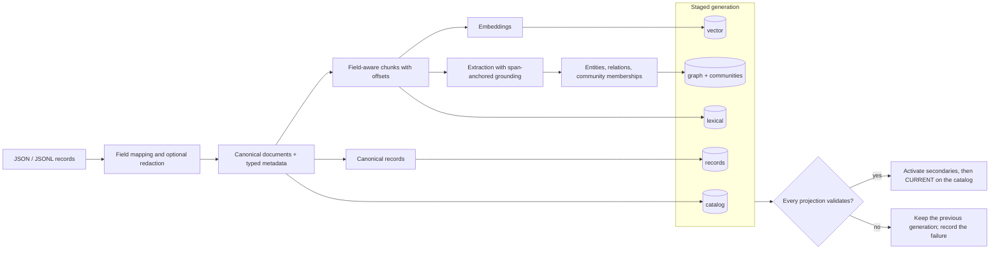
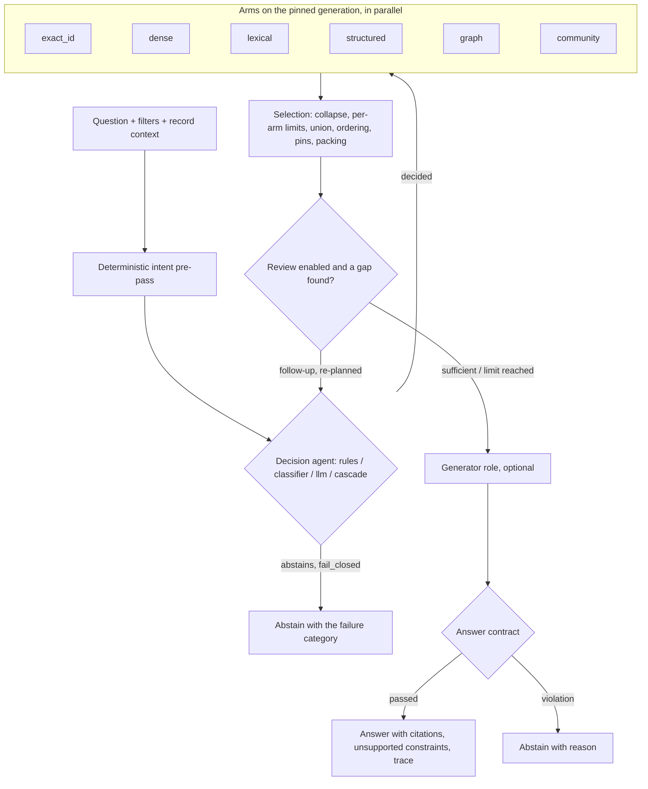

  

# su_multi_arm

**Configurable multi-arm retrieval with typed scope, span-level provenance and contract-checked answers.**

One question fans out into several retrieval **arms** — dense vectors, lexical full-text, structured
aggregates over typed metadata, a provenance-carrying entity graph, communities and exact-identifier
lookup — on the backends you choose. A decision agent plans the arms, a deterministic selection stage
merges their results, an optional review stage asks for what is missing, and an answer contract
refuses counts, exhaustive lists or absence claims that the evidence cannot back. Everything is
declared in one YAML file; nothing is imported by name from configuration.

!!! warning "Alpha (`2.0.0a2`)"
    Interfaces may still change. Relevance on real corpora has not been measured for v2 yet — see
    [Validation and honest status](#validation-and-honest-status).

!!! tip "Runs fully offline — no API key required for the quickstart"
    The example uses a local SQLite backend, hash embeddings and no chat model. Hash embeddings are a
    smoke-test device, not a semantic model.

## When to use it

- You need retrieval over **mixed evidence** (articles, tickets, records with metadata) where one
  ranking method misses what another finds, and you want to see which arm found each document.
- You need **exact, typed answers** to count / earliest / grouped questions next to narrative
  retrieval, and you want the system to abstain instead of guessing when a constraint is unsupported.
- You want to **move between backends** (SQLite locally; PostgreSQL, OpenSearch/Elasticsearch,
  MongoDB, Neo4j in production) without rewriting the pipeline, and trace every passage back to its
  field offsets.

## Choose your starting point

| Goal | Start here |
|---|---|
| Try it on a laptop in five minutes, offline | [Quickstart](quickstart.md) |
| Understand the request and ingestion paths | [How it works](#how-it-works) · [Architecture](ARCHITECTURE.md) |
| Write a configuration for your own corpus | [Configuration reference](CONFIGURATION.md) · [JSON schema](schema.md) |
| Pick databases and model providers | [Backends](backends.md) · [Providers](providers.md) |
| Serve it to an application or an agent | [Serving](serving.md) |
| Judge what is and is not proven | [Validation](VALIDATION.md) |

## How it works

**Write path** — one generation, projected to the backends the configuration selects:

**Request path** — decision, arms, selection, contract, review, answer:

## Validation and honest status

What is and is not proven is recorded, with dates and evidence levels, in [Validation](VALIDATION.md):

- **Relevance on real corpora is not yet measured for v2.** The example corpus is a six-document
  synthetic fixture; it shows that the pipeline runs, not that it ranks well.
- **Hosted model providers are contract-mocked.** No paid call has been made from this repository.
- **Database backends** marked "real-service conformance" pass their conformance suites against
  throwaway containers; this is behavioural conformance, not a scale or latency result.
- **The 2026-10-12 public-data diagnostics** (small development samples of two public QA datasets,
  local models, v1 runtime) found failures that the v2 work is designed to address; re-running those
  cohorts is Phase 4 of the [plan](plans/v2_implementation_plan.md).

## Roadmap

- **Phase 2** — harness depth: cache arm, guards, ACL hook, incremental ingestion with resume, release promote/rollback/GC.
- **Phase 3** — knowledge depth: ontology, entity resolution, more extractors, hierarchical communities, selection policies, quote verification.
- **Phase 4** — evaluation harness, learning proposals and public benchmark re-runs; the gate for any general-purpose claim.

Licensed under Apache-2.0. See [Contributing](contributing.md) for how to contribute and report
security issues.
