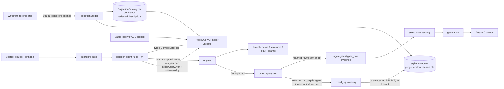

# Typed-column query route (`typed_query` arm) — design plan

Status: **design only, rev 2 (2026-11-08)**; nothing implemented; `<pkg>` = `su_multi_arm`. Code
references are to HEAD `c92dcf2` (V3.2 committed): `arms/{base,structured}.py`,
`decision/{base,llm,scope,qualifiers}.py`, `core/{types,config}.py`, `models.py`,
`backends/capabilities.py`, `runtime/acl.py`, `ingestion/{write,history,pins}.py`; docs
`ARCHITECTURE.md`, `VALIDATION.md`, `plans/nvidia_context_layer_lessons.md`. Private evaluation
artifacts were read only in the external workspace; only aggregates are recorded here.

## Changelog

| Date | Rev | Change |
|---|---|---|
| 2026-11-08 | 1 | Initial design (33 ed core). |
| 2026-11-08 | 2 | Adversarial review (REVISE) and external research incorporated. Added P-1 failure breakdown from stored artifacts (§2): no unsupported question failed for lack of joins; lookup+aggregate is the typed gap. Re-scoped to a ~14.5 ed MVP with a fresh-set gate (§7). Step-level failure policy moved first (M1). sqlite second layer is now per-tenant projection files plus a returned-row check (§5.7). ACL is bound at execution from `ArmInput.acl` and part of the executed fingerprint. Rows are cited as (document id, field, generation); spans are conditional. Exists/multi-join, postgres/RLS, repair default, SQL surface and catalog import moved to gated later phases. Mandatory reviewed column descriptions, reason-then-IR planning, answerability outcome, Looker-style fan-out rules and an Auto-Ontology-eval-style protocol adopted. Code references rebased (`LlmAgent`, `Decision.dropped_steps/fallback`, `UnsupportedReason` in `models.py`). Program estimate 43 ed. Review response in §12. |

## 1. Executive summary

**Problem.** On the frozen fresh set (12 questions, 13 gold groups) our V3.1 candidate executed
5/12 and reached 2/3/8 full/partial/absent group support; the native relational context layer
executed 10/12 with 9/2/2. On dev (development replay) the figures are 11/23, 6/5/10 vs 17/23,
13/3/5. Blinded preference favoured the native layer on 18 of 35 questions.

**What P-1 shows (§2).** Of our 19 unsupported questions, **none failed for lack of a join**:
10 were planner-invented structured scopes on non-aggregate questions (V3.2 now drops these;
unmeasured), 5 were planner schema violations, and the remaining 4 were a misbound qualifier, an
undeclared sortable field and two correct refusals. By needed shape, the questions where the native
layer won and we had *no* executable typed answer are **typed lookups of an identified record (5)
and single-table aggregates (3)**: we executed 0/8, the native layer 8/8. Native joins (9 of 27
executed queries) were almost all one relation, comment→ticket, used to assemble child rows; the
corpora carry that foreign key (all child rows resolve) but our typed schema does not declare it.
No question needed exists/not-exists or more than one join. Several native advantages are
**data binding** (undeclared parent key, raw organisation names, time roles), not query language.

**Recommendation.** Keep the compiled typed IR over a per-generation projection (no model SQL is
executed), **shrunk to what P-1 supports**: (1) **M1–M2, 3 ed, evaluable on fresh by day 3:**
step-level failure policy on the existing `ScopeSpec` path plus a measured V3.2 rerun; (2)
**M3–M7, 11.5 ed:** `typed_query` arm for single-table filter/lookup/aggregate plus one declared
`many_to_one` relation, sqlite projection with per-tenant files, ACL lowered from `ArmInput.acl` at
execution, mandatory reviewed column descriptions and grounded values, reason-then-IR planning
with an explicit answerability outcome; (3) **gate G1** on fresh, pre-registered, with hard safety
conditions (§7.2). Later phases run only on a go and their own trigger. MVP **14.5 ed** (0.5 done);
program **≈ 43 ed** (review estimated 40–45).

## 2. P-1 failure breakdown (aggregate, from stored artifacts)

Inputs (read-only, external workspace): V3 dev diagnosis, our V3.1 contexts/traces, native stored
contexts and SQL, V3.1 unblinded rating aggregates, frozen corpora. Each question was classified once
by the shape its answer needs (question + gold), by one reviewer; boundaries are ±1 question.

**Table A — needed query shape (dev 23 / fresh 12).**

| Needed shape | Dev | Fresh | Ours V3.1 executed dev/fresh | Native executed dev/fresh | Native preferred (35) | Native SQL shape used |
|---|---:|---:|---|---|---:|---|
| Filtered text retrieval, one kind or union, no join needed | 7 | 4 | 4 / 1 | 5 / 3 | 5 | single table, text `LIKE` + raw-name filter; 2 `UNION` |
| Retrieval + parent→child assembly (comment→ticket) | 4 | 3 | 4 / 3 | 4 / 3 | 4 | 6 join on parent key, 1 single table |
| **Typed lookup of an identified record's attributes** | 3 | 2 | **0 / 0** | 3 / 2 | 5 | single table, id or text predicate |
| **Single-table aggregate (group/count/sum)** | 2 | 1 | **0 / 0** | 2 / 1 | 3 | `GROUP BY` + `COUNT`/`SUM` |
| Cross-kind identity mapping | 1 | 0 | 1 / – | 1 / – | 1 | join on canonical customer key |
| Negative (scope, visibility, unanswerable: must refuse or limit) | 6 | 2 | 2 / 1 | 2 / 1 | 0 | 2 child joins, 1 fuzzy-name aggregate |
| **Total** | 23 | 12 | 11 / 5 | 17 / 10 | 18 | — |

No scope leak was detected for either system on the negatives. All 8 native errors were the same
sqlite syntax-error class (free-SQL fragility). Native SQL features over 27 executed queries: text
`LIKE` 19, raw organisation/tenant-name filter 17, event-time column 14, join 9, `GROUP BY` 4,
explicit tenant predicate 3 (isolation was physical, one database per view).

**Table B — our V3.1 unsupported reasons (19 = 12 dev + 7 fresh).**

| Reason (from traces) | Dev | Fresh | Shapes affected | Addressed by |
|---|---:|---:|---|---|
| Planner-invented structured scope on a non-aggregate question (often with prose read as a field qualifier) | 7 | 3 | lookup 4, retrieval 3, negative 3 | V3.2 drop + retrieval fallback (committed, unmeasured); lookups still need M5 |
| Planner reply violated the plan schema (validation paths not retained) | 2 | 3 | retrieval 3, lookup 1, aggregate 1 | schema repair (exists, was off); M1 measures |
| Requested aggregate, qualifier misbound | 1 | 0 | aggregate | V3.2 qualifier binding |
| Sort on a field not declared sortable | 0 | 1 | aggregate | config binding (M2) / typed arm |
| `last_seen` without a declared time basis (negative question) | 1 | 0 | negative | correct refusal; reviewed time roles |
| Out-of-scope id not observed (negative question) | 1 | 0 | negative | correct refusal |
| **Missing join / exists capability** | **0** | **0** | — | — |

**Table C — field roles in the frozen corpora (aggregate presence only).**

| Role | Dev (179 records, 5 kinds) | Fresh (48, 4 kinds) | Declared in V3.1 typed schema |
|---|---|---|---|
| Record kind | yes | yes | yes (`kind`) |
| Child→parent key (comment→ticket) | yes; every value resolves to a ticket document id | yes; every value resolves | **no** |
| Canonical customer key shared across kinds | yes (most records; all kinds) | yes | yes |
| Raw organisation / tenant display names | yes (unique mapping to canonical key) | yes | **no** |
| Native record id | yes | yes | yes (not sortable) |
| Event time with a declared role field | yes | yes | **no** (intentional: role ambiguity) |
| Capture time, environment (log kinds) | yes | yes | **no** |
| Status / module (tickets); service | yes | yes | yes |
| Numeric additive measure | yes (one kind) | no | yes |
| Literal spans for metadata values | **no** (only body excerpt offsets) | no | — |

**Implications.** (1) Build single-table lookup/aggregate first. (2) One declared `many_to_one`
relation covers every observed join except identity mapping, which must use the owner-approved
mapping, never a key or fuzzy join. (3) Exists/multi-join have no measured demand: defer. (4)
Declaring retained fields with reviewed meaning is a cheap, separable win. (5) Measure V3.2 first.

## 3. Options and the IR-vs-SQL question

| Option | Gains | Costs / risks | Decision |
|---|---|---|---|
| Extend `ScopeSpec` in place with joins | One path | Every `RecordStore` backend must join or refuse; frozen §3.5 contract change | Reject; reuse `Predicate`, `Measure`, `ValueResolver`, rendering |
| Compiled typed IR over a projection, planner emits IR | No parser surface; compile-time ACL/fan-out checks; typed errors | Models may emit JSON IR worse than SQL; no rigorous public head-to-head exists | **Adopt (MVP)**, with reason-then-emit |
| SQL over a *logical* schema, parsed (sqlglot) into the same IR, non-representable → refuse | Models are fluent in SQL; closest analogue is the logical-schema rewrite in commercial analysts | Parser-differential surface; dialect drift; still never executed as text | **Comparison arm L1**, same model, same questions |
| Free text-to-SQL executed directly | Reach | 8/35 native syntax errors; injection and ACL-proof burden | Reject |
| External relational catalog | Reviewed terms, FK inference, profiling | Separate authorization model; drift | Defer to L6 as proposal-to-config only |

Strict JSON output degrades reasoning; reasoning first recovers most of it: an untrusted `analysis`
field precedes the IR (M6). IR vs SQL surface is settled empirically by L1.

## 4. Target architecture



Boundaries: the decision agent plans and *validates*; the arm is authoritative for ACL and
execution; the projection is written only by ingestion and read only through read-only handles.

## 5. Module contracts

### 5.1 IR — `core/types_typed.py` (new)

```python
class ColumnRef(StrictModel):      table: str; column: str
class TypedPredicate(StrictModel): table: str; predicate: Predicate      # eq|in|range|date_interval|missing|negate
class TypedQueryDraft(StrictModel):     # grain = table counted/listed/looked up
    grain: str; join: str | None = None # MVP: at most one declared many_to_one relation
    where: list[TypedPredicate] = []; windows: list[TableWindow] = []
    text: TextMatch | None = None       # lexical id set, as StructuredArm.resolve_text
    measure: Measure | None = None; group_by: list[ColumnRef] = []      # group_by max 2
    order: Literal["desc","asc"] | None = None; top_n: int | None = None
    select: list[ColumnRef] = []; limit: int | None = None  # projectable columns; <= row_limit
class PlannedTypedStep(StrictModel):    # planner wire shape; property order is significant
    analysis: str                       # untrusted, <= 600 chars, traced masked, never compiled
    answerability: Literal["answerable", "partial", "not_answerable"]; gaps: list[str] = []
    query: TypedQueryDraft | None       # None iff not_answerable
class CompileError(StrictModel):        # typed feedback and trace record
    path: str; reason: UnsupportedReason; allowed: list[str] = []
class CompiledTypedQuery(StrictModel):  # fingerprint = sha256(IR, catalog fp, generation, acl_key)
    query: TypedQueryDraft; acl_key: str; filters_applied: list[TypedPredicate]
    fanout: Literal["none", "distinct_guarded"]; errors: list[CompileError]; fingerprint: str
```

MVP operations: lookup, list, count, count_distinct, sum/avg/min/max, first/last_seen (declared
`time_basis` only), group_count, rank, share. Absent: exists/not-exists (L3), >1 join (L3),
arithmetic, functions, `LIKE`/regex, unions, CTEs, window functions, self/cross joins, `HAVING`.
New `UnsupportedReason` values in `models.py` (additive Literal): `join_not_declared`,
`fanout_unsafe`, `filter_not_applicable`, `column_not_projectable`, `projection_unavailable`,
`result_truncated`, `planner_not_answerable`.

### 5.2 Projection — `projection/` (new; sqlite only in MVP)

| Module | Contract |
|---|---|
| `spec.py` | `ProjectionSpec`: tables keyed by `kind` value (key = document id), columns referencing `FieldSpec` names, relations `{from: t.c, to: t.id, cardinality: many_to_one}`. Validation: every measured table has the declared key (Looker rule: no PK, no measures); relation targets are keys; under `access.policy: tenant` every table has the access column; every planner-visible column has a reviewed description (§5.8). |
| `builder.py` | `ProjectionBuilder.add(gen, records)` called from `ingestion/write.py` step 3 on the same `StructuredRecord` batches written to `records`; `seal(gen) -> ProjectionManifest` (per-table rows, per-column rejected counts, dangling-FK counts, tenant list, fingerprint). Values coerced with `MetadataSchema.validate_value`; rejected → `NULL` + count. Under `access.policy: tenant` writes **one file per tenant value** plus an all-rows file for `unrestricted` principals; rows without an access value go only to the all-rows file. Not resumable in MVP (L4). |
| `catalog.py` | `ProjectionCatalog`: tables, columns (type, filterable/groupable/sortable/projectable, description, sample-value policy), relations with cardinality, manifest counts, fingerprint. |
| `store.py` | `SqliteProjectionStore.open(gen, grant) -> conn` with `mode=ro`, `PRAGMA query_only=1`, `set_authorizer` allowing only `SELECT`/`READ` on catalog tables/columns, progress-handler timeout, `row_limit + 1` fetch. |

Lifecycle (N3): `"projection"` joins `INCREMENTAL["rebuilt"]` (`ingestion/write.py:85`);
`delete_generation` (`write.py:380`) removes its files; pins/gc (`ingestion/pins.py`, `history.py`)
treat them as generation artifacts; upsert/delete/reparse yield a new generation and projection.
History/log-profile generations get none in MVP (`projection_unavailable`). Activation requires a
sealed manifest. Not its job: typing free text; metadata spans (none exist, Table C).

### 5.3 Compiler and lowering — `decision/typed_query.py`, `decision/typed_sql.py` (new)

`TypedQueryCompiler.compile(draft, request_filters, acl) -> CompiledTypedQuery`. Every failure is a
`CompileError`, never a silent repair: names exist in the catalog; `join` is declared; predicates
resolved by `ValueResolver` (unknown values are refused, never fuzzy-matched; high-cardinality
columns are grounded by literal lookup, not by samples); windows via `ValueResolver.window`;
request filters applied to every alias that has the column, else reachable from `grain` through
the `many_to_one` relation, else `filter_not_applicable`; contradiction with a request filter is
`invalid_step`; measures follow `ScopeCompiler._check_measure`.
**Fan-out rules (Looker-style):** measured tables must declare a key; relation cardinality is
declared, never inferred; a join from the "many" side to its parent is safe; any measure whose
grain is the "one" side with the "many" side joined becomes `count_distinct(grain.key)` and
`sum/avg` over the fanned side is `fanout_unsafe`; outer joins are not offered.
`typed_sql.lower(compiled) -> (sql, params)`: identifiers only from the catalog (dialect-quoted),
values only bound, text-match id sets via `json_each(?)`; deterministic; golden-tested.

### 5.4 Decision integration (`decision/llm.py`, `decision/base.py`)

- **M1 step-level failure policy (B5), independent of the projection.** `LlmConfig.on_step_failure:
  abstain | partial | retrieval_only` (default `abstain` = today, where `LlmAgent.attempt` raises
  on the first non-executable compile). `partial`: the step becomes `DroppedStep(reason=
  "step_not_executable")`, its constraints go to `Decision.unsupported`, other steps run.
  `retrieval_only`: structured steps dropped, the planner's retrieval steps run. Nothing left →
  existing `fallback="retrieval_after_dropped_steps"`. Invariants: aggregate intents of dropped
  steps stay unsupported; `AnswerContract` keeps the count/list/absence ban; caller-typed
  aggregates/scopes, disabled-arm and coherence errors still fail closed. `DroppedStep.reason`
  becomes `unsolicited_structured | step_not_executable | planner_not_answerable`.
- **M6 typed steps.** The capability-bound schema gains `arm: typed_query` with `PlannedTypedStep`;
  table/column/join names are catalog enums; absent when disabled. Payload adds reviewed column and
  relation descriptions and samples (§5.8). The decision compiles for validation only;
  `not_answerable` → `planner_not_answerable`; compile errors → `step_not_executable` under
  `partial`, else `DecisionFailure`. Repair (`repair_attempts: 0|1`, default 0) re-plans once with
  the typed errors as untrusted data and must keep every qualifier `qualifiers.py` detects.
  `rules` agent: single-table drafts for "<field> of <id>" and "how many <kind>" only.

### 5.5 Arm — `arms/typed_query.py` (new)

`TypedQueryArm(BaseArm)`, `capability = "relational"`. `_run`: **re-compile** the draft with
`inputs.acl` (authoritative; review B3) and recompute the fingerprint including `acl_key(inputs.acl)`
— a decision-time fingerprint is never trusted for execution; map the ACL to a projection file
(§5.7); resolve `text` like `StructuredArm.resolve_text`; execute; run the returned-row check;
build evidence. Trace: `typed_query_compiled`, `typed_query_executed` (fingerprint, file grant,
rows, elapsed, truncated). Session-tool exposure is deferred to L2 and must call the same `_run`.

### 5.6 Evidence and lineage (review B4)

| Result | Evidence | Citation / lineage |
|---|---|---|
| Aggregate | `aggregate_record` shape + `typed_query: {fingerprint, grain, join, canonical}` | ≤ 8 contributor document ids per group, matched total, generation, manifest id, truncation flags |
| Lookup / list | one `typed_row` per row: selected values, types, NULL/rejected marks | **(document id, field, generation)** per value; a span only if the `StructuredRecord` carries one (none do today); body passages keep their existing chunk spans |

Exactness `exact` only if every constraint compiled, ACL applied, no truncation and no in-scope
rejected value in a referenced column; else `bounded` with `missing_or_invalid`.

### 5.7 Safety model (reviews B2, B3)

| Threat | Control |
|---|---|
| Cross-tenant read | Layer 1: arm-lowered ACL predicate on every alias. Layer 2 (independent): the ACL selects the file — `[]` → all-rows file (policy `none` or an `unrestricted` principal), `[eq(field, v)]` → tenant file for `v` (tenant absent from the sealed manifest = zero rows; listed but missing file = error), `[in(field, [])]` → no file, empty result, any other shape → `projection_unavailable`. Layer 3 (row results): every returned row carries the access column and must equal the grant, else the result is discarded and `BackendError` raised; aggregates rely on layers 1–2. |
| Proof of layer 2 | Canary test runs with compiler ACL injection **disabled** via a test-only hook: zero canary rows and tenant-only aggregate totals over generated queries. |
| Stale plan; filter widening | Arm recompiles, fingerprint includes ACL/generation/catalog; request filters immutable, contradiction `invalid_step`, unreachable `filter_not_applicable` |
| Visibility (private notes via child join) | `visibility` is a column of each child table; request/view filters apply to the child alias; synthetic and fresh negatives must still refuse |
| Injection; exhaustion | No model text in SQL, catalog identifiers, bound values, no parser on the path; one join, `row_limit`, `timeout_ms`, `max_groups`, text-id cap |
| Silent degradation | every dropped step and failed constraint is recorded; no unrestricted fallback |

### 5.8 Column meaning and value grounding (research)

Every planner-visible column needs a reviewed `description` (new optional `FieldSpec.description`;
projection-level overrides) stating role, unit, timezone/time role and what it does *not* mean;
config validation refuses `projection.enabled` with an undescribed planner-visible column.
Low-cardinality columns expose ACL-scoped observed values under `max_catalog_cardinality`;
high-cardinality columns expose no samples and are grounded by `ValueResolver` literal lookup.
Descriptions and samples are untrusted planner data. Private descriptions may live in an overlay
outside the repository (open decision 4).

## 6. Configuration surface (all opt-in; defaults reproduce today)

```yaml
projection:
  enabled: false
  backend: proj_store                    # declared sqlite backend serving "relational"
  tables: {ticket: {kind: ticket, columns: [tenant, status, module, opened_at]},
           comment: {kind: comment, columns: [tenant, visibility, parent_id, created_at]}}
  relations: {comment_parent: {from: comment.parent_id, to: ticket.id, cardinality: many_to_one, description: "..."}}
pipeline:
  arms: {typed_query: {row_limit: 200, max_groups: 500, timeout_ms: 2000}}
  decision:
    llm: {on_step_failure: abstain}      # abstain | partial | retrieval_only (M1)
    typed_query: {enabled: false, repair_attempts: 0}
```

P0 edits (review N2): add `"relational"` to `Capability` (`backends/capabilities.py:25`);
add `typed_query` to `ALL_ARMS` (`decision/base.py:31`) and to the enabled-arm checks in
`core/config.py`; refuse the arm without `projection.enabled` or a backend declaring `relational`;
`FieldSpec.description`. `projection` enters the index recipe only when enabled.
`docs/config.schema.json` regenerated, `docs/CONFIGURATION.md` updated.

## 7. Phased delivery
### 7.1 MVP (14.5 ed)

| Id | Scope (files) | Tests | Acceptance | ed |
|---|---|---|---|---:|
| M0 | P-1 breakdown (§2) | — | Done in this revision | 0.5 |
| M1 | `on_step_failure` (`decision/llm.py`, `decision/base.py` `DroppedStep`), config, schema regen | contract with fake `JsonModel`: partial never yields an exact count for a dropped step; caller-typed aggregate still fails closed; trace lists every dropped step | unit/contract green; ruff; defaults byte-identical | 2 |
| M2 | Fresh eval #1 (external workspace): V3.1 control, V3.2, V3.2+`partial`, V3.2+schema repair; data-binding overlay (declare parent key, raw names, time roles with reviewed descriptions) as a separate condition | §8.2 | Report recorded in `docs/VALIDATION.md`; no gate | 1 |
| M3 | `core/types_typed.py`, `models.py` reasons, `Capability`, `ALL_ARMS`, config checks, `FieldSpec.description`, schema regen, ARCHITECTURE section | model/config validation | schema regenerated; recipe fingerprints unchanged when disabled | 1.5 |
| M4 | `projection/{spec,builder,catalog,store}.py`, WritePath hook, lifecycle hooks | coercion, rejects, dangling FK, per-tenant split, authorizer denies writes/unlisted columns, delete/reparse/gc | synthetic build deterministic; write attempt fails; delete removes files | 2.5 |
| M5 | `decision/typed_query.py`, `decision/typed_sql.py`, `arms/typed_query.py`, evidence | every refusal reason; golden SQL; fan-out cases; differential vs `StructuredArm` on single-table queries; canary with ACL injection disabled (hypothesis, ≥ 5k queries) | 100% single-table differential equality; zero canary rows; returned-row check fires on a planted bad row | 3.5 |
| M6 | planner schema/enums, descriptions+samples, `analysis`→IR, answerability, typed compile errors, repair flag | strict-schema conversion (both provider dialects); repair cannot drop qualifiers; `not_answerable` never yields counts | synthetic 30-question suite executes or refuses as frozen | 2 |
| M7 | Fresh eval #2 + gate report | §8.2 | G1 decided and recorded | 1.5 |

### 7.2 Gate G1 (pre-registered with the owner before M7 runs)

Fresh set, same planner and answerer models as V3.1, 3 repeated runs per condition:
- **Hard (any miss = no-go):** zero cross-tenant or visibility leaks (both negatives refused or
  limited in every run; canary clean); zero `AnswerContract` violations; no out-of-view ids.
- **Mechanism:** ≥ 2 of the 3 fresh lookup/aggregate questions execute with exact typed evidence
  that matches the hand-derived expected values in ≥ 2 of 3 runs (baseline 0/3).
- **Effect vs M2 best control:** fresh full groups ≥ 5/13 (V3.1 2/13; native 9/13) and fixed ≥
  2 × broke; any difference within the observed run-to-run range is reported as no effect.
- Dev is replay only (it shaped this design) and cannot satisfy the gate.
Go → later phases. No-go → keep M1/V3.2/binding gains, leave `typed_query` disabled; only L1 may
proceed, and only if traces show IR emission (not binding or retrieval) as the dominant failure.
At n = 12 this is a safety-and-mechanism gate, not an accuracy claim; L7 gives larger-n evidence.

### 7.3 Later phases (after G1 go; each has its own trigger)

| Id | Scope | Trigger | ed |
|---|---|---|---:|
| L1 | SQL-over-logical-schema comparison arm: sqlglot parse → `TypedQueryDraft`, non-representable → refuse; same model and questions as IR; parser fuzzing | G1 go, or no-go with IR-emission errors dominant | 3 |
| L2 | Compile repair evaluated and possibly default-on; session tool through the same arm `_run` | L1 or M7 shows compile errors recoverable | 3 |
| L3 | Grammar growth: exists/not-exists, 2 joins, rank/share over a join, distinct guard | a new question set shows the shape (none in P-1) | 4 |
| L4 | Projection hardening: streaming resumable builder, incremental reuse, history shards, conditional span side table | corpus > 1e5 records or history profile need | 4 |
| L5 | postgres store, `SELECT`-only role, RLS as an extra layer; sqlite parity suite | multi-process serving need (review N7) | 4 |
| L6 | `RelationalCatalog` proposals: column profiling, sample values, FK candidates, description drafts → reviewed YAML only | description authoring becomes the bottleneck | 4 |
| L7 | Public-benchmark evaluation (licence verified, external workspace): schema-only vs typed arm, same model | after L1 | 4 |
| — | Docs, release hardening | — | 2 |

Later total 28 ed; program ≈ 43 ed (≈ 9 calendar weeks for one engineer).

## 8. Test and evaluation strategy
### 8.1 Synthetic (repository: `tests/` and fixtures only)

Synthetic domain: four kinds, two tenants plus a canary, a child table with public/private
visibility, rejected values, a dangling FK, NULLs, a fan-out case, same-named columns across
tables, injection strings. 30 questions with frozen expected compile or refusal, mirroring Table A
shapes incl. negatives. Runs from `~/su_mutliarm_tests/<agent>/<run>` (pytest temp/cache there,
`PYTHONDONTWRITEBYTECODE=1`); CI uses its own temporary workspace.

### 8.2 Frozen fresh/dev evaluation (private, external workspace; Auto-Ontology-eval style)

- Same frozen inputs, tokenizer cap and blinded source-gold protocol as V3/V3.1; **same planner and
  answerer models in every arm**; arms differ only in the condition under test.
- Metrics: execution status; **execution accuracy** on lookup/aggregate questions against values
  hand-derived from frozen records (gold audited first); ordinal group support; per-question
  **fixed/broke lists** vs control; refusal correctness; leaks/contract violations/out-of-view ids = 0.
- **3 repeated runs** per condition with run-to-run range; headline withheld if > 5% of questions
  lack output; McNemar on fixed/broke, Wilcoxon on support, directional only at n = 12.
- Native results reused from stored artifacts. Paid calls only under an explicit owner budget;
  only sanitized aggregates go to `docs/VALIDATION.md`.

## 9. Traceability matrix

| Requirement | Module | Phase | Acceptance test |
|---|---|---|---|
| Degraded outcomes explicit, never widened | `on_step_failure`, `DroppedStep` | M1 | no exact count for dropped steps |
| Typed lookup/aggregate execute; one fan-out-safe relation | IR, projection, compiler, arm | M3–M5 | differential, fan-out and synthetic suites; G1 mechanism |
| No model SQL executed | `typed_sql.py`, authorizer | M5 | golden SQL; injection strings; write denial |
| ACL authoritative at execution, two layers; no stale-ACL reuse | arm, per-tenant files, row check, fingerprint | M4–M5 | canary with ACL injection off; reused plan under another principal |
| Column meaning reviewed, values grounded; reason then IR | §5.8, M6 schema | M3, M6 | undescribed column and unknown value refused; `not_answerable` path |
| Generation lifecycle; honest row citations | builder hooks, evidence | M4–M5 | delete/reparse/gc; `typed_row` cites (document id, field, generation) |
| Defaults unchanged; measured on fresh with noise | config, eval runner | M1–M7 | recipe fingerprints unchanged; G1 report with fixed/broke, 3-run range |

## 10. Risks

| Risk | Likelihood / impact | Mitigation |
|---|---|---|
| V3.2 + M1 already close most of the gap | Medium / positive | M2 measures first; G1 compares against the best control, not V3.1 |
| Models plan JSON IR worse than SQL | Medium / high | catalog enums, `analysis` first, typed errors; L1 comparison |
| Gap is data binding, not query language | High / medium | binding overlay measured as its own M2 condition |
| Column roles ambiguous (time, version, identity) | High / high | mandatory reviewed descriptions; undeclared roles stay refused |
| Fan-out wrong counts | Low (MVP one relation) / high | declared cardinality and key; refusal tests |
| ACL bug | Low / critical | arm-authoritative ACL, per-tenant files, row check, canary with layer 1 off |
| n = 12 cannot show an effect | High / medium | gate framed as safety + mechanism; L7 for larger n |
| Two paths diverge; estimates slip | Medium / medium | differential tests, open decision 3; MVP excludes exists, multi-join, resumable build, postgres |

## 11. Non-goals

Executing model-written SQL; expressions, UDFs, writes or DDL from the request path; undeclared,
inferred or fuzzy identity joins; cross-generation or cross-tenant queries; replacing
`StructuredArm` or `RecordStore`; non-sqlite projections before L5; invented metadata spans;
accuracy claims from synthetic fixtures, execution counts or a 12-question set.

## 12. Review response

| Id | Response |
|---|---|
| B1 | **Accepted.** P-1 done now (§2): 0/19 unsupported due to joins; lookup+aggregate is the gap; MVP re-scoped and exists/multi-join gated (L3). |
| B2 | **Accepted.** `set_authorizer` is table/column only. Second layer is per-tenant projection files selected from the ACL plus a returned-row check; canary runs with compiler ACL injection disabled (§5.7). |
| B3 | **Accepted.** The arm recompiles with `ArmInput.acl`; decision-time compile is validation only; executed fingerprint includes `acl_key` (§5.5). |
| B4 | **Accepted.** Rows cite (document id, field, generation); spans conditional; P-1 verified kind and the comment→parent key exist and resolve in both frozen corpora, but the key is undeclared (Table C). |
| B5 | **Accepted.** Step-level policy is M1 on the existing `ScopeSpec` path, measured on fresh in M2 before projection work. |
| N1, N6 | Accepted: rebased on `c92dcf2`; `LlmAgent`; `Decision.dropped_steps`/`fallback` reused. |
| N2, N3 | Accepted: `Capability`, `ALL_ARMS`, config arm checks in M3 (§6); lifecycle hooks in §5.2 with M4 tests. |
| N4, N5, N7 | Accepted: gate uses fresh 2/3/8 vs 9/2/2 and the M2 best control; MVP 14.5 ed, program ≈ 43 ed; postgres/RLS deferred to L5. |
| Research | Adopted: L1 IR-vs-SQL-surface comparison and reason-then-IR (M6); mandatory descriptions, samples and `ValueResolver` grounding (§5.8); typed compile errors and answerability (§5.1, §5.4); Looker fan-out rules (§5.3); same-model arms, execution accuracy, fixed/broke lists, repeated runs, gold audit (§8.2). Vendor accuracy claims are not used as evidence. |

## 13. Open decisions for the owner

1. Approve the MVP (14.5 ed), the G1 conditions (§7.2) and the paid-call budget for M2/M7.
2. Whether the M2 binding overlay (parent key, raw names, time roles) may be declared for the
   frozen views under the owner-approved identity mapping.
3. Long term: lower single-table `ScopeSpec` onto `TypedQuery` (one path) or keep both.
4. Whether reviewed column descriptions may live in a private overlay outside the repository.
5. Whether `partial` becomes the `llm` default after M2 (proposed: stays opt-in until G1).
6. Choice of public dataset for L7 (licence and provenance verified before download).
