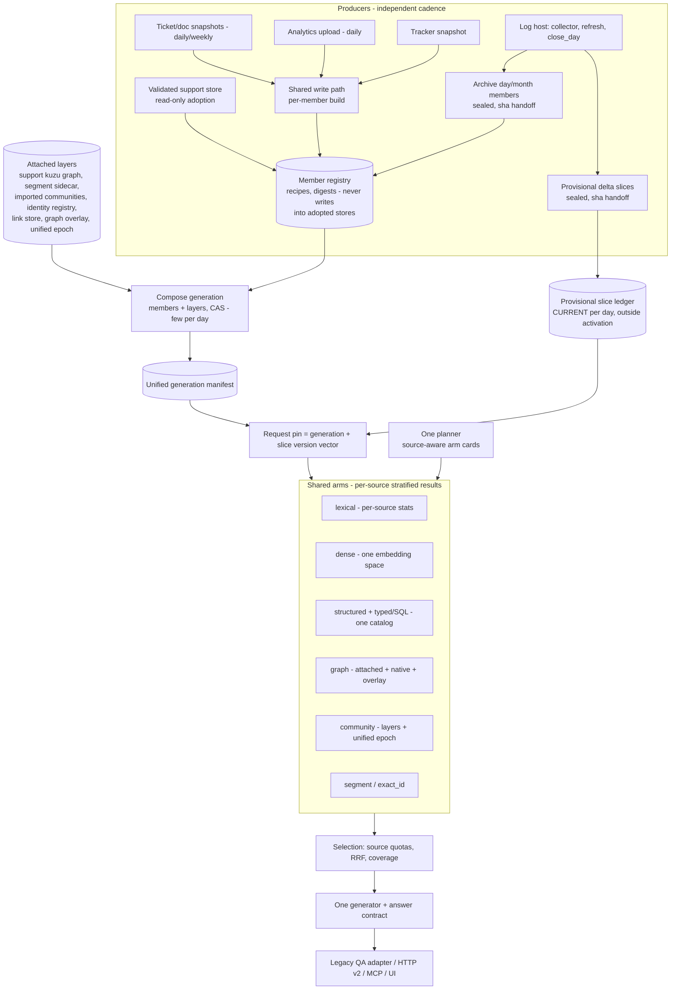

# Unified merge: one collection, shared arms, every SU source

Status: **design only, rev 3 (2026-11-09)**. Nothing here is implemented. `<pkg>` = `su_multi_arm`. This plan
implements the owner decisions of 2026-11-09 — *"all datasets should be merged"* and *every dataset is merged into
the same arms* — on top of [unified_su_platform.md](unified_su_platform.md) (U0–U7),
[unified_su_kg_phase1.md](unified_su_kg_phase1.md) (I0–I9, "phase K") and [typed_query_arm.md](typed_query_arm.md).
§16 states what it amends; §17 answers the rev 2 review. Public document: synthetic and neutral wording only.
Deployment names, hosts, ports, dataset ids, ledgers, the owner's acceptance questions and per-question results live
in the private notes of the external workspace (`~/su_mutliarm_tests/claude/unified-merge-20261109/`).

## 0. Changelog

| Date | Rev | Change |
|---|---|---|
| 2026-11-09 | 1 | Initial draft: collection registry + federated engine over separate engines. |
| 2026-11-09 | 2 | Owner instruction (binding): every dataset merged into the same arms. One collection with partitioned generations; standing onboarding procedure; increments re-planned. |
| 2026-11-09 | 3 | Adversarial review REVISE (B1–B8, 15 non-blocking) addressed (§17). M1 re-scoped as greenfield and split (M1a/M1b), M2 split (M2a/M2b); per-partition recipe decomposition and **read-only adoption** that never writes into the validated store (§6.2); **attached layers** contract keeping the attached graph, segment sidecar and imported communities (§6.4); lexical model = **per-source statistics with source-stratified pools** so support ordering is unchanged by construction (§6.5); live log path = **provisional delta slices outside generation activation**, caches keyed by partition, cost model with acceptance numbers (§6.7); new config surface under `collection:` with `schema_version: 3` (§7); worst-case spend check **warn by default** with a defined formula (§6.13); named graders and "zero unadjudicated correct→wrong flips" (§11); owner question paraphrases moved to private notes; fail-open/closed table, recipe epochs/offboarding, id uniqueness, retention, timezones, canonical units, SQL setup contract. Estimate ≈ 97 ed + 20 % contingency. |
| 2026-11-09 | 3.1 | Owner decisions: O2 resolved (unified answer cap **US$5/day**); "fix all 8 and merge" — implementation follows re-review. Added S0 (schema/seam skeleton) and §10.7 implementation readiness: file-level touch lists, test files per increment, parallel worktree lanes with an ownership/conflict matrix. M1a 12 → 11 ed (schema moved to S0); total 97.5 ed. |
| 2026-11-09 | 3.2 | Re-review REVISE (B9–B11, R1–R6, M0 items) addressed (§17.2): persistent **id directory** for routing and uniqueness, with an explicit **catalog-kind** policy for day-independent ids (§6.1); **query-time lexical statistics** over the pinned slices and members for the log source, superseded rows excluded (§6.5); slice retention (§6.7); backend-free original-recipe builder (§6.3); support member = one statistics/candidate unit with an equality test against today's engine (§6.5); separate `serving.question_timezone` (§6.11, §7); Sonnet-judge bias recorded (§11.2); W formula gains typed re-plan and community slots (§6.13); M0 adds `core/config_resilience.py` and S0 rebases on M0; minimal S0 seam; lane ownership reconciled with every touch list (§10.7). |
| 2026-11-09 | 3.3 | Final check: B12 — slices carry **tombstones** for documents that disappear from a day rebuild (gap-filling merges of episode/incident groups), marked `deleted_by` in the id directory and excluded like superseded rows (§6.7, §6.1, §6.5); F0 gap-filling merge fixtures; property test covers it. N1 CLI stub ownership in the shared table; N2 M4 guard touches only `sql_surface/*`; N3 new-rule catalog documents stay in slices until close, so catalog rebuilds add no activations (§6.1). |

## 1. Executive summary

**Owner goal.** One SU platform: support tickets, KB/docs, issue-tracker issues, log incidents (live last 3 days +
aggregated keyword history) and search analytics in **one collection** served through **one API, one MCP server and
one UI**, every source indexed by **the same arms** (dense, lexical, structured/SQL, graph, community, segment/typed),
one planner, one answer contract, cross-source answers.

**Today.** Two deployments, each one `Engine` over one dataset. On the owner's 7 acceptance questions (private) the
support side gave relevant but historical knowledge and no operational evidence; the log side answered none correctly
(per-request spend-cap refusals, generator truncations, a window defaulted to "today", ungrounded service/time terms,
no analytics source). Diagnosis in §2.3.

**Recommendation: one unified collection with partitioned generations (option C).** One `Engine`, one dataset, one
metadata schema with `source` as a declared field. A generation is a composition by reference of immutable
**member partitions** (support snapshot, docs, archived log days/months, analytics days, tracker snapshots) plus
**attached layers** (the validated support graph, segment sidecar, imported communities, identity registry, link
store, overlays). Fast-changing live log data is **not** composed into generations: it is served as **provisional
delta slices** pinned per request beside the generation, as phase K I1 already does for typed rows.

**What this costs, honestly (§4.3, B1).** Only the structured day kinds are composed by reference today. Partitioned
catalog, records, lexical, dense, projection, segment, exact_id, listing, value resolution and denominators are new
work; so are read-only adoption, attached layers and the live slice path. The plan therefore re-scopes the core into
M1a/M1b and the log member into M2a/M2b.

**Non-regression by construction.** Each arm returns **per-source stratified candidate lists** scored with each
source's own statistics; the adopted support store is served unmodified, so support-only questions read exactly the
indexes they read today, and mixed questions change only by declared source quotas, which QA100 measures. The gate is
**zero unadjudicated correct→wrong flips** on QA100, plus an exact ticket-source top-k identity check with log
members present.

**Identity and links.** Private versioned identity registry; the coordinator decides with recorded evidence (web
allowed); Sonnet reviews non-exact aliases and candidate links under the existing **US$10** ceiling; tiers A/B/C;
unreviewed candidates shown labelled.

**Every future dataset** follows the standing onboarding procedure (§8, D1–D11), including recipe epochs and
offboarding. The SU analytics upload is its first user (M7).

**Effort and value.** M0 (3.5 ed) fixes the log side's refusals and truncations in the current deployment. The
two-halves answer on the unified collection arrives at the end of M2b (≈ 47.5 ed sequential; ≈ 33 working days, about 7
calendar weeks, with the parallel lanes of §10.7). **Total ≈ 97.5 ed + 20 % contingency ≈ 117 ed.** Model spend: ≤ US$10 link/identity review
(approved) + ≈ US$45 evaluation (**owner approval needed**, O1).

## 2. Inputs read and current state

### 2.1 Sources read

Docs: `docs/ARCHITECTURE.md`, `docs/plans/unified_su_platform.md`, `docs/plans/unified_su_kg_phase1.md`,
`docs/plans/typed_query_arm.md`, `AGENTS.md`, the rev 2 review. Code: `engine.py` (`history_route`, `records_execute`,
`_route_sql`, `search`, `answer_stream`, `call_tool`), `ingestion/{write,generations,partitions,history,logs_compose,
episode_archive,episode_history,provisional,overlay,precomputed,relocate,pins,release}.py`, `backends/contracts.py`,
`backends/sqlite/{bm25,search,catalog,graph}.py`, `core/{config,config_logs,config_sources,types}.py`,
`compat/legacy_qa/{app,profile}.py`, `serving/{http,mcp}.py`, `sql_surface/{catalog,guard,executor}.py`,
`projection/store.py`, `decision/{typed_router,arm_cards,values}.py`, `runtime/{budget,acl,answers_spend,
issue_history,log_investigation}.py`, `communities/{shared_errors,imported}.py`, `providers/{base,anthropic}.py`.
Private, read-only: owner question set and its 2026-11-09 run, QA100 (37 SQL, 25 SQL+Graph, 14 SQL+Lexical, 24
other), live configurations and price table, log serve log and answer ledger.

### 2.2 What exists vs what the merge needs (corrected per B1)

| Capability | State today (code) | Needed |
|---|---|---|
| Compose-by-reference | **Structured day kinds only**: history H1/archive day shards are rows of a sqlite history store read by `records_execute` (`ingestion/history.py`, `engine.py` `history_route`). The log compose rebuilds the window with `WritePath.ingest(replace=True)` (`logs_compose.py`). | Partitioned catalog, records, lexical, dense, projection, segment and graph |
| Provisional data | I1: typed projection files per day version, pinned per request through `CURRENT.json`, outside generation activation (`provisional.py`) | Extend the same side channel to text/vector slices |
| One store per generation | sqlite catalog (`catalog_db(gen)`: documents/chunks for scope masks, `document_mask`, `get_document`, listing, exact_id, observed values, denominators), bm25 segment rebuilt from every chunk, `vectors.npy`/faiss, row maps and caches keyed by generation prefix, projection `open_readonly` of one file | Every facet partition-aware, caches keyed by partition |
| Fingerprint | One whole-config `index_fingerprint` (`write.py` `index_recipe`: dataset, chunking, privacy, extractor, embedder incl. precomputed identity, communities, backends, projection); `current()` refuses on mismatch; `index adopt` allows location-only differences and re-stamps manifests (`relocate.py`) | Per-partition recipe decomposition; read-only adoption |
| Attached stores | kuzu `mode: attach` graph excluded from placement (`generations.attached_read_only`); segment sidecar at an external path; imported communities from a pinned JSONL; one `communities.strategy` | Attached-layer contract; multiple community layers |
| `source` field, `selection.source_weights` | Exist in the support config | Shared schema; per-source quotas |
| `Config.sources` | Exists: read-only log sources (`elasticsearch_rest`) with their own `field_map` | New surface must not collide (B6) |
| Identity registry, links, cross-source communities | Designed only; alignment measured (36 of 56 observed log labels alignable, U-plan) | Implemented |
| Analytics / tracker data | Not located | Onboarded via §8 |

### 2.3 Acceptance set gaps and log-side findings

The owner's 7 questions are stored privately with per-question results. In aggregate: each needs a **knowledge half**
(tickets/docs) and an **operations half** (log signals for a service family over a window, optionally a customer and
an hour). Today's gaps: operations halves 0/7 correct; one question needs search-analytics rank/click data; two need
hour/window anchoring; three need service-term grounding; one asks whether a failure was "fixed automatically", which
needs an explicitly correlated success signal; one asks whether a recurring job "halted", which failure-keyword data
alone cannot establish.

| Log-side symptom | Diagnosis | Status of evidence |
|---|---|---|
| `429 budget exhausted (usd)` | per-request `Budget` cap (US$0.10, 3 calls) exceeded by cumulative per-call reservations of a strong-model planner + schema repair + generator; the daily answer ledger stood at ≈ 24 % | consistent with code (`runtime/budget.py` `reserve`, `serving/http.py`) and ledger |
| `502 Model provider request failed` | `ProviderIncomplete` at the generator: truncation at `max_tokens` **or** stream end before `message_stop` | which cause is not yet established; M0 records `stop_reason` first |
| Planner schema violations | free-form planner over many log intents | serve log |
| 503 on bounded selection | `incident selection was incomplete` refusal (`runtime/log_investigation.py`) | code + log |
| Empty window / wrong aggregate | window not defaulted to `default_view_days`; service and hour terms not grounded | answer notes |

## 3. Requirements

| Id | Requirement |
|---|---|
| R1 | One collection, one API/MCP/UI; the legacy dataset id serves it; legacy wire contracts unchanged |
| R2 | Same arms for every source; `source` is a field/facet; interim coverage per increment declared (§12) |
| R3 | Per-source cadence (minutes for live logs, daily tickets/analytics, weekly docs) without rebuilding other sources |
| R4 | Per-partition recipe contract; incompatible partitions refused; declared epochs allowed |
| R5 | Failure of one member never blocks others; stale/missing members and layers labelled; fail-open/closed declared (§6.12) |
| R6 | Identity registry: coordinator-decided with evidence, Sonnet review of non-exact entries, versioned, reported with denominators |
| R7 | Cross-source links with tiers, statuses, review (≤ US$10 shared with R6), labelled display |
| R8 | One SQL catalog over all members plus identity/link tables; pinned; enforced join allowlist; units; ACL |
| R9 | One KG schema across attached and native graphs; issue families spanning tickets and incidents; membership ≠ cause |
| R10 | Live 3 days + history with provisional/partial/gap flags; no double counting across tiers or slices |
| R11 | One planner, one generator, one budget/deadline/trace; worst-case spend check (warn by default); explicit retry/degrade policies |
| R12 | Standing onboarding and offboarding procedure (§8) |
| R13 | Acceptance with named graders: owner set (both halves) and QA100 with zero unadjudicated correct→wrong flips; latency/cost reported |
| R14 | Validated support store served unmodified; existing configs load with identical fingerprints |
| R15 | Public hygiene: synthetic fixtures; private registry, links, corpora, questions and results outside the repository |

## 4. Merge model

### 4.1 Options

| Criterion | A. Separate engines + federator | B. One collection, monolithic generation | **C. One collection, partitioned generation + live slices (recommended)** |
|---|---|---|---|
| Same arms over all sources (owner rule) | No | Yes | Yes |
| Per-source cadence | Yes | No | Yes (members recomposed; live data in slices) |
| Validated support store unmodified | Yes | No (rebuild) | Yes (read-only adoption) |
| Support ranking unaffected by log volume | Yes | No | Yes (per-source statistics, stratified pools) |
| Cross-source SQL/graph | Mirrors needed | Native | Native over members + layers |
| Effort | Lowest | High rebuild, poor freshness | Highest initially (greenfield partition facets) |

### 4.2 Decision

**C**, required by the owner rule and the only option that also keeps the validated support build unmodified and
lets live logs refresh in minutes. It builds on two real precedents — structured day shards composed by reference and
I1's per-request provisional side channel — and extends them to every facet. That extension is new work (B1) and is
estimated as such.

### 4.3 Blocking problems and mitigations

| # | Problem | Mitigation | Where |
|---|---|---|---|
| P1 | Embedders differ (logs: small English model; support: BGE-M3 via an imported matrix) | One **embedding space** contract (§6.2): BGE-M3 identity + declared input template; log texts re-embedded online; precomputed ↔ online equivalence by verify-sample cosine | M1a, M2a |
| P2 | Generations are one store; minute refresh cannot recompose | Members for slow data; **provisional slices outside activation** for live logs (§6.7); caches keyed by partition | M1a, M2a |
| P3 | Global BM25 statistics would reorder support results | **Per-source statistics + stratified pools** (§6.5) | M1a |
| P4 | Data on two hosts | Log host is a producer: sealed member/slice handoff, sha verified | M2a |
| P5 | Failure isolation | Last good member/slice kept, labelled stale; fail-open/closed table (§6.12) | M1a, M2b |
| P6 | Planner catalog size | Source-aware arm cards, typed router, compact schema, labelled deterministic fallback plan | M2b |
| P7 | Volume dominance | Stratified pools + `collection.selection.source_quotas` | M1a |
| P8 | Graph/community rebuild cost, attached stores | Attached-layer contract (§6.4); native partition graph edges for log members; weekly unified epoch | M1b, M5, M6 |
| P9 | Regression of the validated support build | Read-only adoption (§6.3); QA100 gate on the adopted member before logs join | M1b |
| P10 | ACL across sources | `source`/visibility in every scope predicate; operator-only phase | M1a |
| P11 | Whole-config fingerprint refuses any unified config | Recipe decomposition (§6.2); non-partitioned configs keep today's fingerprint (golden tests) | M1a |
| P12 | Vector disk and embedding throughput for live chunks | Embed selected kinds/fields only, text-hash dedupe, float16; cost model §6.7 | M2a |

## 5. Target architecture



Generation activations are few per day (archive close, ticket/analytics daily, docs weekly, layer epochs). Live log
refreshes add slices to the ledger and never activate a generation.

## 6. Module contracts

Partitioned mode is opt-in under `schema_version: 3` and `collection.mode: partitioned` (§7). Configs without it load
and fingerprint exactly as today.

### 6.1 Members and partitions — `ingestion/members.py` (new)

```python
class MemberRef(StrictModel):
    member: str                         # declared member id: "support", "ticket", "doc", "logs", "analytics", "tracker"
    key: str                            # "adopted:<digest>", "snapshot:2026-11-09", "day:2026-11-08", "month:2026-10"
    partition_id: str                   # sha over document ids + content + partition recipe
    recipe: PartitionRecipe             # §6.2
    tier: Literal["adopted", "snapshot", "archive", "partial"]
    as_of: datetime
    counts: dict[str, int]              # per kind
    stats: dict[str, Any]               # per-source lexical stats ref (§6.5)
    facets: dict[str, FacetLocation]    # catalog, records, lexical, vector, projection, graph -> backend location
    digests: dict[str, str]             # sha256 of every backing file / directory listing
```

- `build(member, key, documents) -> MemberRef` (shared write path writing **into a member-scoped location**, staged
  and validated as today); `adopt(...)` (§6.3); `retire(ref)`; `gc(referenced)` (never an archive member while the
  storage ceiling allows; §6.10).
- **Facet contracts (B1).** Each sqlite facet gains a partition-set read; the engine paths that assume one catalog per
  generation get these contracts:

| Path | Partition contract |
|---|---|
| scope mask / `document_mask` | evaluated per member against its catalog; members outside the request's `source`/time scope are not opened |
| `get_document`, `/source`, exact_id | id → unit through the **id directory** (below), then that unit's catalog; unresolvable → not found (never a scan of all members). Log ids are hashes with no day component, so routing never parses ids |
| listing / `search_page` | per-member pages merged by the declared sort key with a k-way merge; cursor = per-member offsets |
| `ValueResolver` observed values | union of per-member observed values under ACL, capped as today |
| denominators / counts (`canonical_unit`) | per-member counts summed; **canonical unit per kind** (`ticket`, `doc`, `episode`, `search`, `issue`); counts of different units never summed |
| records / structured | per-member execution, merged by the shared `scope_result` semantics (as `records_execute` merges shards today) |
| lexical | §6.5 |
| dense | per-member flat index; per-source stratified exact top-k (exact only with flat indexes) |
| projection / SQL | §6.8 |
| segment | attached layer (support) or member facet (others); §6.4 |
| graph / community | §6.4, §6.9 |
| caches (bm25 segment, faiss, row maps, catalog stamps, SQL catalog fingerprints) | keyed by `partition_id`/slice id, never by generation, so composing a generation warms nothing that did not change |

- **Id directory — `ingestion/id_directory.py` (new, B9).** A persistent sqlite table `(doc_id, kind, unit_id,
  unit_kind ∈ {member, slice}, day, version, superseded_by, deleted_by, catalog_provisional)` maintained **incrementally**: rows are inserted when a
  member is registered or a slice is sealed, and marked superseded/retired on compaction, close and member retirement
  (cost O(documents of the new unit), never O(collection)). A pinned view resolves an id with one indexed lookup filtered
  to the pinned unit set. The same table enforces uniqueness at registration time.
- **Catalog kinds (B9).** Kinds whose ids do not depend on the day — today `signature` (`logs:signature:<sha(rule)>`,
  emitted by every day's summary documents) and any kind a member declares in `catalog_kinds` — are **excluded from
  day members** and live in one **catalog member per source** (`key: catalog`), rebuilt **only at close** with
  **latest-wins** by id; its previous version is retired by the same compose. A rule first seen on a provisional day has
  its catalog document carried **in that day's slice** (marked `catalog_provisional` in the id directory, exempt from
  the cross-day uniqueness check, superseded by the catalog member at close); all other catalog documents are excluded
  from slices. The catalog member therefore adds no generation activation beyond the daily close (≤ 6/day holds, N3). Day-scoped evidence of a catalog document (per-day counts, exemplars) stays in day kinds (`signature_day`,
  `episode_cell`), which carry the day.
- **Invariants.** Non-catalog document ids are unique across all members and slices of a pinned view (checked through
  the id directory at registration; a duplicate is refused, except a slice superseding an earlier version of the same
  day, which is recorded as `superseded_by`); catalog-kind ids are unique per source catalog member; tier rule: a log
  day is in exactly one of archive/partial or provisional; legacy id formats kept (`ticket:{n}`, doc URLs) so `/source`
  links survive. Episode/incident ids that continue across midnight are distinct pieces per day (`continues_id`, I1),
  so they do not collide.

### 6.2 Recipe and fingerprint contract — `ingestion/recipes.py` (new) (B2)

Today's `index_recipe` is decomposed; non-partitioned configs keep calling the unchanged function (golden tests).

| Component | Contents | Equality rule |
|---|---|---|
| **Collection recipe** | `index_format`, partition protocol version, embedding-space id, member list with namespaces, schema version | equal for every generation of the collection; the only part compared with the unified config at `current()` |
| **Embedding space** | model identity (name/revision/dims/normalization), declared input template id (title + field + chunk text order) | **equal across all members** read by the dense arm. A precomputed member is equivalent when (a) its declared template equals the online template and (b) a verify sample (n ≥ 200 chunks, stratified by kind) re-embedded online has mean cosine ≥ 0.995 and min ≥ 0.98; result stored in the member registry |
| **Lexical analyzer** | engine (`bm25`), tokenizer, k1/b/epsilon | equal **within a source** (statistics are per source, §6.5); may differ between sources; `fts5` refused for new members, adopted members keep their engine |
| **Chunking** | size/overlap/field order/line recipe per kind | per member, recorded |
| **Privacy** | privacy recipe per source | per member, recorded; masking rules per source |
| **Content recipe** | extractor fingerprint per source, keyword-policy epoch (logs), attach digests | may vary by member and by **epoch**: archived log members keep their keyword epoch; answers spanning epochs say so (existing archive behaviour) |
| **Projection schema** | tables/columns per member | additive per member; catalog fingerprint covers the union |
| **Layer recipes** | attached graph digest + mapping, segment sidecar digest, community layer digests, registry/link/overlay versions | pinned per generation |

- **Member fingerprint** = hash(embedding space, analyzer, chunking, privacy, content recipe, projection part).
- **Unified fingerprint** = hash(collection recipe, sorted member fingerprints, layer recipes) — recorded in the
  unified manifest. `current()` in partitioned mode compares only the **collection recipe** with the config and
  verifies member digests; it never recomputes an adopted member's fingerprint from the unified config.
- **Embedder upgrade** = new embedding-space **epoch**: old members refused by the dense arm until re-embedded (§8 D11);
  lexical/records of old members keep serving and coverage says "dense: not covered for epoch X".

### 6.3 Read-only adoption — `ingestion/adopt_member.py` (new) (B2, P9)

- `adopt(store_root, original_config: Path, original_config_sha256) -> MemberRef`: recomputes the store's
  **original** whole-config fingerprint with a **backend-free `recipe_of(config)`** (new, `ingestion/recipes.py`):
  it derives the extractor fingerprint and projection recipe from the configuration alone, without constructing a
  `WritePath`, opening a backend or touching the adopted path (today's `index_recipe(config=…)` borrows the extractor
  and projection spec from the instance). A golden test proves `recipe_of(cfg) == WritePath(cfg).index_recipe()` on the
  v2 fixtures. The result is checked against the store's own manifest; records file digests (catalog, records, bm25 arrays, vectors, projection files,
  segment sidecar manifest, attached graph directory listing) and the decomposed recipe **in the unified member
  registry** (a separate directory). It opens every file read-only (`sqlite` URI `mode=ro`) and **never writes,
  re-stamps or relocates** the adopted store (unlike `index adopt`).
- At serve time a digest mismatch makes the member `unavailable` (fail closed for that member, §6.12).
- The adopted support member keeps its own lexical engine, statistics, precomputed vectors and projection file.

### 6.4 Attached layers — `ingestion/layers.py` (new) (B3)

- A layer is a read-only store outside the write path, pinned by digest in the unified manifest, declaring the
  **sources it covers** and the arm(s) it serves: `graph_attach` (the existing kuzu attach + mapping, covers
  ticket/doc), `segment_sidecar` (covers ticket), `communities_imported` (covers ticket/doc),
  `communities_shared_errors` (log members' per-day shared-error communities), `communities_unified` (M6),
  `identity`, `links`, `graph_overlay` (M5).
- Attached layers are **exempt** from the "non-sqlite backends refuse partitioned generations" rule; that rule
  applies only to write-path facets of new members.
- Arms read layers and member facets together and report per-source coverage. Graph traversal over several stores
  (attached kuzu + native member graph + overlay) stitches only on declared shared node ids (`ticket:{n}`,
  `customer:…`, `family:…`).
- **Communities config change.** `communities.layers: list[CommunityLayer]` (schema v3), each `{strategy: imported |
  declared | shared_errors | unified_epoch, sources, …}`; the single `communities.strategy` keeps working for v2
  configs; the schema is regenerated and the existing recipe golden values hold for v2.

### 6.5 Lexical statistics model — `arms/lexical.py`, `backends/sqlite/bm25.py` (B4)

- **Decision: per-stratum statistics with stratified pools; no global statistics.** A **stratum** is the unit that
  owns one statistics set and one candidate list.
  - **Support stratum = the adopted support member (R1).** Ticket and doc stay **one** list with today's shared idf,
    today's candidate count and today's `source_weights`; the stratum is never split by the `source` field value, which
    would change today's combined candidate list. Its scoring code path is today's, reading today's files.
  - **Log stratum = the pinned log view** (catalog member, archive members in the requested range, pinned slices). It
    uses **query-time statistics** (B10): `N` and token totals summed from the unit manifests minus superseded and
    tombstoned rows (each slice manifest records the counts of the rows it supersedes or tombstones); `df` computed for the **query terms only** by
    summing per-unit postings-list lengths and subtracting the superseded and tombstoned rows' contributions (from the id directory's
    `superseded_by`/`deleted_by` and each unit's per-row term counts); idf recomputed per query term with the same BM25Okapi formula;
    the epsilon floor uses a per-source `average_idf` maintained at compaction and close (a **declared approximation**:
    it lags by at most one compaction period); superseded and tombstoned rows are excluded from candidates. Cost O(query terms × pinned
    units).
  - **Archive months** of the log source may use per-member statistics fused by RRF (`member_rrf`) only if the M2a
    bound on query-time df over the requested range is exceeded; never for live slices.
  - New sources (analytics, tracker) are one stratum each, with query-time statistics over their members.
- The arm returns a ranked list **per stratum** (`k` each, from the request's per-stratum candidate budget); scores are
  never compared across strata; selection fuses strata by RRF under `source_quotas`.
- **Equivalence tests.** (1) Support stratum on the unified engine vs **today's monolithic engine on the adopted
  store**: identical lexical and dense candidate lists (ids, order, scores) for every QA100 query. (2) Log stratum:
  ranking over N slices + base on fixtures **equals** the ranking over the one compacted day base built from the same
  final documents (exact ids and order; scores within 1e-9), except for the declared epsilon-floor lag, which the
  fixture exercises separately.
- **Guarantee.** For any query, the support source's lexical ranking is **identical** with and without log members
  present (same files, same statistics). Test: exact equality of ticket/doc lexical top-k (ids and order) for every
  QA100 query with log members present vs absent. Dense gets the same per-source stratification and the same test.
- When the planner scopes a step to support sources only, log members and slices are not opened.
- Click-qrels gate: once analytics is onboarded (M7), doc ranking for queries with click qrels (nDCG@10, recall@10) is
  measured with and without log members; required: no decrease beyond run-to-run noise (identical by construction for
  support-scoped steps).

### 6.6 Live-window semantics — log member (R10)

Live window (last `default_view_days` = 3, all unclosed days are provisional under I1) is served from slices; closed
days from archive members; every day in exactly one tier; archive wins. Live incidents, episode cells, shared errors
and `unclassified_example` keep their current behaviour as documents of slices/members.

### 6.7 Live log path: provisional delta slices — `ingestion/log_slices.py` (new) (B5)

- **Model.** Each refresh produces a **delta slice** for each changed day: the documents whose content changed since
  the previous slice (new episodes, updated counts), with a supersede list (latest version per document id wins across
  slices of the day) and a **tombstone list** (B12): ids present in the day's earlier slices but absent from the new
  full-day build — e.g. late lines fill a gap and merge two episode or incident groups (the ≤ 300 s merge in
  `ingestion/episode_summaries.py`), so the later group's id vanishes. The list is computed at sealing as the diff
  between the new day build's ids and the id directory's live ids for that day; tombstoned ids are marked `deleted_by`
  and excluded from candidates, records, counts and statistics exactly like superseded rows (§6.5), so an older slice
  never serves a vanished document (no double counting, R10). A slice is sealed (records rows, a small bm25 segment over its chunks, vectors for new unique
  texts, typed projection rows) and registered in the day's **slice ledger** (`CURRENT.json`, I1 mechanism) — **no
  generation activation**.
- **Compaction.** Background, never on the request path: 5-minute slices of the current hour → one hourly slice;
  every 6 hours the day's slices → one **day base** slice; `close_day` → archive day member (slices retired after the
  generation that includes the archive member is active and no pin holds them); closed days → monthly archive members
  with unique-text dedupe (replaces phase K's month segments, §16).
- **Request pin** = generation id + slice version vector `{day: [slice ids]}` read once per request; bounded per day to
  1 base + ≤ 6 hourly + ≤ 12 five-minute slices (≤ 19 units/day; ≤ 76 for a 4-day provisional window).
- **Caches** keyed by slice id; a new slice warms only itself.
- **Slice retention (R3).** A retired slice (compacted, superseded by a day base or replaced by an archive member) is
  deleted only when (a) no **slice pin** holds it — `ingestion/pins.py` gains slice-level pins taken by the request pin
  and by sessions for their lifetime — and (b) it is older than `collection.slices.gc_grace_seconds` (default 3,600,
  matching today's provisional grace and ≥ the request deadline). Archive members never depend on slices.
- **Embedding.** Only declared kinds/fields are embedded (incident/episode summary text and masked unique text that
  the retention invariant allows, §6.10); vectors stored float16 in a **text-hash vector store** for the log source
  (new; today reuse is ledger-based inside the write path); a slice is servable for lexical/records/projection before
  its vectors finish (coverage `dense: pending` for that slice).
- **Cost model and acceptance numbers (benchmarked in M2a on a synthetic 600k-chunk day in the external workspace,
  then on real data):**

| Quantity | Target | Basis / note |
|---|---|---|
| Refresh-to-servable (lexical/records) | p95 ≤ 5 min after the collector's refresh | slice of ≤ 5k changed documents; bm25 builder over the slice only |
| Refresh-to-servable (dense) | p95 ≤ 15 min | embedding throughput below |
| Generations activated per day | ≤ 6 | archive close, ticket, analytics, layer epochs |
| Compose time | ≤ 10 s | references only |
| First request after a new slice | ≤ +1 s p95 vs warm | slice-keyed caches |
| Live-window lexical + dense over ≤ 76 units | ≤ 3 s p95 | parallel per unit |
| Vector disk, live | ≤ 0.5 GB/day after dedupe (float16, 2 KB/vector, ≤ 250k unique embedded texts/day) | worst case without dedupe: 600k chunks × 4 KB = 2.4 GB/day float32 — refused by config unless the storage ceiling allows |
| Embedding throughput | GPU: ≥ 300 texts/s; CPU: ≥ 30 texts/s measured | the live embedder runs on CPU today; GPU for the log member is an owner decision (O4) |
| Slice GC | slices retired within one day after archive close | slice pins (below) |

### 6.8 One SQL surface — `projection/`, `sql_surface/` (extensions; NB3)

- **Setup contract.** The executor opens a fresh connection per request, `ATTACH`es the pinned member projection
  files, slice projection files, registry and link files read-only, creates **TEMP views** with bare names
  (`ticket`, `doc`, `tracker_issue`, `episode`, `issue_day`, `coverage_day`, `search_query_day`, `search_click`,
  `customer`, `customer_alias`, `link`) — all **before** installing the SELECT/READ authorizer. Model SQL remains
  unable to `ATTACH`, `CREATE`, `UNION` or write (guard unchanged; tests assert it).
- **Pins** injected on every view (member set, slice vector, `history_seq`, `registry_version`, `link_version`).
- **Join allowlist enforcement (new):** every `ON` conjunct must be an equality between a declared relation pair
  (`ticket.customer_id → customer.customer_id`, `issue_day.customer_id → customer.customer_id`, `link.subject_id →
  ticket.doc_id`, `link.object_id → episode.doc_id`, `search_click.doc_id → doc.doc_id`, …) or the query is refused
  with `join_not_declared`; today relations are only shown.
- **Units** declared per measure column; mixed-unit arithmetic refused post-parse.
- Implements phase K I4 once.

### 6.9 Identity, links, graph, communities

- **Identity registry** — `crosssource/identity.py`: tables `customer`, `alias` (namespace, verbatim raw value,
  normalized, `customer_id`, status `matched | candidate | contested | ambiguous | excluded | unmatched | missing`,
  rule, authority, confidence, evidence ids, effective dates, version), `evidence` (web/source field/curated list;
  URL, retrieval date, quote — private), `review` (model, verdict, rationale, cited fields, usd), `registry_version`.
  Deterministic candidates (exact, casefold, environment-suffix stripping as candidate only, curated aliases, token-set
  Jaccard ≥ 0.6); only exact/casefold unique auto-match (owner rule); the coordinator decides the rest with evidence
  (web allowed); Sonnet reviews every non-exact match; `refutes` → `contested` (no joins, owner queue). Only `matched`
  materializes `customer_id`, at query time through the pinned registry version (no member rebuild). Reports per
  namespace with denominators. Identity never grants access.
  **Owner rule change (2026-11-10): fuzzy matches count as matched.** `crosssource.identity.auto_match: fuzzy` (default
  `exact`, today's rule) makes the pinned view also join a `candidate` alias resolved to one customer with confidence
  ≥ `fuzzy_min_confidence` (default 0.8): a fuzzy classifier hit (token-set Jaccard, curated 0.9) or a coordinator
  `match` decision still awaiting review; it joins with rule `fuzzy:<rule>` (`identity describe` counts them).
  `excluded`, `unmatched`, `contested` and `ambiguous` aliases never join, so a coordinator or owner decision is never
  overridden; the registry rows and their digest are unchanged (the option is read at serving time). A deterministic
  environment-suffix candidate (confidence 0.6) stays below the default threshold and joins through a decision.
- **Links** — `crosssource/links/`: tiers per pair as in rev 2 (ticket↔episode A explicit id / B matched customer +
  `[first − 1 d, last + 7 d]` + signature mention / C similarity; ticket↔family B mention; ticket↔doc A/B/C;
  family↔doc B/C; analytics query↔doc A clicks; query↔ticket B/C). Store with statuses `accepted | candidate |
  model_accepted | model_rejected | human_accepted | human_rejected | contested`, builder/registry versions, member
  ids. Review: Sonnet, worst-case reservation per call on a persistent ledger; **cumulative ceiling US$10 shared with
  identity review**, the approved figure recorded with an approval reference in the ledger at first use and never
  raised by a config edit alone (NB15). Display: candidates labelled, rejected hidden.
- **Graph** — one KG schema (node types `customer`, `tenant`, `organization`, `service`, `component`,
  `issue_family`, `episode`, `ticket`, `doc`, `tracker_issue`, `search_query`, `day`; edge kinds `identity_mapped`,
  `explicit_ref`, `rule_derived`, `candidate_link`, `membership`, `native_scope`, `clicked`, with provenance, status,
  member/layer version, valid day range). Stores: the attached support kuzu graph **kept as a layer** (not migrated);
  native graph facets of new members; a sqlite **overlay** for identity/link edges; traversal stitches on declared node
  ids; conformance kit `tests/conformance/test_traversal_templates.py` per store and for the stitched templates.
- **Communities** — layers (§6.4); `communities_unified` weekly epoch seeded from log rule families and support
  ticket groups joined through accepted/model-accepted links; limits, stale epochs labelled, scoped stats, extractive
  summaries only, membership ≠ cause.

### 6.10 Retention, storage ceiling and text (NB4)

- The retention invariant stays: log-line text fields (`LINE_TEXT_FIELDS`) are never embedded. Embedded log text =
  episode/incident **summary** fields and masked texts that are not log-line text by that definition; each kind/field
  is declared in the member's `embed_fields` and checked at config load.
- Masked exemplar text is kept (owner decision: full text) in the content-addressed text store and searchable
  **lexically**; vectors exist only for allowed fields.
- Archive members are never GC'd while within the storage ceiling (phase K O1); above it the operator must choose
  (int8 vectors, older months lexical-only, cold storage) — never silent deletion; coverage reports what is not
  covered.

### 6.11 Planner and serving

- One planner with source-aware arm cards (sources, fields, units, time roles, window defaults); steps carry `source`
  scopes. Deterministic grounding: vocabulary file for surface terms; outage/presence shapes default to
  `default_view_days`; hours without a date are interpreted in the **question clock** (§7: a separate setting
  `serving.question_timezone`; `serving.ui.display_timezone` keeps its display-only meaning and is not repurposed;
  validated at load even when the UI is disabled, so the legacy adapter path has it; partition dates never change;
  the log partition clock stays a data property and is stated in answers), 12-hour ambiguity expanded and stated; customer text through the registry (matched only) or a limitation.
- Schema violation → one repair within budget → a **deterministic fallback plan**, labelled in the answer
  (`limitations`) and the trace (`decision.fallback: deterministic_plan`).
- Legacy adapter: the default dataset id serves the unified config; routes unchanged; additive envelope keys
  `coverage` (per source: members, slices, as-of, stale, provisional/partial days, gaps, layers, unmatched identities)
  and per-citation `source`, `link_status`. Staging first; rollback = previous profile + venv; the separate log UI
  stays until O7.

### 6.12 Fail-open / fail-closed table (NB7)

| Condition | Behaviour |
|---|---|
| Adopted member digest mismatch | member `unavailable` (fail closed for that member); answers labelled; `/ready` not ready if the member is `required` |
| New member or slice handoff verification failure | not registered; previous slice/member kept; coverage `stale` with as-of |
| Embedding-space mismatch | member refused by the dense arm; lexical/records still serve; coverage labelled |
| Id directory unavailable or inconsistent with a unit manifest | registration of new members/slices refused (fail closed); serving continues with the last consistent directory and pinned units; `/ready` note |
| Identity registry digest mismatch | **no cross-source joins** (fail closed): `customer_id` NULL, link-based answers refused with a limitation |
| Link store unavailable | answers without links, labelled |
| Graph overlay / unified epoch missing | arms serve without the layer, labelled; previous epoch if present (stale) |
| Vocabulary file pin mismatch | refuse to start (config error) |
| Price table missing with USD limits | refuse to start (existing behaviour) |
| Worst-case spend check exceeds cap | warn (default) or refuse (`budgets.plan_check: refuse`) — §6.13 |
| Planner failure after repair | deterministic fallback plan, labelled |

### 6.13 Spend and provider resilience (B7)

- **Worst-case formula.** For a pipeline, let the call slots be: planner (1 + `schema_repair_attempts` +
  `pipeline.decision.typed_query.repair_attempts` re-plans), typed router (1 if enabled), SQL writer (1 +
  `repair_attempts` if enabled), reviewer (`review.max_hops` if enabled), community role (its answer-time calls when the
  role is configured), generator (1 + 1 if `on_incomplete: retry_shorter`). For each slot `s` with role `r`:
  `I_s = prompt_tokens(r) + min(evidence_chars(r), request.evidence_chars_max) / 3 + catalog_tokens(r)` and
  `O_s = r.max_tokens`, `cost_s = price(r, I_s, O_s)`. `W = sum of the max_llm_calls most expensive slots`.
  `prompt_tokens`/`catalog_tokens` are measured once at startup from the rendered prompts (character count / 3,
  conservative).
- **Mode.** `budgets.plan_check: off | warn | refuse`, default **`warn`** for every config (a startup warning and a
  `/ready` note with W vs `max_usd`); `refuse` only when set explicitly. Existing configs start unchanged. Test: a
  synthetic copy of the live support config shape (agentic, review hops, router + SQL writer, 120k-character evidence)
  warns and starts.
- **M0 numbers (owner price table, to be confirmed by measured prompt sizes).** Sonnet 5.5 planner, assume
  `I ≈ 30k` tokens, `O = 2,048`: ≈ US$0.080; one repair: ≈ US$0.080; Haiku 5.5 generator `I ≈ 12k` (40k chars),
  `O = 6,000`: ≈ US$0.004; `retry_shorter` ≈ US$0.003. **W ≈ US$0.17 ≤ 0.25.** If the measured planner prompt exceeds
  ≈ 45k tokens, W exceeds 0.25 and M0 shrinks the log planner prompt (cards instead of few-shot) rather than raising
  the cap further.
- `on_incomplete: fail | retry_shorter` and `retry_transient: {attempts: 1, backoff_seconds: 2}` per role, both
  reserved and traced; no silent model substitution. M0 first records `stop_reason` vs stream end for 502s to choose
  between `retry_shorter` and a larger `max_tokens`.
- **Daily cap (NB8, O2 resolved 2026-11-09).** One answer ledger for the unified collection,
  `serving.answers.max_usd_per_day: 5.00` (owner decision; current combined caps were US$4.50/day). The separate log UI
  keeps its own ledger until it is retired (O7).

## 7. Configuration surface (schema v3; `docs/config.schema.json` regenerated) (B6, NB9, NB10)

The existing `sources` key (read-only log sources) is **unchanged**; the new surface lives under `collection`.

| Key | Default | Meaning |
|---|---|---|
| `schema_version: 3` + `collection.mode: partitioned` | v2 / absent | turns partitioned mode on; v2 configs load unchanged with identical fingerprints (golden tests); a v2 config with a `collection` block is refused with a migration message |
| `collection.members.<id>.{kind, record_kinds, cadence, key, producer, id_namespaces, identity_namespace, time_roles, canonical_units, catalog_kinds, field_map, visibility, embed_fields}` | — | members (§8 output); `producer.source` may name an existing `sources.<name>` log source |
| `collection.members.<id>.adopt: {store, original_config, original_config_sha256}` | none | read-only adoption |
| `collection.embedding_space` | from `models.roles.embedder` | identity + template; precomputed equivalence thresholds |
| `collection.lexical.<stratum>.stats` | `query_time` (adopted support: `adopted`, today's files) | `adopted`, `query_time` (§6.5) or `member_rrf` (archive months only, when the M2a bound is exceeded) |
| `collection.selection.source_quotas` | none | per-source shares of candidate pools/evidence |
| `collection.layers[]` | none | attached layers with digests and covered sources |
| `collection.slices.{compaction, max_units_per_day, embed_lag_seconds, gc_grace_seconds}` | `{5m→1h→6h}`, 19, 900, 3600 | live log path; slice retention |
| `collection.id_directory.path` | under the member registry | id directory (§6.1) |
| `communities.layers[]` | none (v2 `strategy` still valid) | community layers |
| `serving.question_timezone` | required when a log member exists (validated with or without the UI) | the question clock for hour-only questions; `serving.ui.display_timezone` unchanged (display only) |
| `decision.vocabulary` | none | reviewed term → value file (sha256 pinned) |
| `crosssource.identity.{registry_path, sha256}` | none | private registry |
| `crosssource.links.{window_before_days, window_after_days, max_per_record, show_candidates, review: {role, usd_ceiling, approval_ref}}` | `1, 7, 5, labelled, {reviewer, 10.0, required}` | links |
| `budgets.plan_check` | `warn` | §6.13 |
| `models.roles.<role>.on_incomplete`, `retry_transient` | `fail`, none | §6.13 |

## 8. Standing dataset onboarding and offboarding procedure

Every new dataset joins the same arms by this procedure; deviations need an owner decision recorded in its onboarding
file.

### 8.1 Artifacts

| Artifact | Location | Content |
|---|---|---|
| Onboarding file | deployment (private) `members/<id>/onboarding.yaml`; synthetic example `tests/fixtures/onboarding/` | all decisions below, versioned, sha256 pinned in the config |
| Source adapter | `<pkg>/sources/<kind>.py` (generic) | snapshot/upload/stream → canonical `Document`s; no source values in code |
| Synthetic fixture | `tests/fixtures/<kind>/` | shapes, traps, planted links |
| Private evaluation set | external workspace | ≥ 10 frozen questions with gold incl. negatives; grader named (§11) |

### 8.2 Steps D1–D11

| Step | Decided / mapped | Output | Gate |
|---|---|---|---|
| D1 Provenance and terms | owner, terms, privacy class, retention, masking | onboarding header | owner sign-off; no data in the repository |
| D2 Kinds, grain, ids | one `kind` per grain; namespaced stable ids (unique across members); event/update/ingest time roles; canonical unit per kind | kind list | id-uniqueness and time-role report |
| D3 Field map | **core fields** (`source`, `kind`, `title`, text fields, `event_time` role, `customer_ref` raw, `service`/`component`/`product`/`version` when present, `status`, `url`, `visibility`) and namespaced source fields with types, flags, caps, reviewed descriptions | `field_map` | all core fields mapped or declared absent |
| D4 Identity | customer field, registry namespace, candidates, coordinator decisions, Sonnet review of non-exact | registry version | report with denominators; no unreviewed join |
| D5 Text and vectors | lexical/dense fields, chunking per kind, masking, retention-invariant check, dedupe | partition recipe | embedding-space equality; analyzer per source |
| D6 SQL | tables, columns, measures with units, declared relations/join keys, time role | catalog entries | pins, allowlist, units tests |
| D7 Graph | node types, edge kinds, ontology version bump for new predicates | ontology diff | conformance; provenance on every edge |
| D8 Communities | membership rule / layer | layer config | determinism; scoped stats |
| D9 Links | applicable builders and tiers, caps, review share of the US$10 pool | link config | planted pairs; ceiling |
| D10 Cadence and validation | member key and cadence or slice path, producer, retention, storage estimate; first member in the external workspace | member + report | QA100 zero unadjudicated correct→wrong flips; support top-k identity check; member eval set at the agreed bar; `VALIDATION.md` |
| D11 Evolution and offboarding | **recipe epochs** (field map, analyzer, chunking, embedder upgrade → new epoch; old members serve under their epoch or are re-built; dense refuses foreign embedding spaces); retiring a member (members dropped from compose, links/families tombstoned, identity namespace frozen, registry entries kept for audit) | epoch/offboarding record | regression gates as D10; coverage shows epochs |

### 8.3 Worked synthetic example: search analytics

Kinds `search_query_day` (customer ref, search client, masked query text, searches, zero-result count, clicks, mean
click rank; unit `search`) and `search_click` (query id, doc id/URL, rank; unit `click`). Core fields `source:
analytics`, `event_time = day`, `customer_ref = company id`; identity namespace `analytics.company_id`; SQL views and
joins `search_click.doc_id → doc.doc_id`, `search_query_day.customer_id → customer.customer_id`; graph
`search_query —clicked→ doc`; no community layer at first; links query↔doc tier A from clicks; daily members.
Clicks also become **click qrels** for the doc-ranking gate (§6.5).

### 8.3b Worked synthetic example: incident/outage records (2026-11-10)

Synthetic fixture `tests/fixtures/onboarding/incident/` (onboarding file + records; contract tests
`tests/unit/test_incident_member.py`). One **write-path snapshot member** (`key: snapshot`, `cadence: manual`,
`producer: write_path`) carrying four kinds from three feeds: `incident_event` (one declared outage or one run of
failed availability-monitor polls; unit `outage`; `event_time = incident_started_at`), `incident_ticket` (one tracker
issue the monitor raised, with comments and an optional human RCA; unit `ticket`; `event_time = incident_created_at`),
`incident_rca` (one curated root-cause note) and `incident_pattern` (one playbook row: symptom, likely cause, first
checks). Ids `incident:<kind>:<key>`.

- **D3**: source fields are **namespaced** (`incident_monitor`, `incident_status`, `incident_has_rca` …) so a
  support or log field never takes their values; `customer_ref = tenant_candidate`. The member declares
  `metadata_fields`: its store is sealed with exactly those fields, so the knowledge half's planner schema gains the
  member's fields and never the log member's (staging N13 stays closed). Fields whose values are ordinary words
  (status, kind, monitor names) are declared filterable but **not listable**, so their values neither reach the
  planner's value catalog nor become qualifier candidates of support questions; their descriptions name the values.
- **D4**: monitor names → log tenant by a suffix rule (namespace `incident.monitor`); under the 2026-11-10 owner
  rule a fuzzy hit at or above the threshold counts as matched (`crosssource.identity.auto_match: fuzzy`), labelled with
  its rule; excluded/unmatched/contested decisions stand.
- **D5**: dense on the cause-bearing fields only (`embed_fields`); `vectors: online` because the collection's
  precomputed import (`on_missing: error`) holds no row for the new text — the member is embedded by the collection's
  embedder model and template and recorded in the collection's space.
- **D6/D7**: deferred. A write-path member carries no typed projection (one SQL surface over several members needs
  the multi-source setup), so counts/lists go through the structured arm over the member's records; the attached
  graph covers tickets/docs only.
- **Serving**: the new source joins the knowledge half by `crosssource.planner.knowledge_sources: [ticket, doc,
  incident]`; the scoped arms read `source in knowledge_sources`, the operations half stays the log member's.
- **Activation**: adding a member changes the collection recipe, so a running server whose configuration lacks the
  member refuses a generation composed with it (`collection recipe mismatch`). Compose the new generation in a
  copy of the store (or with the server stopped) and switch the server's configuration and store together.

## 9. Operational fixes (log side, M0)

| Issue | Fix | Sizing / gate |
|---|---|---|
| 429 per-request cap | cap 0.25, `max_llm_calls` 5; plan check (warn) | W ≈ US$0.17 (§6.13) |
| 502 incomplete | record `stop_reason` vs stream end; then `retry_shorter` or `max_tokens` 6,000 | measured |
| Transient provider errors | one retry with backoff within the deadline | — |
| Schema violations | compact planner prompt; labelled fallback plan | — |
| 503 bounded selection | bounded grouped aggregate with `bounded` note | — |
| Window/service/hour grounding | defaults, vocabulary, question clock | — |
| **Deployment gate (NB11)** | new wheel on the log host only in an owner-approved window; twin dataset first; rollback venv kept; handoff-log entries | M0 acceptance |

## 10. Phased delivery

M0 and F0 run first in parallel; S0 rebases on M0. Lanes and merge order are in §10.7: M1a, M2b-1 and the M4 guard
run in parallel after S0; M1b and M2a follow; M2b-2 joins them.

| Inc | Scope | Depends | ed | Model spend | Owner-visible value |
|---|---|---|---:|---|---|
| M0 | Log-side fixes and deployment gate (§9) | — | 3.5 | ≤ US$1 (log answer cap) | log UI answers without 429/502 |
| F0 | Synthetic fixtures: multi-member collection, alias traps, planted links, synthetic copy of the live config shape, synthetic 600k-chunk log day generator; **real log id semantics** — the same rule's `signature` document emitted on several days, hash ids without a day component, cross-midnight episodes, superseded document versions across slices, **gap-filling merges** where late lines join two episode groups and two incident groups so an earlier id disappears | — | 2.5 | 0 | — |
| S0 | Skeleton that unblocks parallel lanes: schema v3 + every new config block (validated, inert), frozen member/slice/layer types, minimal engine/CLI seams, golden fingerprint tests (§10.7); rebases on M0 | F0, M0 | 1.5 | 0 | — |
| M1a | Partition core (S0 schema in place): golden fingerprints kept; recipe decomposition; member registry; compose; catalog/scope/`get_document`/exact_id routing; records; lexical per-source statistics; dense per-source exact top-k; stratified pools + quotas; partition-keyed caches; equivalence kit (partitioned vs monolithic on fixtures) | S0 | 11 | 0 | — |
| M1b | Projection/listing/values/denominators per member; read-only adoption; attached layers (kuzu graph, segment sidecar, imported communities); `communities.layers`; adopted support served on the unified engine (staging) | M1a | 9 | QA100 run ≤ US$8 (O1) | support answers unchanged on the new core |
| M2a | Log member producer: delta slices + ledger, compaction, archive day/month members, text-hash vector store, handoff with sha verification, retention checks, cost benchmark (§6.7) | S0 (types); M1a (integration) | 10 | 0 | live + history logs inside the shared arms (staging) |
| M2b | Identity registry v1 + CLI; one planner (source-aware cards, grounding, question clock, labelled fallback); log intents as unified intents; coverage envelope; legacy binding; staging acceptance; cutover with rollback | M1b, M2a | 9 | identity review ≤ US$1 (pool); owner set + QA100 + second judge ≤ US$13 (O1) | **one UI/API answers the owner questions with knowledge + operations halves** |
| M3 | Links tier A/B; daily ticket member superseding the adopted ticket portion (QA100 gate); labelled display | M2b | 8 | link review ≤ US$4 (pool); QA100 ticket subset ≤ US$5 (O1) | related tickets ↔ incidents |
| M4 | One SQL surface: setup contract, pins, enforced join allowlist, units (absorbs K I4) | M2b, M3 | 7 | ≤ US$5 (O1) | cross-source tables |
| M5 | One graph: native log member graph facets, overlay, stitched templates, graph view | M3 | 8 | 0 | customer/incident relationship view |
| M6 | One community arm: unified epoch layer | M3, M5 | 6 | 0 | error families across tickets and incidents |
| M7 | Analytics onboarding (§8, gated on the upload); click-qrels gate | M4, data | 5 | ≤ US$2 (O1) | rank/click evidence in answers |
| M8 | Tracker onboarding (gated on access) | M4, access | 4 | ≤ US$0.5 | issues in the same answers and graph |
| M9 | Tier C links; history recall over monthly members | M3, M7 | 6 | link review ≤ US$3 (pool); QA100 + owner set ≤ US$9 (O1) | better "similar past case" recall |
| M10 | Serving polish: MCP discovery, freshness/stale/epoch badges, record pages for incidents/queries, streaming parity | M2b | 4 | 0 | consistent UI/MCP |
| M11 | Real-data validation; latency/cost/scale report; `VALIDATION.md` | all | 3 | ≤ US$3 (O1) | — |
| | **Total** | | **97.5** | **review ≤ US$10 (approved, shared pool 1 + 4 + 3 + reserve 2); evaluation ≈ US$45 (O1)** | |
| | **With 20 % contingency** | | **≈ 117** | | |

Earliest values: M0 (log UI fixed) after ≈ 3.5 ed; two-halves on the unified collection after ≈ 47.5 ed sequential
(≈ 33 working days, about 7 calendar weeks, with the lanes of §10.7 in parallel).

### 10.1 M0 acceptance

Tests: plan check formula and warn/refuse modes; `retry_shorter` reserved once then `provider_incomplete`; transient
retry inside deadline only; bounded aggregate instead of 503; outage shape → default window; hour-only → question
clock with both 12-hour candidates. Real (twin dataset, then owner-approved window): the owner questions return 200
with operations evidence or explicit limitation; zero 429/502; `stop_reason` of earlier 502s recorded; rollback venv
verified.

### 10.2 M1a acceptance and rollback

Tests: v2 configs (support-like, log-like fixtures) load with identical fingerprints; v2 + `collection` refused;
compose O(members), CAS-safe; duplicate ids refused; partitioned vs monolithic equivalence on fixtures — records,
dense (exact, flat) and **per-source** lexical identical; out-of-scope members never opened (counted); caches keyed by
partition (a compose warms nothing unchanged). **Rollback criterion:** any equivalence failure blocks M1b; partitioned
mode stays off; no live change.

### 10.3 M1b acceptance and rollback

Tests: adoption opens read-only, never writes (store tree digests equal before/after), refuses a changed store;
attached graph/segment/communities serve through layers; listing/values/denominators equal to the monolithic engine.
Real (staging, read-only adopted live store): QA100 on the unified engine with the support member only: **zero
unadjudicated correct→wrong flips** vs the live build (§11.3); graph-using QA100 questions keep their graph evidence
(trace check). **Rollback criterion:** any adjudicated regression → no cutover; findings fixed or the increment
stops for an owner decision.

### 10.4 M2a acceptance

Synthetic 600k-chunk day benchmark meets §6.7 targets or reports the gap for an owner decision before real data;
every day in one tier across slices/members (property test over random refresh/compaction/close interleavings);
supersede semantics; retention invariant enforced; handoff resume and sha refusal; then a real week shadowed on
staging.

### 10.5 M2b acceptance

(a) Owner set graded per §11.2: ≥ 6/7 operations halves correct or limitation-correct, knowledge halves not worse
than the live baseline, zero 429/502. (b) QA100 with log members present: zero unadjudicated correct→wrong flips;
support-source lexical/dense top-k identical for all QA100 queries with vs without log members. (c) p95 ≤ 35 s;
mean cost ≤ US$0.12/answer. (d) Identity report with denominators, at least the published 36/56 baseline matched or
classified. (e) Cutover in an owner-approved window with rollback verified.

### 10.6 M3–M11 key gates

| Inc | Key tests | Acceptance |
|---|---|---|
| M3 | planted A/B pairs; ceiling stop; tombstones; labelled display | model-accepted link precision ≥ 0.85 on a coordinator-adjudicated sample of 50; QA100 ticket subset zero unadjudicated flips after the ticket member supersedes the adopted portion |
| M4 | setup-before-authorizer; model SQL cannot attach/create/union; pins; `join_not_declared`; units | ≥ 15 frozen cross-source SQL questions exact |
| M5 | conformance per store and stitched; provenance on every edge | template p95 ≤ 2 s |
| M6 | epoch determinism; scoped stats; stale marking | owner review of the top 20 families |
| M7/M8 | D1–D11 | member eval set; click-qrels gate (M7) |
| M9 | tier C caps; month pruning; flat-scan cost bound | held-out "similar case" recall@10 improves; QA100 zero unadjudicated flips |
| M10 | Python/HTTP/MCP schema parity incl. coverage | browser + MCP journeys on fixtures |

### 10.7 Implementation readiness: touch lists, tests and parallel lanes

Conventions for every increment: tests use F0 fixtures only; pytest temp/cache and model caches point at the external
workspace (`PYTHONDONTWRITEBYTECODE=1`, `--basetemp`, `-p no:cacheprovider` or `cache_dir` there); gates are `ruff check
src tests`, the affected suites, `docs/config.schema.json` regeneration when `Config` changes (done by the integrator
at merge, §10.7.1), wheel/sdist build for release merges, and a `docs/VALIDATION.md` entry with actual results.

#### 10.7.1 Ownership rules

- Every file has **one owner lane**. A file written by more than one lane appears in the **ordered shared-files
  table** (§10.7.4); its writers edit it only in that order, each rebasing on the previous merge.
- An increment may span lanes: every touch-list row below names the lane that writes the file. Lanes use other
  lanes' modules only through their published functions (e.g. `ingestion/members.py` `register`/`supersede`).
- Tests: a lane owns the test files it creates; extensions of existing shared test files follow §10.7.4.
- Docs: each increment appends its own sections to `docs/ARCHITECTURE.md` and `docs/CONFIGURATION.md`;
  `docs/config.schema.json` is regenerated, never hand-merged (by LC at the M0 merge, by L0 afterwards);
  `docs/VALIDATION.md` is written by L0.

#### 10.7.2 M0 first, then S0 (S0 rebases on M0)

M0 adds its own configuration fields in a **new module `core/config_resilience.py`** (role `on_incomplete`,
`retry_transient`; `budgets.plan_check`; `decision.vocabulary`; `serving.question_timezone`) and wires it into
`core/config.py` with the minimal import/field delegation — LC's one-time edit of that file. S0 then rebases onto M0.
**S0 keeps the engine seam minimal (R6):** one constructed attribute `self.view = CollectionView.for_config(config)`
whose single-member implementation is not yet called by any existing path; call-site routing arrives with M1a.

#### 10.7.3 Per-increment touch lists and tests

| Inc | Lane | New files | Modified files | New / extended tests |
|---|---|---|---|---|
| M0 | LC | `core/config_resilience.py`, `runtime/plan_cost.py` (W incl. typed re-plan and community slots), `decision/vocabulary.py` | `core/config.py` (minimal wiring), `docs/config.schema.json` (regenerated), `providers/{base,anthropic,openai}.py` (`on_incomplete`, `retry_transient`, `stop_reason` in the error), `engine.py` (one plan-check call at construction), `runtime/log_investigation.py`, `runtime/log_shared_errors.py` (bounded aggregate), `decision/log_intents.py`, `decision/windows.py` (default window, question clock), `decision/values.py` (one hook calling `vocabulary.py`) | `tests/unit/test_plan_cost.py` (all slots; warn/refuse; live-shape synthetic config warns and starts), `tests/unit/test_config_resilience.py` (v2 configs load unchanged, fingerprints equal), `tests/unit/test_provider_incomplete_policy.py`, `tests/unit/test_log_bounded_aggregate.py`, `tests/unit/test_question_clock.py`, extend `tests/unit/test_log_intents_detect.py` |
| F0 | L0 | `src/su_multi_arm/testing/fixtures/unified/` (tickets, docs, log days archive + provisional with real id semantics, analytics, tracker, aliases with traps, planted links, live-shape config), `scripts/gen_synthetic_log_day.py` (600k chunks; output to the external workspace) | — | `tests/unit/test_unified_fixtures.py` (repeated `signature` ids across days, day-less hash ids, cross-midnight pieces, superseded versions, gap-filling merges for episodes and incidents, planted pairs) |
| S0 | L0 | `core/config_collection.py`, `core/config_crosssource.py`, `core/types_members.py` (frozen `MemberRef`, `SliceRef`, `PartitionRecipe`, `LayerRef`, `PinnedView`, `StratumScorer` protocol), `runtime/collection.py` (single-member view), `cli_collection.py`, `cli_identity.py` (stubs) | `core/config.py` (v3 loader; v2 + `collection` refused), `core/config_selection.py` (`source_quotas`), `engine.py` (one attribute), `cli.py` (registration) | `tests/unit/test_config_v3_schema.py`, extend `tests/unit/test_index_fingerprint_golden.py` |
| M1a | LA | `ingestion/{members,recipes,compose,id_directory}.py` (`recipes.recipe_of` backend-free), `backends/sqlite/members.py`, `arms/stratified.py` | `runtime/collection.py`, `core/config_collection.py` (member fields), `backends/sqlite/{catalog,search,bm25,adapter}.py` (partition-keyed caches; adopted-stratum path = today's), `ingestion/{write,release}.py`, `arms/{lexical,dense,structured,exact_id}.py`, `selection/{union,ordering}.py`, `engine.py` (view routing for `get_document`, listing, values) | `tests/unit/test_members_compose.py` (catalog kinds latest-wins; non-catalog duplicates refused), `tests/unit/test_id_directory.py` (incremental, O(new unit), pinned resolution), `tests/unit/test_recipe_decomposition.py` (`recipe_of == index_recipe` golden), `tests/contract/test_partition_equivalence.py`, `tests/contract/test_partition_scope_pruning.py`, `tests/unit/test_partition_caches.py` |
| M1b | LA | `ingestion/{adopt_member,layers}.py` | `projection/{store,catalog}.py`, `runtime/listing.py`, `decision/values.py` (member value union), `backends/_scope.py` (canonical unit per kind), `arms/{segment,graph,community}.py`, `communities/{base,imported}.py` (layers), `ingestion/generations.py`, `ingestion/members.py` (`supersede` API), `engine.py` (coverage) | `tests/unit/test_adopt_member_readonly.py` (no backend opened during adoption; tree digests unchanged), `tests/contract/test_support_stratum_equality.py` (unified vs today's monolithic engine on the adopted fixture store: identical candidate lists and scores), `tests/contract/test_attached_layers_engine.py`, `tests/unit/test_member_listing_values.py`, extend `tests/conformance/test_traversal_templates.py` |
| M2a | LB | `ingestion/{log_slices,log_members,text_vectors,handoff}.py` (catalog member, archive day/month members), `backends/sqlite/query_stats.py` (query-time stratum statistics, `StratumScorer`), `scripts/bench_log_slices.py` | `ingestion/{provisional,episode_archive,log_policy}.py`, `ingestion/pins.py` (slice pins), `runtime/collection.py` (slice vector), `core/config_collection.py` (slice settings, `embed_fields` retention validator, `catalog_kinds`) | `tests/unit/test_log_slices.py` (supersede, compaction bounds, catalog kinds excluded), `tests/unit/test_log_slice_tiers_property.py` (random refresh/compaction/close interleavings incl. gap-filling merges: one tier per day, no vanished id served, counts equal ground truth), `tests/unit/test_slice_tombstones.py`, `tests/unit/test_query_time_stats.py` (**N slices + base ranking == one compacted day**; superseded rows excluded; epsilon-lag case), `tests/unit/test_slice_retention.py` (pinned slices kept, grace), `tests/unit/test_text_vectors.py`, `tests/unit/test_handoff.py`, `tests/contract/test_live_window_engine.py` |
| M2b-1 | LD | `crosssource/{__init__,identity,identity_candidates,review_ledger}.py` | `cli_identity.py` | `tests/unit/test_identity_registry.py`, `tests/unit/test_identity_candidates.py`, `tests/unit/test_review_ledger.py` |
| M2b-2 | LF | `decision/{source_cards,fallback_plan}.py` | `decision/{arm_cards,llm}.py`, `decision/log_intents.py` (unified intents), `decision/values.py` (registry-grounded customer text), `engine.py` (fallback label, intents), `compat/legacy_qa/{profile,app,envelope}.py`, `serving/{http,mcp,parity}.py` | `tests/unit/test_source_cards.py`, `tests/unit/test_fallback_plan.py`, extend `tests/unit/test_legacy_qa_units.py`, `tests/parity/`, extend `tests/unit/test_log_intents_detect.py`, `tests/contract/test_two_halves_engine.py` |
| M3 | LD + LF | LD: `crosssource/links/{__init__,store,builders,signature_mentions,review}.py`, `sources/ticket_snapshot.py` | LD: none outside its files (uses `members.register`/`supersede`); LF: `compat/legacy_qa/{source,envelope}.py` (render links on record pages and citations) | LD: `tests/unit/test_link_builders.py`, `tests/unit/test_link_review.py`, `tests/unit/test_link_tombstones.py`; LF: extend `tests/unit/test_legacy_qa_units.py` |
| M4 | LE | `sql_surface/setup.py` | `sql_surface/{executor,guard,catalog}.py`, `projection/store.py` (attach list for the setup) | `tests/unit/test_sql_setup_contract.py`, `tests/unit/test_sql_join_allowlist.py`, `tests/unit/test_sql_units.py` |
| M5 | LA | `crosssource/graph_overlay.py` (file owned by LA), `backends/sqlite/member_graph.py` | `arms/{graph,traversal}.py`, `engine.py` (`graph_view`) | extend `tests/conformance/test_traversal_templates.py`, `tests/contract/test_stitched_graph_engine.py` |
| M6 | LD | `communities/unified.py` | `communities/{stats,reports}.py` (uses the layer protocol of `communities/base.py` as published in M1b) | `tests/unit/test_unified_communities.py` |
| M7 | LD | `sources/analytics_upload.py`, fixture onboarding file | `crosssource/links/builders.py` (click links) | `tests/unit/test_analytics_member.py`, `tests/contract/test_click_qrels_gate.py` |
| M8 | LD | `sources/tracker_snapshot.py` | `crosssource/links/builders.py` | `tests/unit/test_tracker_member.py` |
| M9 | LD + LB | — | LD: `crosssource/links/builders.py` (tier C); LB: `ingestion/log_members.py` (month members), `arms/dense.py` (month pruning) | LD: `tests/unit/test_tier_c_caps.py`; LB: `tests/unit/test_month_members.py` |
| M10 | LF | — | `serving/{ui,discovery,mcp}.py`, `compat/legacy_qa/source.py` | extend `tests/parity/`, serving journeys |
| M11 | L0 | — | `docs/VALIDATION.md` | external-workspace runs only |

#### 10.7.4 Lanes, owned files and the ordered shared-files table

| Lane | Increments | Owns (sole writer unless listed in the shared table) |
|---|---|---|
| L0 integrator | F0, S0, merges, M11 | `core/config_collection.py` (created), `core/config_crosssource.py`, `core/types_members.py`, `core/config_selection.py`, `cli.py`, `testing/fixtures/unified/`, `scripts/gen_synthetic_log_day.py`, `docs/VALIDATION.md` |
| LA core | M1a, M1b, M5 | `ingestion/{members,recipes,compose,id_directory,adopt_member,layers,write,release,generations}.py`, `backends/sqlite/{catalog,search,bm25,adapter,members,member_graph}.py`, `backends/_scope.py`, `arms/*`, `selection/*`, `projection/catalog.py`, `runtime/listing.py`, `communities/{base,imported}.py`, `crosssource/graph_overlay.py`, `cli_collection.py` |
| LB logs | M2a, M9 (month members) | `ingestion/{log_slices,log_members,text_vectors,handoff,provisional,episode_archive,log_policy,pins}.py`, `backends/sqlite/query_stats.py`, `scripts/bench_log_slices.py` |
| LC ops | M0 | `core/config_resilience.py`, `runtime/{plan_cost,log_investigation,log_shared_errors}.py`, `providers/*`, `decision/{vocabulary,windows}.py` |
| LD cross-source | M2b-1, M3 (backend), M6, M7, M8, M9 (tier C) | `crosssource/*` except `graph_overlay.py`, `cli_identity.py`, `communities/{unified,stats,reports}.py`, `sources/{ticket_snapshot,analytics_upload,tracker_snapshot}.py` |
| LE SQL | M4 | `sql_surface/*` |
| LF planner/serving | M2b-2, M3 (display), M10 | `decision/{source_cards,fallback_plan,arm_cards,llm}.py`, `compat/legacy_qa/*`, `serving/*` |

| Shared file | Writers in order | Notes |
|---|---|---|
| `core/config.py` | LC (M0, minimal wiring of `config_resilience`) → L0 (S0 v3 loader; any later wiring on a lane's request) | no other lane edits it |
| `docs/config.schema.json` | LC (M0 merge) → L0 (every later merge) | generated only |
| `core/config_collection.py` | L0 (S0) → LA (M1a/M1b member fields) → LB (M2a slice fields and validators) | additive fields only |
| `engine.py` | LC (M0 one call) → L0 (S0 one attribute) → LA (M1a, M1b) → LF (M2b-2) → LA (M5 `graph_view`) | critical path; each edit local to its seam |
| `decision/values.py` | LC (M0 vocabulary hook) → LA (M1b value union) → LF (M2b-2 registry grounding) | separate functions per writer |
| `decision/log_intents.py` | LC (M0) → LF (M2b-2) | |
| `runtime/collection.py` | L0 (S0) → LA (M1a) → LB (M2a slice vector via `PinnedView`) | |
| `projection/store.py` | LA (M1b) → LE (M4) | |
| `arms/dense.py` | LA (M1a) → LB (M9 month pruning) | |
| `crosssource/links/builders.py` | LD only (M3 → M7 → M8 → M9) | listed for clarity: same lane, sequential |
| `compat/legacy_qa/{source,envelope}.py` | LF only (M2b-2 → M3 display → M10) | |
| `cli_collection.py` | L0 (S0 stub) → LA (M1a onwards) | |
| `cli_identity.py` | L0 (S0 stub) → LD (M2b-1 onwards) | |
| `tests/unit/test_index_fingerprint_golden.py` | L0 (S0) → LA (M1a `recipe_of` golden) | |
| `tests/unit/test_log_intents_detect.py` | LC (M0) → LF (M2b-2) | |
| `tests/conformance/test_traversal_templates.py` | LA (M1b → M5) | |
| `docs/ARCHITECTURE.md`, `docs/CONFIGURATION.md` | every lane, append-only sections | L0 orders sections at merge |

**M4 guard** (early part of M4) touches only `sql_surface/*` (setup contract, join allowlist, units against a
single-file fixture); the `projection/store.py` change waits for M4 completion after M1b (LA → LE).

**Merge order.** (F0 ‖ M0) → S0 → (M1a ‖ M2b-1 ‖ M4-guard) → M1b → M2a → M2b-2 → staging acceptance (§10.5) →
cutover → M3 → M4 completion → M5 → M6 → M7/M8 when the data arrives → M9 → M10 → M11. Every merge reruns unit +
contract suites and the golden fingerprint tests; lanes rebase before merging.

**Calendar (estimate, five engineers/agents).** M0 and F0 merged by ≈ day 4, S0 by ≈ day 5; M1a, M2b-1 and the
M4 guard ≈ days 5–16; M1b and M2a ≈ days 16–26; M2b-2 and staging acceptance ≈ days 26–33. The `engine.py`
serialization (LA then LF) is the critical path, which is why every seam stays minimal. Two-halves answers on the
unified collection ≈ 7 calendar weeks from start, contingency included.

## 11. Test and evaluation strategy (B8)

### 11.1 Layers

| Layer | Where | What |
|---|---|---|
| Unit / contract | `tests/` + F0 | members, recipes, adoption (no writes), layers, per-source lexical, slices, registry, links, SQL setup/guard, budgets |
| Golden | `tests/` | v2 fingerprints unchanged; schema regenerated |
| Equivalence | `tests/` | partitioned vs monolithic; support top-k identity with log members |
| Conformance | existing kits | traversal templates per store and stitched; serving parity incl. `coverage` |
| Real-service | external workspace, staging, twin log dataset | owner set, QA100, link adjudication, latency/cost; never live services |
| Benchmark | external workspace | §6.7 numbers; storage/day; embed throughput on the real device |

Temporary/cache paths are in the external workspace; no bytecode in the repository (AGENTS.md).

### 11.2 Owner set: graders and rubric

- **Rubric and gold** frozen (sha256) before M2b runs: for each question, the expected knowledge sources and the
  expected operations facts (service family, window, counts with units, recovery basis, limitations) prepared from
  source data by the coordinator, stored privately.
- **Graders.** (1) Coordinator adjudication of every half with recorded evidence; (2) an independent model judge,
  **Sonnet 5.5**, which differs from every generator in use (Haiku 4.5 support, Haiku 5.5 logs); blind to build
  labels. Disagreement → owner decides. Grades per half: correct / partial / limitation-correct / wrong.
- **Known bias (R5).** Sonnet 5.5 is also the model of the live planner, query-writer and reviewer roles; it is not the
  generator, so it is acceptable as a judge, but self-preference for plans/evidence choices it would make is possible.
  Mitigation: the coordinator's adjudication is primary; every judge/coordinator disagreement is listed in the report.

### 11.3 QA100 non-regression

- Same harness and judge (Haiku 4.5) as the live QA100 run while the **generator is unchanged**, for paired
  comparability.
- **Rule:** every correct→not-correct flip vs the live baseline is adjudicated by the coordinator with evidence; the
  gate passes only with **zero unadjudicated correct→wrong flips** and zero adjudicated real regressions. Any
  tolerance margin is an explicit owner decision (O9); none is assumed.
- Whenever a generator model, its `max_tokens` or retry policy changes, a **second judge (Sonnet 5.5)** grades all
  flips plus a random 20-question sample; judge disagreement is adjudicated.
- Runs: M1b, M2b, M3 (ticket subset), M9, M11.

## 12. Traceability matrix (with interim arm coverage, NB12)

| Req | Module(s) | Inc | Acceptance |
|---|---|---|---|
| R1 | legacy binding, MCP | M2b, M10 | envelope/SSE parity; owner set via the legacy route |
| R2 | member facets, layers, one catalog/graph/community | M1a–M6 | equivalence; conformance; interim table below |
| R3 | members, compose, slices | M1a, M2a | ticket member untouched by log refresh; §6.7 numbers |
| R4 | recipes, epochs | M1a, D11 | foreign embedding space refused; epochs labelled |
| R5 | fail table, coverage | M1a, M2b | failure matrix |
| R6 | identity registry | M2b | statuses, evidence, denominators |
| R7 | links, review ledger | M3, M9 | planted pairs, ceiling, precision |
| R8 | SQL setup, guard | M4 | allowlist, pins, units |
| R9 | graph layers/overlay, community layers | M5, M6 | conformance, determinism |
| R10 | slices, archive members | M2a | one tier per day; no double counting |
| R11 | planner, plan check, retries | M0, M2b | warn mode; zero 429/502 |
| R12 | onboarding D1–D11 | M7, M8 | gates passed |
| R13 | graders, QA100 rule | M1b, M2b, M11 | §11 |
| R14 | adoption, golden fingerprints | M1a, M1b | store digests unchanged; v2 fingerprints equal |
| R15 | private notes | all | repository review |

**Interim arm coverage by increment (declared, per the owner rule):**

| Arm | After M2b (cutover) | After M4 | After M5 | After M6 |
|---|---|---|---|---|
| lexical, dense | ticket, doc, logs | + analytics (M7), tracker (M8) | same | same |
| structured | ticket, doc, logs | same | same | same |
| typed/SQL | ticket (adopted projection); logs via log intents/`issue_history` | **one SQL surface** over all members | same | same |
| graph | ticket/doc (attached layer); logs via log relationship intents | same | **+ logs native + overlay** | same |
| community | imported (ticket/doc), shared_errors (logs) as layers | same | same | **+ unified epoch** |
| segment | ticket | same | same | same |

## 13. Risks

| Risk | Mitigation |
|---|---|
| Greenfield partition facets larger than estimated | split M1a/M1b; equivalence kit first; 20 % contingency; rollback criteria |
| Per-source vocabulary union too large for log statistics | `member_rrf` fallback per source, measured in M2a |
| Slice fan-out latency | compaction bounds (≤ 19 units/day); slice-keyed caches; §6.7 targets |
| CPU-only embedding too slow for live slices | lexical-first servability; GPU decision (O4) |
| Vector disk | selected fields, dedupe, float16; storage ceiling gate |
| Adopted store changes under us | digest check → member unavailable, labelled |
| Identity errors | evidence, Sonnet second opinion, `contested` excluded, reversible versions |
| Historical tickets read as contemporaneous | time roles, labels, daily ticket member (M3) |
| Analytics/tracker not located | M7/M8 gated; explicit limitation |
| Review budget exhausted | ordered review, cumulative ceiling, candidates labelled |
| "Halted"/"fixed" need success signals | stated limitation; O6 |

## 14. Open decisions for the owner

| # | Decision | Recommendation |
|---|---|---|
| O3 | Question clock (`serving.ui.display_timezone`) | the support team's working timezone |
| O4 | Platform host and embedding device for the log member | the support host composes and serves; GPU for log embeddings |
| O5 | Owner of the reviewed vocabulary | SU domain owner; coordinator drafts |
| O7 | Cutover window and retirement of the separate log UI | after M2b acceptance; keep the log UI until M10 |
| O8 | Ticket freshness | daily ticket member in M3 |
| O9 | Any QA100 tolerance margin | none: zero unadjudicated correct→wrong flips |
| O10 | Storage ceiling for archive members incl. vectors | set after the M2a benchmark |

Decided and recorded: merge all datasets into the same arms; coordinator decides identity with evidence, web
allowed; Sonnet reviews links/aliases; US$10 linking/review ceiling; unreviewed candidates shown labelled;
operator-only access this phase; live 3 days + history in one view; full archived text; BGE-M3 embedding space;
unified answer cap US$5/day (O2, 2026-11-09); proceed to implementation after re-review ("fix all 8 and merge");
evaluation budget ≈ US$45 on a separate ledger (O1, 2026-11-09); record success heartbeats — a success keyword family
(crawl completed, report delivered, job finished) in the collection policy (O6, 2026-11-09); analytics onboarding (M7)
after the other increments; question clock default UTC until the owner sets it (O3).

## 15. Non-goals

| Non-goal | Reason |
|---|---|
| Federation of separate engines | owner rule |
| Rebuilding or re-stamping the validated support store | read-only adoption |
| Global BM25 statistics across sources | breaks support ordering (§6.5) |
| Embedding log-line text | retention invariant |
| Customer-facing (tenant-scoped) access | operator-only phase |
| Lucene/other backends for new members in this plan | sqlite first; attached layers exempt |

## 16. Relationship to existing plans

| Plan | Effect |
|---|---|
| [unified_su_platform.md](unified_su_platform.md) | Its collection registry/orchestration (U3/U5) is replaced by one partitioned collection (owner rule); its contracts kept (no raw-score fusion across incompatible indexes — now per-source pools; refuse incompatible filters; typed units; independent watermarks; rollback). U1 → M2b; U2 → producers/§8; U4 → M3/M5/M6; U6 → M10; U7 → M2b cutover + M11. |
| [unified_su_kg_phase1.md](unified_su_kg_phase1.md) | I1 (implemented) supplies tier semantics and the per-request provisional side channel that §6.7 extends. **I2/I5 (monthly FTS5/HNSW history segments) are replaced** by monthly archive members with unique-text dedupe under per-source statistics; I3 → M2b/M3; I4 → M4; I6 → M5/M6; I7 → M9; I8 → M2b. The US$10 ceiling is shared. |
| [typed_query_arm.md](typed_query_arm.md) | Unchanged; its SQL surface and router serve the one catalog (M4) and source-aware cards (M2b). |

## 17. Review responses

### 17.1 Review of rev 2 (verdict REVISE)

| Finding | Response |
|---|---|
| B1 precedent overstated; M1 not credible | **Accepted.** §2.2 corrected (structured day kinds only); facet-by-facet partition contracts (§6.1); M1 split into M1a (12 ed) and M1b (9 ed) with rollback criteria (§10.2–10.3). |
| B2 fingerprint/adoption contract | **Accepted.** Recipe decomposition with equality rules and epochs (§6.2); precomputed ↔ online equivalence by verify-sample cosine; read-only adoption recording digests in the unified registry, never re-stamping (§6.3); golden v2 fingerprint tests (§10.2). |
| B3 attached graph/segment/communities | **Accepted.** Attached-layer contract, exempt from the refusal rule (§6.4); kuzu graph kept as a layer; `communities.layers` schema change; interim arm coverage per increment (§12); QA100 graph-evidence trace check (§10.3). |
| B4 lexical statistics | **Accepted.** Per-source statistics + stratified pools; no global statistics; `fts5` refused for new members; exact support top-k identity gate with log members present; click-qrels gate after M7 (§6.5, §10.5). |
| B5 live-log scale | **Accepted.** Delta slices outside generation activation, compaction, slice-keyed caches, cost model with acceptance numbers, vector disk incl. BGE-M3 for live chunks, CPU/GPU throughput, synthetic 600k-chunk benchmark (§6.7, M2a). |
| B6 `sources` collision | **Accepted.** New surface under `collection`, gated by `schema_version: 3`; v2 configs unchanged; refusal message for mixed use (§7). |
| B7 startup spend check | **Accepted.** Defined worst-case formula; `warn` by default, `refuse` only explicitly; live-shape synthetic test; M0 numbers shown (§6.13). |
| B8 graders and margin | **Accepted.** Coordinator adjudication + Sonnet 5.5 judge for the owner set; QA100 judge kept while the generator is unchanged, second judge on change; zero unadjudicated correct→wrong flips; margin only as owner decision O9 (§11). |
| NB1 dense exactness | Accepted: "exact only with flat indexes"; flat-scan cost bound in M9 (§6.1, §10.6). |
| NB2 vector reuse / phase K I2/I5 | Accepted: text-hash vector store is new (§6.7); I2/I5 replaced by monthly members (§16). |
| NB3 SQL setup | Accepted: setup-before-authorizer contract; join allowlist enforcement is new (§6.8). |
| NB4 retention / GC | Accepted: §6.10. |
| NB5 recipe evolution / offboarding | Accepted: D11 (§8.2). |
| NB6 id uniqueness | Accepted: §6.1 invariants. |
| NB7 fail-open/closed | Accepted: §6.12; fallback plan labelled (§6.11). |
| NB8 daily cap | Accepted: O2 sized from combined traffic (§6.13, §14). |
| NB9 timezones | Accepted: separate question clock `serving.question_timezone` (rev 3.2, R4); partition clock stays data (§6.11, §7). |
| NB10 canonical unit | Accepted: canonical unit per kind (§6.1, §7). |
| NB11 M0 deployment | Accepted: explicit deployment gate; record `stop_reason` first (§9, §10.1). |
| NB12 interim coverage | Accepted: §12 interim table. |
| NB13 estimates | Accepted: M2 = 19 ed (M2a 10 + M2b 9); total 97 ed + 20 % contingency. |
| NB14 hygiene | Accepted: question paraphrases and per-question results moved to private notes (§2.3 is aggregate only). |
| NB15 `usd_ceiling` | Accepted: cumulative persistent ledger with approval reference (§6.9, §7). |

### 17.2 Re-review of rev 3.1 (verdict REVISE)

| Finding | Response |
|---|---|
| B9 log ids carry no day; `signature` ids repeat daily | **Accepted.** Persistent, incremental **id directory** (id → member/slice, day, version, superseded_by) used for routing and the uniqueness check; id-parsing routing removed. **Catalog kinds** (`signature` and declared `catalog_kinds`) excluded from day members/slices and held in one per-source catalog member rebuilt latest-wins at close/refresh; uniqueness applies to non-catalog kinds (§6.1). F0 reproduces repeated `signature` ids, day-less hashes and cross-midnight pieces; `test_members_compose.py`, `test_id_directory.py`, `test_log_slices.py` cover both cases. Fail-closed row added (§6.12). |
| B10 live-slice lexical statistics | **Accepted.** Query-time statistics over the pinned log view: N and token totals from manifests minus superseded rows, df for query terms only from per-unit postings minus superseded contributions, idf recomputed per term, epsilon floor from a per-source `average_idf` maintained at compaction (declared approximation); superseded rows excluded; `member_rrf` only for archive months beyond the M2a bound, never for slices (§6.5). Test: N slices + base ranking equals one compacted day (`test_query_time_stats.py`). |
| B11 lane conflicts | **Accepted.** Ownership rules, per-row lane tags in the touch lists, a complete owned-files table, and an ordered shared-files table covering every multi-writer file (`core/config.py`, schema, `config_collection.py`, `engine.py`, `decision/values.py`, `decision/log_intents.py`, `runtime/collection.py`, `projection/store.py`, `arms/dense.py`, shared tests, docs). `ingestion/members.py` stays LA-only (LD uses `register`/`supersede`); record-page link display moved to LF; communities `base/imported` → LA, `stats/reports/unified` → LD; `backends/_scope.py` → LA; tier-C builders → LD; `crosssource/graph_overlay.py` → LA (§10.7). |
| M0 items 1–2 | **Accepted.** M0 adds `core/config_resilience.py`, wired minimally into `core/config.py` (LC's one-time edit); S0 rebases on M0. Vocabulary moved to `decision/vocabulary.py` with a hook in `decision/values.py` (ordered LC → LA → LF); `decision/log_intents.py` ordered LC → LF; plan-check call site = one call at engine construction (ordered first on `engine.py`) (§10.7.2–10.7.4). |
| M0 item 3 W slots | **Accepted.** W includes typed-query re-plans and community-role calls (§6.13); `test_plan_cost.py` covers them. |
| M0 item 4 F0 ids | **Accepted** (F0 row, §10). |
| R1 support stratum | **Accepted.** The adopted support member is one statistics/candidate unit (ticket + doc together, today's idf, candidates and `source_weights`), never split by `source`; equality test against today's monolithic engine on the adopted store (`test_support_stratum_equality.py`) (§6.5). |
| R2 backend-free recipe | **Accepted.** `recipes.recipe_of(config)` with a golden test equal to `index_recipe`; adoption never constructs a `WritePath` or opens a backend over the adopted path (§6.3). |
| R3 slice retention | **Accepted.** Slice pins in `ingestion/pins.py` plus `gc_grace_seconds` (§6.7). |
| R4 question clock | **Accepted.** Separate `serving.question_timezone`, validated with or without the UI; `display_timezone` unchanged (§6.11, §7). |
| R5 judge bias | **Accepted.** Recorded with mitigation (§11.2). |
| B12 vanished documents (rev 3.3) | **Accepted.** Per-slice tombstone list from the diff against the id directory; `deleted_by` excluded like superseded rows in records, counts, candidates and statistics; F0 gap-filling merges; property test + `test_slice_tombstones.py` (§6.7, §6.5, §6.1). N1–N3 accepted (§10.7.4, §6.1). |
| R6 calendar / seam | **Accepted.** S0 seam = one attribute; calendar restated to ≈ 7 weeks with `engine.py` as the critical path (§10.7.4). |

## 18. Evidence status

Design only. Based on reading the repository at `v2/phase-0` and read-only inspection of the two deployments and the
2026-11-09 owner-question run, recorded privately. Nothing is implemented, mocked or newly measured by this document.
Cost and performance figures other than the measured ≈ US$0.07 per support answer are estimates to be replaced by
M0/M2a measurements. Implementation must update [VALIDATION.md](../VALIDATION.md) with actual results.
