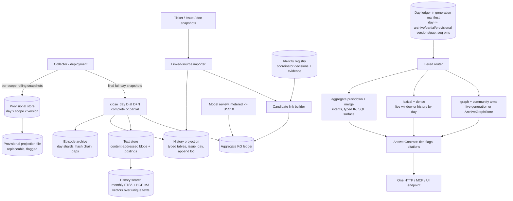

# Unified SU knowledge platform, phase K: one served history and an aggregate knowledge graph

Status: **design only, rev 2 (2026-11-08)**. Nothing here is implemented. `<pkg>` = `su_multi_arm`. Scope: the next
concrete phase of [unified_su_platform.md](unified_su_platform.md) (U1, U2, U4, part of U5/U6) for the log source plus
ticket, issue-tracker and KB/docs sources, **SU content only**. Public document: synthetic examples only; no customer,
host, tenant or dataset names. Measured figures are aggregates from the external test workspace.

## 0. Changelog

| Date | Rev | Change |
|---|---|---|
| 2026-11-08 | 1 | Initial design from owner decisions (single served history; aggregate KG linked to tickets/issues/docs). |
| 2026-11-08 | 1.1 | Owner: archived text searchable by dense **and** lexical arms (§4.4). |
| 2026-11-08 | 2 | Adversarial review REVISE: B1–B4 and all non-blocking findings addressed (§12). Owner decisions of 2026-11-08 incorporated: full archived text kept (no trimming), model review of links/aliases with a US$10 ceiling, unreviewed candidates shown labelled, coordinator-decided identity with recorded evidence, GPU allowed, BGE-M3 default, operator-only, overdue day = partial archive. Sizing rebased on measured volumes. Plan re-ordered into reviewer's smallest increments; estimate 67 ed. |

## 1. Executive summary

**Owner goals.** One UI/API serves the recent log-derived days (default view: last 3) and all older history in one
place. History is one knowledge graph over **aggregated keyword data** (episode summaries, keyword counters, masked
evidence with full text, shared-error communities, daily rollups), linked to tickets, issue-tracker issues and KB/docs.
Raw logs stay bounded by retention. Target question: "ML outages over the last 3 months and the reason".

**What exists (read and measured).** `ingestion/episode_archive.py` closes complete UTC days into append-only,
hash-chained day shards with gap records and recipe epochs; `Engine.history_route` sends structured scopes over archive
kinds to it; `runtime/episode_tools.py::stitch` joins cross-midnight pieces at read time for `incident_episodes`. A
staging run over three real days (external workspace, `STAGING_TEST.md`) measured **≈ 80k archive rows/day, ≈ 1,450
scopes/day, 15k–30k episodes/day, ≈ 590 MB/day of shard data at `max_text_chars: 2000`** (≈ 215 GB/year), an import of
3 days in 32 min with **12.4 GB peak RSS**, and a 3-day generation of 212k documents (3.6 GB state). No row crossed
midnight, so stitching is untested on real data. Missing today: unclosed days are not served; scans load rows (EAV,
`MAX_MATCHED` = 200k, refused above); log profiles get no typed projection; search/graph/communities cover only the live
window; the SQL guard cannot restrict join keys; one `Engine` serves one dataset.

**Recommendation.**
- **Day ledger, two tiers, aggregate pushdown.** Every unclosed day is served from a per-scope-versioned provisional
  store (flagged); closed days from the archive; overdue days close as **partial** and flagged. Count/which/when queries
  push per-day aggregates down into each tier and merge over disjoint days; month ranges never load raw rows.
- **History projection with its own catalog.** Append-only typed tables (archive) plus a replaceable provisional file,
  union views per logical table, `seq`/version pins injected by the SQL guard exactly like ACL conditions, a declared
  join-key allowlist. One SQL/IR route covers provisional and archived days.
- **Full text made affordable by content addressing.** Masked text is stored once per content hash (compressed) with
  postings `(text_hash, day, record)`; deterministic summaries are rendered, not stored. Lexical (monthly FTS5 segments)
  and dense (BGE-M3 on GPU) index **unique texts** only; time filters apply to postings. Both arms bind to history
  through a day-partitioned route; the live window keeps today's behaviour (no regression).
- **Cross-source by a combined aggregate dataset**, not a collection registry: source-typed ticket/issue/doc metadata
  records in the same projection and KG; identity via the coordinator-decided registry (evidence recorded); rule-based
  candidate links reviewed by a metered model (≤ US$10), unreviewed ones shown labelled.
- **Query paths.** Intents and typed/SQL route for counts across months; graph/community templates seeded from those
  rows for "why"; every row, link and day carries tier, status and citation.

**Effort and order.** 10 increments, **≈ 67 engineer-days** (review estimate 65–70). **First increment I1 (11 ed):**
ledger + per-scope provisional store + existing archive with hour pushdown, `issue_day` rollup, per-tier aggregate
pushdown/merge, the cross-midnight count rule, partial close, bounded-memory close, `issue_history` intent, UI 3-day
default. Then lexical full-text history (I2), identity + tier A/B links (I3), SQL route over history (I4), dense (I5),
KG and communities (I6). Remaining owner decisions: §10.

## 2. Requirements

| Id | Requirement |
|---|---|
| R1 | One dataset/endpoint serves every unclosed day (flagged provisional) and all closed history; "last 3 days" is a UI default, not a serving limit |
| R2 | No double counting at tier boundaries, across cross-midnight pieces, or between live-window and history indexes |
| R3 | Day handoff at D+`close_after_days`; an overdue day is archived **partial** and flagged; missing scopes and gaps surfaced, never zero |
| R4 | Incremental: closing a day appends O(day) rows, reads at most the boundary tail of D−1, never rewrites earlier rows (row-hash audited) |
| R5 | Month/year count queries execute as per-day aggregate pushdown with merge; bounded memory; no `MAX_MATCHED` refusal for aggregates |
| R6 | Archive-wide aggregate KG with typed nodes/edges, provenance and `seq` pinning; communities across history, cost-bounded and versioned |
| R7 | Full masked text kept forever; lexical and dense search over all history with time filters; no regression of live-window graph/communities/`unclassified_example` |
| R8 | Identity: coordinator-decided registry with evidence; matched/unmatched/ambiguous/excluded/missing reporting with denominators |
| R9 | Entity resolution and rule-based candidate links; model review metered (≤ US$10); unreviewed shown labelled; no undeclared join |
| R10 | Typed/SQL route over history including provisional days; graph/community route for why/related; planner choice traced |
| R11 | Evidence: tier, partial/provisional flag, recipe/text epoch, gap, link status/reviewer, source revision on every answer |
| R12 | Measured size/latency within the owner storage ceiling (O1); real-data validation only in the external workspace |

## 3. Target architecture

Writers: the heavy-window job (close, projection, text, KG, links) under one writer lease; refresh writes only the
provisional store and provisional projection. Readers: pinned generation manifest (`ProcessPins`), read-only handles.

## 4. Module contracts

### 4.1 Day ledger, provisional store and tiered aggregate execution (B1, B2; R1–R5)

- **Ledger** (manifest `logs.days`): `{D: {tier: archive|provisional|gap, closure: complete|partial|null,
  shard|provisional_file, scope_versions_digest, recipe, text_epoch, as_of, scopes_expected, scopes_captured}}` plus
  `history_seq`, `kg_seq`, `link_seq`, `catalog_fingerprint`, source watermarks.
- **Invariants.** I1 every day from the first archived day to today has exactly one entry; **every unclosed day is
  `provisional`** (no cap; at most `close_after_days + grace_days` + 1 such days). I2 a day becomes `archive` only in the
  publish that removes its provisional entry (CAS on `CURRENT`). I3 no return to provisional. I4 `gap` is "no data,
  reason", never zero. I5 provisional files stay readable while pinned (GC by pin).
- **Provisional store, per-scope versions.** `put_scope(D, scope, snapshot) -> scope_version`; a refresh carrying some
  scopes never drops others. The day's provisional projection file is materialized from the latest scope versions
  (≤ ~80k rows/day, measured scale) and replaced atomically; rows carry `provisional=1`, `as_of`, `scope_version`.
- **Handoff.** `close_day(D)` runs in the heavy window of D+`close_after_days` (default 3) from final staged snapshots.
  If D+`close_after_days`+`grace_days` passes without a complete set, D is **archived partial** from the latest scope
  versions: `closure: partial`, missing/stale scopes listed in `summary_coverage`, every row and answer flagged. A later
  complete set for a partial day is refused (append-only); it may be recorded as a `supersedes` note only (O3).
  `closure_delta` records last provisional vs closed counts.
- **Bounded-memory close.** Close streams snapshots per scope into the shard, projection and text store
  (target peak RSS ≤ 2 GB vs 12.4 GB measured for a 3-day import).
- **Aggregate pushdown and merge.** `TieredAggregate.execute(spec)` splits the requested days into archive days and
  provisional days, runs one `GROUP BY` per tier **inside SQLite** over `issue_day` (or `episode` for finer grains), and
  merges partial results over **disjoint day sets**. Mergeable measures only: `sum`, `count`, `min`, `max`, and
  group-key unions for distinct counts (bounded by `max_groups`); non-mergeable measures (percentiles, rates without
  source counts) are refused. Row listings push `ORDER BY … LIMIT k` into each tier and k-way merge; `MAX_MATCHED` then
  only bounds explicit full listings. EAV reads remain for legacy kinds only.
- **Cross-midnight count rule (stitching, work package I1).** Archived rows stay per-day pieces. At close (or
  provisional build) of D, each piece whose `first_failure` is within `gap_seconds` after midnight is compared with the
  **boundary tail** of D−1 (pieces of the same tenant/env/service/rule ending within `gap_seconds` of midnight; a bounded
  indexed read, no rewrite). A match sets `continues_id` and `is_continuation=1`. Over a range [A, B]:
  `episodes = pieces with is_continuation=0` + `pieces on day A with is_continuation=1` (heads before the range);
  `occurrences` = sum over pieces in range (window-exact); listed rows show chain bounds `chain_first/chain_last` and
  label occurrences outside the window. If D−1 is a gap: `boundary_unknown=1`, counted as a new episode, noted. If D−1 is
  provisional, continuation is recomputed when D−1 closes (provisional rows only). `issue_day` stores
  `episodes_started` and `episodes_continued` so the rule is mergeable. Existing read-time `stitch` stays for the
  episode tool until replaced, with a parity test.
- **Failure modes.** Ledger/file mismatch → scope refused (`bounded`); a missing provisional file →
  `source_unavailable` for that day only. Not its job: collection, re-capture scheduling, recovery inference.

### 4.2 History projection, second catalog and SQL guard (B3; R5, R10)

- **Tables** (archive file, append-only, every row tagged `seq`, `day`, `doc_id`, `closure`, `text_epoch`):
  `episode` (piece; tenant, env, service, signature_id, category, issue, first/last_failure, occurrences,
  recovery_basis, evidence_count, continues_id, is_continuation, boundary_unknown, customer_id, match_status),
  `issue_day` (tenant × env × service × signature × day: occurrences, episodes_started, episodes_continued, first, last),
  `coverage_day`, `shared_error`, `ticket`/`tracker_issue`/`doc` (revisioned: native_id, uri, customer_id,
  created/updated/resolved/published, status, component, title, text_hash; `valid_from_seq`/`valid_to_seq`,
  tombstone), `link` (subject, object, predicate, tier, status, reviewer, features, `link_seq`). Month rollups are
  written **once** when a month seals; the open month is computed from `issue_day` (no in-place `family_month`).
- **Second catalog.** `HistoryCatalog` is built from the history projection's own sealed manifest
  (`<history.path>/catalog.json`: tables, columns, types, reviewed descriptions, relations, schema version,
  fingerprint), independent of generation manifests and `metadata_schema` columns, reusing `ProjectionCatalog`'s table
  and column model. The generation pins `catalog_fingerprint`; a mismatch refuses the route.
- **File lifecycle.** History files live under `logs.history.path`, are never removed by generation GC or retention
  (refuse GC like the archive), change schema only additively with a version bump, and are backed up with the archive.
  The provisional projection is one replaceable file per day version, GC'd by pins.
- **Read access.** SQLite WAL; the single writer checkpoints; readers open `mode=ro` (not `immutable`) and see committed
  rows; the directory's `-shm` must be writable by the reader group (deployment check). Readers attach the archive file
  and the pinned provisional files, and create **TEMP views** (allowed on read-only connections) per logical table:
  `UNION ALL` of archive rows and provisional rows, with `tier`, `provisional`, `closure` columns exposed.
- **Pin injection.** The guard binds, on every reference to a history table, `seq <= :history_seq` (and
  `valid_from_seq <= :history_seq AND (valid_to_seq IS NULL OR valid_to_seq > :history_seq)` for source records) and
  `provisional_file IN (:pinned_files)`, using the same mechanism as ACL injection (`sql_surface/guard.py`, the
  `inject_acl` block); a table lacking pin columns is refused (`pin_not_applicable`). The IR compiler emits the same
  predicates. Answers never depend on the model applying a pin.
- **Join-key allowlist.** The catalog declares `relations` (e.g. `episode.signature_id → issue_family.signature_id`,
  `link.subject_id → episode.doc_id`, `link.object_id → ticket.doc_id`, `episode.customer_id → customer.id`,
  `ticket.customer_id → customer.id`). The guard accepts a JOIN only when every `ON` conjunct is an equality between a
  declared pair; otherwise `join_not_declared`. A direct tenant ↔ organization-name join is therefore impossible.
- **Access.** Operator role only; tenant-scoped `access.policy` refused with the history projection (owner decision).

### 4.3 Full text: content-addressed store (B4; R4, R7, R12)

Owner decision: archived text is kept **in full** (masked), never trimmed. Days already archived at
`max_text_chars: 2000` remain as they are (`text_epoch: trimmed_2000`); new days are `text_epoch: full_v1`.
- **Store.** Each masked text field (exemplars, sample completions, unclassified examples, source summaries) is
  normalized (line endings, trailing space), hashed (sha256) and stored once in `text_blob(hash, bytes_raw,
  zstd_payload)` with a per-month trained zstd dictionary; records keep `text_hash` refs; `text_posting(hash, day,
  doc_id, field)` is append-only. Deterministic texts (episode `summary`, headers) are **rendered** from typed fields at
  read time and not stored. The archive shard keeps typed fields and refs; EAV rows for text fields are dropped (the
  projection serves queries).
- **Audit.** Every append writes `append_log(seq, table, first_rowid, last_rowid, rows_sha256, prev_hash)`; `history
  verify` recomputes row hashes of all earlier seqs. Physical page changes (FTS merges, B-tree splits, HNSW) are allowed;
  logical row changes are not.
- **Sizing (rebased).** Measured: ≈ 590 MB/day at 2,000 chars including EAV duplication. Full-text size and the dedupe
  ratio are **not yet measured** (the full-text benchmark was not available at writing). Planning model, to be replaced:

| Component | Per day | Per year | Basis |
|---|---|---|---|
| Typed rows (projection + shard, no text EAV) | ≈ 40–80 MB | ≈ 15–30 GB | 80k rows × 0.5–1 KB |
| Unique text blobs, zstd | U × L / c | — | U unique texts/day, L avg bytes, c compression |
| Postings | ≈ 10 MB | ≈ 4 GB | ≈ 250k postings × 40 B |
| FTS5 over unique texts | ≈ 1–1.5 × U × L | — | monthly segments |
| BGE-M3 vectors, float16 (int8 optional) | U × 2 KB | — | 1,024 dims |

  Example: U = 20k, L = 4 KB, c = 4 → blobs 20 MB, FTS 80–120 MB, vectors 40 MB, total ≈ 200 MB/day ≈ 75 GB/year
  (vs 215 GB/year trimmed today). Worst case U = 90k (no repetition) → ≈ 900 MB/day ≈ 330 GB/year. The owner ceiling
  (O1) gates I2; if exceeded, options are int8 vectors, FTS on exemplar heads only, or cold-tier compression; never
  silent trimming.

### 4.4 History search and arm binding (B4, non-blocking; R7)

- **Lexical.** FTS5 over **unique texts**, one segment per month of first appearance, plus rendered summaries via typed
  fields. Each segment keeps `segment_days(min_day, max_day)` from postings (small metadata, updated per close) to prune
  by time filter. Hits expand through `text_posting` filtered by day range and kinds to documents. Segment BM25 scores
  are merged by RRF (per-segment statistics differ); recall vs a single index is measured on one real month (I2).
- **Dense.** BGE-M3 (default; fine-tune only on measured need, O7) on GPU over unique texts; vectors appended to the
  current month segment with an HNSW (faiss) index; segments pruned by `segment_days`; postings expand to documents.
  Throughput budget: U ≤ 90k/day embeds in ≈ 2–5 min on one GPU (≈ 300–700 texts/s at ≤ 256 tokens; to be measured).
  Embedder change = new vector epoch; `history reindex --months` re-embeds unique texts (budgeted, old kept until
  verified). If reranking is needed: `nvidia/nemotron-3.5-rerank-8b` behind the existing rerank role (O7).
- **Arm binding.** A `text_route(gen, day_range)` engine hook (like `history_route`) splits a lexical/dense step by day:
  days ≥ `live_from` → the generation's existing `LexicalIndex`/`VectorIndex`; days < `live_from` → `HistorySearch`
  implementing the same `search` contracts (`backends/contracts.py`). Fusion uses the existing RRF across the two.
  Partition by day means no document is served twice and the live window keeps its full behaviour: **graph,
  communities and `unclassified_example` of the last `keep_days` stay in the generation** (regression test in I2).
- **Generation publish cost.** At measured volume a 3-day generation is 212k docs (3.6 GB). Structured and typed reads
  of provisional days come from the provisional projection, so refresh does **not** rebuild the generation; the live
  search generation republishes at most every `serving.live_publish_interval_minutes` (default 360; measured in I1).

### 4.5 Aggregate KG ledger and communities (R6)

Node types: `tenant` (raw label), `customer` (matched only), `environment`, `service`, `issue_family` (rule +
category), `episode` (piece; `continues` edges form chains), `shared_error` (rule × day), `error_family`, `day`/`month`
(hubs), `ticket`, `tracker_issue`, `doc`, `component`. Every edge carries `(predicate, edge_kind ∈ {native_scope,
rule_derived, stitched, membership, identity_mapped, explicit_ref, candidate_link}, provenance{doc_ids,
shard|revision, builder_version, recipe}, seq, status, valid_day_range, weight)`. `kg.append_day(D)` reads D's shard plus
D−1's boundary tail and is idempotent by shard id; provisional days get a replaceable overlay flagged provisional.
`ArchiveGraphStore` implements `GraphStore.traverse` + `GraphExtras` over the ledger, pinned by `kg_seq`/`link_seq` and a
mandatory day range; it must pass `tests/conformance/test_traversal_templates.py`. Hubs are not traversed unless a
template names them. Communities: tier 1 exact per-day `shared_error` (at close); tier 2 seeded Louvain over the
`issue_family × tenant × week` matrix (never episodes), limits `{schedule: weekly, max_nodes, max_edges, max_seconds}`,
versioned `community_epoch`; over a limit the previous epoch is kept and marked `stale`. Membership ≠ cause.

### 4.6 Linked sources, identity and model review (R8, R9)

- **Importers** map ticket/issue-tracker/KB snapshots through reviewed field maps into revisioned source records
  (native id, uri, distinct event/update/ingest times, visibility, title, text via the text store); deletes are
  tombstones; one watermark per source. Live connectors remain U2.
- **Identity registry** (private; sha256 pinned): `{namespace, raw_label, canonical_customer_id, rule, authority,
  evidence, effective_from/to, version}`. Owner decision: **the coordinator (Claude) decides company/tenant/organization
  identity**, using public web evidence where needed; each decision records `authority: coordinator`, the evidence
  (source URL + retrieval date + quoted fact, stored privately) and confidence. Statuses `matched | unmatched |
  ambiguous | excluded (shared infrastructure) | missing`; only `matched` creates customer edges. `identity report`
  gives denominators per source snapshot (baseline: 36 of 56 observed labels alignable).
- **Resolution.** Service ↔ component aliases and signature mentions (pinned rule matchers over ticket/issue text) are
  deterministic evidence; non-exact aliases are candidates.
- **Candidate links (deterministic generation).** Tier A explicit native reference (accepted). Tier B same matched
  customer + ticket created in `[first − before_days, last + after_days]` + signature mention. Tier C customer + window +
  service/component alias + keyword overlap (BM25). Ticket ↔ doc: A native reference, B resolution-text mention, C
  similarity. Caps `max_per_episode` 5, `max_per_record`. Incremental on close and on record change.
- **Model review (owner decision).** A Sonnet 5.5 role (`models.roles.reviewer`) reviews tier B/C candidates and
  non-exact alias mappings with the evidence bundle (features, masked excerpts, identity basis) and returns
  `{verdict: supports|refutes|insufficient, rationale, cited_fields}`; status `model_accepted` / `model_rejected` is
  distinct from `human_accepted`. Metered by a persistent spend ledger with worst-case reservation per call; **hard
  ceiling US$10 across all linking/review model spend**; at the ceiling review stops and candidates stay `candidate`.
  Batch by customer/day; review only candidates that reach answers or the top-k per episode first. Tier C may use
  `nvidia/nemotron-3.5-lightning-30b-a3b` on the local GPU as a free pre-filter (O7).
- **Display (owner decision).** Unreviewed candidates **are shown**, labelled "candidate, not reviewed" with basis;
  `model_accepted` labelled "model-reviewed"; rejected hidden.
- **Invariant.** Log ↔ ticket records join only via `link` rows or the registry's `customer_id`; enforced by the
  join allowlist (§4.2).

### 4.7 Query routing and evidence (R10, R11)

| Question shape | Route | Executor |
|---|---|---|
| count / which / when, any range ("ML outages last 3 months") | `issue_history` / `incident_episodes` intents (rules first) | `TieredAggregate` over `issue_day`/`episode` |
| ad-hoc typed (by component, tickets per customer, linked counts) | typed router → `typed_query` (`ir` / `sql_surface`) | history catalog views, pins injected |
| why / related / what fixed it | outage pre-pass seeded by episode rows → templates `episode_context`, `family_history`, `episode_links` → community | `ArchiveGraphStore` / live graph, links, records |
| similar past cases, procedures | lexical + dense via `text_route` | live indexes + `HistorySearch` |

Planner: deterministic intents first; `routing: router` with arm cards for the rest (both modules are uncommitted at
`3b4329e`; this phase depends on their landing). "Why" = two declared steps (typed rows, then graph seeded with top-N
episodes). Values like "ML" ground via `ValueResolver` or a reviewed synonym file, else a stated limitation. "Reason" is
layered: rule category/issue (classified signal, not cause) → accepted/model-reviewed link resolution → candidate links
(labelled) → docs. Citations: rows `(shard|provisional file, doc_id, field, seq)`; text `(text_hash, posting)`;
links `(id, tier, status, reviewer, link_seq)`; records `(namespace, native_id, revision, uri)`. Every answer carries
`coverage {days, provisional days + as_of, partial days + missing scopes, gaps, recipe/text epochs, unmatched tenants,
watermarks}`.

## 5. Configuration surface (proposed; schema regenerated on implementation)

| Key | Default | Meaning |
|---|---|---|
| `logs.collection.schedule.{close_after_days, grace_days}` | `3`, `2` | close at D+N; partial close after the grace |
| `logs.collection.serving.{default_view_days, live_publish_interval_minutes}` | `3`, `360` | UI/API default range (not a limit); live search republish |
| `logs.history.{path, projection, text_store, search, kg}` | off | history files; each part enabled separately |
| `logs.history.search.{embedder_role, segment: month, ann: hnsw, rerank_role}` | `embedder`, `month`, `hnsw`, `null` | BGE-M3 default |
| `logs.history.text_store.{zstd_level, dictionary: monthly}` | `10`, `monthly` | full text, never trimmed |
| `linked_sources.<name>.{kind, snapshot_path, fields, visibility}` | — | importers |
| `identity.{registry_path, sha256}` | — | private registry pin |
| `links.{before_days, after_days, max_per_episode, show_candidates, review{role, usd_ceiling}}` | `1, 7, 5, labelled, {reviewer, 10.0}` | candidate links and model review |

Validation refuses: KG/search without projection; links without identity; tenant `access.policy` with history;
`archive.max_text_chars` set together with `text_store` (full-text epoch); `usd_ceiling` above the approved budget.

## 6. Delivery increments (reviewer's smallest-increment order)

| Inc | Scope | Depends | ed |
|---|---|---|---:|
| I0 | Synthetic fixtures: 400 days × 200 scopes, epochs, gaps, partial days, cross-midnight chains, repeated texts, tickets/issues/docs, registry with 5 statuses | — | 3 |
| I1 | Ledger (all unclosed days provisional), per-scope provisional store + projection file, partial close, bounded-memory streaming close, `issue_day` + hour pushdown, `TieredAggregate` merge, cross-midnight count rule + parity with `stitch`, `issue_history` intent, UI 3-day default | I0 | 11 |
| I2 | Content-addressed full-text store + postings + append-log audit; monthly FTS5 history search; `text_route` lexical binding; live-window regression suite; size benchmark gate (O1) | I1 | 6 |
| I3 | Identity registry with coordinator decisions + evidence + report; ticket/issue/doc importers; signature mentions; tier A/B links; model review with US$10 ledger; labelled display | I1 | 9 |
| I4 | History projection files + `HistoryCatalog` + WAL ro access + TEMP union views + guard pin injection + join allowlist; IR and SQL routes over history incl. provisional | I1, I3 | 8 |
| I5 | Dense history search: BGE-M3 GPU embedding of unique texts, HNSW month segments, pruning, reindex job, dense binding | I2 | 6 |
| I6 | KG ledger, `ArchiveGraphStore` (conformance), history templates, tier 1/2 communities | I4 | 10 |
| I7 | Tier C and ticket ↔ doc links, optional local pre-filter / rerank | I3, I5 | 4 |
| I8 | Routing: two-step why plans, arm cards, grounding, coverage block, HTTP/MCP/stream/UI parity | I4, I6 | 6 |
| I9 | Real-data validation in the external workspace; scale and latency; VALIDATION.md | all | 4 |
| | **Total** | | **67** |

Value after each: I1 one endpoint with exact month-range counts; I2 full-text keyword search over history; I3 linked
tickets for episodes; I4 ad-hoc typed questions; I5 semantic search; I6 graph "why".

## 7. Acceptance tests

Repo tests use I0 synthetic fixtures only; real-data checks run read-only in the external workspace and record only
aggregates. Gates: `ruff check src tests`, affected suites, schema regeneration, wheel/sdist for releases.

| Inc | Unit / contract (repo) | Real-service / benchmark (external) |
|---|---|---|
| I1 | Property test over random refresh/close/publish interleavings: every day in exactly one tier, per-range sums = ground truth; 6 unclosed days all served; overdue → partial + flagged; per-scope refresh keeps other scopes; 400-day aggregate without row loading (`MAX_MATCHED` never hit, row reads counted); chain counting across ranges/tiers/gaps = ground truth; parity with `stitch`; close RSS bound | Shadow a week of real cycles; 3/6/12-month `issue_history` p95 (< 2 s target); close RSS and time per day; real cross-midnight count (0 seen so far) |
| I2 | Duplicate text stored once; rendered summary equals stored-era text; append-log audit detects a changed earlier row but not FTS merges; time-pruned segments; live-window graph/communities/`unclassified_example` unchanged vs baseline | Full-text bytes/day, dedupe ratio U, FTS size, p95; RRF-segment vs single-index recall@10 on one month |
| I3 | Five identity statuses; evidence required for coordinator entries; tier A/B planted pairs; review ledger stops at ceiling (mock provider); unreviewed shown labelled; tombstones propagate | Identity report vs baseline; review spend and verdict distribution; owner spot-check of a sample |
| I4 | Guard injects pins on every history table and refuses unpinned shapes; `join_not_declared` for tenant=organization; provisional rows visible via views; catalog mismatch refused; WAL reader sees only pinned seq | SQL/IR on frozen typed questions over 3 months |
| I5 | Dense hit on a 300-day-old episode; epoch mix fused by rank with note; missing segment → `source_unavailable` | Embeds/s on GPU, vectors/day, p95 3/12 months, HNSW recall |
| I6 | Conformance kit; provenance + seq on every edge; hub non-traversal; epoch determinism and `stale` | Epoch runtime; template latency over 12 months |
| I7–I9 | Tier C bounds; two-step plan trace; coverage parity across surfaces | Adjudicated link precision; frozen held-out question set (separate budget) |

## 8. Traceability matrix

| Req | Module(s) | Inc | Acceptance |
|---|---|---|---|
| R1 | ledger, provisional store | I1 | all unclosed days served; UI default 3 |
| R2 | TieredAggregate, count rule, text_route day partition | I1, I2 | interleaving sums; chain counts; no dual-served doc |
| R3 | close/partial, gaps | I1 | overdue → partial flagged; gap ≠ 0 |
| R4 | streaming close, append log | I1, I2 | boundary-tail only; row-hash audit |
| R5 | TieredAggregate, issue_day | I1 | 400-day aggregate without row loading |
| R6 | KG ledger, communities | I6 | conformance; determinism |
| R7 | text store, HistorySearch, text_route | I2, I5 | old-episode hits both arms; live regression suite |
| R8 | identity registry | I3 | statuses; evidence; report |
| R9 | link builder, review ledger, join allowlist | I3, I4, I7 | planted pairs; ceiling; `join_not_declared` |
| R10 | HistoryCatalog, guard pins, routing | I4, I8 | pins on every table; route trace |
| R11 | AnswerContract coverage | I8 | parity across surfaces |
| R12 | sizing gate, benchmarks | I2, I5, I9 | measured vs O1 ceiling |

## 9. Risks

| Risk | Mitigation |
|---|---|
| Full text larger than the model (low repetition) | I2 benchmark gate vs O1 before enabling; int8 vectors, exemplar-head FTS, cold-tier compression; never silent trim |
| Close/import memory (12.4 GB measured) | streaming per scope; RSS bound tested in I1 |
| Live generation rebuild heavy at real volume | refresh does not rebuild; republish interval; measured |
| WAL read-only readers need a writable `-shm` | deployment check in `history verify`; fail closed |
| Segment RRF lowers lexical recall | measured; fall back to yearly segments with global stats if worse |
| Model review wrong or budget exhausted | distinct `model_*` statuses, evidence bundle, owner spot-checks, hard US$10 ceiling, candidates stay labelled |
| Coordinator identity error | evidence recorded per entry; reversible registry versions invalidate dependent links |
| Ticket export older than log window | fresh snapshot required in I3; report volume not quality until adjudicated |
| Rule category read as cause | layered, labelled "reason" |
| Dependence on uncommitted typed router / arm cards | I8 starts only after they land; I1–I5 do not need them |

## 10. Open decisions for the owner

| # | Decision | Recommendation |
|---|---|---|
| O1 | Storage ceiling for full-text history (GB/year) gating I2/I5 | Set after the full-text benchmark; ≤ 150 GB/year proposed |
| O2 | Link window defaults (`before_days` 1, `after_days` 7) and community schedule (weekly) | Accept; tune after I3 adjudication |
| O3 | Late complete data for a day archived partial: refuse, or allow one recorded `supersedes` re-close | Refuse (append-only); note only |
| O4 | Spot-check rate of model-reviewed links by a human | 5% sample per week while spend lasts |
| O5 | Owner of the reviewed vocabulary ("ML" → categories/services/components) | SU domain owner; versioned file |
| O6 | Budget for the I8/I9 held-out evaluation (paid models) | Separate approval |
| O7 | Use local NVIDIA models (pre-filter, rerank, embed) and BGE fine-tuning only on measured need | Yes, gated by I5/I7 measurements |

Decided 2026-11-08 (recorded, not open): full text kept; Sonnet 5.5 reviews links/aliases; unreviewed candidates shown
labelled; coordinator decides identity with evidence; US$10 linking/review ceiling; GPU allowed; BGE-M3 default; SU
only; operator-only access; overdue day archived partial and flagged.

## 11. Non-goals

| Non-goal | Reason |
|---|---|
| Raw/per-line log history beyond retention | owner decision |
| Collection registry / multi-Engine federation; live connectors | U5/U2; combined aggregate dataset meets the one-endpoint goal |
| Customer-facing (tenant-scoped) history, KG, communities | operator-only this phase; needs U6 isolation |
| Model-written community reports; model-generated links | links are rule-generated; the model only reviews |
| Causal root cause; outage duration from silence | silence ≠ recovery; membership ≠ cause |
| Graph database migration | ledger behind `GraphStore` keeps the option |

## 12. Review response (rev 1.1 adversarial review, verdict REVISE)

| Finding | Response |
|---|---|
| B1 unclosed days beyond 3 had no tier | **Accepted.** Every unclosed day is provisional (I1); "3 days" is `default_view_days`; overdue → partial (owner) (§4.1). |
| B2 row loading exceeds `MAX_MATCHED`; SQL misses provisional; stitching unowned | **Accepted.** Per-tier SQL aggregate pushdown + merge over disjoint days; provisional rows in a flagged projection file unioned by views; count rule with boundary-tail read, `issue_day` counters, owned by I1 (§4.1–4.2). Note: read-time `stitch` exists in `runtime/episode_tools.py` but is untested on real data; it is kept with a parity test. |
| B3 catalog lifecycle, view mechanism, unpinned SQL, no join allowlist | **Accepted.** `HistoryCatalog` from its own manifest; history file lifecycle outside generation GC; WAL `mode=ro` + TEMP views; pins injected like ACL; declared join allowlist (§4.2). |
| B4 sizing 100× low; global FTS growth; "no earlier file changes" false | **Accepted.** Rebased on measured 590 MB/day; content-addressed dedupe and rendered summaries; monthly FTS segments over unique texts; row-hash append log replaces file-change claims (§4.3–4.4). The reviewer's "keep text trimmed until benchmark passes" is **superseded by the owner decision** to keep full text: the benchmark now gates *enabling* I2/I5 against a storage ceiling (O1), not trimming. |
| Uncommitted typed router / arm cards | **Accepted.** Stated as a dependency of I8 only (§4.7, §9). |
| Split loses `unclassified_example` and live graph/communities | **Accepted.** Day partition keeps the generation unchanged for the live window; regression suite in I2 (§4.4). |
| `put_version` replaces the whole day | **Accepted.** Per-scope versions (§4.1). |
| History search ↔ arm binding unspecified | **Accepted.** `text_route` + `HistorySearch` on the `LexicalIndex`/`VectorIndex` contracts (§4.4). |
| Estimate low (51 ed) | **Accepted.** 67 ed including stitching, catalog, guard, binding, review ledger. |
| Smallest-increment order | **Accepted** with one change: the SQL route (I4) follows identity links (I3), as the reviewer proposed, but lexical full-text (I2) includes the content-addressed store because full text is now mandatory. |

## 13. Evidence status

This document is a design based on reading the source and docs at `v2/phase-0` `3b4329e`, plus the external staging
measurements cited above. Nothing in it is implemented, mocked or newly measured. The full-text sizing figures are a
model until the benchmark reports.
