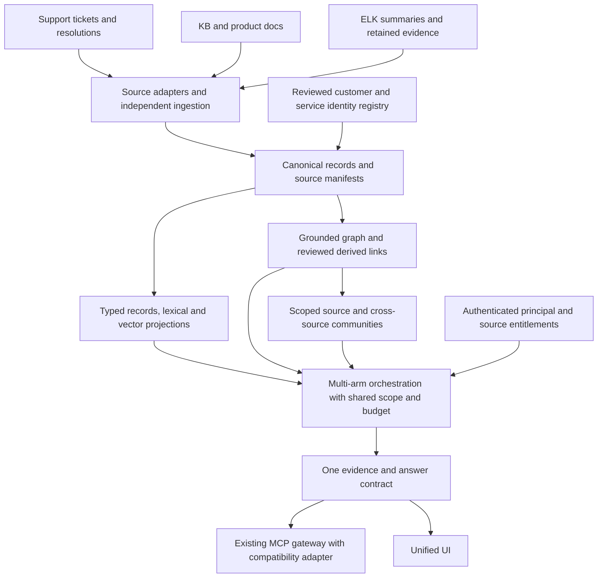

# Unified SU knowledge platform: endgame and integration plan

Status: proposed integration roadmap, 2026-11-07. Prepared for shared Codex/Claude
review at the owner's request. This document changes no running service, deployment,
configuration contract or access grant. Existing extraction and coverage work continues.

## Intended outcome

Serve SU support tickets, knowledge articles, product documentation and ELK operational
evidence through one authenticated MCP entry point and one UI. Build governed links
between their customers, services, products, issues, resolutions and source records.
Run the multi-arm planner over that connected platform, returning useful tables,
grounded graph paths, scoped community evidence and cited procedures.

The existing SU serving experience is the migration entry point. Reuse its
gateway and useful UI behavior while moving reusable implementation into
`su_multi_arm`. A common front door does not require one physical index, one refresh
schedule or one unrestricted graph. Source ownership, permissions and provenance
remain distinct.

The owner explicitly confirmed **SU content only**. Reuse of the serving shell that
previously served deployment does not include other-tenant records, indexes, embeddings or
model releases. References to earlier implementations below concern reusable
mechanisms and compatibility behavior only.

## What exists and what still needs integration

| Area | Inspected state | Integration decision |
|---|---|---|
| Standard `su_multi_arm` | Canonical records, generation pins, multiple retrieval arms, typed aggregation, graph/community evidence, HTTP/MCP parity and optional UI exist. The logs foundation and portable fixes have been integrated locally. | Use as the shared kernel. Preserve its component/backend contracts and explicit failure behavior. |
| Dataset orchestration | An `Engine` is configured for one dataset. `SearchRequest` does not currently select a list of datasets. Multi-dataset serving remains deferred in the implementation plan. | Add a tested collection registry and orchestration layer; do not describe current search as federated. |
| Existing MCP front door | The inspected `su-cognee-mcp` gateway routes client selections to the earlier product hybrid API. It preserves existing search/answer and discovery contracts. Its historical name is not evidence that Cognee is the retrieval route. | Add a compatibility adapter for the shared kernel, preserve existing clients, then introduce unified selection through versioned discovery. |
| Existing UI | The shared earlier product frontend and legacy backend are separate integration assets. A separate operational dashboard is not the shared product UI. | Reuse proven interaction and citation behavior; inventory the actual service entry points before replacement. |
| Ticket/KB/doc graph work | Earlier earlier product work includes source mappings, exact-ID behavior, source inspection, graph/SQL projections, communities and versioned release builders. | Port reviewed mechanisms and source profiles. Keep private releases, corpora, models and deployment settings outside this public repository. |
| ELK | Read-only source ingestion, incident summaries, classified/unclassified evidence, exactness/coverage reporting, pattern lifecycle and shared-error groups exist. | Add the ELK collection to the common catalog and source adapters while preserving occurrence counts and collection limits. |
| Identity | The owner declares ELK tenant name and SU organization name to be the same business identity. Source inspection finds index-derived tenant labels and ticket organization-name fields; matching their observed values is a separate compatibility check. | Accept unique exact organization-name matches under this owner-declared equivalence; report formatting/alias candidates, missing values and ambiguous/shared deployment labels separately. |
| Customer-facing authorization | Core principal/ACL hooks exist. The current logs profile explicitly refuses a tenant-scoped access policy; its client dimension is an operator analytics dimension. Inspection routes also have single-tenant restrictions. | A shared internal operator UI can precede customer-facing federation. Customer-scoped logs, graph and communities require additional authorization work and isolation tests. |
| Learning | Versioned pattern learning and individual-log comparison mechanisms exist. Large local batch experiments are external; shared semantic enforcement and mandatory independent holdouts are not automatic today. | Follow the [extraction learning plan](../EXTRACTION_LEARNING_PLAN.md); do not automatically promote model findings. |

Historical runbooks and recorded tests establish earlier behavior, not current service
health. Read-only deployment inspection found degraded/unavailable retrieval backends;
an active gateway/UI process does not establish working search. This plan does not
restart services stopped for the local model audit.

## Inventory and code consolidation

For each existing repository/branch, record its source revision, feature, tests,
data owner, public/private boundary and disposition: **port**, **adapt**, **keep
private**, **reference only**, **quarantined**, or **retire after parity**.

Prioritize the shared gateway/frontend and active backend source over similarly named
older experiments. Review earlier product graph builders, issue-tracker/doc ingestion and source
inspection for reusable components. Simulation work can supply synthetic benchmarks;
fictional company identifiers must never become production customer aliases.
Quarantined retrieval experiments remain disabled until their relevance gate passes.

Consolidate supported behavior into the standard package plus deployment profiles.
Do not merge every fork wholesale or copy source-specific credentials, customer rules,
private examples, release databases, embeddings or checkpoints into the package.
Track an explicit replacement and rollback decision before retiring an old path.

## Customer identity and tenant compatibility

The owner has supplied the business-key definition: **ELK tenant name = SU organization
name**. Start by cross-checking the actual observed values. Unique exact name matches
within SU are an accepted identity rule under that declaration; the plan does not
require an unavailable account ID before acknowledging those matches. A versioned
registry preserves this rule, records exceptions and keeps identity separate from
authorization. Keep these concepts separate:

| Proposed field | Meaning |
|---|---|
| `access_domain_id` | Ownership/security boundary used to resolve authorization. It is not inferred from a customer name in a log. |
| `canonical_customer_id` | Stable, namespaced business customer identity used for approved cross-source joins. |
| `source_customer_ref` | Original source account ID or client slug, retained without reinterpretation. |
| `source_organization_name` | Owner-declared SU business join key when uniquely matched; preserve the raw spelling. It is not an authorization credential. |
| `environment_id` / `deployment_id` | Operational scope beneath a customer, distinct from customer identity. |
| `service_id` / `product_id` | Versioned canonical operational/product identities with separate alias rules. |

These are proposed mapping fields, not newly implemented `Config` options.

Each private registry entry records source namespace/name, canonical identity, mapping
authority, effective dates and registry version. Exact unique name matches can use the
owner-declared rule; review is needed for additional aliases or ambiguous mappings.
Measure case/whitespace-only differences separately before approving a normalization
rule. Do not overwrite raw identifiers, guess domains or use embeddings to grant access.
One-to-many organizations, missing names, renamed/reused slugs, trials and shared
environments enter an exception queue rather than silently inheriting a customer.

Some ELK index labels describe a shared deployment rather than one customer. The inspected
collector does not establish an authoritative per-record organization for those records.
Such labels cannot be joined to a ticket organization until actual customer metadata is
available. Likewise, comments/private notes need source visibility enforcement; a ticket
being visible does not automatically make every associated comment visible.

Synthetic examples: the exact organization name `Example Company` in both sources can
map through the declared name rule to `su:customer:example`. A shortened ELK name
`example-prod` needs a reviewed alias. An identically named customer outside the SU
ownership domain remains a different identity.

Measure mapping coverage against each source's native customer population: matched,
unmatched, ambiguous, excluded and records with no customer identifier. Report the
denominator and source snapshot. A count over retained log exemplars does not establish
mapping completeness for the full ELK population.

### Observed SU organization compatibility

Read-only metadata comparison on 2026-11-07 covered 56 observed ELK labels from 4,674
successfully captured index/day scopes and 68 non-null organization labels across 1,231
SU tickets. Six tickets had no organization. No ticket bodies or customer identifiers
are included here.

| Comparison tier | ELK labels | SU organization labels | Tickets in those organizations |
|---|---:|---:|---:|
| Raw exact spelling | 0 | 0 | 0 |
| Unique case/whitespace equivalence | 6 | 6 | 106 |
| Existing explicit curated organization aliases, additional matches | 30 | 30 | 626 |
| Total alignable under these rules | 36 | 36 | 732 |

There were no ambiguous matches in these tiers. Of the remaining ELK labels, 19 had no
accepted counterpart and one represented shared infrastructure; 32 SU organization
labels had no accepted counterpart in this observed ELK snapshot. Additional aggressive
normalization candidates require review and are not included in the accepted total.

This establishes usable name/alias compatibility, not deployed joins or authorization.
The ticket export and recent ELK evidence cover different periods; an absent counterpart
does not prove collection failure or a different customer. The inspected support export
predates the recent log window, so same-incident investigations also need fresh ticket
ingestion. Keep historical related-issue evidence distinct from a contemporaneous event.
Observed successful scopes are not the full source inventory. Raw names, native keys
and the crosswalk stay in the private deployment.

## Canonical source and release contracts

Preserve the current canonical `Document` and typed metadata validation. Define explicit
profiles for ticket, article, documentation page, issue-tracker issue where applicable, log evidence,
episode, hourly cell, signature and community-support records. Source adapters map native
fields rather than making the planner guess field names.

Existing ticket/doc/issue-tracker import paths are substantially snapshot normalization. Add live
connector, pagination, update/delete and freshness work where absent; a successful CSV
import does not demonstrate continuous source synchronization. Only SU-owned issue
collections are in scope. Verify native created/updated/activity timestamp mappings
before using earlier import conventions for first-report or resolution-time measures.

Every record/projection needs:

- Dataset and source namespace, stable native ID, record kind, native revision and
  canonical URI. A user-supplied record context is not retrieved evidence.
- Approved customer/service/product mappings and their versions, plus audience and
  access classification. Docs without a customer field are not automatically public.
- Event time, source update time, ingestion time and applicable product version as
  distinct fields. A ticket creation date, observed error time and doc publication
  date must not be substituted for one another.
- Extraction/ontology recipes, evidence spans, truncation/rejection state and source
  provenance. Preserve observed counts independently of representative evidence.
- Independent source watermarks, delete/tombstone propagation, retention and rebuild
  rules. Keep the existing bounded keyword-summary collection policy for ELK.

Propose a platform release manifest that pins each collection's generation plus identity,
ontology and cross-source link versions. A request pins that bundle; it must not traverse
a graph built from a newer ticket generation while citing an older record store without
disclosing the version difference. Stage and validate links/community projections before
atomically switching the platform pointer. Keep source and platform rollback manifests.

Cache and session identities must include the effective source generations, identity/
ontology recipes, principal access scope and request filters. An alias correction or source
deletion must invalidate dependent links, communities, summaries and cached answers.
Keep optional legacy anchor-evidence/session caches disabled until their keys and evidence
revalidation use trusted principal/entitlement state; a caller-provided client/session
header is not an identity boundary. Reuse the authenticated session contract rather than
assuming all earlier cache implementations provide equivalent isolation.

## Connected graph and communities

Start with reviewed identity links and explicit native references. Add proposed semantic
links only as reviewable candidates with their own provenance and status.

| Link | Required basis |
|---|---|
| Ticket to customer | Native account reference, or owner-authorized unique organization-name / approved-alias mapping; preserve source and mapping provenance. |
| Log observation to service/customer | Source scope and reviewed mapping; preserve its derived/association nature where not literal in the log body. |
| Ticket to incident | Explicit incident/reference ID, or a separately labeled candidate correlation. Matching time or customer alone is insufficient. |
| Ticket to resolving article | Explicit resolution reference or adjudicated evidence. Retrieval relevance alone does not prove the article fixed the ticket. |
| Doc to product/service/version | Anchored source statement and applicability; distinguish product mentions from deployed dependencies. |
| Service to service | Explicit supported operation/relationship, not shared appearance in one payload or community. |
| Shared error membership | Declared signature/rule, source scopes, time window and membership evidence; not proof of common cause. |

Keep core edge kinds and support requirements. A scope-provided service can be useful
context for an audit, but cannot bypass the core fact requirement for typed same-chunk
endpoints within the supporting span. Use reviewed derived links or properly anchored
source-header evidence where appropriate. Add missing predicates through a versioned
ontology; never force collection queries into `queries_index` or mentions into dependencies.

Maintain source communities first, then add distinct cross-source issue families joining
eligible ticket issues, error signatures, relevant docs and reviewed resolutions.
Recompute affected memberships and claims when sources or mappings change. Publication
must refresh scoped counts and invalidate stale reports. Preserve missing-day/partial-input
status, disagreement and provisional labels; a quiet log interval is not recovery.

Customer-facing views must derive community statistics and summaries from visible members.
Filtering a global summary after generation can leak hidden clients and is insufficient.
Cross-customer shared-error analysis belongs only to a role authorized for those members.

## Multi-arm planning across collections

Introduce federation as a shared-kernel capability, behind a validated collection registry.
Preserve source engines initially; do not duplicate their retrieval logic in the gateway.
One request needs one principal, immutable effective filters, date anchor, platform pin,
trace and bounded model/retrieval budget across all children.

The planner chooses eligible collections and arms from authorized discovery:

- Outage/count/window questions use typed log summaries and exact record aggregation,
  then bounded graph/community evidence. Dense snippets cannot establish exhaustive counts.
- Troubleshooting uses ticket evidence plus applicable KB/doc procedures, with lexical,
  semantic, exact-ID and graph retrieval as supported. Preserve useful resolution fields.
- Cross-source investigations use approved identities, version/time constraints and
  reviewed links. Unknown or ambiguous customer mappings produce an explicit limitation.

Compile canonical filters into each source's declared schema. Refuse incompatible filters
rather than dropping them. Budget fan-out and graph hops globally, retain per-source
timeouts/failures, and do not silently substitute another provider or unrestricted search.
Normalize fusion deliberately; raw vector/BM25 scores from different indexes are not directly
comparable. Retain arm and source provenance and measure source-specific ranking regressions.

Keep typed measures distinct: tickets, observed error occurrences, episode observations,
unique customers and retrieved examples are different units. Cross-source totals require
an explicit compatible measure and deduplication identity. Missing or inaccessible sources
cannot support an exhaustive answer. Discovery/error messages must not reveal unauthorized
collection names or record identities.

## One MCP, HTTP API and UI

Preserve the existing gateway's authentication boundary, public route and client integration
contracts through a compatibility adapter. Verify actual tool discovery including search,
answer, client discovery and filter discovery; preserve historical schemas until versioned
clients migrate. Existing hybrid/agentic mode names need explicit translation to kernel
pipelines rather than passing incompatible enum values through unchanged.

The inspected gateway exposes `search`, `answer`, `get-search-clients` and
`get-filter-options`; preserve these names and test their actual wire schemas. Legacy
record-context propagation currently differs by client and needs an explicit SU mapping.
Replace hard-coded two-corpus UI selectors with authorized capability discovery. Reject
unknown collection names instead of inheriting the legacy default-to-SU behavior.
Synthetic/mock response modes must be disabled for production integration acceptance.
Cut over the SU binding only. The SU-facing collection catalog must exclude content from other product deployments;
existing unrelated client routes require their own retirement decision and are not a
fallback for an unavailable SU collection.

Add a unified catalog/selection capability through a versioned request contract, not a
magic dataset string that silently changes filters. Extend Python/HTTP/MCP schema parity
checks when collection selection becomes public. Validate context-key translation,
source lookup, pagination, cancellation, streaming, error categories and citations.

The UI should provide one answer experience, overview and graph with customer, source,
service/product and date controls. Answers use structured tables for counts/issues and
safe Markdown for procedures, with expandable supporting records and source badges.
Show source freshness and completeness/scanned/extracted separately. Graph views connect
eligible customers, services, issues, tickets and articles with evidence/edge-status
inspection. Communities can be inspected within the graph/investigation flow; operational
pattern/job controls stay in authorized administration views. Preserve profile-specific
navigation instead of globally hiding capabilities.

UI and MCP consume the same structured answer/evidence payload. MCP must receive table
columns, typed rows, measures, source pins, citations and limitations directly; parsing
rendered Markdown is not an integration contract. No UI-only authorization or answer logic.

## Auto-Ontology evaluation

Evaluate NVIDIA's [Auto-Ontology](https://github.com/NVIDIA/auto-ontology/tree/c447003f72a822301e927196a4ecb5b597c308d5)
as an optional semantic-catalog component. Its documented workflow drafts business terms,
column mappings and relationships, then supports human certification. Its
[MCP tools](https://github.com/NVIDIA/auto-ontology/blob/c447003f72a822301e927196a4ecb5b597c308d5/docs/mcp.md)
include term inspection and answerability checks. The inspected
[connector registry](https://github.com/NVIDIA/auto-ontology/blob/c447003f72a822301e927196a4ecb5b597c308d5/auto_ontology/connectors/registry.py)
is relational and has no Elasticsearch connector.

Proposed SU use: compile synthetic organization, ticket, service, doc-metadata and
log-summary tables into candidate semantic definitions; compare those with the shared
ontology and approved organization aliases. Measure whether certification and
answerability reduce wrong fields, joins and measures. Raw log parsing, retrieval of
document passages and incident/community semantics still need the multi-arm components.

The owner authorized a separate isolated pilot with a **US$25 total Haiku API ceiling**.
Use synthetic inputs, reserve worst-case call cost before each request, persist actual
usage, and stop before the cap. No private source data, production connections or default
unmetered inference endpoints are part of that pilot. A configuration claim about
compatible model endpoints does not establish native Haiku compatibility; execute and
label the adapter check. Installation or a successful synthetic query is not SU relevance
or production isolation validation.

If useful, import reviewed definitions into the common semantic contract or expose an
internal adapter through the existing MCP gateway. Revalidate authorization and immutable
filters at the shared kernel; generated SQL is not automatically an exact, authorized
`ScopeResult`. Compare dependency/licensing, recipe identity, update/delete propagation
and rollback before adopting the full upstream application. Retain one supported UI/MCP
experience. This is an evaluation milestone, not a new runtime dependency or deployment.

Initial isolated component result (2026-11-07): the pinned upstream SQLite connector,
catalog/FK inspection and term sanitizer executed over six synthetic tables; a
handwritten typed adapter ran eight parameterized queries. Twenty-four synthetic
checks and pilot Ruff checks passed. Term proposals were mocked, and selective leaf
module loading did not establish a full upstream installation. Provider quota blocked
successful Haiku inference, so generated ontology quality, upstream answerability and
text-to-SQL remain unmeasured. Resume the metered model phase against the same fixtures
and ledger when quota permits; offline success is not an adoption or certification gate.

### First real SU context-layer comparison

After the owner supplied a working credential and authorized real-data evaluation,
both approaches were tested on the same privately frozen, redacted 179-record SU
slice from four organizations. The comparison used 23 questions, identical CPU
BGE-M3 embeddings, a common 6,000-token evidence limit and separate 179-record
operator / 38-record customer views. The owner set initial limits of **US$5 per
approach**, within the original shared US$25 ceiling.

The primary task-capable pair used the actual core's supported mixed extraction/
retrieval configuration and NVIDIA's supported native source-query configuration.
Deployed pattern and catalog-only diagnostic controls were retained separately.
QA froze source-grounded ratings before unblinding randomized condition labels;
native output style makes blindness partial.

The native source-query context was favored on eight questions and our mixed
context on seven. There was one substantive tie, four comparisons where both were
insufficient, and three scoped-negative cases without detected prohibited evidence
under the isolated views. These are small-pilot context preferences, not final-answer
accuracy or a production winner. Our side more often retrieved relevant cases/docs
but omitted important resolution or metadata in packing. Native source-query was
stronger on several exact aggregates and provenance questions, with source-selection
misses and three observed SQLite qualification errors.

Layer review found unresolved identity materialization, predicate qualification and
community-coherence gaps in our extracted graph, and time/version/offset-definition
ambiguities in the native catalog and shared projection. A schema/FK ontology is not
an incident-instance graph. Both retain the raw source catalog; graph rejection is
not loss of the complete retrieval corpus. Scope isolation used external projected
views and does not establish native customer-facing ACL support.

Including a common-answerer check, reported settled costs were approximately
**US$0.18 for our family and US$0.44 for NVIDIA's**. Paid inference was paused after
the experiment; no budget increase, production migration, graph/community promotion
or algorithm replacement followed. The next candidate should repair question-specific
field packing, canonical identity, typed measures and semantic roles, then test a
clearly versioned configuration on fresh held-out data. A hybrid remains a proposal,
not a demonstrated winner. See [validation](../VALIDATION.md) for the measured scope.

## Delivery sequence and acceptance gates

| Milestone | Deliverable | Acceptance evidence |
|---|---|---|
| U0: inventory | Source-of-truth matrix, ownership, current capabilities and compatibility fixtures. | Every port/adapt/retire decision has a revision, tests and private/public boundary; stopped services remain stopped. |
| U1: identity and permissions | Versioned private alias registry, source field maps and entitlement model. | Matched/unmatched/ambiguous counts with denominators; no unreviewed join; adversarial isolation and alias-reassignment tests. |
| U1a: ontology pilot, parallel | Isolated Auto-Ontology comparison with synthetic SU tables and metered Haiku calls. | Certified/candidate distinction, known-answer and forbidden-join checks, actual adapter result, spend ledger within US$25; no automatic adoption. |
| U2: source integration | SU tickets, KB/docs and ELK adapters with independent immutable releases. | Mapped fields preserved; update/delete/reparse, source windows, exactness, recipe mismatches and unavailable-source behavior tested. |
| U3: common front door | Existing MCP/UI can select isolated source collections through the shared kernel. | Legacy-client parity and Python/HTTP/MCP shape tests; source lookup/context/streaming and scoped discovery verified. No cross-source join required for this milestone. |
| U4: governed connections | Shared entity registry, reviewed graph links and version-pinned issue families. | Grounding/edge-kind checks, ambiguous-identity refusal, doc applicability, scoped membership and deletion propagation tests. |
| U5: federated multi-arm | Joint planning, bounded fan-out, typed aggregates and unified evidence contract. | Frozen cross-source questions with adjudicated relevance/grounding; no dropped filters, double counts or unit mixing; per-source ranking and latency/cost reports. |
| U6: connected UI and operations | Unified answer/overview/graph, source freshness and incremental communities. | Synthetic browser/MCP journeys, mobile/CSP/Markdown checks; role-based visibility, stale-source indicators and source outage tests. |
| U7: staged migration | Shadow comparisons, operator canary, then permitted audience expansion. | Explicit parity report, monitored source/provider failures, verified rollback and no unauthorized disclosure. Retire old paths only after acceptance. |

U1 and U2 can progress together; U3 is useful with isolated sources. U4/U5 depend on
identity and authorization gates. This reorders the earlier deferred multi-dataset goal
for the requested endgame; it does not claim that implementation has already shipped.
Size calendar work after U0/U1 evidence, not from ingestion totals or synthetic tests.

## Evaluation and representative end-to-end journeys

Maintain frozen, source-versioned evaluation sets outside this public repository, with
synthetic counterparts here. Include known-answer questions, unanswerable questions,
ambiguous customers, deleted records, unauthorized membership and misleading payload text.
Evaluate retrieval, mapping precision, claim grounding, exact counts, graph link meaning,
community freshness, latency, token cost and isolation separately.

Synthetic target journeys include:

1. For customer Example, list failed services over three days, grouped by issue and
   occurrence count, then show related support tickets and applicable procedures.
2. For a failed crawl, show observed errors and any explicitly correlated success;
   link a matching ticket/article while preserving unknown recovery and cause.
3. Explain a support authentication issue using the permitted ticket, corresponding
   operational evidence and the documentation version that applied at that time.
4. Find shared errors across authorized customers, show scoped community membership,
   and compare documented fixes without claiming a universal cause.
5. Refuse an unapproved customer alias and exclude inaccessible ticket/doc/graph members
   consistently across answers, tables, filters, graph expansion and cached follow-ups.

Use the [learning plan](../EXTRACTION_LEARNING_PLAN.md) for gap adjudication and rule
promotion. Model agreement is not independent truth. A code merge, populated graph or
ingestion count does not establish source compatibility or production answer quality.

## Scope of this plan's validation

The initial findings come from read-only source/configuration inspection and existing
recorded validation, with private evidence maps retained outside the public repository.
No live endpoint migration, customer identity join, new ingestion, provider benchmark or
production quality result is claimed by this document. Implementation work must update
[VALIDATION.md](../VALIDATION.md) with the exact revisions, fixtures, exclusions and results.
