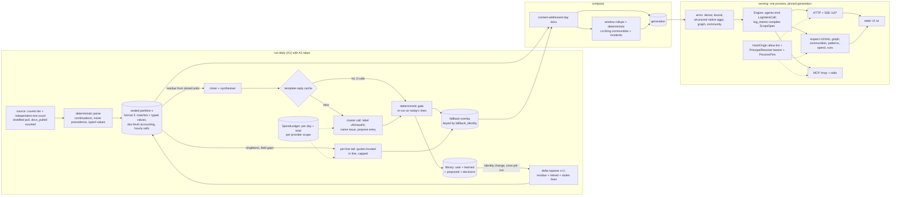

# V2 plan addendum A2: log analytics profile, accounted coverage with LLM fallback, UI and MCP

Status: **revision 4 — design, partly implemented (see §2.1 at `fdb7c4a`). Implementation runs in
four parallel slices. §11.R4 lists the rev 4 deltas, which apply on top of §11.0 (rev 3) and §11.1–§11.4
(rev 2) unless they supersede them.** It extends `docs/plans/v2_addendum_logs_and_patterns.md` (A1
rev 3) and `docs/plans/v2_implementation_plan.md`. It changes no frozen contract by itself. The
contract changes are listed in §4.7 and take effect only when the main plan's changelog records
them. `<pkg>` means the import root (today `su_multi_arm`). Owner-specific facts (hosts, ports, index
names, tenants, services, per-service measurements) live in a private deployment plan and never
here.

## Changelog

| Date | Rev | Change |
|---|---|---|
| 2026-11-04 | 1 | First version, grounded in `v2/logs` at `106d4b0`, the serving surfaces, the arms, the A1 execution-log entries, one private read-only deployment run (orders of magnitude only) and a pattern study of the historical support-search services' console and MCP adapter. |
| 2026-11-04 | 2 | Review r1 (`docs/plans/a2_plan_review_r1.md`, REVISE): all 10 blocking and 20 non-blocking findings accepted (see "Review response (round 1)"). The main changes are listed below. Owner decisions since rev 1: "100 % coverage" = 100 % accounted, signed off (O-A2-0); a total model budget per provider key for learning and extraction (§4.2.6); extraction extended to all in-scope services; GPU allowed for embeddings in the deployment (private plan). Kept compatible with the four slices already implementing rev 1, with per-slice deltas in §11. |
| 2026-11-04 | 3 | Review r2 (`docs/plans/a2_plan_review_r2.md`, REVISE: R2-B1..B6, n1–n9): all accepted except one part of n6, which is answered with evidence (see "Review response (round 2)"). Owner decisions since rev 2: **retention scopes**: raw (unredacted) copies 3 days, masked partitions 10 days, **derived arm data never expires** in the deployment, with a finite public default (§4.8); **raw tier as a package feature, off by default** (§4.9); **model capacity and budget** (latest owner decision, superseding an interim USD 20 figure): **self-hosted models first**: a local model server, then a shared self-hosted model on the LAN. A **paid** provider is used only as overflow, under a **USD 2 total per paid key**. When no tier has capacity, work is rescheduled (`capacity_deferred`). On paid exhaustion the overflow stops and the owner is asked, with no automatic raise. Answer-time model spend is a separate, reported budget line (§4.2.6). **Serving through a LAN forwarder** is supported (single-tenant, bearer, Host allow-list) (§4.4.2). Names already chosen by the running slices are adopted (`logs.retention.{keep_days, raw_days, derived}`, `logs.partitions.raw`, `logs reparse --from-raw`, `RawStore.read_unit(purpose=)`, `ingestion/log_rollups.py` with kinds `log_day` and `log_hour`, the `malformed` term in identity D, `recorded: false` units). |
| 2026-11-04 | 4 | Review r3 (`docs/plans/a2_plan_review_r3.md`, REVISE: R3-B1, R3-B2, n-r3-1..6): all accepted (see "Review response (round 3)"). Text-only edits, no restructuring. The landed per-day derived snapshots become the **interim archive and H1 import source**, with a versioned and widened identity, a pre-H1 serving bound `logs.history.serve_days`, window rollups over the masked window, and identity-span labels (§4.8.6). A paid tier fails closed without finite caps (§4.2.6). §2.1 is re-based on `fdb7c4a`. |

Rev 2 changes, with the finding each addresses:

- Accounting is redefined on source documents: two independently computed identities, with
  `fragment` as a document count (B1).
- The fallback runs **after seal** as a sealed overlay, and a `fallback` step joins `run-daily`
  (B2).
- Reparse becomes a delta reparse with content-addressed day documents and a reparse cost model
  (B3).
- Serving is single-tenant (operator sees all), and per-tenant ACL is deferred (B4).
- A typed log-intent step joins the plan contract, and free scopes over log kinds are refused (B5).
- Typed field values are persisted from L5a under a partition format gate (B6).
- Relations from unreviewed entries are `co_occurrence`, and `model_line` has an arm mapping (B7).
- A serving-path pins slice is added (B8).
- The `_` dataset fix and deterministic Louvain move into P0 (B9).
- Host and Origin allow-lists are added, and bearer auth is required whenever the UI is enabled
  (B10).

## Review response (round 3)

| Id | Disposition | What changed (section) |
|---|---|---|
| R3-B1 | Accepted | New §4.8.6, the **interim archive contract**. (a) The landed per-day derived snapshot (`<partitions>/derived/<source>/<day>.json.gz`) **is** the derived archive until H1, and H1 imports day shards from it for days whose partitions are gone. The §11.0 "refuse `derived ≠ window`" instruction is withdrawn, and A1 row 3a is corrected. (b) The snapshot gets `derived_format: 2` and the identity `sha(partition key, version, library identity, partition format, fallback identity, compose format)`. Its payload adds the typed-value aggregates (format 2), the accounting (format 3) and the overlay's model-assisted rows, and it is rewritten whenever that identity changes. A snapshot of an earlier format gives `source_unavailable` for the new kinds in history, never zero. (c) `logs.history.serve_days` (default = `keep_days`) bounds pre-H1 serving: compose serves at most that many most recent days, and older snapshots stay archived but unserved. Compose cost is therefore bounded by `serve_days`, not by history. (d) Window rollups (`signature_window`, `signature_tenant_window`, `first_seen`, co-firing) are computed over the **masked window** only. A rendering note states when the served days span more than one library identity. Tests: snapshot round trip including overlay rows; the serve bound; window rollups unchanged by archived days; mixed-identity label. |
| R3-B2 | Accepted | §4.2.6, §4.6: config load **refuses** a chain containing `tier: paid` unless `budgets.providers.<p>.max_usd_total` is finite **and** every learning scope that can reach it (`learning.bootstrap`, `learning.patterns`, `learning.extraction`) has a finite `max_usd_per_day`, with a typed `ConfigError`. `learning.bootstrap.enabled` defaults to `false`, and when enabled it draws on paid tiers only within those caps. C4 test: a paid tier without caps is refused at load. |
| n-r3-1 | Accepted | §4.9: the raw-tier write and `--from-raw` move into `ingestion/raw_reparse.py`. `schedule.py` and `learning/` must not import `raw_store`, and the import test is extended to them. |
| n-r3-2 | Accepted | §2.1 is re-based on `fdb7c4a` with an evidence label per landed item; "Evidence status" and the stale risk rows (§8) are updated. |
| n-r3-3 | Accepted | §4.8.5: at 180 days of synthetic history, log-tool p95 ≤ 200 ms and graph neighbourhood p95 ≤ 500 ms. |
| n-r3-4 | Accepted | §4.4.2: the Host guard is active whenever `serving.ui.enabled`, `serving.mcp.mount_on_http` or a non-empty `serving.allowed_hosts` is set, with a test for API-only LAN use. |
| n-r3-5 | Accepted | §4.2.6: measuring the per-tier throughput `T` is an E1b/R0 deliverable, and `learning.bootstrap.enabled: true` is refused until a measured `T` is recorded in the run report (`bootstrap.require_measured_throughput`, default true). |
| n-r3-6 | Accepted | §4.8.6: the H1 import builds lineage rows for snapshot days from the decisions replay up to each day's library identity. |

## Review response (round 2)

### Blocking

| Id | Disposition | What changed (section) |
|---|---|---|
| R2-B1 | Accepted (owner budget decision; options (a) and (c)) | §4.2.6 is rewritten under the caps. **(a)** A separate `learning.bootstrap` scope: ≤ USD 10 of the provider total, ≤ USD 5/day, active for at most 3 days, with `bootstrap.max_clusters_per_day: 800`. That is ≈ 1.5×10³ top-ranked clusters in 2 days at the illustrative price, before their partitions expire. **(c)** A deferred cluster is re-keyed to its newest member partition, so a recurring template survives the expiry of the day it was first seen. Steady state: ≤ USD 1/day and `max_clusters_per_day: 150` (one number everywhere, n9). Runway is restated: USD 20 − 10 = USD 10 at ≤ USD 1/day is ≥ 10 days. There is a defined **`exhausted` state**: model calls stop, the cache-only rebuild continues, new residue becomes `unresolved: budget_deferred`, `coverage_day.fallback_state` is set, the rendering says "model-assisted extraction paused since D (budget)", the run report asks the owner, and the cap is never raised automatically. C4 has an exhaustion test. **Superseded in part by the later owner decision:** the paid budget is USD 2 per key in total, and self-hosted models are primary. The bootstrap is therefore **capacity-bound, not budget-bound**: it is front-loaded on self-hosted capacity over the first 2–3 days (`learning.bootstrap.max_calls_per_day`), with the paid overflow ≤ USD 2 per key in total. `capacity_deferred` joins `budget_deferred`. The exhausted state now means "paid overflow off; self-hosted tiers continue". §4.2.6 is rewritten again. |
| R2-B2 | Accepted | §4.2.3: a **line-reply cache** keyed by `(redacted line sha, requested field set, model id, prompt version, reply schema version)`, stored as ledger `raw:` entries tagged with every contributing masked partition (they expire with the last one). Overlay rebuild is therefore 0-call for template, fill and line sources alike. The `fallback` step ranks `fallback_pending` and `budget_deferred` heads of **every in-window masked partition**, not only today's, under the caps. C2 acceptance covers `model_line` and line-fill heads after an identity change, plus a pending head on day D−5 filled by the day-D run. |
| R2-B3 | Accepted | §4.1.6: `library_diff(old_snapshot, new_snapshot) -> list[ChangeClass]` classifies changes A–H, each with a defined delta (format, continuation, redaction and engine changes reparse the affected units in full; annotate changes re-run the annotate stage; any field change on an existing entry puts its heads in the retired set plus a steal scan; and so on). L5c acceptance adds a **property test**: over generated diffs covering every class on the synthetic corpus, delta reparse produces byte-identical `matches` to a full reparse. |
| R2-B4 | Accepted | §4.1.5: one guard, `log_scope_guard`, sits at the records choke point (`arms/structured.py` before `RecordStore.execute`, and `Engine.aggregate_in`). Under `profile: logs` it refuses any `ScopeSpec` that **can match** a log kind (no kind predicate, a negated kind predicate, or a kind set that is not exactly one log kind) unless it was compiled from a `LogIntentCall`. The reason is `intent_required`, with the matchable kinds named. That covers decision steps, `DecisionRequest.scope`, `SearchRequest.aggregate`, `POST /v2/tools/aggregate` and the MCP `aggregate` tool. An explicit single-kind scope passes only with `logs.serving.allow_adhoc_scopes: true` (default false), and is then rendered "ad-hoc scope, not a log intent". There is one test per entry point. |
| R2-B5 | Accepted (owner retention decision) | New §4.8 **history tier**. Retention scopes are config (`logs.retention.{raw_days, keep_days, derived}`), with the finite public default `derived: window`. With `derived` set to `forever` or N days, compose writes **append-only day shards** (content-addressed per day and derivation identity). A generation becomes a manifest of shard references plus one window shard, and every read path filters on the generation's shard set natively in the backend, so compose touches only new or changed days and never copies history. Frozen days (older than `keep_days`) are never reparsed. They keep their library identity, and the new **`signature_lineage`** table maps superseded and fixed signatures to a lineage root, so trends join across identities and answers state "spans N library identities". History-scale questions run on-the-fly native aggregations over day rollups, plus an incrementally maintained `signature_history` kind. `retention verify` is scoped per tier. A 6-month sizing table and an alert threshold are added, and hourly-to-daily downsampling has a placeholder contract. Acceptance: append day 181 to 180 days of synthetic history in ≤ 10 min and ≤ 4 GB, with 0 rows rewritten for days 1–180. A1 §3.8.3 rule (a) is amended by changelog to apply only to tiers that expire. New slices H1 and H2. |
| R2-B6 | Accepted, option (b) | New §4.9 **raw tier**, a package feature off by default (`logs.partitions.raw`, being built in the bug-fix slice). Unredacted units are written before redaction, mode 0700/0600, at a path outside the partition store, backends, library and any served directory. `RawStore.read_unit` accepts only the purposes `reparse` (`logs reparse --from-raw`, which writes a new masked partition version) and `audit` (`privacy scan --raw`). An import-graph test proves that ingest, compose, egress, learning, serving, UI and MCP never import it. It expires after `raw_days` (< `keep_days`), and `verify` checks age and modes. Re-redaction is possible only within `raw_days`; reparse is possible within `keep_days` from masked partitions; history is never re-derived. |

### Non-blocking

| Id | Disposition | Change |
|---|---|---|
| n1 | Accepted | §4.2.1: identity D is `docs_pulled = malformed + heads + joined + fragments + overflow`. Units stored before accounting are `recorded: false`, and their S, Q and D are reported as `not_recorded`, never zero or balanced. The compose format rule reparses them for H only. |
| n2 | Accepted | §4.2.1: with an INFO-sample stratum, the strata cover the unit by construction, so S is `total = Σ_strata count_s` with independent counts. `rest` exists only when no INFO stratum is configured, and is then the independently counted complement. |
| n3 | Accepted | §4.2.1: the Q tolerance is uncapped `count ≤ fetched ≤ ⌈count × (1 + settle.max_growth)⌉`, and capped `min(quota, count) ≤ fetched ≤ quota`. `random_score` plans check per stratum, not per hour. There is a late-write fake test. |
| n4 | Accepted | §4.3: the single-tenant refusal is enforced in `Engine.__init__`, `create_app` and `create_mcp` (the access policy is injected from Python, so config validation alone cannot see it). |
| n5 | Accepted | §4.2.6: the ledger is keyed by `(provider, api_key_env)`. A key rotation under the same provider name keeps the total (the owner's cap is per provider key, and the rotation is recorded). Answer-time spend (generator, `llm` planner, community reports) is a separate scope `serving.answers`, reported and outside the learning totals unless `budgets.providers.<p>.include_serving: true`. |
| n6 | Partly accepted | The `mcp>=1.10` floor is kept. A check on 2026-11-04 showed that 1.10.0 ships `mcp/server/transport_security.py`, `FastMCP(transport_security=…)` and `streamable_http_path`, while 1.9.0 lacks transport security. Accepted: an M1 CI job runs at `mcp==1.10.0`. |
| n7 | Accepted | §5.3: merge order bug-fix → L5 → fallback → UI; an owner for every shared file; format 2 owned by L5, format 3 by fallback; B2+B3 → L5 slice, B10 → fallback slice. |
| n8 | Accepted | §4.4.2: the Host match compares the host name only and ignores the port (tunnels on other local ports). |
| n9 | Accepted | `max_clusters_per_day` is 150 everywhere; the deployment's override is stated in the private plan. |

No finding was rejected.

## Review response (round 1)

### Blocking

| Id | Disposition | What changed (section) |
|---|---|---|
| B1 | Accepted | §4.2.1: the counting unit is the **source document** (scroll hit). Identity (a) per unit: `docs_pulled` (counted by the puller, never derived) = `heads + joined + fragments + overflow` (multiline stats). Identity (b): each head record has exactly one final status, so Σ final status = `heads`. `fragment` is a document count, not a status. Source level: strata are disjoint **by query construction** (each stratum query excludes the higher ones); per stratum and hour, `fetched == min(quota, count)` is checked against the sample plan; `rest` (outside the tier) comes from an **independent** `_count` of the complement query, so `total = Σ strata + rest` is a check, not a definition. Token strata are exact for their query and `approximate` as level claims (A1 B2). C1 acceptance adds a pull containing joined and overflow documents, and a puller-side miscount that refuses the seal. |
| B2 | Accepted (overlay option) | §4.2.3, §4.2.8: pull → deterministic parse → **seal v** → fallback over the sealed residue, read from the stored units (not the capped `unparsed` sample) → atomically written **fallback overlay** keyed by `fallback_identity = sha(partition key, version, library identity, proposed-set identity, model ids, prompt version, reply schema version)`. Compose reads v + overlay. A crash between seal and overlay leaves the overlay missing: compose proceeds deterministic-only, the affected heads are `unresolved: fallback_pending`, and the next run fills in. Provisional values are re-derived after a reparse **without model calls**, from the template reply cache. The `run_daily` integration (`ingestion/schedule.py` step `fallback`, run report, resume) moves into C2 (+3 ed). |
| B3 | Accepted (a) + cost model | §4.1.6: **delta reparse.** The lines re-matched are the residue, plus lines whose `pattern_id` was deprecated, superseded or disabled, plus lines that new entries would steal. The last set comes from an RE2 `Set` scan of the new entries over the stored parsed lines, which is a proof, not the gate's sample. Partitions get v+1 with unaffected rows copied. Day-document ids are content-addressed (they no longer contain the partition version), so unchanged rows are reused. Identity changes are applied at most once per run. There is a reparse cost model and a measured fallback budget. L5c acceptance adds "one auto-approved entry on day 11". +3 ed. |
| B4 | Accepted (a) | §4.3, §4.1.2: **single-tenant serving** (`NoConstraints`, operator sees all) is the logs-profile default and the only supported mode in A2. Config validation refuses a non-default access policy under `profile: logs` with a typed error naming this addendum. S1 acceptance becomes "operator sees all; a tenant-scoped deployment is refused at start-up". Per-tenant ACL is deferred, with its requirements listed (§9). |
| B5 | Accepted | §4.1.5, §4.7: `StructuredStep.intent: LogIntentCall | None`. Under `profile: logs` every agent (rules, classifier, `llm`, cascade) selects log questions through it, and the `ScopeSpec` is compiled only by `decision/log_intents.py`. A free `ScopeDraft` over a log kind is refused (`intent_required`). Each `SearchResult.aggregates` entry of a log intent carries `intent`, `args` and `rendering`. L5d acceptance adds `llm` and `cascade` with a scripted provider (identical `ScopeSpec` and `ScopeResult` to the tool call). +2 ed. |
| B6 | Accepted | §4.1.2, §4.7: L5a persists typed group values with spans in `matches` (`source: pattern`) and introduces `PartitionManifest.format` (1 = today, 2 = typed values + document-level multiline counts, 3 = C1 accounting). Compose reparses an older-format partition from retained raw data first, and if the raw data is gone it reports `source_unavailable` for the new kinds, never zero. There is a mixed-format compose test. +2 ed. |
| B7 | Accepted | §4.1.3, §4.2.5: relations from any entry without a human approval (`provisional`, auto-learned) and from `model_line` are emitted as `edge_kind: co_occurrence, support: unchecked` (valid under the `Relation` validator), never `fact`. `model_line` heads feed `unit_day`, `coverage_day` and an `unknown_signature` bucket (`signature_id = "unknown"`, `extraction_source: model_assisted`) in the signature rollups, and they produce no graph edges. There is a test. |
| B8 | Accepted | New P0 item P0-PIN (+3 ed): `ProcessPins` in `Engine` and in every serving entry point (HTTP, SSE, MCP, inspect). Acceptance: a streaming answer holds G; a concurrent `retention run` is refused for G until the stream ends; the stream completes. S1 and M1 depend on it. |
| B9 | Accepted | P0: the `_`-dataset fix (literal prefix match in the Lucene index-name parse, plus checking `active_generation` after activation) splits from F7. Deterministic Louvain construction (sorted integer node ids) with a `PYTHONHASHSEED`-varied cross-process test is in P0, and L5b's co-firing must use the same constructor; its acceptance repeats the test. |
| B10 | Accepted | §4.4.2: when `serving.ui.enabled` or `serving.mcp.mount_on_http` is set, a Host-header allow-list (loopback names plus the configured bind and `serving.allowed_hosts`) applies to every route, and a cross-origin `Origin` is refused on every non-GET route and on `/v2/answer/stream`. `ui.enabled` requires `auth: bearer_env` (or an injected resolver), unless `serving.ui.allow_unauthenticated_loopback: true` is set explicitly; `doctor` warns when it is. S1 acceptance: `Host: attacker.example` gets 421. The SDK's `TransportSecuritySettings` are enabled on `/mcp`. |

### Non-blocking

| Id | Disposition | Change |
|---|---|---|
| N1 | Accepted; **owner decided 2026-11-04** | O-A2-0 recorded as decided (§10): "100 % coverage" means 100 % accounted. Regex-only (`deterministic_coverage`) target ≥ 0.90 per core service; coverage including the model (`extracted_coverage`) target ≥ 0.99. The convergence target (error tier ≥ 0.98 after 14 days, `model_assisted_share` ≤ 0.02) stays a non-binding proposal. INFO sample ≥ 0.80. The owner may revisit. |
| N2 | Accepted | Rollup and coverage dimension `pattern_owner: user \| learned \| none`; metric `deterministic_reviewed` (user-owned or human-approved entries only). |
| N3 | Accepted | Labels use the synthesiser's group names `vN` and `maskN` (no rename in synthesis). |
| N4 | Accepted | Cache key: `(template sha, service, level, model id, prompt version, reply schema version)`. Only labels and regex are reused; the gate always re-runs on today's lines, and cluster or line ids are never reused. Test: day-2 reuse with new ids passes the gate with 0 calls. |
| N5 | Accepted | §4.2.6: a convergence timeline, and deferred clusters re-ranked against the newest partitions (they expire with their partitions). E1 reports the backlog trajectory. The total-budget decision removes the bootstrap backlog at the measured volume. A real-model benchmark needs the owner's paid-provider approval (given for the deployment, §4.2.6). The ratio wording is corrected to "about 2 orders of magnitude". |
| N6 | Accepted | §4.7: per-line `egress_refused` is a behaviour change from L4b's refuse-the-run, with a test. A run is still refused when more than `egress.max_refused_share` (default 0.01) of the batch is refused. |
| N7 | Accepted | §4.1.5: log tools choose a rollup whose estimated group count is ≤ `max_groups` (compose records the cardinalities). `by: endpoint` requires `service`, and otherwise uses `endpoint_window` (top endpoints per service, bounded). There is a gold case above `max_groups`. |
| N8 | Accepted | `CoFiringConfig.unit: tenant_env_hour \| service_hour` (default `tenant_env_hour`, from the cells' existing keys). `deployment` joins the cells at partition format 2, and `deployment_hour` becomes valid only then. |
| N9 | Accepted | `signature.template` is the masked human template (from mining, or derived from exemplars by masking). The regex moves into metadata `regex`. |
| N10 | Accepted | §5.3: S1 is split into S1a (info, tools, UI mount, Host check) and S1b (graph, communities); backend B starts with B2+B3; the gold generator (E1a) moves ahead of L5a; the MVP overview drops `log_coverage`; timing re-derived. |
| N11 | Accepted | §4.4.1: the rationale is corrected (a static Next.js export would also avoid a runtime server; the choice rests on no SSR need, one toolchain and a smaller surface). Runtime validators come from JSON Schema via `ajv` (compiled standalone). Pinned Node, a committed lockfile and `npm ci`. Third-party licence notices go in the UI wheel. The UI wheel build fails on an empty static directory. A test asserts the core sdist excludes `ui/`. |
| N12 | Accepted | Playwright asserts zero `securitypolicyviolation` events. External links render with `rel="noopener noreferrer"` and the visible URL. `nosniff` is added on `/v2/*`. |
| N13 | Accepted | Copy commands use POSIX quoting (`shlex.quote`), with a `shlex.split` round-trip test over metacharacters. |
| N14 | Accepted | §4.5.2: lifespan composition (the parent lifespan runs `session_manager.run()`), `streamable_http_path="/"` mounted at `/mcp`, optional `serving.mcp.token_env` (a second resolver in one process), and `TransportSecuritySettings`. Tested in M1. |
| N15 | Accepted | §4.7 rows fixed: `Document.kind` is a free `str` (new kinds need no literal change); `FieldSpec.role` arrives with B2, so C1 depends on B2+B3. |
| N16 | Accepted | P0 adds the env-anchored index-name grammar. Unparseable names are counted as `excluded_scope (unparsed_name)` in source accounting. S1a adds WARNING logs on 503 (class and operation only). C1 adds fragment accounting to the coverage CLI. |
| N17 | Accepted | Per-field type and range validators (`status_code` 100–599, `latency_ms` ≥ 0 and ≤ 3.6×10⁶, `http_method` enum, `endpoint` starts with `/`). E1 reports per-field precision. |
| N18 | Accepted | §2.3 and §4.5 describe the historical tools generically. |
| N19 | Accepted | The path is `src/<pkg>/testing/fixtures/logs/gold/`. |
| N20 | Accepted | S1a: `serve` honours `serving.http.bind` and `auth: bearer_env` when flags are absent, and its non-loopback guard checks the resolved auth, not only `--token-env`. |

No finding was rejected.

---

## 1. Executive summary

**Goal.** Operators ask questions about their log cluster in a browser or from an MCP client and get
streamed, cited answers whose numbers carry their basis and exactness. Examples: "which services
error most yesterday", "what is new", "which tenants are affected by S", "how has S trended", "what
fired together around 14:00", "how much did we parse". Every arm (dense, lexical, structured, graph,
community) is fed from the pattern extractor's output, and every pulled source document is
**accounted for**.

**Key decisions.**

1. **The L5 logs profile maps pattern output onto every arm** (§4.1).
   - Dense embeds signature and incident texts only, using the masked human template, never the
     regex or line text.
   - Lexical indexes signatures, exemplars and incidents, plus an opt-in, capped, lexical-only
     `line` kind.
   - Structured runs on typed rollups through native aggregations, with typed field values persisted
     per line from L5a.
   - Graph edges carry span provenance, and unreviewed sources are `co_occurrence`, never `fact`.
   - Communities are deterministic co-firing incidents.
   - Log questions compile only through typed log intents, so every agent, the UI and MCP get the
     same numbers.
2. **"100 % coverage" is "100 % accounted", as the owner decided on 2026-11-04 (O-A2-0)** (§4.2).
   Every source document is a head with exactly one of `parsed`, `parsed_filled`, `provisional`,
   `model_line`, `noise` or `unresolved` (with a closed-list reason), or a `joined`, `fragment` or
   `overflow` document. Targets: regex-only ≥ 0.90 per core service, coverage including the model
   ≥ 0.99. Two
   independently computed identities hold over source documents, and an imbalance refuses the seal.
   Deterministic coverage stays the headline, with a convergence target on the error tier.
   Model-assisted extraction is reported and labelled separately.
3. **The LLM fallback runs after seal, cluster-first, grounded by construction, as a sealed
   overlay** (§4.2.3).
   - Each residue cluster gets one call that labels the groups of the synthesised regex (or
     proposes a regex through the gate). Values are always spans.
   - A capped per-line tail locates quotes in the line or drops them.
   - A template reply cache makes recurring templates free, and lets provisional values be rebuilt
     after a reparse without model calls.
4. **Reparse is a delta**: only residue, retired-entry lines and lines a new entry would steal are
   re-matched. Day documents are content-addressed, so a daily library change does not rebuild the
   window (§4.1.6).
5. **Single-tenant serving** (the operator sees all). Per-tenant ACL is deferred with its
   requirements (§4.3, §9).
6. **UI.** A static React SPA in a separate `su-multi-arm-ui` wheel, served by the package's HTTP
   server on one origin. It is read-only, bearer-authenticated whenever enabled and Host-checked
   (§4.4).
7. **MCP.** Typed read-only log tools on the existing FastMCP server, with stdio and streamable HTTP
   (optionally mounted on the HTTP app, with correct lifespan and transport security) (§4.5).
   Pattern decisions stay CLI-only by default (O-A2-3).
8. **Three retention tiers** (§4.8, §4.9):
   - an optional raw (unredacted) tier, off by default (`raw_days`, 3 in the deployment);
   - masked partitions (`keep_days`, 10);
   - derived arm data (`derived`: `window` by public default; `forever` or N days by opt-in).

   With non-window retention, history is an append-only set of per-day shards that generations
   reference without copying. Frozen days keep their library identity and join across identities
   through a signature lineage table.
9. **Model capacity and budget** (§4.2.6):
   - an explicit, recorded **provider chain** per role: a self-hosted local server, then a shared
     self-hosted LAN server, then paid overflow;
   - paid spend is capped at **USD 2 total per key** (deployment value; the public default is no
     paid tier);
   - when no tier has capacity, heads become `capacity_deferred` and are rescheduled;
   - when the paid total is spent, the overflow stops and the owner is asked;
   - answer-time spend is a separate, reported budget line.

**Estimate.** 147 ed of package work, 138 ed net after A1's L5 row (9 ed) is absorbed.
A1's B2+B3, B10 and B11 (15 ed) are not re-counted:

- B11 is in progress in the bug-fix slice.
- B2+B3 is owned by the L5 slice.
- B10 is owned by the fallback slice.

Rev 3 adds 30 ed:

| Item | ed |
|---|---|
| History tier H1 | 14 |
| Lineage and history questions H2 | 4 |
| Raw tier R1 | 3 |
| Change classifier and property test | 2 |
| Line cache and window-wide pending | 2 |
| Bootstrap scope and exhausted state | 2 |
| Provider chain and capacity scheduling | 2 |
| Scope guard | 1 |

The work runs as four parallel slices (§11). A read-only UI MVP on the existing API is being
deployed early. The full scope lands about week 13 of the original staffing model.

**Evidence status (at `fdb7c4a`).** These have landed with synthetic and contract tests:

- the raw tier;
- retention scopes with per-day derived snapshots;
- serving pins;
- the Host/Origin guard;
- the web UI MVP with shell-quoted copy commands;
- deterministic Louvain;
- safe redaction (B11);
- the `_` dataset fix.

Everything else is design (§2.1). Volumes in §4.2.6 are orders of magnitude from one private run, and
prices are illustrative.

---

## 2. Inputs and current state

### 2.1 What exists (read at `106d4b0`; landed since, at `fdb7c4a`)

**Landed at `fdb7c4a`** (evidence: synthetic/contract tests unless stated):

| Item | Where | Note |
|---|---|---|
| Safe redaction engine (B11) | `privacy/` | |
| Raw-copy tier, purpose-gated reader, 0700/0600, `raw_days < keep_days`, import test | `ingestion/raw_store.py`, `core/config_logs.py` | n-r3-1 moves the calls out of `schedule.py` |
| Retention scopes `keep_days`/`raw_days`/`derived` and **per-day derived snapshots** | `ingestion/logs_compose.py` (`write_derived`), `ingestion/retention.py` | interim archive; R3-B1 widens it (§4.8.6) |
| Serving pins (`ProcessPins`) | `engine.py` | P0-PIN |
| Deterministic Louvain (`louvain_partitions`) | `communities/base.py` | |
| OpenSearch index naming fix (`_` datasets) | `backends/opensearch/adapter.py` | |
| Host allow-list (421), Origin check (403), `nosniff`; bearer required with the UI | `serving/hosts.py`, `serving/ui.py`, `serving/http.py` | guard active only with the UI today (n-r3-4) |
| Web UI MVP (Ask/stream, per-arm evidence, graph, charts, trace; CSP) | `ui/`, `serving/ui.py` | |

**Still design:** L5a–L5d, C1–C4, H1/H2, M1 log tools and S1b. The table below is the state at
`106d4b0`.

| Area | State | Evidence label | Where |
|---|---|---|---|
| Read-only source, allow-list, counts tier, stratified pull | implemented | synthetic + one private read-only run | `sources/` |
| `pattern` extractor, library files, lint, RE2; stage statuses `parsed/format_only/unparsed/noise/timeout`; multiline stats `heads/joined/fragments/overflow` | implemented | synthetic/contract | `extraction/patterns/*`, `ingestion/logs_parse.py`, `sources/multiline.py` |
| Miner, synthesiser (groups `vN`, `maskN`), gate, auto/manual promotion | implemented | synthetic | `learning/patterns/*` |
| LLM proposal loop, egress policy, per-day SQLite spend ledger (learning scope only) | implemented, **not wired into `run-daily`** (`learn: not_run`) | mocked provider | `learning/patterns/*`, `ingestion/schedule.py` |
| Day partitions (sealed versions immutable; reparse/repull write v+1), compose, rollups | implemented; `matches` hold no typed field values; no partition format version | synthetic/contract; N10 memory not met (10.3 GiB at 10⁶ rows) | `ingestion/*` |
| Retention rule (a), pins, ledger refs, content-based verify | implemented; **`ProcessPins` not used by `Engine` or serving** | synthetic + real-service ledger/pins | `ingestion/{retention,pins}.py` |
| Native aggregation pushdown (OpenSearch 2.x/3.x, Elasticsearch 8.x) | implemented, opt-in | real-service, synthetic, 2×10⁵ docs | `backends/_lucene_aggs.py` |
| HTTP, SSE, MCP (stdio, streamable HTTP, drift check), `PrincipalResolver` | implemented; no Host/Origin checks; built-in principals have no tenant; access policy injected from Python only | contract | `serving/*`, `engine.py` |
| Co-firing communities, log intents, graph `edge_kinds` from config, B2+B3, B10 | not started | — | — |
| B11 safe redaction, noise precedence, library continuations, `_` dataset fix, deterministic Louvain, PIT probe | **in progress** (bug-fix slice) | — | §11 |

### 2.2 Findings from a private deployment run (neutral terms)

| Id | Finding | Fixed in |
|---|---|---|
| F1 | Library `continuation` entries were not applied, and built-ins missed bracket-only, object-field and column-0 traceback lines | P0 (in progress) |
| F2 | Noise ran only after messages | P0 (in progress; key `precedence: before_message`) |
| F3 | The grammar bound qualifiers inside "by \<field\> \<window\>" and inside numeric field names | P0 |
| F4 | Grouped sums were labelled `group_count`/`rank` | P0 |
| F5 | The manifest reported `relations: 0` with native links present | P0 |
| F6 | Filters on built-in record keys were refused | P0 |
| F7a | **A dataset name with `_` activated, then every request failed** (index-name parse) | P0 (in progress) |
| F7b | `storage.catalog` cannot name a Lucene backend (no generation registry) | deferred (§9) |
| F8 | Char chunks overflowed a 512-token embedder | P0 |
| F9 | `probe` sent PIT requests when PIT was unavailable | P0 (in progress) |
| F10 | Seeded Louvain was not reproducible across processes (graph built in set/dict order) | P0 (in progress) |
| F11 | About 10 % of in-scope index names stayed `unparsed` without an env-anchored grammar | P0 |
| F12 | 503s were not logged server-side | S1a (in progress in the bug-fix slice) |
| F13 | The coverage CLI had no fragment accounting | C1 |

### 2.3 Reference console and MCP adapter (pattern study)

The historical console's interactions that A2 keeps, inferred from code and to be confirmed (O-A2-9):

- the Ask box with Stop and superseding abort;
- the answer card with clickable `[n]` citations that scroll to and flash the evidence;
- arm chips;
- per-arm tabs (overview, dense, lexical, graph, structured with table and chart, community,
  fusion, trace);
- the graph panel;
- the community panel with trend badges.

Dropped: evaluation views (replays, evolution, progress), model selectors, and an API route that
silently served bundled mock data when the backend failed.

Its MCP adapter exposed three read-only tools: an answer tool (answer, citations, stage-level
progress, a status, exact counts only when the engine produced them, limitations, arms used), a
filter-options tool (the values the engine can apply exactly, with counts) and a dataset-listing
tool. It used stdio and streamable HTTP.

---

## 3. Target architecture

### 3.1 Principles (additions to A1 §2.1)

13. **Accounted, not assumed.** Two identities over source documents are computed independently,
    and an imbalance is a seal error.
14. **Model output is labels and quotes, never values.** Stored values are spans of the redacted
    line, and a quote that cannot be located is dropped.
15. **Deterministic first, model second, both labelled.** Rollups carry `extraction_source` and
    `pattern_owner`. Unreviewed sources never become `fact` edges.
16. **Sealed means sealed.** Model work happens after seal, in an overlay with its own identity.
17. **One plan per log question.** Every agent, the UI and MCP compile log questions through typed
    intents only.
18. **Read-only, authenticated, Host-checked by default.**
19. **Tiers expire independently; history is appended, never copied or rewritten.** The public
    defaults are finite, and a deployment opts in to longer derived retention.
20. **Unredacted data is quarantined.** Only the raw tier holds it; one reader with a declared
    purpose may open it; it is never served, indexed or sent to a model.

### 3.2 Component diagram



### 3.3 Package layout additions

```
src/<pkg>/
  profiles/logs.yaml                     # L5 profile
  ingestion/
    accounting.py                        # identities, final statuses, reasons, coverage rows      [C1]
    overlay.py                           # fallback overlay store, fallback_identity               [C2]
    reparse.py                           # delta reparse (Set scan, retired entries, residue)      [L5c]
    rollups.py                           # + endpoint_day, endpoint_window, exception_day, coverage_day, incident, line
    logs_compose.py                      # content-addressed day docs, overlay read, format gate
    schedule.py                          # + fallback step                                         [C2]
  communities/cooccurrence.py            # uses the deterministic Louvain constructor              [L5b]
  learning/extraction/                   # slots.py lines.py fill.py replies.py cache.py validators.py  [C2, C3]
  decision/log_intents.py                # LogIntentCall compile                                   [L5d]
  runtime/log_tools.py                   # typed read-only tools                                   [L5d]
  serving/inspect.py serving/ui.py serving/hosts.py serving/patterns_admin.py   [S1a, S1b, S2]
ui/                                      # npm project -> wheel su-multi-arm-ui                     [U1-U4]
scripts/gen_ui_schema.py
src/<pkg>/testing/fixtures/logs/gold/    # synthetic 10-day generator + questions                  [E1a]
```

---

## 4. Module contracts

### 4.1 L5 logs analytics profile

**Purpose.** A declarative profile (`profile: logs`) that turns sealed partitions plus their overlays
into documents for every arm, declares the schema, intents and tools, and configures the arms.
**It does not** pull, parse or learn, and it leaves non-log profiles unchanged.

#### 4.1.1 Document kinds and projections

| Kind | One per | Text fields | Projections | Notes |
|---|---|---|---|---|
| `signature` | signature | header, `template` (**masked human template**), `issue` (after human approval only, N3), `exemplars` (`line` recipe) | catalog, lexical, vector (`template` + `issue` + category), graph | regex in metadata `regex` (N9) |
| A1 day/window kinds | A1 §3.7 | header | catalog, records, graph (header links) | new dimensions (§4.1.2) |
| `endpoint_day` | day × service × endpoint × HTTP method × status class | header | catalog, records, graph | typed values (§4.1.2) |
| `endpoint_window` | service × endpoint (top `max_per_service`) | header | catalog, records | keeps `by: endpoint` under `max_groups` (N7) |
| `exception_day` | day × service × exception class | header | catalog, records, graph | |
| `coverage_day` | day × service × tier | header | catalog, records | §4.2 metrics |
| `incident` | co-firing community × window | header (member signature ids, services, peak hour), `summary` (deterministic) | catalog, lexical, vector, graph | anchors `co_fires_with` |
| `line` (opt-in) | head record in configured tiers | header, `text` | catalog, lexical only | Lucene only; capped; never embedded |

`Document.kind` is a free string, so new kinds need no type change (N15). The L5 slice implements
the per-day and per-hour analytics rows as `log_day` (day × tenant × env × service × level × status ×
signature) and `log_hour` in `ingestion/log_rollups.py`, next to A1's `rollups.py`. Rev 3 adopts
those names, and the intent table (§4.1.5) maps onto them where it names `signature_day` or
`signature_hour`.

**Content-addressed day documents (B3).** A day document's id is `doc_id(kind, partition_key, dims…)`
and does not contain the partition version. Its catalog content hash covers metadata and text. A
reparse that leaves a row unchanged therefore yields the same id and hash, and compose reuses it
(catalog, embeddings and records).

#### 4.1.2 Records schema, typed values and sizing

**Typed values persisted per line (B6, slice L5a).** `matches` rows gain
`fields: [{name, value, type, start, end, source: "pattern"}]` for every declared typed group of the
format, message and annotate hits that parses. A value that fails its type or range validator
(§4.2.4, N17) is stored as a gap `{name, error: "type_invalid" | "range_invalid"}`, not as a value.
Rows also gain `pattern_owner`. **Partition format** (`PartitionManifest.format: int`):

| Format | Content | Owner slice |
|---|---|---|
| 1 | today (`106d4b0`) | — |
| 2 | typed values and gaps in `matches`, `pattern_owner`, `deployment` in hourly cells, document-level multiline counts and `docs_pulled` in the manifest | L5a (with the puller counter from C1) |
| 3 | `accounting` section (§4.2.2) | C1 |

**Compose rule.** A partition below the profile's `min_partition_format` (3) is delta-reparsed from
retained raw data first. When the raw data has expired, the new kinds report `source_unavailable` for
that day, never zero, and the run report lists the day.

**Schema.** These are the A1 fields plus the following; `role` per A1 B2 lands with B2+B3:

| Field | Type | Role / flags |
|---|---|---|
| `date`, `ts_hour`; `tenant`, `env`, `deployment`, `service` | date, datetime; keyword | time basis (N19); listable, filterable. **`tenant` is a dimension, not an ACL field** (B4) |
| `level`, `signature_id`, `category`, `pattern_id` | enum/keyword | listable; `signature_id = "unknown"` for `model_line` heads (B7) |
| `endpoint`, `http_method`, `status_class`, `status_code`, `exception_class` | keyword/enum/integer | typed groups; endpoints path-templated, `__other__` overflow approximate |
| `latency_ms_sum`, `_count`, `_max`; `latency_ms_p95` | number | additive (max-additive); p95 `additive: false` |
| `lines`, `lines_total`, `count_<query>` | integer | additive |
| `basis`, `row_exactness`, `method` | enum | `role: basis` / `exactness` |
| `extraction_source` | `deterministic \| model_assisted` | `role: extraction` (worst-of; needs B2's `FieldSpec.role`) |
| `pattern_owner` | `user \| learned \| none` | dimension (N2) |

**Sizing** (unchanged from rev 1; about 6.3×10⁵ window rows, about 1.3×10⁶ with `signature_hour`).
Native aggregation is the serving plan. Compose records the cardinality of every rollup for intent
selection (N7).

#### 4.1.3 Graph ontology and provenance

| Predicate | Subject → object | `edge_kind`, support | Anchor |
|---|---|---|---|
| `emits`, `runs`, `serves`, `raises` | service→signature, tenant→service, service→endpoint, signature→exception | `native_link`, `unchecked` | headers of day rollups |
| library relations of **user-owned or human-approved** entries | line entity groups | `fact` (`trigger_in_span`) or `co_occurrence` (A1 `PredicateSupport`) | exemplar line chunk |
| library relations of **auto-learned, unreviewed or provisional** entries | line entity groups | **`co_occurrence`, `unchecked`** (B7) | exemplar line chunk |
| `co_fires_with` | signature ↔ signature | `co_firing` (new), support `{lift, cells, window}` | `incident` header |

- `model_line` heads emit **no** graph edges (B7).
- Relations become `fact` only after a human `approve` record. The next reparse re-derives them,
  which is visible through the reuse salt (A1 §3.4.3).
- `edge_kinds` come from config. The profile default is `["fact", "native_link"]`; `co_firing` is
  admitted only by the `around` and `co_fired` templates and labelled "co-occurrence, not
  causality".

#### 4.1.4 Co-firing communities (`communities/cooccurrence.py`)

```python
class CoFiringConfig(StrictModel):
    min_support_cells: int = 3; min_lift: float = 2.0; max_signatures: int = 20_000
    resolution: float = 1.0; seed: int = 42
    unit: Literal["tenant_env_hour", "service_hour", "deployment_hour"] = "tenant_env_hour"   # deployment_hour needs format ≥ 2 (N8)
```

- **Determinism (B9).** The graph is built with the P0 deterministic constructor (integer node ids
  assigned in sorted label order, edges added sorted). Acceptance includes a cross-process test that
  varies `PYTHONHASHSEED` over 3 values and asserts identical communities and ids.
- `IncidentStats` and `incident_documents` are as in rev 1. Exactness is the worst over member
  cells, single-signature communities are not emitted, and the tail beyond `max_signatures` is
  reported. There are no causal claims and no LLM summary by default.

#### 4.1.5 Intents, the plan contract and tools

**Plan contract (B5).**

```python
class LogIntentCall(StrictModel):
    intent: Literal["log_top", "log_new", "log_affected", "log_trend", "log_compare", "log_tenants",
                    "log_around", "log_endpoints", "log_signature", "log_coverage"]
    args: LogToolArgs          # discriminated union of the Log*Input models below, by intent
class StructuredStep(StrictModel):            # existing; additive field
    arm: Literal["structured"]; scope: ScopeSpec; unapplied: list[UnsupportedConstraint] = []
    intent: LogIntentCall | None = None       # under profile: logs, required for any scope over a log kind
```

- The `rules` and `classifier` agents map recognised intents to a `LogIntentCall`. The `llm` agent's
  structured-output schema gains a `log_intent` option (the same union). `cascade` inherits both.
- The engine compiles `intent → ScopeSpec` with `decision/log_intents.py` and **overwrites** any
  model-supplied scope.
- **Scope guard (R2-B4).** `log_scope_guard(spec, origin)` runs at the records choke point:
  `arms/structured.py` before `RecordStore.execute`, and `Engine.aggregate_in` for the tool paths.
  Under `profile: logs` it computes the set of log kinds the spec **can match**:
  - no kind predicate, or a negated one, can match all log kinds;
  - `kind in {…}` can match those kinds.

  If that set is non-empty and the spec was not compiled from a `LogIntentCall` (`origin != intent`),
  the request is refused with `UnsupportedConstraint(reason="intent_required")`, naming the matchable
  kinds. The guard covers decision steps (every agent), `DecisionRequest.scope`,
  `SearchRequest.aggregate`, `POST /v2/tools/aggregate` and the MCP `aggregate` tool.
  `logs.serving.allow_adhoc_scopes: true` (default false) lets an **explicit single-kind** scope
  through, rendered "ad-hoc scope over \<kind\>, not a log intent". Scopes that can match only
  non-log kinds are unaffected. Tests: one per entry point, plus kind-less, negated and two-kind
  cases.
- **Output.** Each aggregate dict of a log intent in `SearchResult.aggregates` carries `intent`,
  `args` and `rendering` (the deterministic sentence of `log_tools.py`). The UI exactness banner and
  the MCP text read `rendering` from there, so the Ask path and the tool path print the same
  sentence.

| Intent | Plan (rollup → ScopeSpec) | Cardinality rule (N7) |
|---|---|---|
| `log_top` | `service_day` or `signature_window` / `signature_service_day`, sum(`lines`), sort `$measure`, `top_n` | the rollup with the smallest estimated group count ≥ the filter's; refused with `bounded` only when none fits `max_groups` |
| `log_new` | `signature_window`, `first_seen` ∈ window | ≤ distinct signatures |
| `log_affected` | `signature_tenant_window` (per day: `signature_day`) | ≤ tenants |
| `log_trend` | `signature_service_day` bucket(day) of sum; `signature_hour` for hour (B3 `hour`) | services × days |
| `log_compare` | `ScopeSpec.periods` on `service_day` | — |
| `log_tenants` | `unit_day` with the basis rendering | ≤ units |
| `log_around` | `signature_hour` (or `signature_day`) + incident | — |
| `log_endpoints` | `endpoint_day` with `service` required; else `endpoint_window` | ≤ `max_per_service` |
| `log_signature` | `get_document` + `signature_window` | 1 |
| `log_coverage` | `coverage_day` | services × tiers × days |

The input models are as in rev 1 (`LogWindow`, `LogTopInput{by, level, service, top_n, extraction:
any|deterministic, owner: any|reviewed}`, …), and every model is in `TOOL_MODELS`. Rendering rules
are unchanged, plus one addition: when the result includes `model_assisted` rows, the sentence states
their share; when the owner filter is `any`, it states the unreviewed (`learned`) share.

#### 4.1.6 Delta reparse and compose (`ingestion/reparse.py`, `logs_compose.py`)

**Trigger.** The effective approved library identity changed since a partition's version. All
approvals and decisions of one run apply as **one** identity change at the end of the learn step
(B3 b).

**Change classification (R2-B3).** `library_diff(old_snapshot, new_snapshot) -> list[Change]`
compares the two effective approved snapshots, which are stored content-addressed in the ledger
(A1). It also compares the redaction and engine provenance. Each `Change` has a class:

| Class | Change | Delta per affected unit |
|---|---|---|
| A | `format` entry added, removed or changed (any field, including priority and `applies_to`) | **full reparse** of units whose attributes match the old or new `applies_to` |
| B | `continuation` entry or built-in multiline rule changed | **full reparse** of affected units (heads, joined docs and fragments change, and so does identity D) |
| C | `annotate` entry added, removed or changed | re-run the annotate stage (typed values, entities) for every head in the old ∪ new scope; message and noise results are kept |
| D | existing `message`/`noise` entry changed without retirement: regex, priority, `applies_to`, kind, category, signature, fields, relations or noise `precedence` | heads matched by it → retired set; plus an RE2 `Set` steal scan of the **changed** entry over all `parsed` and `noise` heads in its old ∪ new scope |
| E | new `message`/`noise` entry | steal scan of the new entries over all `parsed`/`noise` heads in scope (priority compared, and noise `precedence` honoured); plus the residue |
| F | deprecate, supersede, disable, expire | heads with that `pattern_id` → retired set |
| G | redaction rules or redactor version changed | **full re-redaction from the raw tier** for days still inside `raw_days`; masked days beyond it keep their redaction version (recorded in the manifest, shown by `retention report`); history is never re-derived |
| H | engine, engine version or validator version changed | **full reparse** |

**Delta set** = the residue (`unresolved`, `provisional`, `model_line`, `format_only`) ∪ the retired
set ∪ steal hits ∪ the class-C annotate scope. Units of classes A, B, G and H are reparsed in full.

**Output.** Partition v+1 = v with the delta rows re-matched and every other row copied unchanged
(typed values included). If the delta exceeds `reparse.max_delta_share` (default 0.3), the
partition is fully reparsed. Day documents are content-addressed, so unchanged rows keep their ids.
Window documents are recomputed in a bounded-memory merge.

**Cost model** (to be measured in E1 and the private run). The window holds about 6.5×10⁷ head
records at full width. At a parse rate `r` per worker (the CLI suggests about 10⁴–2×10⁴ lines/s per
process; to be measured), a full reparse with 8 workers takes about `6.5×10⁷ / (8 r)` ≈ 7–14 min,
plus decompression. A delta reparse re-matches the residue (1–5 %) and runs one `Set` scan with a
few new entries: about 1–3 min. The acceptance budget is the delta path ≤ 10 min and full reparse
≤ 30 min at full width (benchmark), with ≤ 4 GB RSS.

**Acceptance (L5c).**

- 1.3×10⁶ synthetic rows compose in ≤ 20 min with ≤ 4 GB RSS (SQLite); OpenSearch client RSS
  ≤ 2 GB.
- **Day 11 of an 11-day synthetic run: one auto-approved entry is added.** Reparse plus compose
  stay within the budgets above, and ≥ 95 % of day documents are reused by id and hash.
- A deprecated entry's lines move to residue or to another entry, and no other row changes.
- A stealing entry is detected by the scan, and its lines are re-matched.
- A recompose of an unchanged window is a no-op.
- **Property test (R2-B3):** `hypothesis` generates library diffs covering classes A–H (including
  priority-only, `applies_to`-only and noise-precedence-only changes) over the synthetic 11-day
  corpus. For each diff, delta reparse produces `matches` byte-identical to a full reparse, and
  identity D/H accounting identical.

#### 4.1.7 Storage placement

As in rev 1: the catalog and registry on SQLite (F7b); lexical, vector and records on a Lucene
backend with native aggregations for large deployments; graph and communities on SQLite (Kuzu after
measurement); ledger, sessions, cache, pins and spend on SQLite or PostgreSQL.

### 4.2 Accounted coverage and the LLM fallback

#### 4.2.1 Definitions (B1)

The **counting unit is the source document** (one scroll hit, de-duplicated by `source_id`).

| Identity | Formula | Each side computed by |
|---|---|---|
| (S) source, per unit | `total = Σ_strata count_s` when the tier has an INFO-sample stratum; otherwise `total = Σ_strata count_s + rest` | `total` and each `count_s` are **separate** `_count`s. Strata are disjoint by query construction: F = q_F, E = q_E ∧ ¬q_F, W = q_W ∧ ¬(q_E ∨ q_F), INFO = ¬(q_F ∨ q_E ∨ q_W). With an INFO stratum they cover the unit, so there is no `rest` (n2). Without one, `rest` is the complement query, counted independently when `accounting.independent_rest: true`, otherwise derived and labelled `rest_basis: derived` (S is then reported, not enforced). Excluded index families and unparseable index names are listed at discovery with their totals as `excluded_scope(reason)`. |
| (Q) quota, per unit × stratum × hour (`random_score` plans: per stratum) | uncapped (`quota ≥ count`): `count ≤ fetched ≤ ⌈count × (1 + settle.max_growth)⌉`; capped: `min(quota, count) ≤ fetched ≤ quota` (n3) | `fetched` is counted by the puller; `quota` comes from the sample plan; `count` from the per-hour `_count`. `sampled_out_s = count_s − fetched_s` is a reported consequence. A unit the partition budget capped (flagged by the puller) may fetch less and is `approximate`. |
| (D) documents, per unit | `docs_pulled = malformed + heads + joined + fragments + overflow` (n1) | `docs_pulled` is counted by the puller (hits after de-duplication); `malformed` (documents the mapper could not map) by the mapper; the rest by `MultilineStats` |
| (H) heads, per unit | `heads = Σ final_status` | the accounting of every head record |

**Exactness of S.** Strata are exact for their **queries**. Where a stratum is token-based, a
statement about *levels* is `approximate` (A1 B2).

**Units recorded before accounting (n1).** A unit stored without `docs_pulled` (format < 3, earlier
deployment runs) is `recorded: false`. Its S, Q and D are reported as `not_recorded`, never as zero
and never as balanced. A reparse to format 3 establishes identity H only.

**Final status** (one per head record; A1's stage status is kept as `stage_status`):

| Final status | Meaning | Covered in |
|---|---|---|
| `parsed` | approved entry matched; required fields present and valid | deterministic (and `deterministic_reviewed` when `pattern_owner = user` or the entry is human-approved) |
| `parsed_filled` | approved entry; ≥ 1 required field from the fallback | extracted |
| `provisional` | gate-passing, unapproved entry (in the overlay) | extracted |
| `model_line` | per-line extraction, every field quote located | extracted |
| `noise` | noise entry matched | deterministic |
| `unresolved` + reason | none of the above | — |

**Reasons:** `format_only`, `no_cluster`, `budget_deferred`, `below_rank`, `model_declined`,
`gate_failed`, `grounding_failed`, `type_invalid`, `range_invalid`, `egress_refused`, `timeout`,
`truncated_unmatched`, **`fallback_pending`** (overlay not written yet), **`capacity_deferred`**
(no tier of the provider chain had capacity; rescheduled).

**Document-level categories** (not statuses): `joined` (part of a head), `fragment` (head-less),
`overflow` (beyond multiline bounds; its head is flagged `truncated`). The owner's list of accounted
outcomes (O-A2-0) includes `fragment`. It is accounted here at document level (identity D), because a
fragment has no head record (B1).

**Metrics** (per service × tier × day):

| Metric | Formula | Default target |
|---|---|---|
| `accounted` | identities S, Q, D and H hold | always (the seal refuses otherwise; S, when `rest` is derived, is reported, not enforced) |
| `deterministic_coverage` (regex-only) | (`parsed` + `noise`) / `heads` | **≥ 0.90 per core service (owner, O-A2-0)**. Proposed convergence: error tier ≥ 0.98 after 14 days of approvals |
| `deterministic_reviewed` | the same, restricted to user-owned or human-approved entries | reported (N2) |
| `extracted_coverage` (including the model) | (`parsed` + `parsed_filled` + `provisional` + `model_line` + `noise`) / `heads` | **≥ 0.99 (owner, O-A2-0)** |
| `fragment_share` | `fragments / docs_pulled` | reported |
| `field_completeness[f]` | valid `f` / heads of categories requiring `f` | ≥ 0.98 |
| `model_assisted_share` | (`parsed_filled` + `provisional` + `model_line`) / covered | **≤ 0.02 after convergence** |
| `unresolved_by_reason`, `source_pulled_share` | counts, fetched/count | reported |

The INFO tier is a capped sample: its target stays ≥ 0.80 and it is never mixed into error-tier
targets.

#### 4.2.2 `ingestion/accounting.py`

```python
class FieldValue(StrictModel):
    name: str; value: JsonScalar; type: FieldTypeName; start: int; end: int
    source: Literal["pattern", "provisional_pattern", "model_line", "model_fill"]
    entry_id: str | None; reply_sha: str | None; model: str | None
class HeadAccount(StrictModel):
    head_id: str; unit_id: str; final_status: FinalStatus; reason: UnresolvedReason | None
    stage_status: str; signature_id: str | None; pattern_owner: Literal["user", "learned", "none"]
    fields: list[FieldValue]; gaps: list[FieldGap]
class UnitAccounting(StrictModel):
    unit_id: str
    total: int; strata: dict[str, int]; rest: int; rest_basis: Literal["counted", "derived"]
    quota_checks: list[QuotaCheck]            # per stratum x hour: quota, count, fetched, ok
    docs_pulled: int; heads: int; joined: int; fragments: int; overflow: int
    by_status: dict[FinalStatus, int]; by_reason: dict[UnresolvedReason, int]
    def violations(self) -> list[str]        # identities D, H and Q, plus S when rest is counted
```

- **Invariants:** `parse(line[start:end]) == value`, and the value passes its validator. A model
  value never overwrites a valid pattern value. Identities D and H are asserted at seal (format 3),
  and H again when the overlay is written.
- **Failure:** `AccountingImbalance(unit_id, identity, expected, got)` refuses the seal or the
  overlay.

#### 4.2.3 Cluster-first fallback, as an overlay (`learning/extraction/slots.py`, `ingestion/overlay.py`)

**Order (B2):** pull → parse → **seal v** → fallback over v's residue → **overlay** → (once per run)
identity change → delta reparse v+1 → overlay rebuilt from the cache → compose.

1. **Residue:** heads with stage status `unparsed`/`format_only`, read from the stored units of v.
   They are already redacted, and egress checks apply.
2. **Mine** per `(service, level)` and rank by size × level weight × novelty. Clusters deferred on
   earlier days are re-ranked together with today's, and deferred clusters expire with their
   partitions (N5).
3. **Cache (N4)** keyed by `(template sha, service, level, model id, prompt version, reply schema
   version)`. A hit reuses only the labels and the regex. The gate is re-run on today's member lines
   with today's ids, at no model call.
4. **Synthesise** the anchored regex with groups `vN` (wildcards) and `maskN` (masks) (N3).
5. **One cluster call** (role `pattern_learner`, scope `learning.patterns`):

   ```python
   class GroupLabel(StrictModel):
       group: str = Field(pattern=r"^(v|mask)[0-9]{1,3}$"); field: str = Field(pattern=FIELD_NAME)
       type: FieldTypeName; entity_type: str | None = None
   class ClusterExtractionReply(PatternProposalReply):
       labels: list[GroupLabel] = Field(max_length=24)
   ```

6. **Provisional application:** (A) the synthesised regex plus labels, after the gate's safety,
   `cluster_coverage` and `out_of_cluster` checks; (B) a model-written regex only after every gate
   check. Values are group spans and pass the validators (§4.2.4). The proposal is written through
   the existing writer (`learned.yaml` + `approve` under `auto` for `message`, else
   `proposed.yaml`).
7. **Overlay** (`ingestion/overlay.py`): per partition version, written atomically per unit
   (temp file plus rename), and sealed with a manifest. Its fields are `fallback_identity = sha(partition
   key, version, library identity, proposed-set identity, model ids, prompt version, reply schema
   version)`, per-head `HeadAccount` updates, reply shas and spend. Compose reads v + the overlay
   whose identity matches. A stale overlay (identity mismatch after a reparse) is **rebuilt from the
   caches with 0 model calls**. Heads whose replies are in neither cache stay `unresolved:
   fallback_pending` until a run fills them. Overlays share the masked partition's retention.
   Their derived results survive in the history tier (§4.8).

**Two reply caches (R2-B2).**

| Cache | Key | Reused | Retention |
|---|---|---|---|
| Template | `(template sha, service, level, model id, prompt version, reply schema version)` | labels and regex only; the gate is re-run on today's lines | ledger `raw:` tagged with every contributing masked partition; re-keyed to the newest member partition when the template recurs |
| Line | `(redacted line sha, requested field set, model id, prompt version, reply schema version)` | the located quotes. They are re-located in the line, so a reply never applies to a different text. | ledger `raw:` tagged with the line's masked partition |

**Window-wide pending (R2-B2).** The `fallback` step ranks heads in `fallback_pending` and
`budget_deferred` across **every in-window masked partition** together with today's residue, under
the same caps. Each partition's filled heads go into that partition's next overlay version.
8. **Approval** turns `provisional` into `parsed` at the next delta reparse.

#### 4.2.4 Field gaps, validators and the per-line tail

- **Validators (N17)**, per field and declared in the profile:

  ```yaml
  logs:
    accounting:
      required_fields: {http: [status_code, endpoint, latency_ms], exception: [exception_class]}
      validators:
        status_code: {min: 100, max: 599}
        latency_ms:  {min: 0, max: 3600000}
        http_method: {enum: [GET, POST, PUT, PATCH, DELETE, HEAD, OPTIONS]}
        endpoint:    {regex: '^/'}
  ```

- **Field gaps** are handled cluster tier first: `(pattern_id, gap set)` leads to a `fix` proposal
  through the existing gate (values `provisional_pattern`). The line tier comes second, under caps,
  with `LineExtractionReply` quotes located by `extraction/grounding.py` (`exact` and `normalised`;
  ambiguous quotes rejected unless the value is the same at every occurrence) and then validated.
- **Per-line tail:** singletons and alignment failures, up to `lines.max_per_day`, batches of 8.
  Over the cap → `budget_deferred`.
- **Per-line egress (N6, behaviour change):** a line with a residual PII shape is `unresolved:
  egress_refused` and excluded from the batch. The run is refused only when more than
  `egress.max_refused_share` (0.01) of the batch is refused, which is L4b's behaviour at that
  threshold.

#### 4.2.5 Provenance and arm mapping of model-assisted data (B7)

| Source | Records | Lexical/dense | Graph |
|---|---|---|---|
| `provisional` | its signature rollups, `extraction_source: model_assisted`, `pattern_owner: learned` | exemplars only after approval | `co_occurrence`/`unchecked` relations |
| `parsed_filled` | as `parsed`, with `extraction_source: model_assisted` | as `parsed` | as its entry's rule |
| `model_line` | `unit_day`, `coverage_day`, `signature_id = "unknown"` buckets with `model_assisted` | no | none |

`ScopeResult.applied_extraction` and the rendering rules are as in rev 1. Tool inputs take
`extraction: deterministic` and `owner: reviewed` filters.

#### 4.2.6 Spend model

**Volume and unit costs** (unchanged from rev 1):

| Quantity | Value |
|---|---|
| Lines per day | ≈ 3.8×10⁸ |
| Error tier per day | ≈ 2×10⁷ |
| Pulled per day | ≈ 6.5×10⁶ |
| Residue | 1–5 % (hypothesis; measured so far only on low-error services) |
| Cluster call | ≈ USD 0.0065 at the illustrative USD 1 / 5 per million tokens |
| Line call (batch of 8) | ≈ USD 0.0084 |

Per-line extraction of all residue would cost USD 68–345/day, about 2 orders of magnitude above the
cluster-first cost.

**Provider chain (owner decision; supersedes the rev 3 draft's USD 20 model).** Each model role
(`pattern_learner`, `log_extractor`) names an **ordered, explicit chain** of tiers. This is not a
silent fallback: the chain is configuration, every call records the tier that served it, and the
run report shows calls and replies per tier.

```yaml
models:
  roles:
    pattern_learner:
      chain:
        - {tier: local,  provider: openai_compatible, base_url_env: LOCAL_LLM_URL, model: <local model>,
           capacity: {max_concurrency: 2, max_calls_per_run: null, window: null}}
        - {tier: lan,    provider: openai_compatible, base_url_env: LAN_LLM_URL,   model: <shared model>,
           capacity: {max_concurrency: 1, max_calls_per_run: 500, window: "18:00-08:00 UTC"}}   # shared: polite
        - {tier: paid,   provider: anthropic, model: <small hosted model>, api_key_env: ANTHROPIC_API_KEY}
    log_extractor: {chain: [...]}           # same shape
budgets:
  providers:                                # paid tiers only; self-hosted tiers cost 0 USD and are capacity-bound
    anthropic: {max_usd_total: null, include_serving: false}   # deployment sets 2.00
    openai:    {max_usd_total: null, include_serving: false}   # deployment sets 2.00
learning:
  bootstrap: {enabled: false, max_days: 3, max_calls_per_day: 3000, max_usd_total: null, max_usd_per_day: null,
              require_measured_throughput: true}
  patterns:   {template: {max_clusters_per_day: 150}, budget: {max_usd_per_day: null}}
  extraction: {lines: {max_per_day: 200}, fill: {max_per_day: 200}, budget: {max_usd_per_day: null}}
serving:
  budget: {scope: serving.answers, max_usd_per_day: null}
```

**Fail closed on paid tiers (R3-B2).** Config load refuses (typed `ConfigError`) any chain containing
`tier: paid` unless:

- `budgets.providers.<p>.max_usd_total` is finite; **and**
- every learning scope that can reach that role has a finite `max_usd_per_day`: `learning.bootstrap`
  (when enabled), `learning.patterns` and `learning.extraction`.

`serving.answers` needs a finite `max_usd_per_day` when a serving role chain has a paid tier.

**Throughput before bootstrap (n-r3-5).** Measuring `T` (calls/hour) per self-hosted tier on ≥ 50
sample clusters is an E1b/R0 deliverable, recorded in the run report. With
`require_measured_throughput: true`, `learning.bootstrap.enabled: true` is refused until a
measurement exists for every self-hosted tier in the chain.

**Tier selection.** Tiers are tried in order. A call goes to the first tier that:

- is **healthy**: a probe passed this run, and the last `k` calls had no transport errors;
- has **capacity**: a concurrency slot is free, the tier's `max_calls_per_run` is not reached, and the
  current time is inside its `window`;
- for paid tiers, can reserve within the paid totals.

A tier that is busy or outside its window is skipped for that call, never waited on beyond
`capacity.queue_timeout_s`. When **no** tier qualifies, the head or cluster becomes `unresolved:
capacity_deferred` and is rescheduled. The next run's window-wide ranking (§4.2.3) retries it, and
deferred clusters are re-keyed to their newest member partition.

**Rules on the chain:**

- **Egress.** LAN and paid tiers count as egress. LAN tiers need `learning.patterns.egress.allow_lan:
  true`, and paid tiers need `allow_hosted: true`, with the same redaction and pseudonymisation as
  A1. Local loopback tiers need neither.
- **Same contract for every tier.** Structured output is validated, the deterministic gate re-runs,
  quotes are located in the line, and validators apply. A tier whose replies fail validation above
  `tier.max_invalid_share` (default 0.2) for a run is suspended for that run and reported.
- **Caches** are keyed by model id (§4.2.3), so replies from different tiers never collide. A reply
  from a cheaper tier is not re-asked of a paid tier.
- **Quality per tier.** E1b and the private gold measure label precision and quote precision per
  tier.

**Budget accounting (n5).**

- Paid totals are keyed by `(provider, api_key_env)`. A key rotation under the same provider keeps
  the total.
- Self-hosted tiers are metered in calls and tokens, not USD.
- Answer-time spend (`serving.answers`) is reported separately and counts toward a paid total only
  with `include_serving: true`.

**Timeline (capacity-bound).** These are parameters, measured in E1b and the private run:

| Quantity | Value |
|---|---|
| Cluster call | ≈ 3,000 input + 700 output tokens |
| Self-hosted throughput | `T` cluster calls/hour per tier |
| Bootstrap need | 1–3×10³ clusters |

| Phase | Plan |
|---|---|
| Bootstrap (days 1–3) | Front-loaded on self-hosted capacity up to `bootstrap.max_calls_per_day`. With `T ≈ 60–120` calls/hour on a local mid-size model and the LAN tier in its window, 1–3×10³ clusters fit in 1–2 days. The paid overflow takes only what does not fit, within its USD 2 total (≈ 300 cluster calls at USD 0.0065 at the illustrative price). The ranked tail beyond capacity is `capacity_deferred`. |
| Steady state | ≤ 150 new clusters/day plus the deferred, ranked backlog, mostly on self-hosted tiers. Cache hits are free. |
| Line tail and fill | ≤ 200 + 200 lines/day, self-hosted first |

**Exhausted and degraded states** (`coverage_day.fallback_state`, the run report and `/v2/info`):

| State | Meaning | Behaviour |
|---|---|---|
| `ok` | at least one tier is serving | normal |
| `paid_exhausted` | the paid totals are spent | paid tier skipped; self-hosted tiers continue; the owner is asked; **no automatic raise** |
| `capacity_limited` | some heads `capacity_deferred` today | rescheduled; the backlog is reported |
| `paused` | no tier is healthy or in window, and the paid tier is exhausted or absent | no calls; cache-only overlay rebuild; new residue `capacity_deferred`; renderings say "model-assisted extraction paused since D"; `extracted_coverage` still reported against its target |

C4 tests:

- tier order and skip on capacity or window;
- `capacity_deferred` and rescheduling;
- paid exhaustion, with self-hosted continuing;
- `paused`;
- `include_serving`;
- per-tier invalid-reply suspension;
- egress gates for LAN and paid tiers.

**Backlog.** Deferred clusters and heads per day are reported (E1b trajectory). A backlog that grows
for 3 days in a row is a run-report warning.

#### 4.2.7 Reporting

As in rev 1: `coverage_day` rows, the run report, `su-multi-arm logs coverage` (now with fragment
accounting, F13), and alerts. One alert is added: the provider's total budget is projected to run out
within 3 days.

#### 4.2.8 `run-daily` integration (B2, slice C2)

| Step | Change |
|---|---|
| after `seal` | `fallback` step: residue → cache → cluster calls → gate → writer → line tail → overlay. Resumable per unit: an existing overlay unit with a matching identity is skipped. |
| after `fallback` | `apply_decisions`: one identity change → delta reparse → overlay rebuild from the cache |
| `compose` | reads v + overlay; refuses an overlay whose identity mismatches (it rebuilds or marks `fallback_pending`) |
| run report | accounting violations, overlay status, calls, cache hits, USD per scope and provider, backlog |

### 4.3 Serving: tenancy and the inspect API

**Tenancy (B4).** A2 supports **single-tenant serving only**: one operator audience that sees every
tenant (`NoConstraints`).

- Under `profile: logs`, a non-default access policy is refused at start-up with a `ConfigError`
  that names this addendum. The check runs in `Engine.__init__`, `create_app` and `create_mcp`,
  because the policy is injected from Python and config validation cannot see it (n4).
- `tenant` is an analysis dimension.
- Per-tenant serving is deferred (§9). It would need per-tenant variants of every aggregate kind,
  per-tenant exemplars and incidents, a closed-set policy selection in config, and an `operator`
  scope for spend, runs and the patterns view.

**Inspect routes.** The routes of rev 1 stay: `/v2/info`, `/v2/graph/neighbourhood`,
`/v2/graph/edges/{id}`, `/v2/communities`, `/v2/patterns/view`, `/v2/spend`, `/v2/runs` and the opt-in
`/v2/patterns/decisions`. They all require scope `inspect` (added to the built-in principals), read
only the pinned generation (P0-PIN), and add `X-Content-Type-Options: nosniff`. S1a holds `/v2/info`,
spend, runs and the patterns view; S1b holds graph and communities.

### 4.4 UI component

#### 4.4.1 Stack and packaging

The stack is a static SPA (React 18, TypeScript, Vite, Tailwind, TanStack Query, cytoscape, recharts,
react-markdown + remark-gfm without raw HTML, lucide-react), served at `/ui` by the package's FastAPI.

**Rationale (N11).** A static Next.js export would also avoid a runtime Node server. The choice rests
on three points: no SSR or routing features are needed, a single Vite toolchain gives a smaller
build surface, and same-origin static serving gives one port and one auth.

**Packaging.**

- `ui/` is built in release CI with a pinned Node (`.nvmrc`), a committed `package-lock.json` and
  `npm ci`.
- The output is wrapped in the wheel `su-multi-arm-ui` (with `THIRD_PARTY_NOTICES`). The build
  fails when the static directory is empty or lacks `index.html`.
- `su-multi-arm[ui]` pins the same version.
- A test asserts that the core sdist and wheel exclude `ui/`.

**Types and validators.** `scripts/gen_ui_schema.py` writes `ui/src/api/schema.json`.
`json-schema-to-typescript` gives the types, and `ajv` standalone validators (compiled at build)
check every API payload at runtime. A drift test compares the committed schema with the models.

#### 4.4.2 Auth, transport and security (B10)

- **Host allow-list** (`serving/hosts.py`, active when `ui.enabled`, `mcp.mount_on_http` or a non-empty
  `serving.allowed_hosts` is set (n-r3-4; landed today only with the UI)) admits
  `127.0.0.1`, `localhost`, `[::1]`, the configured bind host and `serving.allowed_hosts`. It compares
  the **host name only and ignores the port**, so a tunnel on another local port works (n8).
  Otherwise the response is **421**.
- **Origin check.** Non-GET routes and `/v2/answer/stream` refuse an `Origin` that is not the
  server's own scheme://host:port (403), or an origin built from a `serving.allowed_hosts` entry.
- **Forwarders and LAN serving.** A deployment may expose the loopback server through a TCP
  forwarder on another host. Its LAN name or address must be in `serving.allowed_hosts`, and the
  auth stays bearer (single-tenant). Without TLS the token crosses the LAN in clear text: `doctor`
  warns when `allowed_hosts` contains a non-loopback name and no TLS terminator is declared
  (`serving.tls_terminated_upstream: false`).
- **Auth.** `ui.enabled: true` requires `serving.http.auth: bearer_env` or an injected resolver.
  `serving.ui.allow_unauthenticated_loopback: true` is an explicit opt-out for single-user
  development, and `doctor` warns about it.
- **Static assets.** `/ui/*` is served without a credential (the SPA then asks for the token);
  every `/v2/*` call needs it.
- **Token handling:**
  - the bearer token is held in memory (optionally `sessionStorage`);
  - the API is CSRF-immune because it uses the bearer header, not cookies;
  - a cookie-based custom resolver must check `Origin` and require a custom header.
- **Untrusted content:**
  - all log text and model output is rendered as text nodes;
  - markdown is rendered with `skipHtml`, and links get a protocol allow-list,
    `rel="noopener noreferrer"` and the visible URL (N12);
  - ANSI escapes are stripped.
- **Headers:** a strict CSP on `/ui/*` (as rev 1), `nosniff` on `/v2/*`. Playwright asserts zero
  `securitypolicyviolation` events.
- **`serve` (N20)** honours `serving.http.bind` and `auth` when flags are absent. Its non-loopback
  guard checks the resolved auth.

#### 4.4.3 Views

The views are as in rev 1: Overview, Ask (with evidence tabs), Graph explorer, Incidents, Trends,
Patterns, Runs and spend, and Settings. Changes:

- The Overview MVP tiles are `log_top` and `log_new` only; `log_coverage` arrives with C1 (N10).
- The structured banner and tile sentences come from `aggregates[].rendering` (B5).
- Exemplar field underlines distinguish `pattern`, `provisional_pattern`, `model_line` and
  `model_fill`, and an owner badge marks `user` or `learned`.
- The Patterns view shows `deterministic` next to `deterministic_reviewed`, the convergence
  targets, the backlog, and provider total-budget burn.
- Copy-command text uses `shlex.quote` (N13).

#### 4.4.4 Configuration

```yaml
serving:
  allowed_hosts: []                       # extra Host names (reverse proxy), exact match
  ui: {enabled: false, mount: /ui, display_timezone: null, session_storage_token: false,
       allow_unauthenticated_loopback: false}
  inspect: {graph: {max_hops: 2, max_nodes: 300, max_edges: 1000}, communities: {max_list: 200, max_members: 500}}
  patterns_decisions: {enabled: false}
```

#### 4.4.5 Opt-in pattern decisions

The endpoint is as in rev 1 (`op: promote|deprecate|disable`, scope `patterns_admin`, never
`anonymous`, CAS writer, audit, no reparse). Rejecting it remains the recommendation (O-A2-3).

### 4.5 MCP

#### 4.5.1 Tool set

| Tool | Generic counterpart in the historical adapter | Input |
|---|---|---|
| `answer` | answer tool | `SearchRequest` |
| `search` | — | `SearchRequest` |
| `filter_options` (new) | filter-options tool | `FilterOptionsInput` |
| `capabilities` | dataset-listing tool | — |
| `list_values`, `get_document`, `aggregate`, `session_*` | — | unchanged |
| `log_*` (10, new) | — | §4.1.5 |
| `incidents` (new) | — | `IncidentsInput` |
| `graph_neighbourhood` (new) | — | `NeighbourhoodRequest` |

- Outputs are `structuredContent` plus a text rendering.
- All tools are `readOnlyHint: true`, and there is no decision tool.
- Scopes are as in rev 1.

#### 4.5.2 Transports and mounting (N14)

- **stdio:** `su-multi-arm mcp --transport stdio`; remote use is possible over ssh.
- **Streamable HTTP, separate process:** `mcp_http_app` (today).
- **Mounted:** with `serving.mcp.mount_on_http: true`, `create_mcp(...,
  streamable_http_path="/")` is mounted at `/mcp` in the FastAPI app.
  - The FastAPI lifespan enters `server.session_manager.run()`.
  - `PrincipalMiddleware` wraps the mounted app with a resolver built from `serving.mcp.token_env`
    when it is set; otherwise it uses the HTTP resolver.
  - `TransportSecuritySettings(enable_dns_rebinding_protection=True, allowed_hosts=…,
    allowed_origins=…)` follows the same Host list.
  - Engine and pins are shared.
  - M1 tests: path `/mcp` (not `/mcp/mcp`); the session manager runs; separate tokens work;
    `Host: attacker.example` is refused.
- **SDK floor (n6).** `mcp>=1.10,<2` stays. Version 1.10.0 ships `mcp.server.transport_security`,
  `FastMCP(transport_security=…)` and `streamable_http_path`, while 1.9.0 lacks transport security
  (checked 2026-11-04). An M1 CI job installs `mcp==1.10.0` and runs the MCP tests.

### 4.6 Configuration surface (new keys since A1)

These are the rev 1 keys plus:

- `logs.compose.kinds.endpoint_window`
- `logs.reparse.{max_delta_share}`
- `logs.accounting.{independent_rest, validators, min_partition_format}`
- `logs.communities.co_firing.unit`
- `learning.extraction.egress.max_refused_share`
- `budgets.providers.<name>.max_usd_total`
- `serving.allowed_hosts`
- `serving.ui.allow_unauthenticated_loopback`
- `serving.mcp.token_env`
- rev 3:
  - `logs.retention.{raw_days, keep_days, derived}` (`keep_days` alias `partition_days`)
  - `logs.partitions.raw.{enabled, path, compression}`
  - `logs.history.{max_bytes_warn, hourly_days, serve_days, max_serve_rows}`
  - `learning.bootstrap.{max_usd_per_day, require_measured_throughput}`
  - `logs.serving.allow_adhoc_scopes`
  - `learning.bootstrap.*`
  - `models.roles.<role>.chain[]` with `tier`, `capacity.{max_concurrency, max_calls_per_run, window, queue_timeout_s}` and `max_invalid_share`
  - `learning.patterns.egress.allow_lan`
  - `serving.tls_terminated_upstream`
  - `budgets.providers.<name>.include_serving`
  - `serving.budget`

Every key is refused until its consumer lands (R3), and the schema is regenerated each slice.

### 4.7 Contract changes (each needs a main-plan changelog entry)

| Change | Where | Compatibility | Slice |
|---|---|---|---|
| `StructuredStep.intent: LogIntentCall \| None`; `intent_required` refusal under `profile: logs`; aggregates carry `intent`, `args`, `rendering` | `decision/base.py`, `decision/llm.py`, engine | additive; stricter under the logs profile only | L5d |
| `PartitionManifest.format`; `matches.fields`, `gaps`, `pattern_owner`; `deployment` in cells; `docs_pulled` and multiline counts in the manifest | `ingestion/partitions.py`, `logs_parse.py` | additive; compose reparses older formats | L5a |
| `accounting` manifest section; `AccountingImbalance`; final status + reason | `ingestion/accounting.py` | the seal becomes stricter at format 3 | C1 |
| Fallback overlay and `fallback_identity`; `run-daily` step `fallback` | `ingestion/overlay.py`, `schedule.py` | additive | C2 |
| Content-addressed day-document ids (no partition version) | `ingestion/rollups.py` | ids change once at upgrade | L5c |
| Delta reparse (`reparse.py`) | partitions | v+1 semantics unchanged | L5c |
| `FieldSpec.additive`; `FieldSpec.role += extraction` (after B2) ; `ScopeResult.applied_extraction` | `core/types.py`, adapters | additive | L5a, C1 (depends on B2+B3) |
| New document kinds (free `str`, no type change) | rollups | additive | L5a, L5b |
| Edge kind `co_firing` | `EdgeKind` literal, graph adapters | additive; not admitted by default | L5b |
| Relations of unreviewed entries emitted `co_occurrence`/`unchecked` | `extraction/patterns/extractor.py` | behaviour change for auto-learned entries | L5a |
| Noise `precedence: before_message \| after_message` | library | additive (unset = A1 behaviour) | P0 |
| Library `continuation` entries applied | multiline | behaviour change | P0 |
| Lucene index-name parse with a literal prefix; activation checks `active_generation` | `backends/opensearch/adapter.py` | fix | P0 |
| Deterministic Louvain constructor | `communities/base.py` | community ids may change once | P0 |
| `ProcessPins` in `Engine` and serving | `engine.py`, `serving/*` | additive | P0-PIN |
| Per-line `egress_refused` with a run threshold | `learning/patterns/egress.py` | behaviour change from L4b | C3 |
| SpendLedger `total` period and provider caps | spend ledger (B10) | additive | C4 |
| Roles `log_extractor`; `ClusterExtractionReply` (`vN`/`maskN` labels); `LineExtractionReply` | learning | additive | C2, C3 |
| Scope `inspect` in built-in principals; `patterns_admin` | `serving/auth.py` | additive | S1a |
| Host/Origin allow-list; bearer required with UI; `serve` honours config | `serving/hosts.py`, `cli.py` | stricter when UI or MCP mount is enabled | S1a |
| Inspect routes; static mount | `serving/inspect.py`, `ui.py` | additive | S1a, S1b |
| `POST /v2/patterns/decisions` (opt-in; reverses N16 under opt-in) | `serving/patterns_admin.py` | policy | S2 |
| MCP log tools, `filter_options`, `incidents`, `graph_neighbourhood`; `mount_on_http`, `mcp.token_env`; transport security | `serving/mcp.py` | additive | M1 |
| A non-default access policy refused under `profile: logs` | `Engine.__init__`, `create_app`, `create_mcp` | stricter | L5a |
| `log_scope_guard` at the records choke point (`intent_required` for scopes that can match a log kind) | `arms/structured.py`, `engine.py` | stricter under `profile: logs` | L5d |
| `library_diff` change classes A–H drive delta reparse | `ingestion/reparse.py` | internal | L5c |
| Line-reply cache; window-wide pending ranking | `learning/extraction/cache.py`, `schedule.py` | additive | C2 |
| SpendLedger keyed by `(provider, api_key_env)`; `learning.bootstrap` scope; `serving.answers` scope; fallback states `ok/paid_exhausted/capacity_limited/paused` | spend ledger, `coverage_day`, `/v2/info` | additive | C4 |
| Explicit provider **chain** per model role (self-hosted local, self-hosted LAN, paid overflow); `capacity_deferred` reason; `egress.allow_lan` | `core/config.py` roles, provider wrapper, `learning/extraction` | additive; a single-provider role is a one-tier chain | C4 |
| Retention scopes `raw_days` / `keep_days` / `derived`; A1 rule (a) applies only to expiring tiers | `core/config_logs.py`, `ingestion/retention.py` | default (`derived: window`) keeps A1 behaviour | H1 (config in the bug-fix slice) |
| History tier: day shards, shard-set generations, shard filter on every read path | write path, generation registry, sqlite + opensearch adapters, graph (sqlite), kuzu `planned` | new mode, only with `derived ≠ window` | H1 |
| `signature_lineage`, `signature_history`, history-span labelling | `ingestion/lineage.py`, `log_tools.py` | additive | H2 |
| Raw tier (`logs.partitions.raw`, `RawStore`, `logs reparse --from-raw`, `privacy scan --raw`) | `ingestion/raw_store.py`, `schedule.py`, `cli.py` | off by default | R1 |
| A1 §3.8.3 amended (rule (a) scoped to expiring tiers; verify scoped per tier) | A1 changelog | policy | H1 |

### 4.8 History tier and retention scopes (R2-B5)

**Purpose.** Keep derived arm data for longer than the masked partitions (for months, or forever)
without copying it into every generation and without ever reparsing frozen days. **It does not**
keep line-level masked partitions or raw copies beyond their own tiers.

#### 4.8.1 Retention scopes

| Scope | Key | Public default | Holds | Expiry and verify |
|---|---|---|---|---|
| Raw | `logs.retention.raw_days` (with `logs.partitions.raw.enabled`) | off (3 when enabled; must be < `keep_days`) | unredacted pulled units (§4.9) | deleted after `raw_days` index dates; verify checks no older day and modes 0700/0600 |
| Masked | `logs.retention.keep_days` | 10 | sealed masked partitions, overlays, unparsed queues, hourly cells, line-reply and template caches | A1 rule (a) and content-based verify, **scoped to this tier** |
| Derived | `logs.retention.derived` | `window` (derived data follows the masked tier: A1 behaviour) | before H1: per-day derived snapshots (§4.8.6), served up to `serve_days`; after H1: day shards, window shard, catalog, graph, communities and incidents, signature docs with masked exemplars | `window`: as A1. `N` (≥ `keep_days`): day shards older than N days are dropped by gc. `forever`: never dropped. Verify checks shard references and lists the retained content classes (exemplars as with A1 O7). |

`retention report` lists each tier's days, bytes and content classes. `verify` never asserts the
absence of content a longer tier legitimately keeps; it asserts that each tier's own expiry holds.

#### 4.8.2 Day shards and shard-set generations

- **Day shard.** A sealed, content-addressed unit of derived data for one index date: `shard_id =
  sha(day, partition version, overlay identity, library identity, compose format, derivation
  config)`. It holds that day's rollup rows (`log_day`, `log_hour`, `endpoint_day`, `exception_day`,
  `coverage_day`, A1 day kinds), header-scoped graph edges and mentions anchored in them, and that
  day's `incident` documents.
- **Window shard.** One per compose. It holds the cross-day documents: `signature` (with masked
  exemplars refreshed from the newest days), the window rollups over the masked window, co-firing
  communities, `signature_history`, and lineage. It is replaced each compose.
- **Generation = manifest of shard references** `{day → shard_id}` plus the window shard id.
  Activation is a pointer switch that is O(number of days).
- **Storage without copying.** Rows of every shard live in **append-only history collections**:
  - SQLite tables keyed by `shard_id`;
  - an OpenSearch history index set with a `shard_id` keyword field, one index per month to bound
    index size;
  - graph nodes are global entities with `first_seen` and `last_seen`, and edges and mentions carry
    `shard_id`.

  Every read path (records, lexical, vector, graph traversal, communities, catalog) adds `shard_id ∈
  generation.shards` as a **backend-native filter**. That is a terms filter, or an indexed `IN` on a
  temp table of the generation's shard ids.
- **Compose.** Compose writes shards only for days that are new or whose derivation identity
  changed. A changed day is possible only inside the masked window, after a delta reparse or a new
  overlay. Old shard rows are never rewritten. `gc` deletes shards that no remaining generation
  references (pins honoured) and day shards older than `derived` when it is N.
- **Backends.** SQLite and OpenSearch/Elasticsearch implement the history collections. PostgreSQL
  is `planned`, and Kuzu and Neo4j graph history are `planned`. With `derived ≠ window`, config
  refuses any backend that lacks history support (typed error, no silent fallback).

#### 4.8.3 Frozen days and lineage

- **Frozen days.** A day older than `keep_days` has no masked partition left. **It is never
  reparsed and never re-derived.** Its shard keeps the library identity it was built with. N11's
  mixed-identity refusal applies only to days inside the masked window.
- **`signature_lineage`** (catalog table, rebuilt from the decisions replay at each compose):

  ```python
  class LineageRow(StrictModel):
      signature_id: str; lineage_id: str          # root of the supersede/fix chain
      op: Literal["origin", "supersede", "fix", "rename"]; via_entry: str; at: datetime
      library_identity: str                       # identity in which this mapping took effect
  ```

  Synthesised `syn.<sha>` signatures that a later approved entry absorbs (detected by the gate's
  cluster coverage) are mapped with `op: rename`. Splits (one old signature into several new ones)
  are **not** mapped: the old series ends, and the answer says so.
- **History questions.** Log intents take `window` beyond the masked window (for example "last 6
  months"). The intent compiles `lineage_id → {signature_ids}` and aggregates natively over the day
  rollups of the shards in range, by `signature_id`. `log_tools` then folds the rows into lineage
  groups, which is bounded by the number of signatures in the lineage. When the shards in range span
  more than one library identity, the rendering states "spans N library identities; signatures
  mapped by lineage".
- **`signature_history`** (window shard, one row per lineage): `first_seen`, `last_seen`,
  `lines_total`, `days_active`, `identities`. It is updated incrementally from the previous window
  shard plus the new day shards (O(signatures)), never by rescanning history.
- **Downsampling placeholder.** `logs.history.hourly_days: N` (default `null`: hourly rows kept as
  long as `derived`). When set, a later slice replaces the `log_hour` rows of day shards older than N
  days with day-level rows in a new shard version. The contract is reserved and unimplemented.

#### 4.8.4 Sizing (6 months; orders of magnitude at the measured volume)

| Store | Per day | 180 days | Notes |
|---|---:|---:|---|
| Records rows, day kinds (`log_day`, endpoint, exception, coverage, A1 day kinds) | ≈ 6×10⁴ | ≈ 1.1×10⁷ | ≈ 1–2 KB each in a Lucene index |
| Records rows, `log_hour` | ≈ 7×10⁴ | ≈ 1.3×10⁷ | the largest item until downsampling |
| Catalog rows (all of the above, minimal text) | same | ≈ 2.4×10⁷ | headers only; no lexical projection for rollups |
| Graph edges and mentions | ≈ 10⁴–10⁵ | ≈ 2×10⁶–2×10⁷ | entities are global |
| Lexical/vector (signature, incident) | ≈ 10² new | ≈ 10⁴–10⁵ | small |
| Interim snapshot archive (§4.8.6) | a few MB compressed | ≈ 1–2 GB | aggregates, cells, exemplars, typed-value aggregates, accounting, overlay rows |
| Second generation's copy of the serve window (pre-H1) | | ≈ the 10-day window | until H1 removes copying |
| **Total** | | **≈ 40–70 GB** | consistent with the owner's ≈ 60 GB estimate; `logs.history.max_bytes_warn` raises a run-report warning |

#### 4.8.5 Acceptance (H1, H2)

- **Append:** 180 days of synthetic history plus day 181 composes in ≤ 10 min with ≤ 4 GB RSS. **0
  rows are written** for days 1–180 (counted at the adapter), and activation time is independent of
  history length within a factor of 2.
- **Delta within the window:** a library change re-derives only the in-window days whose shard
  identity changed; frozen days are untouched.
- **No leakage across generations:** a query on generation G never returns a row from a shard
  outside G's set (all projections, both backends).
- **gc:** with `derived: 30`, day 31's shard is gone from every store; with `forever`, nothing is
  dropped. Pins are honoured.
- **Lineage:** a supersede on day 50 keeps a 6-month trend continuous under `lineage_id`, and the
  rendering states the identity span. A split ends the old series.
- **Default unchanged:** with `derived: window`, the 11-day A1 retention test passes unchanged.
- **Read latency (n-r3-3):** at 180 days of synthetic history, log-tool p95 ≤ 200 ms and graph
  neighbourhood p95 ≤ 500 ms, on SQLite and OpenSearch.
- **Import:** H1 imports every interim snapshot (§4.8.6) into day shards with counts equal to the
  snapshot's, and builds lineage rows for those days.

#### 4.8.6 Interim archive before H1: per-day derived snapshots (R3-B1)

The landed snapshot (`<partitions>/derived/<source>/<day>.json.gz`, written by
`logs_compose.write_derived`) is the derived archive until H1, and the H1 import source afterwards.

| Aspect | Contract |
|---|---|
| Format | `derived_format: 2`. A format-1 snapshot (landed) is readable; it lacks the new inputs. |
| Identity | `sha(partition key, version, library identity, partition format, fallback identity, compose format)`, replacing the landed `(version, library identity)`. The snapshot is rewritten when the identity changes (new overlay, delta reparse, format upgrade) and while the masked partition still exists. |
| Payload | aggregates, hourly cells and masked exemplars (landed), **plus** typed-value aggregates (`endpoint_day`, `exception_day` inputs, format 2), the accounting section (`coverage_day` input, format 3), the overlay's model-assisted rows with `extraction_source` and `pattern_owner`, and the day's library identity. |
| Missing inputs | A day archived before an input existed gives `source_unavailable` for that kind in history, never zero. |
| Pre-H1 serving bound | `logs.history.serve_days` (default `keep_days`): compose serves at most that many most recent days. Older snapshots stay archived and unserved until H1 serves them as shards. Compose cost is bounded by `serve_days`, not by history length. `serve_days > keep_days` is allowed only with a compose row budget (`logs.history.max_serve_rows`), and above it compose refuses with a typed error. |
| Window rollups | `signature_window`, `signature_tenant_window`, `first_seen`/`new` and co-firing are computed over the **masked window** (or a declared question window), never over all served days. |
| Identity label | When served days span more than one library identity, log-tool renderings add "spans N library identities". Before H2 there is no lineage folding, and signature ids are shown as recorded. |
| H1 import | Day shards are built from snapshots for days whose partitions are gone. Lineage rows come from the decisions replay up to each day's library identity (n-r3-6). |
| Retention | Snapshots follow `derived`. `forever` keeps them; `N` drops older ones; `window` drops them with their partitions (landed behaviour). |
| Tests | Snapshot round trip including overlay rows and typed-value aggregates; the serve bound (archived days not composed, compose rows constant as history grows); window rollups unchanged by archived days; a format-1 snapshot gives `source_unavailable` for the new kinds; the mixed-identity label. |


### 4.9 Raw tier (R2-B6; package feature, off by default)

| Aspect | Contract |
|---|---|
| Config | `logs.partitions.raw: {enabled: false, path: null, compression: gzip}` and `logs.retention.raw_days` (< `keep_days`). `path` must lie outside the partition store, every backend path, the pattern library and any served directory (checked at load). Its parent must not be group- or world-writable. |
| Write | The puller writes each unit **before** redaction, one file per unit, directory 0700, files 0600, atomically. Nothing else writes there. |
| Read | Only `RawStore.read_unit(key, unit, purpose)` with `purpose ∈ {"reparse", "audit"}`: `logs reparse --from-raw` (re-redaction plus parse, which writes a **new masked partition version**) and `privacy scan --raw`. The raw write (puller hook) and `--from-raw` live in **`ingestion/raw_reparse.py`**, the only module besides the CLI `privacy scan` path that imports `raw_store` (n-r3-1). An import-graph test asserts that `ingestion/raw_store.py` is imported by no module under ingest/compose, **`ingestion/schedule.py`**, `learning/`, `serving/`, the MCP server, the UI package or `providers/`. Raw text never enters a prompt, an index, a report or a log line. |
| Expiry | `retention run` deletes days older than `raw_days` (index date). `retention verify` checks that no such day remains and that modes are 0700/0600; `retention report` lists days and bytes only. |
| Reach | Re-redaction is possible only within `raw_days`. Reparse from masked partitions is possible within `keep_days`. History is never re-derived (§4.8.3). |
| Tests | A config without the raw tier writes nothing unredacted. A redaction-rule change re-derives the in-raw days and leaves older masked days at their recorded redaction version. Verify fails on a planted 4-day-old raw day and on a 0644 file. |


---

## 5. Phased delivery

### 5.1 Prerequisites from A1 (not re-estimated)

B11 (in progress in P0), B10 (3 ed; needed by C4) and B2+B3 (9 ed; needed by L5a, L5d and C1).

### 5.2 Slices

| Slice | Scope | Acceptance (additions in **bold**) | ed | Depends on |
|---|---|---|---|---|
| **P0** Carry-over fixes | F1–F11 | rev 1 list; **`_` dataset end to end (build, activate, query) on OpenSearch; `active_generation` checked after activation; Louvain identical across 3 `PYTHONHASHSEED`s; env-anchored grammar ≥ 99 % parity on the synthetic name corpus; unparseable names counted `excluded_scope`** | 5 | — |
| **P0-PIN** Serving pins | §4.3, B8 | **A stream holds G; a concurrent retention run is refused for G until the stream ends; the stream completes; MCP sessions and inspect calls hold pins likewise** | 3 | — |
| **E1a** Gold generator | §6.2 generator only | deterministic; expected answers produced by the generator | 2 | — |
| **L5a** Profile, schema, kinds, typed values | §4.1.1–4.1.3, §4.1.7 | rev 1 list; **typed values with spans persisted (format 2); mixed format-1/2 window composes with reparse, expired raw → `source_unavailable`; unreviewed-entry relations are `co_occurrence`; a non-default access policy refused** | 10 | P0, B2+B3, E1a |
| **L5c** Delta reparse and compose | §4.1.6 | rev 1 list; **day-11 auto-approval within budgets with ≥ 95 % reuse; deprecate and steal cases; change classes A–H; delta = full property test** | 11 | L5a |
| **L5b** Co-firing and incidents | §4.1.4 | rev 1 list; **cross-process determinism; `tenant_env_hour` default** | 5 | L5a, P0 |
| **L5d** Intents, plan contract, tools | §4.1.5 | rev 1 list; **`llm` and `cascade` with a scripted provider give an identical ScopeSpec/ScopeResult to the tool; `log_scope_guard` refuses kind-less, negated and multi-kind scopes at every entry point; `rendering` in aggregates; a gold case above `max_groups`** | 10 | L5a, B2+B3 |
| **C1** Accounting | §4.2.1–4.2.2 | **identities S/Q/D/H on 11 synthetic days with joined, overflow, malformed and capped units; a puller-side miscount refuses the seal; INFO-stratum S without `rest`; Q tolerance with a late-write fake; `recorded: false` units reported `not_recorded`; fragment accounting in the CLI** | 6 | P0, L5a (format 2), B2+B3 |
| **C2** Cluster fallback, overlay, run-daily | §4.2.3, §4.2.8 | rev 1 list; **overlay atomic and resumable (kill between seal and overlay → `fallback_pending`, the next run fills); stale overlay rebuilt with 0 calls, including `model_line` and line-fill heads (line cache); a pending head on day D−5 filled by the day-D run; day-2 cache reuse with new ids passes the gate with 0 calls; `vN`/`maskN` labels; residue read from stored units beyond 2,000 lines** | 12 | C1, B10, L4b |
| **C3** Fill, validators, line tail | §4.2.4 | rev 1 list; **range validators reject out-of-range quotes; per-line egress refusal with the run threshold** | 5 | C2 |
| **C4** Provider chain, spend, bootstrap, states | §4.2.6 | rev 1 list; **a paid tier without a finite provider total and finite daily caps is refused at load (R3-B2); bootstrap refused without measured `T`; explicit tier chain with capacity, window and health; `capacity_deferred` with rescheduling; paid totals keyed by `(provider, api_key_env)`; `learning.bootstrap` call caps and `max_days`; states `paid_exhausted`, `capacity_limited` and `paused` rendered and reported, with no automatic raise; `serving.answers` outside the totals unless `include_serving`; per-tier invalid-reply suspension; LAN and paid egress gates** | 6 | B10 |
| **S1a** Info, spend, runs, patterns view, UI mount, hosts | §4.3, §4.4.2 | **`Host: attacker.example` → 421; cross-origin POST → 403; `ui.enabled` without bearer refused unless opt-out; `serve` honours config; 503 logged; operator-sees-all contract** | 5 | P0-PIN, L5a |
| **S1b** Graph and communities routes | §4.3 | bounds, `truncated`, provenance spans | 3 | S1a, L5b |
| **S2** Opt-in decisions | §4.4.5 | as rev 1 | 3 | S1a, O-A2-3 |
| **U1** Shell, Ask, evidence | §4.4 | rev 1 list; **banner from `rendering`** | 9 | S1a |
| **U2** Overview, charts, graph, incidents | §4.4.3 | as rev 1 | 8 | U1, S1b, L5d |
| **U3** Patterns, coverage, runs, spend | §4.4.3 | rev 1 list; **`shlex` round-trip; reviewed vs unreviewed; backlog; provider burn** | 5 | U1, C1, C4 |
| **U4** Packaging, validators, e2e, a11y | §4.4.1 | rev 1 list; **ajv validators; empty-static build fails; sdist excludes `ui/`; zero CSP violations; licence notices** | 5 | U1 |
| **M1** MCP | §4.5 | rev 1 list; **mounted path, lifespan, separate token, transport security** | 4 | L5d, S1a, P0-PIN |
| **E1b** Evaluation harness and benchmarks | §6 | paired report; backlog trajectory; per-field precision; reparse benchmark | 3 | E1a, C2 |
| **R1** Raw tier | §4.9 | §4.9 tests; import-graph test | 3 | P0 (in progress in the bug-fix slice) |
| **H1** History tier | §4.8.1–4.8.2, §4.8.4 | §4.8.5 append, delta, leakage, gc and default-unchanged tests on SQLite and OpenSearch | 14 | L5a, L5c, P0-PIN |
| **H2** Lineage and history questions | §4.8.3 | lineage continuity, identity-span rendering, split ends the series, `signature_history` incremental | 4 | H1, L5d |
| **Docs, VALIDATION, schema, buffer** | | | 6 | all |
| **Total** | | | **147** | |

The net addition is **138 ed** after absorbing A1's L5 (9 ed), or 135 ed without S2.

### 5.3 Running slices, ownership, merge order and timing (n7)

**Slices and owners.**

| Slice | Owns | Format bump | Prerequisites it also owns |
|---|---|---|---|
| Bug-fix | P0, P0-PIN, B11, R1 (raw tier), retention scopes config | — | — |
| L5 | L5a–L5d, M1, H1, H2 | partition format **2** | **B2+B3** |
| Fallback | C1–C4, E1a/E1b | partition format **3** | **B10** |
| UI | S1a, S1b, S2, U1–U4 | — | — |

**Merge order:** bug-fix → L5 → fallback → UI. Each later slice rebases on the merged earlier ones
before merging.

**Shared files** (one owner each; other slices send changes to the owner, or make additive hunks
reviewed by the owner):

| File | Owner | Also edited by |
|---|---|---|
| `core/config.py`, `core/config_logs.py` | bug-fix (merges first) | L5 (profile, history keys), fallback (accounting, bootstrap), UI (serving keys): additive blocks only |
| `core/config_learning.py` | fallback | — |
| `engine.py` | bug-fix (pins) | L5 (scope guard, single-tenant refusal) |
| `communities/base.py` | bug-fix (`louvain_partitions`) | L5 (uses it, no edits) |
| `ingestion/logs_parse.py`, `ingestion/partitions.py` | L5 (format 2) | fallback (format 3 `accounting` section, `docs_pulled`) |
| `ingestion/schedule.py` | fallback (`fallback`, `apply_decisions` steps) | bug-fix (raw tier write, `--from-raw`) |
| `ingestion/retention.py` | bug-fix (scopes, raw tier) | L5 (H1 shard gc) |
| `ingestion/write.py`, generation registry | L5 (H1) | bug-fix (batched build) |
| `serving/http.py`, `serving/auth.py`, `cli.py` | UI | bug-fix (503 logging), L5 (MCP mount in `mcp.py`) |
| `docs/config.schema.json` | regenerated by each slice at merge time; never hand-merged | |

**Timing** (original 3-person model, plus H1/H2):

| Milestone | Week |
|---|---|
| M-UI-MVP | ≈ 6–7 (a read-only MVP on the existing API is deployed earlier; see the private plan) |
| M-Coverage | ≈ 9 |
| M-History | ≈ 11–12 |
| M-Full | ≈ 13 |

---

## 6. Test and evaluation strategy

The tiers are as in rev 1 (unit, contract, real-service, UI with an XSS corpus, MCP, benchmark),
plus:

- **Accounting:** identities S/Q/D/H, including a puller miscount.
- **Overlay:** crash and resume.
- **Delta reparse:** add, deprecate and steal cases.
- **Determinism:** cross-process runs with `PYTHONHASHSEED` varied.
- **Plan contract:** `llm`/`cascade` intent identity.
- **Network:** Host and Origin refusal.
- **Pins:** pins under streaming.
- **Packaging:** the UI wheel.
- **Rev 3:**
  - change classes A–H with the delta = full property test;
  - line-cache rebuild with 0 calls;
  - window-wide pending;
  - bootstrap and exhaustion states;
  - the scope guard at every entry point;
  - history append, leakage and gc;
  - lineage continuity;
  - the raw-tier import graph and verify;
  - the MCP floor job at `mcp==1.10.0`.

**Synthetic gold** (`src/<pkg>/testing/fixtures/logs/gold/`, N19) is as in rev 1, plus:

- planted cases above `max_groups`;
- out-of-range quotes;
- a stealing entry;
- multiline documents with joined and overflow lines;
- unknown templates recurring on day 2 (cache).

Metrics add per-field precision (N17), backlog trajectory (N5) and reparse time and reuse (B3).

**Private gold** stays outside the repository, as in rev 1. Real-provider runs happen only within
the owner's approved provider budgets.

---

## 7. Traceability matrix

| Requirement | Module | Slice | Acceptance test |
|---|---|---|---|
| UI like the earlier consoles | `ui/`, `serving/{ui,inspect,hosts}.py` | U1–U4, S1a/b | `e2e/ask_stream.spec.ts`, `tests/contract/test_host_allowlist.py` |
| UI represents the arms | evidence tabs, graph, incidents | U1, U2 | `e2e/evidence_tabs.spec.ts`, `e2e/graph_explorer.spec.ts` |
| Dense, lexical arms from regex output | `signature`, `incident`, exemplars | L5a | `tests/unit/test_logs_projections.py` |
| Structured arm | typed values, rollups, intents | L5a, L5c, L5d | `test_typed_values_persisted.py`, `test_logs_gold_questions.py`, `test_intent_plan_identity.py` |
| Graph arm with provenance | edges, unreviewed rule | L5a | `test_logs_graph_edges.py`, `test_unreviewed_relations_cooccurrence.py` |
| Community arm | co-firing | L5b | `test_cofiring_recovery.py`, `test_louvain_cross_process.py` |
| MCP like before | `serving/mcp.py` | M1 | `test_mcp_log_tools.py`, `test_mcp_mounted.py` |
| Regex extracts everything | P0, typed values, validators | P0, L5a, C3 | `test_continuation_entries.py`, `test_field_validators.py` |
| 100 % coverage (= 100 % accounted; owner-decided O-A2-0) | accounting identities | C1 | `test_accounting_identities_11_days.py`, `test_puller_miscount_refuses_seal.py` |
| LLM where regex fails | overlay, cluster, fill, tail | C2, C3 | `test_cluster_fallback_overlay.py`, `test_overlay_resume.py`, `test_line_tail_grounding.py` |
| Grounded model output | spans, located quotes, validators | C1, C3 | `test_quote_grounding.py` |
| Spend bounded (day + provider total) | SpendLedger | C4 | `test_provider_total_cap.py` |
| Daily library changes affordable | delta reparse | L5c | `test_delta_reparse_day11.py` |
| Same numbers on every path | `LogIntentCall` | L5d | `test_intent_plan_identity.py` |
| Readers survive retention | pins | P0-PIN | `test_stream_pins_generation.py` |
| Derived data kept for months; compose touches only new days | history tier | H1 | `test_history_append_no_rewrite.py`, `test_history_shard_isolation.py` |
| Trends survive pattern changes | lineage | H2 | `test_lineage_trend_continuity.py` |
| Raw 3 days, masked 10, derived per config | retention scopes, raw tier | R1, H1 | `test_raw_tier_import_graph.py`, `test_retention_scopes.py` |
| Self-hosted first, paid overflow capped, honest pause | provider chain, states | C4 | `test_provider_chain_capacity.py`, `test_paid_exhausted_state.py`, `test_capacity_deferred_reschedule.py` |
| No bypass of log intents | scope guard | L5d | `test_log_scope_guard_entry_points.py` |
| Read-only, safe by default | hosts, auth, annotations | S1a, M1 | `test_ui_requires_bearer.py`, `test_mcp_readonly_annotations.py` |

---

## 8. Risks

The rev 1 risks stand, plus:

| Risk | Mitigation |
|---|---|
| A delta reparse proof misses a priority interaction | Full reparse above `max_delta_share`; property test comparing delta vs full reparse on synthetic days |
| Overlay and partition drift | `fallback_identity` check at compose; rebuild from cache |
| Paid totals spent, or no self-hosted capacity | Fallback states `paid_exhausted`, `capacity_limited` and `paused`; `capacity_deferred` with rescheduling; projected-exhaustion alert; no automatic raise |
| Uncapped paid spend by misconfiguration | Fail-closed config rule (R3-B2) |
| Pre-H1 compose cost grows with history | `logs.history.serve_days` bound; snapshots archived, not composed (§4.8.6) |
| Parallel implementation diverges from rev 2 | Per-slice deltas (§11); merge review against §4.7 |
| Single-tenant serving exposed to a wider audience | Documented; per-tenant serving deferred and refused by config |
| History tier touches every read path (shard filter) | Leakage test on every projection and backend; `derived: window` default keeps today's path |
| Long-retained masked exemplars | Bounded (≤ k per signature, refreshed from the newest days); listed by `retention report`; owner-approved |
| Raw tier leaks into a read path | Import-graph test; one reader with a declared purpose; verify of age and modes |
| Bootstrap leaves the tail unprocessed | The tail is ranked, re-keyed if recurring, and visible as `budget_deferred` |

## 9. Deferred

As in rev 1, plus:

- **Per-tenant ACL serving (B4).** It needs per-tenant aggregates, exemplars and incidents, a
  closed-set policy key and an `operator` scope.
- **The F7b Lucene registry.**
- **Provider batch APIs.**
- **Hourly-to-daily downsampling of history** (contract reserved, §4.8.3).
- **History on PostgreSQL, Kuzu and Neo4j** (`planned`; refused with `derived ≠ window`).

## 10. Open decisions for the owner

| # | Decision | Recommendation |
|---|---|---|
| **O-A2-0** | **DECIDED 2026-11-04 (owner; may be revisited):** "100 % coverage" = 100 % accounted. Regex-only coverage is reported separately with a target ≥ 0.90 per core service; coverage including the model has a target ≥ 0.99. | — (convergence target ≥ 0.98 / ≤ 0.02 model share remains a proposal) |
| O-A2-1 | Coverage targets per tier | As §4.2.1 |
| O-A2-2 | Budgets: per-day scope caps and per-provider total caps | Superseded by O-A2-14 |
| O-A2-3 | Opt-in decisions endpoint | Not in the first rollout |
| O-A2-4 | `line` kind | Off |
| O-A2-5 | UI stack | Static SPA |
| O-A2-6 | Provisional values in answers | Shown, labelled |
| O-A2-7 | MCP mounted on HTTP | Yes |
| O-A2-8 | Graph store | SQLite until measured |
| O-A2-9 | Reference views to keep | As §2.3 |
| O-A2-10 | Time wording | A1 N19 |
| O-A2-11 | Single-tenant serving for A2 | Accept |
| O-A2-12 | Owners for B2+B3 and B10 among the running slices | **Decided:** B2+B3 → L5 slice; B10 → fallback slice |
| O-A2-13 | Retention scopes | **Decided (owner):** deployment raw 3 / masked 10 / derived forever; public default `derived: window`, raw off |
| O-A2-14 | Model capacity and budget | **Decided (owner):** self-hosted models first (local, then shared LAN); paid overflow only, **USD 2 total per paid key**; reschedule when no capacity (`capacity_deferred`); on paid exhaustion stop the overflow and ask; serving spend separate |
| O-A2-17 | LAN forwarder serving (plain HTTP plus bearer) | **Decided (owner) for the deployment.** TLS recommended later. |
| O-A2-15 | Ad-hoc single-kind scopes under `profile: logs` | Off |
| O-A2-16 | Hourly-to-daily downsampling age | Later; ≈ 30 days when implemented |

---

## 11. Deltas for the slices already running

### 11.R4 Rev 4 deltas (on top of §11.0 and §11.1–§11.4)

**Bug-fix slice** (owns `logs_compose.py` snapshots and `retention.py` until H1 merges)

1. **R3-B1, snapshots** (§4.8.6).
   - Set `derived_format: 2`. Widen the snapshot identity to partition format, fallback identity and
     compose format.
   - Extend the payload with typed-value aggregates, accounting and overlay rows, reading them from
     the partition and overlay when present; earlier formats leave the new inputs absent.
   - Rewrite a snapshot whenever its identity changes while the partition exists.
   - Missing inputs give `source_unavailable`.
2. **R3-B1, serving.** Add `logs.history.serve_days` (default `keep_days`) and
   `logs.history.max_serve_rows`. Compose serves only the most recent `serve_days`, and older
   snapshots stay archived. Compute window rollups over the masked window, and add the
   multi-identity rendering flag in the manifest's `logs` section.
3. Drop the "refuse `derived ≠ window`" instruction.
4. **n-r3-1.** Move the raw write and `--from-raw` into `ingestion/raw_reparse.py`. `schedule.py`
   calls it and does not import `raw_store`. Extend the import test to `schedule.py` and `learning/`.
5. **n-r3-4.** Activate the Host guard when `mcp.mount_on_http` or a non-empty `allowed_hosts` is
   set, not only with the UI. Add a test for API-only use behind a LAN forwarder.
6. Tests as in §4.8.6.

**L5 slice**

1. **H1** imports day shards from snapshots (format 1 and 2), counts equal.
2. **H2** builds lineage rows for imported days from the decisions replay up to each day's identity
   (n-r3-6).
3. Add the §4.8.5 read-latency acceptance (n-r3-3).
4. Log-tool renderings carry "spans N library identities" from the manifest flag.

**Fallback slice**

1. **R3-B2.** Config load refuses `tier: paid` without a finite provider total and finite daily caps
   on `learning.bootstrap`, `learning.patterns` and `learning.extraction` (and on `serving.answers`
   for serving chains).
2. `learning.bootstrap.enabled: false` by default; `require_measured_throughput: true`.
3. A per-tier `T` measurement command (`learn measure-throughput --tier <t> --clusters 50`) whose
   result goes to the run report (n-r3-5).
4. **C4 tests:** an uncapped paid tier is refused at load; bootstrap is refused without `T`.
5. Expose the overlay rows and accounting that the snapshot payload reads (an interface for the
   bug-fix slice).

**UI slice**

1. The Runs and Patterns views show `serve_days` versus archived days and the identity-span note.
2. R1-early on the LAN must **pass** the 421/403 checks. The guard is landed and active because the
   UI is enabled on that process.

---

### 11.0 Rev 3 deltas (apply on top of the rev 2 deltas in §11.1–§11.4)

Merge order is bug-fix → L5 → fallback → UI, and shared-file owners are listed in §5.3. Names already
in the worktrees are adopted:

- `logs.retention.{keep_days, raw_days, derived}` and `logs.partitions.raw`;
- `logs reparse --from-raw` and `RawStore.read_unit(purpose=)`;
- `ingestion/log_rollups.py` with `log_day` and `log_hour`;
- `malformed` and `recorded: false` in accounting;
- `ingestion/overlay.py` layout `v<n>/fallback/<identity>/`.

**Bug-fix slice**

1. **R1 raw tier (R2-B6).**
   - Keep `derived: window` and raw `enabled: false` as the defaults.
   - Raw path checks: outside the partition store, backends, library and served directories, with a
     parent that is not group- or world-writable.
   - An import-graph test that only `logs reparse --from-raw` and `privacy scan --raw` reach
     `raw_store`.
   - `verify` fails on a raw day older than `raw_days` and on non-0600 files.
   - Class G (redaction change) re-derives in-raw days only.
2. **Retention scopes (R2-B5).** Scope A1 rule (a) and content-based verify to the masked tier.
   With `derived ≠ window`, gc must not delete history shards or snapshots of expired days.
   **Superseded by §11.R4:** do not refuse `derived ≠ window`. The landed snapshots are the interim
   archive (§4.8.6).
3. Note in your `docs/` changes that A1 §3.8.3 is amended by A2 rev 3 (changelog row).

**L5 slice** (owns B2+B3, format 2, H1, H2)

1. **R2-B4.** `log_scope_guard` in `arms/structured.py` before `execute` and in
   `Engine.aggregate_in`. It refuses kind-less, negated and multi-kind scopes that can match a log
   kind unless compiled from a `LogIntentCall`, with `intent_required` naming the kinds.
   `logs.serving.allow_adhoc_scopes` (default false). One test per entry point.
2. **R2-B3.** `library_diff` change classes A–H in `ingestion/reparse.py`. Full reparse for A, B, G
   and H; annotate re-run for C; retired set plus a steal scan of the changed entry for D. A
   `hypothesis` property test asserts delta = full.
3. **R2-B5, H1.**
   - Day shards and the window shard.
   - Generations as shard manifests.
   - Append-only history collections with `shard_id` on SQLite and OpenSearch.
   - A shard-set filter on every read path.
   - gc by reference and by `derived`.
   - The §4.8.5 acceptance.
   - Coordinate `write.py` with the bug-fix slice's batched build.
4. **H2.** `signature_lineage` (from the decisions replay), `signature_history` (incremental), lineage
   folding in `log_tools`, and the "spans N library identities" rendering.
5. **n4.** The single-tenant refusal goes in `Engine.__init__`, `create_app` and `create_mcp`.
6. **n6.** Keep `mcp>=1.10`; add a CI job at `mcp==1.10.0` for M1.

**Fallback slice** (owns B10, format 3, E1a, E1b)

1. **R2-B2.**
   - The line-reply cache `(redacted line sha, field set, model id, prompt version, reply schema
     version)` as ledger `raw:` entries tagged with the masked partition.
   - Overlay rebuild with 0 calls for every model source.
   - The `fallback` step ranks `fallback_pending` and `budget_deferred` heads of every in-window
     partition.
   - Tests: a D−5 pending head filled on day D; `model_line` and fill heads rebuilt after an
     identity change.
2. **R2-B1, owner capacity decision.**
   - `models.roles.<role>.chain` with tiers `local` → `lan` → `paid`. Each tier has health,
     capacity (concurrency, calls per run, time window, queue timeout) and `max_invalid_share`.
   - The tier is recorded per call.
   - New reason `capacity_deferred`, with rescheduling through the window-wide ranking.
     Deferred clusters are re-keyed to their newest member partition.
   - `learning.bootstrap` is call-capped (`max_calls_per_day`, `max_days` 3) and front-loaded on the
     self-hosted tiers.
   - Paid totals per `(provider, api_key_env)`. The public default is `null`; the deployment sets
     USD 2.
   - States `ok`, `paid_exhausted`, `capacity_limited` and `paused` in `coverage_day`, the run
     report and `/v2/info`. No automatic raise.
   - `egress.allow_lan` for the LAN tier.
3. **n5.** Provider totals keyed by `(provider, api_key_env)`. The `serving.answers` scope is outside
   the totals unless `include_serving`.
4. **n1–n3.**
   - Keep `malformed` in D and `recorded: false`. Add S without `rest` when an INFO stratum exists.
   - The Q tolerance: uncapped `count ≤ fetched ≤ ⌈count·(1+max_growth)⌉`; capped
     `min(quota, count) ≤ fetched ≤ quota`; per stratum for `random_score`.
   - A late-write fake test.
5. **n9.** One default of 150 in code and docs.

**UI slice**

1. The "R1-early" MVP on the existing API (the private deployment) must ship with
   `ui.enabled` + bearer + the Host check (as implemented). Read-only. It shows only what the existing
   `/v2/*` routes return, and the overview tiles stay hidden until the log tools exist (no
   placeholder numbers).
2. **n8.** Document that the Host match ignores the port. Support a LAN forwarder: its name goes in
   `serving.allowed_hosts`, the Origin check accepts it, and `doctor` warns without TLS. Show the
   fallback state (`paid_exhausted`, `capacity_limited`, `paused`) and the per-tier call counts in
   the Runs view.
3. The Patterns and Runs views gain:
   - provider total burn and the projected exhaustion date;
   - the bootstrap and steady-state phase;
   - the fallback-state banner (`paid_exhausted`, `capacity_limited`, `paused`);
   - per-tier retention (raw, masked, derived days and bytes).
4. The Trends view accepts history windows (for example 6 months) and shows the identity-span note
   from `rendering`.

---

The rev 2 deltas follow. Names introduced by the running slices are adopted where they already
exist (noise `precedence`, `louvain_partitions`, `docs_index_parts`, `privacy/`).

### 11.1 L5 slice (arms mapping, intents, MCP log tools: L5a–L5d, M1)

1. **B5:** add `StructuredStep.intent: LogIntentCall | None`. Every agent (`llm` and `cascade`
   included) emits it; the engine compiles the scope from it; a free scope over log kinds is refused
   (`intent_required`); aggregates carry `intent`, `args`, `rendering`. Add the `llm`/`cascade`
   identity tests.
2. **B6:** persist typed values and gaps with spans in `matches`; `pattern_owner`; `deployment` in
   hourly cells; `PartitionManifest.format = 2`; compose's older-format reparse and
   `source_unavailable` rule; the mixed-format test.
3. **B3:** day-document ids without the partition version (content-addressed); `ingestion/reparse.py`
   delta reparse; one identity change per run; the day-11 acceptance.
4. **B7:** relations of unreviewed entries are `co_occurrence`/`unchecked`; `model_line` →
   `signature_id = "unknown"` buckets, no edges (reads the C2 overlay).
5. **B4:** refuse a non-default access policy under `profile: logs`. There are no per-tenant ACL
   tests; the acceptance is "operator sees all".
6. **B9:** co-firing uses `communities.base.louvain_partitions` (deterministic constructor from the
   bug-fix slice); cross-process test.
7. **N7, N8, N9, N2:** cardinality-aware rollup choice and `endpoint_window`; `unit:
   tenant_env_hour` default (`deployment_hour` only at format ≥ 2); `signature.template` = masked
   template, regex in metadata; `pattern_owner` dimension and `owner` tool filter.
8. **M1 (N14, N18):** mount with `streamable_http_path="/"` at `/mcp`, parent lifespan running the
   session manager, optional `serving.mcp.token_env`, `TransportSecuritySettings`; generic wording
   for the historical tools.
9. Take **B2+B3** first if no other slice owns it (O-A2-12).

### 11.2 Fallback slice (LLM fallback and accounting: C1–C4, E1b)

1. **B1:** the source-document counting unit; identities S/Q/D/H; `docs_pulled` counted by the
   puller; per-hour quota checks; an independent `rest` count (`accounting.independent_rest`);
   `fragment` is a document count, not a final status; the joined/overflow and puller-miscount
   tests.
2. **B2:** the fallback runs **after seal** and writes `ingestion/overlay.py` overlays keyed by
   `fallback_identity`; compose reads v + overlay; a `fallback` step in `ingestion/schedule.py` plus
   an `apply_decisions` step; per-unit resume; `fallback_pending` reason; residue read from stored
   units (not `unparsed.jsonl.gz`).
3. **N3, N4, N5:** labels on `vN`/`maskN`; cache key `(template sha, service, level, model id,
   prompt version, reply schema version)`, reusing labels and regex only and re-running the gate;
   re-rank deferred clusters daily, which expire with their partitions; backlog in the run report
   and E1b.
4. **N6, N17:** per-line `egress_refused` with `max_refused_share`; per-field validators
   (`range_invalid` reason).
5. **N1, N2:** the `deterministic_reviewed` metric and convergence targets in `coverage_day`.
6. **Budget (owner):** **superseded by §11.0 (fallback slice item 2).** Paid totals are USD 2 per
   key, and an explicit provider chain applies, self-hosted first. The SpendLedger `total` period and
   the projected-exhaustion alert stay.
7. **N15:** `FieldSpec.role: extraction` needs B2. Until B2 lands, ship `extraction_source` as a
   plain enum field and compute `applied_extraction` in `log_tools`.
8. **N16:** fragment accounting in `logs coverage`. Take **B10** first if no other slice owns it.

### 11.3 UI slice (S1a, S1b, U1–U4)

1. **B10:** `serving/hosts.py` Host allow-list (421) and Origin check (403); `ui.enabled` requires
   bearer unless `allow_unauthenticated_loopback`; tests.
2. **B4:** no tenant-ACL acceptance; the operator-sees-all contract; scope `inspect` on built-in
   principals.
3. **B5:** the banner and tiles read `aggregates[].rendering` (not a separate tool call on the Ask
   path).
4. **N10:** the MVP overview uses `log_top` and `log_new` only; split the routes into S1a (info,
   spend, runs, patterns view, mount) and S1b (graph, communities).
5. **N11:** pinned Node + lockfile + `npm ci`; ajv standalone validators; licence notices; fail on an
   empty static dir; the core sdist excludes `ui/`; corrected rationale text in docs.
6. **N12, N13, N20:** zero-CSP-violation e2e; `rel="noopener noreferrer"` and visible URLs; `nosniff`
   on `/v2/*`; `shlex.quote` copy commands with a round-trip test; `serve` honours
   `serving.http.bind`/`auth`.
7. Exemplar underlines for the four field sources, the owner badge, reviewed-vs-unreviewed coverage,
   backlog and provider burn in Patterns and Runs.

### 11.4 Bug-fix slice (P0, P0-PIN, B11)

1. **B8 (new item):** `ProcessPins` in `Engine` and every serving entry point (HTTP, SSE, MCP,
   inspect), with the stream-vs-retention test.
2. **B9:** finish the `_`-dataset fix with a check of `active_generation` after activation and an
   end-to-end build/activate/query test; Louvain cross-process test with 3 `PYTHONHASHSEED` values.
3. **N16, F11:** the env-anchored index-name grammar; unparseable names reported as
   `excluded_scope(unparsed_name)` counts for C1; 503 WARNING logs (already started).
4. Keep the noise key `precedence: before_message | after_message`. A2 adopts that name, replacing
   rev 1's `stage`.
