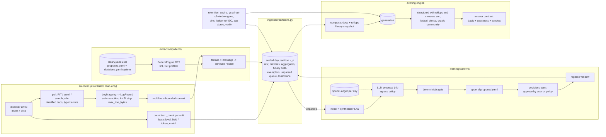

# V2 plan addendum A1: log analytics, source connectors and the pattern extractor

Status: **revision 3 — design only. Nothing in this document is implemented.** It extends
`docs/plans/v2_implementation_plan.md` (rev 3 + 2.0.0a2 amendment) and changes no frozen contract by
itself. The contract changes it needs are listed in §3.12 and take effect only when the main plan's
changelog records them. `<pkg>` means the import root (today `su_multi_arm`).

## Changelog

| Date | Rev | Change |
|---|---|---|
| 2026-11-04 | 1 | Initial addendum from the owner's log-analytics requirements. Grounded in the source at `cccd8d2` (2.0.0a2) and a bounded read-only sample of one operational log cluster: index resolution, mappings and 20-document searches on seven service indices for one day, plus `_count`. Only orders of magnitude appear here; the concrete numbers are in the private deployment plan. |
| 2026-11-04 | 2 | Review r1 (`docs/plans/reviews/addendum_logs_review_r1.md`, REVISE). All 11 blocking and 19 non-blocking findings accepted; see "Review response". Main changes: exact source allow-list including the cursor-close `DELETE`s, plus a read-only self-check (§3.1). Count semantics separate exact counts from proxy counts, with row exactness flowing into `ScopeResult` (§3.9). Structured-arm contract changes plus compose-time rollups (§3.9). Retention rule (a) deletes every out-of-window generation; a cross-process pin registry; schedule lock separate from the write lease; reference-based ledger GC; content-based verify; full store table (§3.8). Library identity becomes build provenance outside the live fingerprint, with the a1/a2 golden fingerprints preserved (§3.4). Line-scoped fact relations and header-scoped `native_link` (§3.4). Write protocol with system-owned append-only files and file-hash CAS (§3.6). Persistent per-day spend ledger (§3.6). Safe redaction contract (§3.2). `google-re2` verified (§3.4). Stratified sampling, hourly co-firing substrate, phases re-estimated on the re-based baseline (§4). |
| 2026-11-04 | 3 | Review r2 (`docs/plans/reviews/addendum_logs_review_r2.md`): one remaining B7 problem and nine non-blocking findings (n1–n9), all accepted (see "Review response (round 2)"). Compose-time extraction reuse keys now carry a pattern-provenance salt that is kept out of the live fingerprint (§3.4.3). Other changes: long-line rule for the `line` recipe; `ledger_refs` moved to a side table; ledger job entries added to retention; SpendLedger and PinRegistry backend coverage, with refusal elsewhere; per-process pins; a `signature_tenant_window` rollup; retention rule for synthesised literals; estimates and baseline corrected (100 ed; 359–364). |
| 2026-11-04 | 3a | Amendment by A2 rev 3 (`v2_addendum_log_analytics_ui.md` §4.8–§4.9). §3.8.3 rule (a) and the content-based `retention verify` apply **per retention tier**: raw (`logs.retention.raw_days`, optional raw tier, off by default), masked partitions (`keep_days`) and derived arm data (`derived`: `window` by default = this addendum's behaviour; `N` days or `forever` by opt-in). Before A2 H1, derived data is kept as per-day derived snapshots under `<partitions>/derived/`, served up to `logs.history.serve_days`. After H1, it is kept as append-only day shards imported from those snapshots (A2 §4.8.6). §3.2.3 "nothing unredacted is persisted" holds unless the opt-in raw tier is enabled, whose only reader is `logs reparse --from-raw` / `privacy scan --raw`. N11's mixed-identity refusal applies only to days inside the masked window. |

## Review response (round 1)

| Id | Disposition | What changed (section) |
|---|---|---|
| B1 | Accepted | §3.1 "Transport allow-list": an exact `(method, anchored path)` table. `DELETE` is allowed only on `/_search/scroll` (body-scoped ids this source opened) and `/_pit`. Index names are restricted to discovered names; wildcards are allowed only on `_resolve` and `_count`; no redirects; refusal happens before any I/O. A read-only self-check uses `_security/user/_has_privileges` (warning by default, error under `require_read_only_role`). Cursors are closed on exit and crash, with a bounded keepalive. L1 tests are rewritten. |
| B2 | Accepted | §3.9.1 "Count semantics": `level_field` counts may be stated as level counts. `token_match` counts are exact counts of *lines matching query Q*, named as such, and the answer contract may never render them as "N errors". Signature counts are exact only when the coverage condition holds; otherwise they are `approximate`. A new `FieldSpec.role: exactness` lets `RecordStore.execute` degrade `ScopeResult.exactness` to the worst matched row (§3.12). Tests named. |
| B3 | Accepted | §3.9.2: structured contract changes (sort groups by measure value, `bucket` with an inner measure, `hour` granularity), 6 ed across all records adapters plus conformance. Compose-time **rollups** keep every advertised question under `max_matched`, and each question is mapped to its rollup with a cardinality bound. Pushdown aggregation is deferred. An L5 gold test has row-count order ≠ sum order. |
| B4 | Accepted, rule (a) | §3.8.3: `gc` deletes **every** non-active generation that contains an expired partition, regardless of `keep_generations`. Rollback depth is limited to in-window generations. `retention verify` enumerates the partitions of every remaining generation from its manifest. The 11-day test runs with `keep_generations: 2`. |
| B5 | Accepted | §3.8.1: `run-daily` holds only a schedule lock (partition-store lease) and never the registry write lease. Compose and `gc` each acquire the write lease themselves. §3.8.4: the multi-process pin registry (completeness review F9) is pulled forward, with pins persisted with a TTL in the registry store and honoured by `gc`, at +4 ed. Cross-process test named. |
| B6 | Accepted | §3.8.3: reference-based ledger GC (each generation manifest records its ledger key set; after `gc`, every `extraction:`/`embedding:`/`raw:` key not referenced by a remaining generation and not tagged to an in-window partition is purged). Learning raw replies are tagged with **all** contributing partitions. The verifier is content-based (line hashes and `source_id`s of expired partitions, from the tombstone). The retention table now covers cache, sessions, traces, manifests, proposals, audit, examples, run reports and metrics. |
| B7 | Accepted | §3.4.3: the library identity, engine and engine version are **build provenance** recorded in partition and generation manifests, and are not part of the live fingerprint. Serving uses the library snapshot stored with its pinned generation. `extraction.pattern_library` is excluded from the recipe dump when unset, so the 2.0.0a1/a2 golden fingerprints (`tests/unit/test_index_fingerprint_golden.py`) are unchanged. Tests named. The false A1_RECIPE_KEYS claim is removed. |
| B8 | Accepted, option (a) | §3.4.2: `$attribute` endpoints produce only `native_link`/`unchecked` edges, with both endpoints and the span in the rendered `header` field of the same document and chunk (every log document kind now has a `header`). `fact` relations are **line-scoped**: both endpoints and the trigger are groups of one log line, and that line lies in a single chunk under the `line` chunk recipe. Lint makes a `$attribute` endpoint with `trigger_group` an error. An end-to-end validation test is named. |
| B9 | Accepted | §3.6.3: users own `library.yaml`, which the system never writes. The system writes only append-only `proposed.yaml` and `decisions.yaml` (approve, deprecate, supersede and expire records), and the loader applies decisions at load time, so supersede shadows the target without editing it. CAS uses the file sha, re-checked immediately before `rename` and verified after, plus a git commit when the directory is a repository. `revision` becomes advisory. Tests named. |
| B10 | Accepted | §3.6.4: a persistent, atomic `SpendLedger` keyed by `(budget scope, role, day in the declared timezone)` covers every entry point (run-daily, settle, manual learn, bootstrap, community reports). A crash keeps the reservation counted until reconciliation. A two-process test is named. +3 ed. |
| B11 | Accepted | §3.2.3: the `PrivacyConfig` extension adds named built-in redactors plus user patterns compiled by the **same safe engine and validator** as the library, with `max_line_bytes`. Redaction runs before partition write, exemplar selection, the unparsed queue and every prompt. Counts go in the manifest. The log profile refuses `engine: legacy`. Tests named. +3 ed. |
| N1 | Accepted | §3.4.1: `google-re2` 1.1.20251105 installed from a wheel in an isolated venv and was verified (`re2.Set.SearchSet` works; backreferences and lookaround are refused at compile; group spans need integer indexes through `groupindex`; `\w` is ASCII). RE2 is **required** for the log profile; `regex` is a dev fallback forced to ASCII (`(?a)`), and its timeouts are flagged non-deterministic. The lint is specified, and the engine and version are in the provenance. |
| N2 | Accepted | §3.6.2: the writer assigns priority below all approved entries of the kind. Stealing is checked against all approved examples and exemplars plus a sample. The ratio is replaced by an absolute out-of-cluster bound. Only `message` patterns can be auto-promoted, and `noise` at WARN and above is manual only. |
| N3 | Accepted | §3.7: `issue_name` and `rationale` are labelled metadata with provenance and never evidence text. They enter `issue` text fields only after human approval. |
| N4 | Accepted | §3.6.1: `learning.patterns.egress` (`allow_hosted`, `pseudonymise`). Injection control is stated: structured output plus the gate, and nothing in a reply is executed except the regex, which goes through the validator. |
| N5 | Accepted | §3.1.3: capped units use a stratified per-hour quota, or `random_score{seed, field: _seq_no}`. The method is recorded, and approximate counts state it. |
| N6 | Accepted | §3.10: hourly per-signature, per-deployment counts are always kept in the partition (not as documents) as the co-firing substrate. |
| N7 | Accepted | §3.4.2: the pattern extractor emits no `Event`s to the write path. Library `events:` are consumed only at partition stage to build aggregate rows. The 4 ed P3 credit is removed (§4.2). |
| N8 | Accepted | §3.4.4: the dispatcher gains a `pattern` member that runs first, and other extractors run on the residue with a composed recipe. The config key is renamed `extraction.pattern_library`. |
| N9 | Accepted | §4: re-based on the completeness review (Phase 2 ≈ 92–97 ed). L4 is split into L4a (deterministic miner and synthesiser, needed for the first deployment) and L4b (LLM loop). Blocker work is added and the milestones are restated. |
| N10 | Accepted | §4.1 L3a acceptance: 10⁶ synthetic aggregate rows composed on SQLite within a stated time and RSS budget, in the external workspace. |
| N11 | Accepted | §3.7: compose requires the current library identity for every partition in the window, and reparses stale partitions from retained raw lines first. |
| N12 | Accepted | §3.5: `repull(key, units) -> v+1`. `begin` takes `source_query_sha` and refuses to resume a partition with a different sha. |
| N13 | Accepted | §3.4.2 and private exit check: `fragment` is reported separately, is excluded from coverage targets, and a sample of fragments goes into the unparsed queue. |
| N14 | Accepted | §3.1.2: the minimum is Elasticsearch 7.9 (`_resolve/index`) or OpenSearch 1.0, with a `GET /{pattern}/_alias` fallback discovery for older 7.x releases. |
| N15 | Accepted | §3.8.1 and private plan: a cron wrapper sources a 0600 env file. `limits.window` is defined (pause at the end of the window, partition stays unsealed, resume next window). No silent provider fallback: an alternative model is a separate explicit config. |
| N16 | Accepted | §3.6.3 and §3.12: `patterns promote|deprecate|supersede` are CLI-only, are not `Action`s and have no HTTP/MCP surface. The main-plan §3.16 policy amendment is listed in §3.12. |
| N17 | Accepted | §3.7 and §3.12: `kind` is the built-in `Document.kind`. `COMPONENT_KINDS` changes with the `Literal`. New keys are refused until their consumer lands (R3 rule), with a schema-walk test. |
| N18 | Accepted | §3.3: the example format is now a synthetic `key=value` layout, unrelated to any observed layout. |
| N19 | Accepted | §3.9.1: an answer that claims exactness states its time basis (index date or event time) and timezone. |

No finding was rejected.

## Review response (round 2)

| Id | Disposition | What changed (section) |
|---|---|---|
| B7 (remaining) | Accepted | §3.4.3 "Extraction reuse salt". The extractor contract gains `reuse_salt() -> str`. For `pattern` it is the sha of `pattern_provenance`: library identity (approved entries after decisions replay, so approve, deprecate and supersede all change it), the applied decision set, engine, engine version and validator version. `WritePath._extract` keys reuse as `extraction:{recipe[:16]}:{salt[:16]}:{chunk_id}`, and `ledger_refs` records those keys. The salt never enters `recipe_fingerprint()` or the index fingerprint. Test `test_library_change_invalidates_extraction_reuse`: approve a pattern matching an unchanged exemplar and the next compose shows the new relation; deprecate it and the relation is gone; `test_index_fingerprint_golden.py` stays green. Extractors other than `pattern` return `""`, so the key is unchanged for them and existing ledgers keep their hits. +1 ed (L2). |
| n1 | Accepted | §3.4.2: the `line` recipe emits exactly one chunk per `LogRecord`, whatever `chunking.size` is. Config validation requires `max_line_bytes + multiline.max_bytes ≤ line_recipe.max_chunk_chars` (default 24 KiB). A reassembled multiline record counts as one "line" (one chunk). A record that would still exceed the bound is cut at `max_line_bytes` before matching and flagged `truncated`, so no fact is ever split across chunks. |
| n2 | Accepted | §3.8.3: references live in a ledger side table `ledger_refs(generation, key)`. The manifest keeps only `ledger_refs_count` and `ledger_refs_sha`. |
| n3 | Accepted | §3.8.3: per-generation ledger job entries (`ledger.append(gen, …)`) are purged with the generation. They hold document ids only and are content-free by invariant. |
| n4 | Accepted | §3.12: `SpendLedger` and `PinRegistry` are implemented on sqlite, postgres, sql (SQLAlchemy) and memory, and the file registry stores pins in a sqlite sidecar. On mongodb, and on the Elasticsearch registry, they are `planned`. Config validation then refuses `logs:` / `learning.patterns` with a typed error and never falls back silently. +1 ed (L3b). |
| n5 | Accepted | §1, §4.2: baseline corrected to 359–364 ed. B10 moved to stream B (it gates L4b). Full scope is 10–11 weeks, usable deployment about 8 weeks. |
| n6 | Accepted | §3.7, §3.9.2: a `signature_tenant_window` rollup (signature × tenant, sums and first/last seen) answers "tenants affected by S" with ≤ number-of-tenants rows. |
| n7 | Accepted | Private plan runbook: spend is enforced by the persistent spend ledger, and `retention report` lists retained content. |
| n8 | Accepted | §3.8.3: literal tokens in synthesised or proposed regexes derive from redacted lines. For an unpromoted proposal, an `expire` record is appended when its clusters expire, and the loader drops expired proposals from the effective library and from `retention report` content. Literals of approved patterns are kept under O7 and listed by `retention report`. |
| n9 | Accepted | §3.8.4: one pin per (serving process, generation), renewed by a heartbeat (default every 30 s, TTL 120 s) with an in-process refcount of requests and session turns. Registry writes happen per heartbeat, not per request. A per-request pin is taken only when a request may outlive the process pin (detached streams). |

---

## 1. Executive summary

**Goal.** Operators should be able to ask a multi-arm engine about operational logs:

- "which services error most today"
- "what new error signatures appeared"
- "which tenants are affected by X"
- "how has Y trended over ten days"
- "what else broke at the same time"

The engine pulls daily logs from a read-only Elasticsearch/OpenSearch cluster and extracts typed
aggregates, entities and relations. It populates the catalog, records, vector, graph and community
stores, and keeps a rolling N-day window (default 10).

**Key design decisions.**

1. **Read-only `sources/` contract, separate from storage adapters.** The source issues an exact
   allow-list of read requests plus the two cursor-close `DELETE`s, and checks at startup that its
   account cannot write. The first implementation is `elasticsearch_rest`: plain REST over `httpx`
   for Elasticsearch ≥ 7.9 and OpenSearch. It is separate from the 8.x storage adapter.
2. **The `pattern` extractor is a first-class extractor kind.** It is backed by a pattern library
   that users own. Patterns run on RE2 (linear time; verified) with typed named groups. They produce
   signatures, typed fields, entities and relations, all span-anchored. The library's identity is
   build provenance pinned per generation, so editing the library never breaks serving.
3. **The learning loop proposes and never edits.** It mines Drain-style templates, synthesises
   regexes, and asks an LLM to name the issue and propose a pattern or a fix through structured output.
   A deterministic gate checks every proposal. The system writes only append-only system files
   (`proposed.yaml`, `decisions.yaml`); approval is a decision record, manual by default. The affected
   window is then reparsed. Spend is capped per day across all processes by a persistent ledger.
4. **Count every line, store signatures.** Source `_count` gives totals per unit (index or slice):
   exact counts of the declared query. Non-INFO lines are pulled, with stratified caps, and reduced
   to aggregates and exemplars. Every count carries its basis and exactness, and those flow into the
   answer contract. A count of lines containing a token is never presented as a count of errors.
5. **Day partitions composed into a rolling generation.** Each day is pulled and sealed once into an
   immutable partition. A daily compose builds the serving generation, including window rollups,
   through the existing write path. Retention deletes the expired day from **every** store, including
   older generations, the ledger, cache, sessions, traces, proposals and reports. A content-based
   verifier proves it.

**Estimate.** 100 ed of package work, about 22 ed of it pulled forward from existing Phase 2–4 rows,
which leaves about 78 ed net, on a corrected baseline of 359–364 ed. Private deployment adds 6 ed. With two engineers, a usable deployment
takes about 8 weeks and the full scope about 10–11 weeks. One engineer needs about 20 weeks.

**Evidence status.** Nothing is implemented. Only `google-re2` behaviour was verified (isolated venv).
Pull throughput, scroll/PIT permission and parse coverage are L0 probe items.

---

## 2. Target architecture

### 2.1 Principles (additions to main plan §2.1)

8. **Sources are read-only, bounded and self-checking.** The source sends only allow-listed requests
   (§3.1.1), under declared rate, concurrency and cap limits. A forbidden or unavailable operation is
   a typed error and never an empty day.
9. **Counts carry basis and exactness.** A count comes from the source (exact *for its query*) or
   from a declared, stratified sample (`approximate`). Answers render the basis, and a proxy is never
   stated as a level count.
10. **The pattern library is user-owned data.** The system never writes user-owned files. It appends
    to system-owned files only and never edits existing entries.
11. **Retention is a verified deletion across every store**, including non-active generations, the
    ledger and auxiliary stores. The verification is content-based.
12. **The library version is provenance, not configuration.** Library edits never change the live
    fingerprint, and a generation serves with the library snapshot it was built with.

### 2.2 Component diagram



### 2.3 Package layout additions

```
src/<pkg>/
  sources/      contracts.py errors.py transport.py (allow-list) cursor.py ratelimit.py sampling.py
                elasticsearch_rest.py   # ES >= 7.9 and OpenSearch over httpx (no client library)
                logs.py                 # LogMapping -> LogRecord, index-name parsing
                multiline.py
  privacy/      redactors.py            # named built-ins + safe user patterns (shared engine)
  extraction/patterns/
                library.py              # model, multi-file loader, decisions replay, lint, identity
                engine.py               # re2 (required for logs) | regex (?a)+timeout (dev); validator; Set prefilter
                extractor.py            # extractor name "pattern"
                coverage.py writer.py   # writer: system-owned files only, sha CAS
  ingestion/    partitions.py logs_compose.py rollups.py retention.py pins.py schedule.py spend.py
  learning/patterns/  mining.py synthesis.py propose.py gate.py loop.py
  communities/  cooccurrence.py
  profiles/     logs_example.yaml
  testing/fixtures/logs/                # synthetic generators, library, fake source, ReDoS corpus
```

---

## 3. Module contracts

### 3.1 `sources/` — read-only source contract

```python
class SourceCapabilities(StrictModel):
    server: str; version: str | None            # None when GET / is forbidden (recorded, not fatal)
    pit: bool; scroll: bool; sliced_scroll: bool; search_after: bool
    count: bool; resolve_index: bool; has_privileges: bool
class SourceWindow(StrictModel): partition_key: str; start: datetime; end: datetime
class SourceUnit(StrictModel):
    id: str                                     # sha(index, slice, query_sha): stable across runs
    index: str; slice: tuple[datetime, datetime] | None
    attributes: dict[str, str]; query_sha: str
class UnitCount(StrictModel):
    unit_id: str; query_sha: str; total: int
    by_query: dict[str, int]                    # named count queries, e.g. "level_error" or "token_error"
    basis: dict[str, Literal["level_field", "token_match"]]
    at: datetime
class SourceCursor(StrictModel):
    unit_id: str; mode: Literal["pit", "scroll", "search_after"]
    state: dict[str, Any]; fetched: int; opened_ids: list[str]   # ids this process opened (close scope)
class SourceDoc(StrictModel): source_id: str; index: str; fields: dict[str, Any]
class Source(Component):                        # ComponentKind "source"
    def capabilities(self, probe: bool = False) -> SourceCapabilities
    def self_check(self) -> list[Diagnostic]    # read-only role check (§3.1.1)
    def discover(self, window) -> list[SourceUnit]
    def count(self, unit, queries: dict[str, CountQuery]) -> UnitCount
    def pull(self, unit, cursor, page_size, sample: SamplePlan | None) -> Iterator[SourceBatch]
    def context(self, doc, before: int, after: int) -> list[SourceDoc]
    def close(self, cursor) -> None             # idempotent; only ids in cursor.opened_ids
```

**Errors.** `SourceAuthError`, `SourceForbidden(operation)`, `SourceRateLimited(retry_after)`,
`SourceUnavailable`, `SourceTimeout`, `SourceCursorExpired`, `SourceSchemaDrift`,
`SourceQueryRejected` and `SourceRequestRefused(method, path)`. The last one is raised before any I/O.

#### 3.1.1 Transport allow-list and read-only self-check

`sources/transport.py` refuses any request that does not match one of these rows. `{idx}` is a name
returned by discovery: it matches `[a-z0-9][a-z0-9._-]*` (no leading `_`, no `/`, no `*`, no `,`). The
`{expr}` placeholder may contain `*` and `,`. Paths are matched as anchored regexes on the
percent-decoded path, and query strings are matched against a per-row parameter allow-list.

| # | Method | Path | Purpose | Notes |
|---|---|---|---|---|
| 1 | GET | `/_resolve/index/{expr}` | discovery | wildcards allowed |
| 2 | GET | `/{expr}/_alias` | discovery fallback (< 7.9) | wildcards allowed |
| 3 | GET | `/{idx}/_mapping` | mapping per unit | |
| 4 | GET, POST | `/{idx}/_count`, `/{expr}/_count` | counts tier | the only wildcard data request |
| 5 | GET, POST | `/{idx}/_search` | pull, sample, context | params: `scroll`, `size`, `filter_path`, `_source_includes`, `request_cache` |
| 6 | POST | `/_search/scroll` | scroll continue | |
| 7 | DELETE | `/_search/scroll` | close scroll | body `scroll_id` must be ⊆ `cursor.opened_ids`; never `/_search/scroll/_all` |
| 8 | POST | `/{idx}/_pit` (OpenSearch: `/{idx}/_search/point_in_time`) | open PIT | `keep_alive` ≤ `pull.keepalive_max` |
| 9 | DELETE | `/_pit` (OpenSearch: `/_search/point_in_time`) | close PIT | body id ∈ `cursor.opened_ids`; never `_all` |
| 10 | GET | `/` | version | 403 tolerated |
| 11 | GET, POST | `/_security/user/_has_privileges` (OpenSearch: `/_plugins/_security/api/account`) | self-check | optional |

Redirects are not followed. Search and count bodies are checked as well: `script`,
`_update`/`_delete` operations and `stored` scripts are refused (only `query`, `sort`, `size`,
`search_after`, `pit`, `slice`, `_source`, `track_total_hits` and `random_score`/`function_score`
without script are accepted).

**Self-check.** `self_check()` asks `_has_privileges` for index privileges `write`, `delete`, `index`
and `manage`, and cluster privilege `all`, on the configured patterns. Any granted write privilege is
a `warning`. It is an `error` when `sources.<name>.require_read_only_role: true`, the default in the
log profile. If the endpoint is forbidden, the check reports `unknown` (warning) and the allow-list
remains the guarantee.

**Cursor hygiene.** `close()` runs in `finally` and from an `atexit`/signal handler. Scroll and PIT
keepalive is bounded (`≤ 2m` by default), so contexts leaked by a hard kill expire on the server. Each
process has at most `max_concurrency × slices` open contexts.

#### 3.1.2 `elasticsearch_rest` and version floor

The floor is Elasticsearch 7.9 or OpenSearch 1.0 (`_resolve/index`). Older 7.x releases use
discovery fallback row 2. The capability probe tries PIT open and close on one unit when PIT may
exist. Otherwise the pull uses sliced scroll, and the resumable unit is `(index, time slice)`; a
crashed unit restarts from its slice start and de-duplicates by `source_id`. `search_after` is used
when a declared unique tiebreaker exists. Count queries are built **per index from its mapping**: a
`level` term query only where the field exists, and a token query otherwise. A query on a field
missing from most indices was observed to stall a cluster, so wildcard count queries may only
reference fields declared present in all matched indices.

#### 3.1.3 Caps and stratified sampling

When a unit's records-tier count exceeds `max_docs_per_unit`, the pull is **stratified**, using one of
two methods:

| Method | What it does |
|---|---|
| `hourly_quota` (default) | Slices per hour, with quota = cap × the hour's share of the unit's count (from one `_count` per hour). |
| `random_score` | `function_score.random_score{seed, field: "_seq_no"}`, reproducible per shard. |

The manifest records the method, seed, per-stratum counts and fetched counts. Estimates scale per
stratum and are labelled `approximate (method)`. A partition cap (`max_docs_per_partition`) stops the
pull and marks the partition `capped`, so a cap never silently truncates.

### 3.2 `sources/logs.py` — mapping, multiline, redaction

#### 3.2.1 `LogRecord`

```python
class LogRecord(StrictModel):
    id: str; ts: datetime; partition_key: str
    attributes: dict[str, str]          # tenant/env/service; "unknown" + diagnostic when unparsed
    level: str | None; level_basis: Literal["level_field", "format_pattern", "none"]
    message: str                        # normalised + redacted + truncated to max_line_bytes; span source text
    stack: str | None; host: str | None; container: str | None; offset: int | None
    extra: dict[str, JsonScalar]        # declared passthrough only
```

The index-name parser is a library entry of kind `index_name`, with the service alternation generated
from a declared vocabulary and matched longest-first. `drop_fields` are never requested. Text beyond
`max_line_bytes` (default 8 KiB) is cut, and the cut is recorded with `truncated: true`.

#### 3.2.2 Multiline

A line that matches no `format` pattern but does match a `continuation` pattern attaches to the
preceding record of the same `(container, file)` within `max_gap_ms`, up to `max_lines`/`max_bytes`.
Head-less fragments are counted as `fragment`. They are reported separately and excluded from coverage
targets, and a sample of `fragment_sample_rate` goes into the unparsed queue (N13). Context fetches for
exemplars are capped per partition.

#### 3.2.3 Redaction contract (B11)

```python
class PrivacyConfig(StrictModel):            # existing fields unchanged; new fields default to a2 behaviour
    redact_emails: bool = False; patterns: dict[str, str] = {}; metadata_fields: list[str] = []
    trace_masking: Literal["privacy", "raw"] = "privacy"
    redactors: list[Literal["email", "ipv4", "ipv6", "bearer_token", "jwt", "url_query_secrets",
                            "aws_key", "hex_secret", "uuid"]] = []     # built-ins, RE2-safe, tested
    engine: Literal["legacy", "safe"] = "legacy"   # legacy = today's Python re path (documents only)
    max_line_bytes: int = 8192
```

- With `engine: safe`, `patterns` are validated and compiled by the pattern engine (§3.4.1: RE2
  subset, RE2 runtime). The built-in redactors always use the safe engine.
- The log profile and any config with `sources:` **require `engine: safe`**; anything else is a
  `ConfigError`.
- New fields are excluded from the fingerprint dump while they hold their defaults, so the a1/a2
  golden fingerprints are unchanged.
- Redaction runs in `LogMapping`, before partition write. Exemplar selection, the unparsed queue and
  prompt construction consume only redacted `LogRecord`s. The prompt builder asserts that its input
  comes from a `LogRecord` (type check) and re-runs the built-in redactors as defence in depth.
- Counts per redactor go into the partition manifest. A lint refuses unredacted email, IP or token
  shapes in library `examples`.

### 3.3 `extraction/patterns/library.py` — library files

**Files and ownership** (all in one library directory):

| File | Owner | Writes |
|---|---|---|
| `library.yaml` | user | user only. **The system never writes it.** |
| `proposed.yaml` | system | append-only proposals |
| `decisions.yaml` | system (records written by the CLI or the promotion policy) | append-only `{op: approve\|deprecate\|supersede\|expire, id, by, at, reason, examples?}` |
| `metrics` (ledger table or `metrics.json`) | system | per-pattern counters, keyed by `(pattern id, regex sha)` |

**Load order.** The loader reads the user entries, then the proposed entries, then replays the
decisions in order.

- The effective status of a proposed entry is that of its latest decision (`proposed` when it has
  none).
- `supersede {id: new, target: old}` shadows `old` at load time without touching its file.
- A user entry with the same `id` as a system entry overrides the system entry, with an `info`
  diagnostic, so a user can take ownership by copying the entry into `library.yaml`.

**Example (synthetic layout).**

```yaml
library: logs-core
format_version: 1
engine: re2
vocabularies: {service: [ingest-worker, query-gateway, doc-fetcher, scheduler]}
masks:
  uuid: '[0-9a-f]{8}-[0-9a-f]{4}-[0-9a-f]{4}-[0-9a-f]{4}-[0-9a-f]{12}'
  num:  '-?[0-9]+(?:\.[0-9]+)?'
patterns:
  - id: fmt.kv_v1
    kind: format
    status: approved
    priority: 100
    applies_to: {field: message, service: ["*"]}
    regex: '^ts=(?P<ts>[0-9T:.\-]+Z) lvl=(?P<level>[a-z]+) comp=(?P<component>[a-z0-9_.]+) msg="(?P<body>[^"]*)"$'
    fields: {ts: {type: datetime}, level: {type: enum, values: [debug, info, warn, error, fatal]}}
    entities: [{group: component, type: component}]
    then: {field_from_group: body}
  - id: msg.dependency.connect_failed
    kind: message
    status: approved
    priority: 50
    applies_to: {service: ["*"], level: [error, warn]}
    regex: '(?P<client>[a-z]+-client) (?P<trigger>failed to connect|refused by) (?P<dep>kafka|mongo|postgres|redis)(?: after (?P<ms>[0-9]+) ?ms)?'
    signature: {id: dependency.connect_failed, category: connectivity}
    fields: {ms: {type: integer}}
    entities: [{group: client, type: component}, {group: dep, type: dependency}]
    relations:
      - {subject: client, predicate: fails_to_connect, object: dep, trigger_group: trigger}   # line-scoped fact
    attribute_links:
      - {subject: "$service", predicate: emits, object: "$signature"}                         # native_link, header-scoped
    examples:
      positive: ["db-client failed to connect redis after 3000 ms", "queue-client refused by kafka", "http-client failed to connect mongo"]
      negative: ["db-client connected to redis"]
    provenance: {author: user, created: 2026-11-04T10:00:00Z}
```

**Kinds.**

| Kind | Purpose |
|---|---|
| `index_name` | Parses the index name into tenant, env and service. |
| `format` | Matches the line layout and hands one group (`then.field_from_group`) to the message stage. |
| `continuation` | Recognises continuation lines for multiline assembly. |
| `message` | Matches the message body. The first match by priority sets the signature. |
| `annotate` | Adds entities only; every match applies. |
| `noise` | Marks known-benign lines, counted as `noise`. |

**Lint (load-time errors).**

- Duplicate id within one owner.
- Unknown kind or status.
- A pattern outside the RE2 subset (refused by the validator and by RE2 compilation itself).
- The ReDoS lint (§3.4.1) fails.
- A group is referenced but not declared.
- A field type is not a `MetadataSchema` type.
- **A relation with a `$attribute` endpoint and a `trigger_group`.** Attribute links belong under
  `attribute_links` (B8).
- A relation endpoint that is not an entity group of the same pattern or of its `format` parent.
- An example that fails its own pattern.
- An unresolvable `{{vocab:}}` or `{{mask:}}`.
- An ambiguity: same kind, priority and overlapping selectors, with each pattern matching the other's
  positives.
- An unredacted PII shape in `examples`.

**Lint warnings.**

- Fewer than `min_literal_chars` literal characters.
- Unanchored at both ends.
- A system file edited by hand: its sha does not match the writer's last recorded sha.

### 3.4 `extraction/patterns/engine.py` and `extractor.py`

#### 3.4.1 Engine, validator and lint (N1)

`engine: re2` uses `google-re2` (extra `patterns`) and is **required** for the log profile. It was
verified on 2026-11-04 in an isolated venv with version 1.1.20251105, installed from a wheel:

- Linear time: `(a+)+$` over 5 000 characters took 0.06 ms.
- Backreferences and lookaround are refused at compile time.
- `re2.Set.SearchSet` works as a multi-pattern prefilter.
- Named-group spans need integer indexes through `groupindex`.
- `\w`/`\d` are ASCII.

`engine: regex` is a development fallback (extra `patterns-lite`). Every pattern is compiled with
`(?a)`, giving ASCII classes like RE2, and runs with a per-call timeout. A timeout makes the result
**non-deterministic**: such lines are marked `timeout` and are re-classified in the next run when RE2
is available. A generation built with `regex` records `engine_deterministic: false` in its manifest.

**Validator and lint (applied under both engines).**

- RE2-subset syntax only.
- Star height ≤ 1, so no quantified group may contain an unbounded quantifier.
- No quantified alternation whose branches can match a common prefix (checked on the parsed AST by
  first-character set intersection).
- No two adjacent unbounded repeats over intersecting classes (`\S+\S+`, `.*.*`).
- Every unbounded repeat inside a group must be followed by a literal or anchor.
- Lines are capped at `max_line_bytes` before matching.

#### 3.4.2 Outputs and grounding (B8, N7, N13)

- **Line-scoped facts.** A relation's endpoints and its `trigger_group` must all be groups of the same
  line: the `format` match plus its message sub-match, with offsets mapped back to the line.
  - The relation span is the smallest span covering both endpoints and the trigger.
  - Exemplar fields use the `line` chunk recipe. It emits exactly one chunk per `LogRecord` regardless
    of `chunking.size`. A reassembled multiline record is one line. Validation requires
    `max_line_bytes + multiline.max_bytes ≤ line_recipe.max_chunk_chars`. A longer record is cut and
    flagged `truncated`. The relation span and the endpoint spans are therefore always in the same
    chunk (n1).
  - The result satisfies `ExtractionOutput.endpoints_contained` unchanged.
  - `PredicateSupport` (trigger present, no negation between trigger and endpoints) decides between
    `fact` and `co_occurrence`.
- **Attribute links.** These are edges between `$service`, `$tenant`, `$env` and `$signature`. They
  are emitted only from a document's rendered `header` field (§3.7), where both endpoint names appear
  in one header chunk. They are `edge_kind: native_link`, `support: unchecked`, with spans in that
  header. The graph arm traverses them only when its `TraversalSpec.edge_kinds` admits `native_link`
  (the arm hard-codes `["fact"]` today; §3.12).
- **Events and records.** The pattern extractor emits only entities and relations to the write path.
  Library `events:` and typed fields are consumed at partition stage to build aggregate and rollup
  rows, which become documents (§3.7). Nothing is emitted into `ExtractionOutput.events`/`.records`,
  which the write path does not persist today.
- **Line status.** Each line ends up `parsed`, `format_only`, `unparsed`, `noise`, `fragment` or
  `timeout`. Coverage targets count only `parsed + noise` over the lines that are not fragments.

#### 3.4.3 Identity and fingerprint (B7)

- `library_identity = sha256(canonical JSON of the effective approved entries)`. The provenance
  record is `pattern_provenance = {library_identity, engine, engine_version, validator_version}`.
- `pattern_provenance` is written into every partition manifest and every generation manifest. The
  effective approved library is snapshotted into the generation's artifact set (`library.snapshot.json`,
  included in the release sha256 manifest).
- **It is not part of the live index fingerprint.** `ExtractionConfig` gains
  `pattern_library: PatternLibraryRef | None = None`, and the recipe dump omits the key when it is
  `None`.
  - When it is set, only static options are hashed: path-independent `engine` kind,
    `max_line_bytes`, `mode`. The library contents and the engine version are not hashed.
  - The existing extractor list change (`"pattern"` added) changes the fingerprint only for configs
    that select it.
- Serving never reads the working library files. Request-time consumers (the intent pre-pass for
  signature ids, `exact_id`) use the pinned generation's snapshot.
- **Extraction reuse salt (B7, round 2).** The extractor contract gains `reuse_salt() -> str`, which
  defaults to `""`.
  - For `pattern`, it is `sha256(pattern_provenance + sorted applied decision ids)`. Approve,
    deprecate, supersede, user edits and engine or validator upgrades all change it.
  - `WritePath._extract` keys reuse as `extraction:{recipe[:16]}:{salt[:16]}:{chunk_id}` when the salt
    is non-empty. The key format is unchanged when the salt is empty, so existing ledgers keep hitting.
  - The salted keys are what `ledger_refs` records, so retention ref-GC removes stale variants once
    their generations are gone.
  - The salt is **never** part of `recipe_fingerprint()` or the index fingerprint.
- Tests:
  - `test_library_change_invalidates_extraction_reuse`: approve a pattern that matches an unchanged
    exemplar, and the next compose shows the new relation. Deprecate it, and the relation is gone.
    The golden fingerprints are unchanged throughout.
  - `test_index_fingerprint_golden.py` stays green unchanged.
  - `test_library_edit_keeps_serving`: approve a pattern, restart, and `current()` still opens the
    active generation.
  - `test_provenance_recorded`: the generation manifest lists the identity, engine and version.
  - `test_compose_requires_identity` (N11).

#### 3.4.4 Extractor composition (N8)

`ExtractionConfig.extractors` gains `pattern`, and `extraction.pattern_library` is the new key, kept
distinct from the existing `extraction.patterns` (extractor `regex`). When `pattern` is listed first,
the dispatcher runs it first and passes the lines it did not parse (the *residue*) to the following
extractors (for example `gliner` or `llm`) with a `residue_only: true` flag. The composed recipe is
the ordered list of sub-recipes, and the routing of each unit is logged.

### 3.5 `ingestion/partitions.py` — day partitions

```python
class PartitionStore(Protocol):
    def begin(self, key: str, source_query_sha: str, provenance: PatternProvenance) -> PartitionManifest
        # resumes a non-sealed partition only if source_query_sha matches, else PartitionConflict
    def put_unit(self, key, unit_id, artifacts) -> None        # atomic per unit
    def seal(self, key) -> PartitionManifest
    def get(self, key) -> PartitionManifest | None; def list(self, since=None) -> list[PartitionManifest]
    def reparse(self, key, library: CompiledLibrary) -> PartitionManifest    # v+1 from retained raw
    def repull(self, key, units: list[str]) -> PartitionManifest             # v+1 for settle (N12)
    def expire(self, key) -> Tombstone
class Tombstone(StrictModel):
    key: str; expired_at: datetime; deleted: dict[str, int]
    verify_sample: list[str]        # sha256 of up to 1 000 redacted lines + source_ids, kept for content-based verify
```

Artifacts per version are `raw.jsonl.zst`, `matches`, `aggregates`, `hourly_cells` (signature ×
deployment × hour counts; N6), `exemplars`, `unparsed` and the manifest. A sealed version is immutable.

### 3.6 `learning/patterns/` — learning loop

#### 3.6.1 Steps

| Step | Phase | Contract |
|---|---|---|
| Template mining | L4a | Drain-style, with lines masked by library `masks`. Memory is bounded (`max_clusters`, evictions counted) and the miner runs per `(service, level)`. |
| Regex synthesis | L4a | Deterministic. A template becomes a regex with typed groups. The output is a `proposed` pattern with no issue name. On its own this bootstraps coverage without an LLM. |
| Unparsed queue | L3a | Per partition, holding `unparsed`, `format_only` and sampled `fragment` lines. Clusters are ranked by size × level weight × novelty. |
| LLM proposal | L4b | Role `pattern_learner`. Input: one cluster (template, ≤ k redacted lines with ids), its nearest patterns and the category enum. **Egress:** `learning.patterns.egress{allow_hosted: bool, pseudonymise: [tenant, host]}`. With `allow_hosted: false`, only a loopback model is permitted. Pseudonymisation replaces attribute values with stable per-run aliases before the prompt. Raw replies are tagged with **all** contributing partitions. |
| Gate | L4b | See §3.6.2. |
| Write | L4b | See §3.6.3. |
| Reparse | L3a/L4b | Partitions in the window are reparsed whenever the effective approved library changes. Compose refuses mixed identities (N11). |

**Injection control.** Log text is untrusted input. The reply is a structured model. Nothing in it is
executed except `regex`, which passes the validator and the RE2 compiler. `issue_name` and `rationale`
are inert metadata (N3). Example references must be ids of supplied lines. The gate is deterministic.

```python
class PatternProposalReply(StrictModel):
    cluster_id: str; issue_name: str = Field(max_length=120)
    issue_category: IssueCategory; action: Literal["new", "fix", "noise", "none"]
    target_pattern_id: str | None; regex: str | None
    fields: dict[str, FieldTypeName]; entities: list[EntityGroup]; relations: list[RelationTemplate]
    positive_line_ids: list[str]; negative_line_ids: list[str]; rationale: str = Field(max_length=600)
```

#### 3.6.2 Gate (N2)

| Check | Rule |
|---|---|
| Safe compile | Passes the validator and RE2 compile. A timing probe on adversarial strings is run as defence in depth. |
| Priority | Assigned by the writer, below every approved entry of the same kind. Replies carry no priority. |
| Target coverage | Matches ≥ `min_cluster_coverage` (0.9) of the cluster over the full queue. |
| No stealing | Must match **none** of: every positive example of every approved pattern of the kind, every stored exemplar of approved signatures in the window, and a `parsed` sample (≥ 20 000 lines). The exception is a `fix`, which may match only lines of its target and must pass all of the target's positives. |
| Not over-broad | An absolute bound on out-of-cluster matches: ≤ `max_out_of_cluster` (default 0) on the full unparsed queue minus the cluster, plus the `parsed` sample. Also ≥ `min_literal_chars` literal characters. |
| Examples and types | All supplied positive ids match, all negative ids fail, at least 3 positives, and typed groups parse. |
| Novelty | Not a regex-sha duplicate, and < 0.98 overlap with any existing entry on the cluster. |

Only `message` proposals are eligible for auto-promotion. `noise` proposals whose cluster contains
WARN-or-above lines, and every `format`, `index_name` and `continuation` proposal, need a human
decision. Fixes to `author: user` patterns are never auto-promoted.

#### 3.6.3 Write protocol (B9, N16)

- The system writes only `proposed.yaml` and `decisions.yaml`, and always as an append. **It never
  opens `library.yaml` for writing**, so a user save is never lost to the system.
- **Append algorithm:**
  1. Read the file bytes and compute their sha `h0`.
  2. Build `content = bytes + new_entry` (round-trip YAML, so existing bytes are unchanged).
  3. Write a temp file in the same directory and `fsync` it.
  4. Re-read the target and compare its sha to `h0`. On a mismatch, restart from step 1, up to `n`
     tries.
  5. `os.replace`.
  6. Re-read and assert the sha equals the written content's sha. On a mismatch (a concurrent writer
     landed after the replace), restart from step 1.
  7. When the directory is a git work tree, `git add` + `git commit` the system file, with an
     `--author` of `system:<policy|cli>`. A dirty system file (uncommitted hand edits) stops the
     writer with `SystemFileDirty`, which asks the user to commit or revert.
- The residual race only concerns system-owned files. Hand edits to them trigger a warning, and git
  history recovers any loss.
- `revision` is advisory, display only. The CAS key is the file sha.
- **Promotion** is the append of an `approve` record to `decisions.yaml`, by `patterns promote <id>`
  (user) or by the policy. Approval copies the redacted example lines into the record, so they
  survive retention (O7). **Retiring** a pattern appends `supersede` or `deprecate`. Nothing is edited
  in place.
- `patterns promote|deprecate|supersede|expire` are CLI-only. They are not `Action`s and have no
  HTTP/MCP surface.

#### 3.6.4 Persistent spend ledger (B10)

```python
class SpendLedger(Protocol):        # sqlite / postgres table in the ledger backend; atomic conditional update
    def reserve(self, scope: str, role: str, day: date, usd: Decimal, calls: int) -> Reservation  # raises BudgetExhausted
    def commit(self, r: Reservation, usd: Decimal, usage: Usage) -> None
    def release(self, r: Reservation) -> None
    def reconcile(self, older_than: timedelta) -> int   # stale reservations become committed at their reserved amount
```

- `reserve` is one conditional update: `UPDATE … SET reserved = reserved + :usd WHERE committed +
  reserved + :usd <= :cap AND calls + :n <= :max_calls`. When no row changes, it raises
  `BudgetExhausted`.
- `day` is the calendar day in `logs.timezone`.
- **Scopes:**

  | Scope | Cap |
  |---|---|
  | `learning.patterns` | `max_usd_per_day`, `max_calls_per_day`. Covers run-daily, settle, manual `learn patterns *`. |
  | `learning.bootstrap` | A one-time `max_usd_total`, also counted in a `monthly` cap. |
  | `communities.reports` | Its own daily cap. |
  | Global | `budgets.daily_max_usd` across every scope. |

- Every CLI path that can call `pattern_learner` or the community reporter must reserve. The provider
  wrapper refuses to call without a reservation.
- A crash between reserve and commit leaves the reservation counted. `reconcile` keeps it as spent.
- Test: two processes reserving concurrently cannot exceed the cap; a killed process's reservation
  stays counted.

### 3.7 `ingestion/logs_compose.py` and `rollups.py` — partitions to generation

Compose reads the sealed partitions in the window. It first reparses any partition whose
`library_identity` differs from the current one (N11). It then emits documents whose built-in
`Document.kind` (N17) is one of the following. Every kind has a rendered `header` field.

| Kind | One per | Text fields | Typed metadata (profile `MetadataSchema`) | Projections |
|---|---|---|---|---|
| `unit_day` | day × unit | header | date, tenant, env, service, lines_total, lines_matching_level_error / lines_matching_token_error (per basis), …, row_exactness, basis | catalog, records |
| `signature_day` | day × unit × signature | header | date, tenant, env, service, signature_id, category, lines, row_exactness, method | catalog, records |
| `service_day` (rollup) | day × service | header | date, service, sums of the above, tenants_affected, row_exactness | catalog, records |
| `signature_window` (rollup) | signature | header | signature_id, category, first_seen, last_seen, lines_window, tenants_affected, services, row_exactness | catalog, records |
| `signature_service_day` (rollup) | day × service × signature | header | date, service, signature_id, lines, row_exactness | catalog, records |
| `signature_tenant_window` (rollup) | signature × tenant | header | signature_id, tenant, lines_window, first_seen, last_seen, row_exactness | catalog, records |
| `signature_hour` (rollup, opt-in) | hour × service × signature | header | ts_hour, service, signature_id, lines | catalog, records |
| `signature` | signature | header, `template`, `exemplars` (`line` recipe) | signature_id, pattern_id, author, reviewed | catalog, lexical, vector (template only), graph |
| `issue_report` | community | header, `summary` | community_id, window | catalog, lexical, vector |

- `issue_name`/`rationale` from an LLM go into metadata, never evidence (N3). They enter the `issue`
  text field only once the pattern's approval record has `by: user`. Until then the `signature`
  documents show the deterministic signature id and template.
- Projection exclusion uses `ingestion.projections.exclude_kinds`. `embed_fields` per kind keeps
  exemplars out of the embedding input. That is a **retention invariant**, not only a cost choice
  (§3.8.3).
- **Scale acceptance (N10):** compose 10⁶ synthetic aggregate rows on SQLite in ≤ 20 min with ≤ 8 GB
  RSS (external workspace, recorded in VALIDATION).

### 3.8 Daily operation

#### 3.8.1 Locks and orchestration (B5, N15)

- `logs run-daily --date D` holds **only the schedule lock**, a partition-store lease with owner token
  and TTL that is separate from the generation registry. It never holds the registry write lease.
- Compose calls `WritePath.ingest(replace=True)`, which acquires and releases the registry lease
  itself. `gc` and `delete_generation` likewise acquire it per call, so the non-reentrant lease is
  never nested.
- **Steps:**
  1. Self-check.
  2. `discover`.
  3. `count`.
  4. Stratified `pull`.
  5. Parse in a process pool.
  6. `seal`.
  7. `learn patterns run` (budgeted).
  8. `compose` → activate.
  9. Retention (§3.8.3).
  10. `retention verify`.
  11. Run report.
- Each step is resumable.
- `limits.window: "HH:MM-HH:MM <tz>"`: outside the window the pull pauses at a unit boundary, the
  partition stays unsealed, and the next run resumes it.
- Cron and systemd units ship as examples with a wrapper script that sources a 0600 env file. No
  secrets go into the crontab or unit files.
- `settle` (D+1) recounts and calls `repull` for units that grew by more than `settle.max_growth`.
- `backfill` runs oldest first and composes once.

#### 3.8.2 Partition clock

`partition.clock` is `index_date` (default) or `event_time_utc`. `logs.timezone` declares what
"today" means.

#### 3.8.3 Retention (B4, B6)

**Rule (a).** When partition D expires, `gc` deletes **every non-active generation whose manifest
lists D**, regardless of `keep_generations`. `keep_generations` only bounds how many in-window
generations are kept for rollback, so rollback can never resurrect expired data. The active generation
never contains D, because compose has already excluded it. If compose failed, expiry is skipped for
that run and data is never deleted before its replacement serves.

| Store | Rule |
|---|---|
| Catalog, lexical, vector, records, graph, communities (all projections) | Generation deletion by `gc` (rule a), subject to pins (§3.8.4). |
| Ledger `extraction:` / `embedding:` keys | **Reference-based.** A ledger side table `ledger_refs(generation, key)` records each generation's keys, including the salted extraction keys (§3.4.3). The manifest keeps only the count and sha (n2). After `gc`, a key is purged when no remaining generation references it. Embedding inputs never contain line text (template only), and that is asserted at compose. |
| Ledger `raw:` replies (learning, reports) | Tagged with every contributing partition; purged when any tagged partition expires. Replies carry line text, so the earliest partition decides. |
| Partition artifacts, unparsed queue, hourly cells, per-partition metrics | `PartitionStore.expire`, which leaves a content-free tombstone with the verify sample hashes. |
| Cache store | Keys are generation-prefixed. `invalidate(prefix)` runs for every deleted generation. TTL ≤ 1 day. |
| Sessions (episodic) | Store ids and hashes only. `store_text` is refused in the log profile. `SessionStore.expire` runs with TTL ≤ window. |
| Traces and exports | `trace_masking: privacy` is required in the log profile, so traces hold no passages. Exported trace files rotate with TTL ≤ window. |
| Ledger job entries of deleted generations (`ledger.append(gen, …)`) | Purged with the generation. They hold document ids only, content-free by invariant (n3). |
| Generation manifests of deleted generations | Kept as audit, and **content-free by invariant**: counts, ids, hashes, provenance, no line text. A test asserts it. |
| Run reports | Content-free by invariant, rotated at window length. |
| `proposals/<run>/` diffs and gate reports, rejected proposals | Deleted when all contributing partitions have expired. |
| `proposed.yaml` | Entries hold a regex and line-id references, not line text. Unpromoted examples live in `proposals/<run>/` (above). Decision `expire` records are appended for proposals whose clusters expired. Expired proposals, including the literal tokens of their synthesised regexes, drop out of the effective library and of `retention report` content. The literals of approved patterns are kept under O7 and listed (n8). |
| `decisions.yaml` approve records with examples, `metrics.first_matched` | **Kept by owner decision O7.** Examples are redacted lines, lint-checked, and listed by `retention report`. |
| `patterns.audit.jsonl` | Ids, hashes and decisions only. Content-free by invariant. |

`retention verify` checks four things:

1. It enumerates the partitions of every remaining generation's manifest. None may be older than the
   cutoff.
2. No ledger key outside the referenced set, or tagged with an expired partition, remains.
3. **Content-based check:** for each expired tombstone's `verify_sample`, it hashes the text-bearing
   rows of every remaining store (bounded: the window holds ≤ 10⁴ searchable documents, plus ledger
   extraction entries and partition artifacts) and asserts that no expired line hash or `source_id`
   occurs. Content held under O7 is reported separately.
4. Content-free invariants hold for manifests, reports and the audit log.

#### 3.8.4 Cross-process pin registry (B5; completeness review F9)

```python
class PinRegistry(Protocol):          # persisted in the generation registry backend (sqlite/postgres/file)
    def pin(self, generation: str, holder: str, ttl: float) -> PinToken   # serving: one pin per (process, generation), heartbeat-renewed
    def renew(self, token) -> None; def release(self, token) -> None
    def pinned(self, generation: str, now) -> list[PinToken]               # non-expired pins only
```

- `gc` refuses a pinned generation with a typed `GenerationPinned(holders)`.
- Retention retries until `retention.max_pin_wait` (default 15 min). If the generation is still
  pinned after that, the run report shows `pinned_expired_generation` and verify fails loudly. It never
  deletes under a live pin.
- In-process `protect()` stays as the fast path.
- **Write cost (n9).** The serving process holds one registry pin per generation it serves (heartbeat
  every 30 s, TTL 120 s). It keeps an in-process refcount of the requests and session turns using that
  generation, and releases the pin when the refcount is 0 and the generation is no longer current.
  Registry writes therefore scale with heartbeats, not requests. A per-request pin is taken only for
  requests that can outlive the process pin (detached streams).
- **Backend coverage (n4).** Pins live in sqlite, postgres, sql and memory registries, and the file
  registry uses a sqlite sidecar. On the mongodb and elasticsearch registries pins are `planned`, and
  `logs:` is refused there by config validation.
- Test: a serving process pins G, a separate process's `gc` is refused, and after TTL expiry `gc`
  deletes G.

### 3.9 Analytics surface

#### 3.9.1 Count semantics (B2, N19)

| Basis | Meaning | Answer rendering |
|---|---|---|
| `level_field` + uncapped | Exact count of lines whose level field = L | "N ERROR-level lines" (exact) |
| `token_match` | Exact count of lines matching the token query Q (for example "contains token *error*"); several tokens may overlap | "N lines containing 'error'". **Never** "N errors". The aggregate exactness for a *level* claim is `approximate`. |
| Signature count, coverage condition holds | Exact count of lines matched by pattern P | stated as exact |
| Signature count, otherwise | Estimate | `approximate (method)` |

The coverage condition for a signature count has three parts:

- The unit is uncapped.
- The pattern's `applies_to.level` ⊆ the records-tier levels.
- The unit's tier query is level-field-based, so every line the pattern could match was pulled.

Under a token-filtered tier, a signature count is exact only for "lines matched by P among lines
matching Q", and it is rendered as such.

**Contract.** `FieldSpec.role: Literal["exactness", "basis"] | None`. `RecordStore.execute` sets
`ScopeResult.exactness` to the worst `row_exactness` over the matched rows, and returns the set of
`basis` values in `ScopeResult.applied_basis`. The answer contract refuses level wording for a
`token_match` basis. Any exactness claim states the time basis (index date or event time) and the
timezone.

Tests:

- A capped row inside a sum makes the result `approximate`.
- A `token_match` measure can never yield an exact level claim (`answer_level_claim_on_proxy`).

#### 3.9.2 Structured arm changes and rollups (B3)

**Contract changes** (all records adapters: memory, sqlite, sql, postgres, mongodb, opensearch,
elasticsearch; conformance kit):

- `Sort(field="$measure")` orders groups by the measure value, and `top_n` is applied after that
  sort.
- `Measure(kind="bucket", granularity, of=Measure(kind="sum", field=…))` computes an inner measure per
  bucket.
- The granularity set becomes `hour | day | month | year`.

**Rollups keep every advertised question under `max_matched`.** Pushdown aggregation is deferred
(§4.3). Compose computes cardinalities and raises a `warning` when a rollup's natural scope exceeds
`max_matched`. A query that still exceeds it gets the existing typed refusal, never a truncated answer.

| Question | Rollup and plan | Rows matched (bound) |
|---|---|---|
| Services with most errors today / over the window | `service_day`, sum by service, sort `$measure` | services × days ≤ ~10³ |
| Top signatures this week | `signature_window`, sort `$measure` | distinct signatures ≤ ~10⁴ |
| New signatures today | `signature_window` where first_seen = D | ≤ 10⁴ |
| Tenants affected by S | `signature_tenant_window` where signature = S (per-day detail: `signature_day` with a date predicate) | ≤ number of tenants (~10²) |
| Trend of S | `signature_service_day` where signature = S, bucket(day) of sum(lines) | services × days ≤ ~10³ |
| Around 14:00 for tenant T | `signature_day` where tenant = T and date = D, plus the co-firing community; `signature_hour` when enabled | ≤ 10³ |

The L5 gold test includes a case where row-count order ≠ sum order.

### 3.10 Communities (N6)

The co-firing substrate is the partition's `hourly_cells`, which are always kept: signature ×
deployment × hour. Edge weight is lift over cells, filtered by `min_support`/`min_lift`. Louvain runs
with a fixed seed. Reports are deterministic stats by default. LLM reports are budgeted under
`communities.reports` (§3.6.4).

### 3.11 Intent additions

`today`, `yesterday`, `last N days`, `new`, `top N`, `affected` and `around HH:MM` are mapped to the
rollup plans of §3.9.2. Tenant visibility is decided per deployment (O5).

### 3.12 Contract changes (each needs a main-plan changelog entry; new keys are refused until their consumer lands, R3)

| Change | Where | Compatibility | ed (in phase) |
|---|---|---|---|
| `ComponentKind` + `COMPONENT_KINDS` gain `source` | `core/component.py` | additive | L1 |
| `extraction.extractors += pattern`; `extraction.pattern_library` (omitted from dump when `None`); residue composition | `core/config.py`, dispatcher | golden fingerprints unchanged | L2 |
| `PrivacyConfig.redactors`, `engine`, `max_line_bytes` (defaults preserve a2 and are omitted from the dump at defaults) | `core/config.py`, `privacy/` | additive | B11: 3 |
| `LedgerStore.put_raw(tags)`, `purge(PurgeSpec{tag, keys_not_in})`; generation manifest `ledger_refs` | contracts + 5 adapters + kit | additive | L3b |
| `PinRegistry` on sqlite/postgres/sql/memory and the file registry (sqlite sidecar); `planned` on mongodb/elasticsearch, so `logs:` is refused there | `ingestion/pins.py`, registries | additive | L3b: 4 (+1 for n4 coverage) |
| `SpendLedger` on sqlite/postgres/sql/memory; `planned` on mongodb, so `learning.patterns` is refused there | `ingestion/spend.py`, ledger backends | additive | B10: 3 |
| Extractor `reuse_salt()`; salted extraction reuse key in `WritePath._extract` | `extraction/`, `ingestion/write.py` | key unchanged for empty salt | L2: +1 |
| `FieldSpec.role`, `ScopeResult.applied_basis`, worst-row exactness | `core/types.py`, `_scope.py`, adapters | additive | B2: 3 |
| `Sort("$measure")`, `bucket.of`, `hour` granularity | `core/types.py`, all records adapters | additive | B3: 6 |
| `ingestion.projections.exclude_kinds`, `embed_fields`, `line` chunk recipe | `core/config.py`, write path | additive | L3a |
| `models.roles.pattern_learner`; `sources:`, `logs:`, `learning.patterns` keys | `core/config.py` | additive | L1–L4 |
| Graph arm uses `TraversalSpec.edge_kinds` from config instead of hard-coded `["fact"]` | `arms/graph.py` | default unchanged (`["fact"]`) | L5 |
| Main plan §3.16 policy amendment: the pattern library may be auto-promoted under an explicit, audited policy (`message` kind only); config `apply` stays human-only | main plan §3.16 | policy | — |

---

## 4. Phased delivery

### 4.1 Phases

| Phase | Scope | Key tests | ed |
|---|---|---|---|
| **L0** Probe and fixtures | Owner-authorised source probe (scroll/PIT, throughput, `_has_privileges`, `random_score` by `_seq_no`). Synthetic generator, fake source, ReDoS corpus. | Generator determinism; fake server allow-list behaviour | 3 |
| **L1** Sources | §3.1–3.2.2: allow-list transport, self-check, cursors and close hygiene, stratified sampling, mapping, index-name parsing, multiline, CLI | Every non-listed `(method, path)` refused before I/O; `DELETE` only on rows 7/9 with own ids; script bodies refused; no redirects; crash closes or bounded keepalive; `_has_privileges` write → warning or error; 403 on `GET /` non-fatal; cursor expiry restarts unit; stratum counts recorded; real-service on isolated ES 7.x/OpenSearch 2.x with synthetic data | 11 |
| **B11** Safe redaction | §3.2.3 | ReDoS corpus on user redaction patterns bounded; deployment-style config validates; no fixture PII shape reaches partition, prompt or examples; golden fingerprints unchanged | 3 |
| **L2** Pattern extractor (incl. reuse salt) | §3.3–3.4: files and loader with decisions replay, lint (incl. ReDoS rules and the `$attribute` rule), RE2 engine plus `regex (?a)` fallback, Set prefilter, line-scoped facts, attribute links, residue composition, provenance and snapshot, coverage, CLI | §3.3 example end to end through `ExtractionOutput` validation; determinism; span invariant; fact vs co_occurrence; fingerprint golden; library-edit-keeps-serving; library change invalidates extraction reuse | 14 |
| **L3a** Partitions, compose, schedule | §3.5, §3.7, §3.8.1–2: partition store (`repull`, query sha), parse pool, aggregates, hourly cells, documents, projection exclusions, `line` recipe, compose with identity check, run-daily under the schedule lock, settle, backfill, window pause | Crash resume without duplicates; compose takes the lease itself (no `WriteConflict`); scale acceptance (N10) | 12 |
| **B2 + B3** Count semantics and structured contract | §3.9 | Worst-row exactness; proxy-claim refusal; measure sort; bucket of sum; hour; conformance on 7 records adapters; gold row-count ≠ sum | 9 |
| **L3b** Retention | §3.8.3–3.8.4: rule (a) gc, pin registry, ledger tags/refs/purge (5 adapters + memory), aux stores, tombstones, content-based verify | 11 synthetic days with `keep_generations: 2`: day 1 absent everywhere, including the previous generation, ledger, cache, sessions, proposals and reports; cross-process pin test; compose failure skips expiry; per-process pin heartbeat; refusal on backends without pins/spend | 12 |
| **B10** Spend ledger | §3.6.4 | Two-process cap; crash keeps reservation; every entry point reserves | 3 |
| **L4a** Miner and synthesiser | §3.6.1 rows 1–3 | Bounded memory; bootstrap coverage on fixtures without an LLM | 5 |
| **L4b** LLM loop and writer | §3.6.1–3.6.3: proposal, egress, gate, system-file writer, decisions, CLI, reparse | Concurrent user save between read and rename detected and retried; `library.yaml` byte-identical after promoting a fix; gate rejects each class; invented example rejected; auto policy limits; drift scenario with fake provider | 11 |
| **L5** Analytics profile | §3.9–3.11: profile, schema, rollups wiring, intents, tool presets, co-firing communities, graph edge-kind config | Each question type against synthetic 10-day gold; exactness and basis rendering | 9 |
| **Docs, VALIDATION, buffer** | | ruff, schema regen, wheel/sdist | 8 |
| **Package total** | | | **100** |
| **L6** Private deployment (outside the repo) | Config, bootstrap, schedule, soak, private evaluation | Private reports | 6 |

### 4.2 Mapping to existing phases and re-based totals (N9)

| Existing row | Used or delivered here | Credit |
|---|---|---|
| P2 Ingestion jobs/ledger/delta (12) | Ledger tags and purge, partition-level resume | 3 |
| P2 Release/GC + F9 multi-process pins (completeness review: 5 + 1) | Rule (a) `gc`, pin registry | 5 |
| P3 Extractors (10) | Residue composition (tiered order) only; no events/records producer (N7) | 2 |
| P3 Communities (10) | Substrate and stats report | 3 |
| P3 Traversal (2) | `edge_kinds` from config | 2 |
| P4 Learning (14) | Proposal layout, audit, isolated validation | 5 |
| P4 Harness (16) | Replay and paired stats only if present | 2 |
| **Total** | | **22** |

**Re-based baseline.** Main plan 328 ed, with Phase 2 raised from 61 to about 92–97 by the
completeness review, gives 328 − 61 + (92…97) = **359–364 ed**. This addendum adds about **78 ed net**
(100 − 22).

**Critical path and milestones.**

- **Two engineers.** Stream A: L0 → L1 → L3a → L3b (38 ed; L3a waits on L2 around day 17). Stream B:
  B11 → L2 → B2+B3 → B10 → L4a → L4b → L5 (54 ed). B10 sits on stream B because it gates L4b.
  - **Usable deployment** takes about 8 weeks. It needs L0, L1, B11, L2, L3a, L3b, B2+B3 and L4a,
    which is 69 ed, with stream A critical at 38 ed. The library is bootstrapped by the deterministic
    miner plus human review, and there is no LLM loop.
  - **Full scope** takes about **10–11 weeks**: stream B is 54 ed plus a share of docs.
- **One engineer:** about 20 weeks.

### 4.3 Deferred

| Item | Reason |
|---|---|
| Pushdown aggregation in records adapters | Rollups cover the advertised questions (§3.9.2). Revisit when a question exceeds `max_matched`. |
| Intraday partitions | Needs a mutable partition kind. |
| Per-partition delta compose | Only if the scale acceptance fails. |
| Kafka, Loki and file sources | No current use case. |
| NER/GLiNER on log text | Runs on the residue via composition when selected. Not default. |
| Event/record persistence in the write path | Main plan P3. |

---

## 5. Test and evaluation strategy

| Tier | Content |
|---|---|
| Unit | Allow-list, self-check, lint rules (including ReDoS and `$attribute`), engine determinism, gate classes, writer CAS, spend ledger, pin registry, exactness propagation, retention stores |
| Contract | Fake source plus fake provider, end to end over 11 synthetic days. Covers drift learning, retention with `keep_generations: 2`, cross-process `gc`/pins, two-process spend. |
| Real-service (isolated) | ES 7.x and OpenSearch 2.x containers seeded with synthetic logs (read path and allow-list). Ledger purge and pins on PostgreSQL/MongoDB. Records conformance for the B3 changes on all records adapters. |
| Benchmark (external workspace) | Throughput per engine. Bootstrap and learning coverage on a public log corpus whose terms are verified before download (candidate: LogHub), never committed. Compose scale (N10). |
| Private evaluation | Counts compared with source `_count` for each basis: 100 % where exact, proxies rendered as proxies. Coverage per service. About 30 owner-graded questions. Cost per day from the spend ledger. |

Fixtures are synthetic only, with layouts unrelated to any observed system (N18).

**Evidence labels.**

- implemented
- real-service (isolated)
- measured, with scope stated

---

## 6. Traceability matrix

| Requirement | Module | Phase | Acceptance test |
|---|---|---|---|
| Multi-arm over a log cluster: services and issues | sources, profile, arms, rollups | L1, L5 | `test_logs_questions.py` (row-count ≠ sum case included) |
| Daily pull, read-only | `sources/transport.py`, schedule | L1, L3a | `test_source_allowlist.py`, `test_source_self_check.py`, `test_run_daily_resume.py` |
| Canonical records with MetadataSchema | `sources/logs.py`, profile | L1, L5 | `test_log_mapping.py` |
| Populate db, KG, communities | compose, extractor, cooccurrence | L2, L3a, L5 | `test_compose_projections.py`, `test_pattern_relations_validate.py` |
| Correct counts | count semantics, structured contract | B2+B3 | `test_exactness_propagation.py`, `test_proxy_claim_refused.py`, `test_measure_sort_conformance.py` |
| Keep about 10 days, then delete everywhere | retention, pins, ledger refs | L3b | `test_retention_11_days.py` (`keep_generations: 2`, content-based), `test_gc_cross_process_pin.py` |
| Regexes from sampled data | miner, synthesiser | L4a | `test_bootstrap_synthesis.py` |
| Unparsed → LLM names issue, new or fixed regex, re-run | propose, gate, writer, reparse | L4b | `test_drift_learning_loop.py` |
| Pattern recognition as a first-class extractor | `extraction/patterns/*` | L2 | `test_pattern_extractor_contract.py`, `test_index_fingerprint_golden.py` |
| Library changes reach the KG without changing the fingerprint | reuse salt, `ledger_refs` | L2 | `test_library_change_invalidates_extraction_reuse.py` (golden fingerprints unchanged) |
| File maintained by user and LLM | library and writer | L2, L4b | `test_library_writer_cas.py`, `test_promote_fix_user_file_untouched.py` |
| ReDoS safety | engine, validator, redaction | L2, B11 | `test_redos_corpus.py`, `test_redaction_safe_engine.py` |
| PII before any LLM | redaction contract, egress | B11, L4b | `test_no_pii_reaches_prompt.py` |
| LLM cost caps | spend ledger | B10 | `test_spend_two_process.py` |
| Incident-style questions | hourly cells, communities | L5 | `test_cooccurrence_community.py` |

## 7. Risks

| Risk | Mitigation |
|---|---|
| Pull volume (about 10⁷ error-token lines per day on a real cluster) | Counts tier, stratified caps, `_source` includes, pull window, L0 throughput probe (O2) |
| Load on the source cluster | Allow-list, per-index count queries, concurrency 1–2, bounded keepalive |
| Scroll/PIT not permitted | L0 probe; `search_after` or small hourly slices |
| Level only in text | Explicit `token_match` basis and answer-rendering rule (§3.9.1) |
| Over-broad or stealing LLM regexes | Gate with an absolute out-of-cluster bound; manual promotion by default |
| Retention misses a store | Store table plus content-based verify plus content-free invariants |
| PII in logs | Safe redaction before persistence and egress; pseudonymisation; example lint |
| Rollup cardinality grows past `max_matched` | Compose warning, then the deferred pushdown aggregation |
| `regex` fallback non-determinism | RE2 required in the log profile; fallback is flagged in the manifest |

## 8. Open decisions for the owner

| # | Decision | Recommendation |
|---|---|---|
| O1 | Deployment topology | See the private plan |
| O2 | Records-tier depth: capped stratified vs full non-INFO | Capped, then raised after L0 |
| O3 | Index families in scope and noise filters | Service indices only; health checks as `noise` |
| O4 | Auto-promotion of `message` patterns (§3.12 policy amendment) | Manual for the first two weeks |
| O5 | Tenant visibility | ACL-scoped; pseudonymised for hosted egress |
| O6 | Partition clock and timezone | `index_date` plus a declared timezone |
| O7 | Content kept beyond retention: approved examples (redacted) and `first_matched` | Keep, listed by `retention report` |
| O8 | Require `google-re2` for the log profile (verified installable) | Yes |
| O9 | Retain redacted raw lines for reparse vs re-pull | Retain (bounded by the window) |
| O10 | Replace `extraction.patterns` (`regex`) with `pattern` in 2.1 | Yes, keep `regex` as sugar |
| O11 | `pattern_learner` provider and caps; whether hosted egress is allowed | Hosted small model, egress with pseudonymisation, ≤ USD 1/day; local model only as an explicit alternative config |
